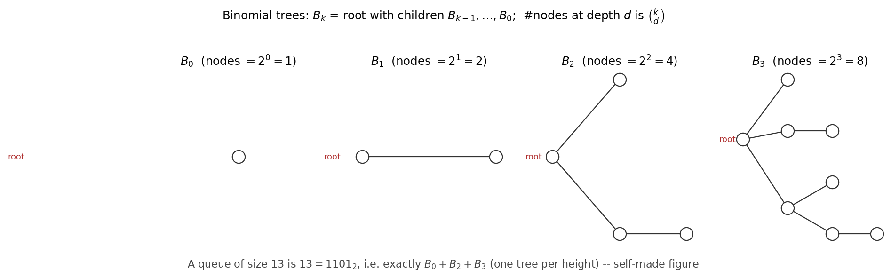
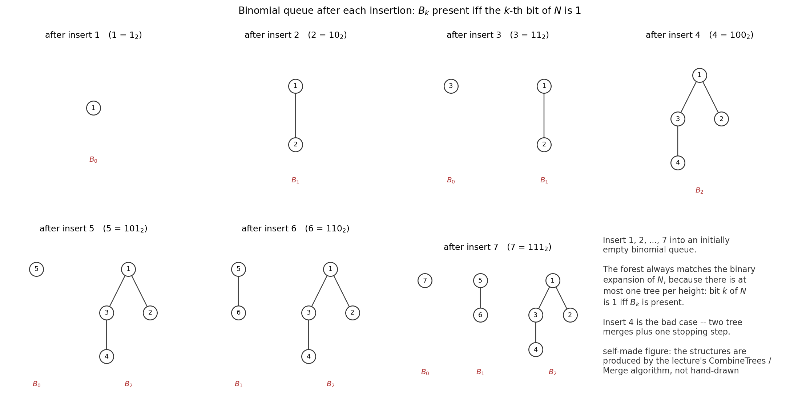
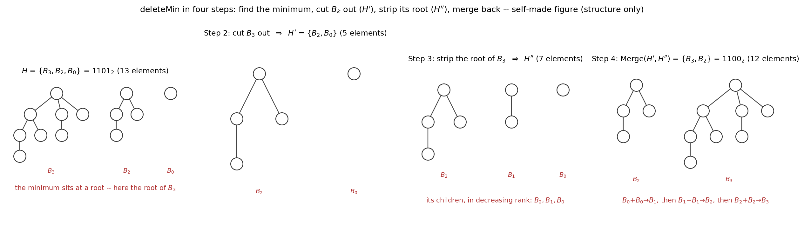

# ADS05 二项队列（binomial queue） —— 课前笔记

> 来源：`../Materials/Student Slides/ADS05BinomialQ_Stu.ppt`（*Binomial Queue*）
> 教材参考（讲义末页给出）：Weiss《Data Structures and Algorithm Analysis in C》(2nd Ed.) Ch.5 p.170–180；Ch.11 p.430–435；CLRS 3rd Ch.19 p.505–530（斐波那契堆）
> 整理日期：2026-09-16；2026-10-13 补齐：§2 的表示法与 *Discussion 7 / 8*、§4 的三段代码分析、§5 的摊还细节、§6 的讨论题（按"逢三进一"处理），并把讲义里的示例并入各小节；新增自绘图 `assets/fig_binomial_insert7.png`、`assets/fig_binomial_deletemin.png`
> 示意图：`assets/fig_binomial_queue.png`、`assets/fig_binomial_insert7.png`、`assets/fig_binomial_deletemin.png`（均为自绘，非讲义截图）
> 对照记录：2026-10-13 与站外主参考（研习室）第 05 章逐条对照完毕（`concepts / proofs / extensions / correction / quiz`），补入内容见正文的「（研习室）」标注与 [§9](#9-来源与延伸阅读)

## 1. 一页速览

| 问题 | 讲义给的答案 |
|---|---|
| 本讲动机 | 左式堆（leftist heap）/ 斜堆（skew heap）的**平均（average case）**插入（insertion）是 $O(\log N)$，这"不够好"——二叉堆（binary heap）连续插入 $N$ 个键（key）的总时间是 $O(N)$（教材定理 5.1，p.156） |
| 结构 | 二项队列**不是一棵堆序树（heap-ordered tree）**，而是**一组**堆序树（森林（forest）），每棵是**二项树（binomial tree）** $B_k$ |
| 表示 | 规模 $N$ 的优先队列（priority queue）由 $N$ 的**二进制位（binary digit）**唯一决定：第 $k$ 位为 1 就有一棵 $B_k$；实现上用**数组（array）**存森林（下标 = 阶）+ **孩子链（children list）**存树内的孩子 |
| 操作 | FindMin $O(\log N)$（记住最小值则 $O(1)$）、归并（merge）$O(\log N)$、删除最小值（delete_min）$O(\log N)$、插入（insertion）**摊还（amortized）常数**，但**单次最坏仍是 $O(\log N)$** |
| 关键结论 | **$N$ 次插入建成队列（queue）的最坏（worst case）总时间是 $O(N)$**（聚合分析（aggregate analysis）与势能法（potential method）两种证明，见 [§5](#5-为什么-n-次插入是-on两种证明讲义)） |

### 1.1 讲义开篇的四个问题

| 讲义的问题（原文） | 讲义的答案 |
|---|---|
| *Have n't we had enough about queues? What is a binomial queue for?* | 前面的可归并堆都不够好：左式堆 / 斜堆的插入（平均 / 摊还）是 $O(\log N)$，需要一种"**插入摊还常数、归并仍对数级**"的结构 |
| *Well, what is the average time for insertions with leftist or skew heaps?* | $O(\log N)$——讲义紧接着问 *What's wrong?*，并在下一页给出参照对象 |
| *What is the total time for inserting $N$ keys into an empty binary heap?* | 教材定理 5.1（p.156）给的答案是 $O(N)$；再问 *Then what is the average time?* → **Constant!**（**注意**这条 $O(N)$ 的**前提**，见 [§3.3](#33-insert) 的研习室勘误） |
| *So $O(\log N)$ for an insertion is NOT good enough!* | 所以本讲的目标：**把插入做到摊还常数**，同时把归并保持在 $O(\log N)$ |

## 2. 二项树 $B_k$

### 2.1 二项树的定义与性质

- 【讲义定义】高度（height）为 $0$ 的二项树 $B_0$ 只有一个节点（node）；
- 高度为 $k$ 的二项树 $B_k$：把一棵 $B_{k-1}$ 接到**另一棵 $B_{k-1}$ 的根（root）**上（讲义原文 *by attaching a binomial tree, $B_{k-1}$, to the root of another binomial tree, $B_{k-1}$*），接的时候让小根在上（堆序（heap order））；
- 于是逐层构造：
  - $B_0$：$1=2^0$ 个节点；
  - $B_1$：$B_0$ 挂到另一个 $B_0$ 的根上 ⇒ 根有 1 个孩子（child），共 $2^1=2$ 个节点；
  - $B_2$：$B_1$ 挂到另一个 $B_1$ 的根上 ⇒ 根有 2 个孩子（$B_1,B_0$），共 $2^2=4$ 个节点；
  - $B_3$：$B_2$ 挂到另一个 $B_2$ 的根上 ⇒ 根有 3 个孩子（$B_2,B_1,B_0$），共 $2^3=8$ 个节点。

- 【讲义】观察（Observation）——$B_k$ 的性质：
  1. 根有 $k$ 个孩子，依次是 $B_0,B_1,\dots,B_{k-1}$（讲义原文：*$B_k$ consists of a root with $k$ children, which are $B_0,B_1,\dots,B_{k-1}$*）；
  2. 恰好有 $2^k$ 个节点（*$B_k$ has exactly $2^k$ nodes*）；
  3. **深度（depth） $d$ 处的节点数是二项式系数（binomial coefficient） $\binom{k}{d}$**（"二项树"因此得名）。

$$B_k:\quad \#\text{nodes}=2^k,\qquad \#\text{nodes at depth }d=\binom{k}{d} \tag{1}$$

- 由性质 2 归纳可知 $B_k$ 的高度恰好是 $k$：**规模与阶一一对应**（$2^k$ 个节点的二项树只能是 $B_k$），所以实现里可以用"阶（rank）"直接指认树（讲义用数组下标（index），教材的另一种实现把 $rank$ 存在根上）；
- 性质 1、3 在讲义上是"看图就知道"（*It is probably obvious from the diagram*），教材把它们留成归纳证明的习题：两条都能对 $k$ 归纳（$B_k$ = 根 + 一棵 $B_{k-1}$ 的全部孩子 + 另一棵 $B_{k-1}$），课前记住结论即可。
- 严格一点的写法（研习室）：两条性质都能对 $k$ 归纳——$B_k$ 由两棵 $B_{k-1}$ 拼成、其中一棵整体下移一层，于是节点数翻倍（$|B_k|=2\,|B_{k-1}|=2^k$）；第 $d$ 层的节点来自"没下移那棵的第 $d$ 层"与"下移那棵的第 $d-1$ 层"，所以

$$\#\text{nodes at depth }d=\binom{k-1}{d}+\binom{k-1}{d-1}=\binom{k}{d}$$

（帕斯卡（Pascal）递推），即性质 3。

### 2.2 森林表示与唯一性

- 【讲义】*A binomial queue is not a heap-ordered tree, but rather a collection of heap-ordered trees, known as a forest.*
- 【讲义】表示的三要素：*$B_k$ structure + heap order + one binomial tree for each height* ⇒ *A priority queue of any size can be uniquely represented by a collection of binomial trees.*
  - **堆序只在每棵树内部**成立，树与树之间没有约束；
  - **每个高度至多一棵树**。
- 于是规模 $N$ 的队列与 $N$ 的二进制展开一一对应：第 $k$ 位为 1 ⇔ 森林里有一棵 $B_k$；
- 【讲义】例子（*Example: Represent a priority queue of size 13 by a collection of binomial trees*）：

$$13=2^0+0\cdot 2^1+2^2+2^3=1101_2\quad\Longrightarrow\quad H=\{B_3,B_2,B_0\}\ \text{（没有 }B_1\text{）} \tag{2}$$



*图 1　讲义 "Represent a priority queue of size 13" 一页的复述（自绘）：$13=1101_2$，故由 $B_0,B_2,B_3$ 组成；每个 $B_k$ 内部满足堆序。*

- 本文下面把队列记成"规模 $=$ 二进制串 $=$ 树清单"，例如 $H\cong1101_2=\{B_3,B_2,B_0\}$。

### 2.3 讨论题 7（Discussion 7）：树怎么表示，才能快速取到根的全部子树？

> 【讲义】*Discussion 7: How can we implement the trees so that all the subtrees can be accessed quickly?*

**为什么需要**：DeleteMin（[§3.4](#34-deletemin)）第 3 步要把被删根的孩子**全部**摘下来、倒序回填成 $H''$，所以"一个根的全部子树（subtree）"必须能**一次遍历**取出。

**讲义给的答案**（Implementation 页的两句话）：

1. *Binomial queue = array of binomial trees*：森林用**数组** `TheTrees[]` 存，**下标就是阶 $k$**（$B_k$ 放在 `TheTrees[k]`）——取"某阶的树"是 $O(1)$ 的数组访问；
2. *The children are ordered by their sizes*：树内部用**通用树的经典表示**——孩子串成一条**链表（linked list）**（`LeftChild` + `NextSibling`），并且**按子树规模有序**（顺序见 [§2.5](#25-讨论题-8discussion-8孩子链必须按什么顺序)）。

教材 §6.8.3 把这两句合成一段说得更直白：

> 教材（§6.8.3）：*The deleteMin operation requires the ability to find all the subtrees of the root quickly, so the standard representation of general trees is required: The children of each node are kept in a linked list, and each node has a pointer to its first child (if any).*

**"数组实现 vs 链表实现"的差别**（整理者按讲义与教材口径归纳，**不是讲义原文**）：

| 关注点 | 数组存森林（讲义 / 教材的做法） | 把森林的树串成一条根链 |
|---|---|---|
| 取某阶的树 | $O(1)$，下标即阶 | 要沿链找，$O(\log N)$ |
| 对齐"同阶"做进位（carry） | 按下标 $i=0,1,2,\dots$ 逐位扫描，两条队列天然对齐 | 必须先把两条链按阶归并，代码更绕 |
| DeleteMin 回填 $H''$ | 直接写 `TheTrees[j]` | 要为 $H''$ 重建一条链 |
| 树内的孩子 | 仍要靠孩子链（`LeftChild` / `NextSibling`） | 同上 |

- 结论：**森林用数组、树内用"第一个孩子 + 下一个兄弟（next sibling）"的链表**，两种表示各管一头——这是讲义选的方案；
- 讲义只在这里写了结论（Implementation 页 *Operation / Property / Solution* 表格的 *Property* 列），把 *Discussion 7* 留成课上讨论（讨论题占平时成绩）。

### 2.4 默认的实现：数组 + 树（讲义代码）

```c
typedef struct BinNode *Position;
typedef struct Collection *BinQueue;
typedef struct BinNode *BinTree;  /* missing from p.176 */

struct BinNode 
{ 
	ElementType	    Element;
	Position	    LeftChild;
	Position 	    NextSibling;
} ;

struct Collection 
{ 
	int	    	CurrentSize;  /* total number of nodes */
	BinTree	TheTrees[ MaxTrees ];
} ;
```

### 2.5 讨论题 8（Discussion 8）：孩子链必须按什么顺序？

> 【讲义】*Discussion 8: In which order must we link the subtrees?*

**答案：按子树规模从大到小**——$B_{k-1},B_{k-2},\dots,B_0$（即讲义 Implementation 页写的 *the children are ordered by their sizes*）。教材 §6.8.3 说得更直接：

> 教材（§6.8.3）：*This operation also requires that the children be ordered by the size of their subtrees. … Since this new tree will be the largest subtree, it makes sense to maintain the subtrees in decreasing sizes.*

**为什么必须这样**（用讲义的两段代码就能看出来）：

1. `CombineTrees` 把"大根"挂到"小根"孩子链的**最前面**（`T2->NextSibling = T1->LeftChild; T1->LeftChild = T2;`）。$B_r+B_r\to B_{r+1}$ 时新并进来的 $B_r$ 正是**最大**的孩子，头插（insert at the front）之后孩子链自然排成 $B_r,B_{r-1},\dots,B_0$——**递减**（[§4.1](#41-combinetrees合并两棵等高的树o1)）；
2. DeleteMin 第 3 步是 `for( j = MinTree - 1; j >= 0; j-- )`：从 `LeftChild` 起沿 `NextSibling` 依次读，正好把 $B_{k-1},B_{k-2},\dots,B_0$ 写回 `TheTrees[k-1] … TheTrees[0]`（[§4.3](#43-deletemin-的代码)）。**孩子链的顺序必须与这个循环一致**，否则 $H''$ 里 `TheTrees[j]` 装的就是错阶的树；
3. 也因为"递减 + 头插"，**每次合并都是 $O(1)$**：不需要遍历孩子链去找插入位置。

**易错点**：

- 这里是**一棵树内部孩子链**的顺序，不是森林里树的顺序。森林用数组存，顺序就是下标 $=$ 阶；讲义对森林只要求 *keep the trees in the binomial queue sorted by height*（[§3.2](#32-merge)）；
- 讲义把这个问题留成 *Discussion 8*，上面的答案来自教材 §6.8.3 与两段代码的对应关系，**不是课件的官方答案**。

## 3. 五种操作

### 3.1 FindMin

最小值必在**某个根**上，而根至多 $\lceil\log N\rceil$ 个，故 $T_p=O(\log N)$。

> 【讲义】备注：如果**记住最小值**并在它被改变时更新，则 FindMin 可以做到 $O(1)$（*We can remember the minimum and update whenever it is changed. Then this operation will take O(1)*）。

### 3.2 Merge

- 与**二进制（binary）加法**完全同构：两条队列按阶对齐，同阶的两棵树"进位（carry）"合并（讲义原话：两棵同阶树合成一棵高一阶的树）；
- 【讲义】例子：$6=110_2$ 与 $7=111_2$ 相加得 $13=1101_2$——逐位看就是：

| 位 $k$ | $H_1$（$6=110_2$） | $H_2$（$7=111_2$） | 进位（carry） | 结果的第 $k$ 位 |
|---|---|---|---|---|
| 0 | — | $B_0$ | — | $B_0$ |
| 1 | $B_1$ | $B_1$ | $B_1+B_1\to B_2$（这就是进到第 2 位的进位） | 空 |
| 2 | $B_2$ | $B_2$ | 三个输入都在：**和位取旧进位**（$B_2$ 留下），$B_2+B_2\to B_3$ 成为新进位 | $B_2$ |
| 3 | — | — | — | $B_3$ |

  结果 $13=1101_2=\{B_3,B_2,B_0\}$（$13=8+4+0+1$）。
- 【讲义】*Must keep the trees in the binomial queue sorted by height*：**必须把队列里的树按高度排好序**，否则没法按位对齐（这是森林用数组、下标即阶的另一个理由，见 [§2.3](#23-讨论题-7discussion-7树怎么表示才能快速取到根的全部子树)）；
- $T_p=O(\log N)$：最多扫 $\lceil\log N\rceil$ 位，每一位 $O(1)$；8 个分支的代码见 [§4.2](#42-merge-的代码8-个分支)。

### 3.3 Insert

- 归并的特例：造一棵只有一个节点的 $B_0$，再与整个队列归并；
- 【讲义】例子：依次插入 $1,2,\dots,7$：

| 插入 | 插入后的森林（$=$ 该数的二进制） | 本次做了什么 |
|---|---|---|
| 1 | $1=1_2=\{B_0\}$ | 放进 $B_0$ |
| 2 | $2=10_2=\{B_1\}$ | 两个 $B_0$ 合并成 $B_1$ |
| 3 | $3=11_2=\{B_1,B_0\}$ | 放进 $B_0$ |
| 4 | $4=100_2=\{B_2\}$ | **连进位两次**（讲义说 4 是"坏情况"；教材：共 3 步 $=$ 2 次树合并 $+$ 1 次收尾） |
| 5 | $5=101_2=\{B_2,B_0\}$ | 放进 $B_0$ |
| 6 | $6=110_2=\{B_2,B_1\}$ | 两个 $B_0$ 合并成 $B_1$ |
| 7 | $7=111_2=\{B_2,B_1,B_0\}$ | 放进 $B_0$ |



*图 2　讲义 "Insert 1, 2, …, 7 into an initially empty queue" 的复述（自绘）：每行是插入后的森林，右侧标出它的二进制。*

- 【讲义】结论：若插入时"最小的不存在的二项树"是 $B_i$，则 $T_p=\text{Const}\cdot(i+1)$；
  - **单次最坏**：$O(\log N)$（最坏情形是队列已经"满"了，即 $N=2^k-1$，这一次插入要连锁 $k$ 次进位）；
  - **连续 $N$ 次插入**：总时间是 **$O(N)$（最坏）**，所以**摊还**是常数（证明见 [§5](#5-为什么-n-次插入是-on两种证明讲义)）。注意讲义 Insert 页写的 *Hence the average time is constant* 是紧接着"$N$ 次插入 $O(N)$"说的，指的是**摊还**，不是"任意输入分布下的平均"；
- ⚠️ 实现上的坑：讲义配套代码 `../Materials/Code/binomial.c` 的 `Insert` 直接调用 `Merge( H, OneItem )`，文件里给 `Insert` 注了 *Not optimized for O(1) amortized performance*、给 `Merge` 注了 *Not optimized for early termination*——**摊还 $O(1)$ 记的是"树合并（link）次数"的账**；要真正吃到这个界，`Merge` 的循环必须在 `Carry`、`T2`、`T1` **全空时提前结束**（见 [§4.2](#42-merge-的代码8-个分支)），否则每次插入都要扫 $O(\log N)$ 位。

> 研习室勘误（p.2）：上面"二叉堆连续插入 $N$ 个键的总时间是 $O(N)$"这一句**不能不加输入假设地当作最坏情况**——
> 自底向上建堆（buildHeap）才是最坏 $O(N)$，逐个插入递减键最坏要 $\Theta(N\log N)$，"平均 $O(N)$"依赖输入分布。
> 本讲二项队列的 $O(N)$ 是**任意键序列**的摊还结论，与该处的平均结论不是一回事。

### 3.4 DeleteMin

四步【讲义】（括号内是该步代价）：

```text
Step 1: FindMin in Bk            /* O(log N) */
Step 2: Remove Bk from H  => H'  /* O(1)     */
Step 3: Remove root from Bk => H''  /* O(log N) */
Step 4: Merge( H', H'' )         /* O(log N) */
```

- Step 1：扫 $O(\log N)$ 个根找最小的根（[§3.1](#31-findmin)）；
- Step 2：把这棵树从数组里摘下来（$O(1)$），剩下的树构成 $H'$；
- Step 3：摘掉 $B_k$ 的根并 `free`，它的孩子**恰好**是 $B_{k-1},B_{k-2},\dots,B_0$，**倒序放回** `TheTrees[k-1] … TheTrees[0]` 就构成一个合法的二项队列 $H''$（规模 $(1\ll k)-1=2^k-1$）。代价 $O(\log N)$：要沿孩子链走 $k$ 个孩子（讲义代码 `for( j = MinTree - 1; j >= 0; j-- )`）；
- Step 4：`Merge(H', H'')`（[§3.2](#32-merge)），$O(\log N)$。



*图 3　讲义 DeleteMin 页四步的复述（自绘，只画结构、不写键值）：最小根在 $B_3$ 上；整棵树摘下得 $H'$，去根后它的孩子 $B_2,B_1,B_0$ 构成 $H''$；最后归并 $H'$ 与 $H''$。*

### 3.5 实现【讲义】

- **等价于数组**：`struct Collection { int CurrentSize; BinTree TheTrees[MaxTrees]; }`——数组下标（index）就是 $k$；
- 每棵树的节点用 **left-child / next-sibling** 表示：`struct BinNode { ElementType Element; Position LeftChild; Position NextSibling; };`
  （讲义特别标注：`BinTree` 这一行 **missing from p.176**，即教材该页漏印。）
- 孩子的**排列顺序**：讲义把 *In which order must we link the subtrees?* 留成 *Discussion 8*（答案见 [§2.5](#25-讨论题-8discussion-8孩子链必须按什么顺序)）——必须与 DeleteMin 的"倒填"循环一致，所以孩子链按规模**递减**（$B_{k-1},\dots,B_0$）；
- **容量上限**：配套代码 `../Materials/Code/binomial.h` 写的是 `#define MaxTrees (14)`（注释 *Stores $2^{14}-1$ items*）与 `#define Capacity (16383)`，即最多 $2^{14}-1$ 个元素（`TheTrees[13]` 那棵 $B_{13}$ 就占 $8192$ 个）；
- Implementation 页表格里的 *Find all the subtrees quickly* 就是 *Discussion 7* 的问题（[§2.3](#23-讨论题-7discussion-7树怎么表示才能快速取到根的全部子树)）。

## 4. 关键算法片段

> 这里都取 [§2.4](#24-默认的实现数组--树讲义代码) 的默认实现：数组存森林 + 孩子链存树内的孩子。

### 4.1 CombineTrees：合并两棵等高的树（$O(1)$）

```c
BinTree CombineTrees( BinTree T1, BinTree T2 ) {   /* merge equal-sized T1 and T2 */
    if ( T1->Element > T2->Element ) return CombineTrees( T2, T1 );  /* 大者挂到小者下面 */
    T2->NextSibling = T1->LeftChild;   /* 把 T2 插到 T1 孩子链的最前面 */
    T1->LeftChild = T2;
    return T1;
}
```

**代码分析**：

- 第一条 `if` 里的递归**只用来换序**（把关键字大的那棵换到 `T2`），交换参数后必然继续往下走，所以它**最多执行一次**——整个函数仍是 $O(1)$，讲义在代码旁标了 $T_p=O(1)$；
- 比较的目的：*attach the larger one to the smaller one*，大根必须挂到小根下面，堆序才不被破坏；
- 两条指针操作是一对"头插"：`T2->NextSibling = T1->LeftChild` 让 $T_2$ 接在 $T_1$ 孩子链的**最前面**，`T1->LeftChild = T2` 让 $T_1$ 认下这个新孩子。**新并进来的一定是最大的那棵子树**，所以"头插"恰好让孩子链保持"按规模递减"（[§2.5](#25-讨论题-8discussion-8孩子链必须按什么顺序)）；
- 结果是一棵 $B_{r+1}$：`T1` 的孩子数从 $r$ 变成 $r+1$（讲义实现不存孩子数，规模可以从数组下标读出来；教材的链表实现才需要在根上存 $rank$）。

### 4.2 Merge 的代码：8 个分支

```c
BinQueue  Merge( BinQueue H1, BinQueue H2 )
{	BinTree T1, T2, Carry = NULL; 	
	int i, j;
	if ( H1->CurrentSize + H2-> CurrentSize > Capacity )  ErrorMessage();
	H1->CurrentSize += H2-> CurrentSize;
	for ( i=0, j=1; j<= H1->CurrentSize; i++, j*=2 ) {
	    T1 = H1->TheTrees[i]; T2 = H2->TheTrees[i]; /*current trees */
	    switch( 4*!!Carry + 2*!!T2 + !!T1 ) { 
		case 0: /* 000 */
	 	case 1: /* 001 */  break;	
		case 2: /* 010 */  H1->TheTrees[i] = T2; H2->TheTrees[i] = NULL; break;
		case 4: /* 100 */  H1->TheTrees[i] = Carry; Carry = NULL; break;
		case 3: /* 011 */  Carry = CombineTrees( T1, T2 );
			            H1->TheTrees[i] = H2->TheTrees[i] = NULL; break;
		case 5: /* 101 */  Carry = CombineTrees( T1, Carry );
			            H1->TheTrees[i] = NULL; break;
		case 6: /* 110 */  Carry = CombineTrees( T2, Carry );
			            H2->TheTrees[i] = NULL; break;
		case 7: /* 111 */  H1->TheTrees[i] = Carry; 
			            Carry = CombineTrees( T1, T2 ); 
			            H2->TheTrees[i] = NULL; break;
	    } /* end switch */
	} /* end for-loop */
	return H1;
}
```

**代码分析**：

- `for( i=0, j=1; j <= H1->CurrentSize; i++, j*=2 )`：$i$ 是阶、$j=2^i$；循环到"结果规模 $N$ 的最高位"为止，**只扫 $O(\log N)$ 位**——这就是 $T_p=O(\log N)$ 的来源；
- `T1`、`T2` 是两条队列在第 $i$ 阶上的树（可能为 `NULL`），`Carry` 是上一位进上来的树（也可能为 `NULL`）；
- `switch( 4*!!Carry + 2*!!T2 + !!T1 )` 把"这三处有没有树"编成一个 3 位二进制（就是 `Carry`、`T2`、`T1` 的顺序），等价于**全加器（full adder）**的三路输入，于是 8 个分支覆盖全部情形：

| 分支 | `Carry`,`T2`,`T1` | 含义 | 处理 |
|---|---|---|---|
| `0` / `1` | `000` / `001` | 什么都没有 / 只有 $T_1$ | 不动（$T_1$ 留在原位） |
| `2` | `010` | 只有 $T_2$ | $T_2$ 搬进 $H_1$ 的第 $i$ 位，`H2->TheTrees[i] = NULL` |
| `4` | `100` | 只有进位 | 进位落到第 $i$ 位，`Carry = NULL` |
| `3` | `011` | $T_1$ 与 $T_2$ | 合并成新 `Carry`，第 $i$ 位清空（"和位"$=0$） |
| `5` | `101` | $T_1$ 与 `Carry` | 合并成新 `Carry`，第 $i$ 位清空 |
| `6` | `110` | $T_2$ 与 `Carry` | 合并成新 `Carry`，第 $i$ 位清空 |
| `7` | `111` | 三个都有 | **和位 $=$ 旧 `Carry`**（留在第 $i$ 位），$T_1+T_2$ 合并成**新的**进位（二进制里的 $1+1+1=11_2$） |

- **易错点（研习室）**：同一阶上出现"$H_1$、$H_2$ 与 `Carry`"三棵树时，只能**留一棵在当前阶、把另外两棵链接成一棵高一阶的进位**，**不能把三棵一起变成一棵 $B_{k+1}$**（三棵 $B_k$ 有 $3\cdot2^k$ 个元素，而 $B_{k+1}$ 只有 $2^{k+1}$ 个）；`case 7` 干的就是前者；
- 逐位的实例见 [§3.2](#32-merge) 的 $6+7$ 那张表；
- 讲义代码上那条注释 */* assign each digit to a tree */* 说的就是这个循环在干的事：**第 $i$ 次迭代决定"结果的第 $i$ 位由哪棵树占"**（教材 §6.8.3 的对应叙述：*Depending on each of the eight possible cases, the tree that results for rank i and the carry tree of rank i+1 is formed*）；
- ⚠️ **早停（early termination）**：这份代码的循环上界是 `j <= H1->CurrentSize`，会一路扫到最高位。教材配套代码 `binomial.c` 因此在 `Merge` 上注 *Not optimized for early termination*、在 `Insert` 上注 *Not optimized for O(1) amortized performance*——**只有"当 `Carry`、`T2`、`T1` 全空时立刻收尾"的改进版**，每次插入的代价才正比于"进位次数 $+1$"，$N$ 次插入才是 $O(N)$（[§5](#5-为什么-n-次插入是-on两种证明讲义)）；否则每次插入都要扫 $O(\log N)$ 位，$N$ 次插入会退化成 $O(N\log N)$。

### 4.3 DeleteMin 的代码

```c
ElementType  DeleteMin( BinQueue H )
{	BinQueue DeletedQueue; 
	Position DeletedTree, OldRoot;
	ElementType MinItem = Infinity;  /* the minimum item to be returned */	
	int i, j, MinTree; /* MinTree is the index of the tree with the minimum item */

	if ( IsEmpty( H ) )  {  PrintErrorMessage();  return –Infinity; }

	for ( i = 0; i < MaxTrees; i++) {  /* Step 1: find the minimum item */
	    if( H->TheTrees[i] && H->TheTrees[i]->Element < MinItem ) { 
		MinItem = H->TheTrees[i]->Element;  MinTree = i;    } /* end if */
	} /* end for-i-loop */
	DeletedTree = H->TheTrees[ MinTree ];  
	H->TheTrees[ MinTree ] = NULL;   /* Step 2: remove the MinTree from H => H’ */ 
	OldRoot = DeletedTree;   /* Step 3.1: remove the root */ 
	DeletedTree = DeletedTree->LeftChild;   free(OldRoot);
	DeletedQueue = Initialize();   /* Step 3.2: create H” */ 
	DeletedQueue->CurrentSize = ( 1<<MinTree ) – 1;  /* 2MinTree – 1 */
	for ( j = MinTree – 1; j >= 0; j – – ) {  
	    DeletedQueue->TheTrees[j] = DeletedTree;
	    DeletedTree = DeletedTree->NextSibling;
	    DeletedQueue->TheTrees[j]->NextSibling = NULL;
	} /* end for-j-loop */
	H->CurrentSize  – = DeletedQueue->CurrentSize + 1;
	H = Merge( H, DeletedQueue ); /* Step 4: merge H’ and H” */ 
	return MinItem;
}
```

**代码分析**：

- Step 1 的 `for( i = 0; i < MaxTrees; i++ )` 扫**固定**的 `MaxTrees` 个槽位（[§3.5](#35-实现讲义) 里是 14），逐个比较根的关键字，用 `MinItem`、`MinTree` 记下最小值与它所在的阶；
- Step 3.1：`DeletedTree = DeletedTree->LeftChild; free(OldRoot);` 摘掉根，`DeletedTree` 此时指向**最大的那个孩子** $B_{k-1}$（孩子链按规模递减，[§2.5](#25-讨论题-8discussion-8孩子链必须按什么顺序)）；
- Step 3.2：`DeletedQueue->CurrentSize = ( 1<<MinTree ) - 1` 就是 $2^k-1$；随后 `for( j = MinTree - 1; j >= 0; j-- )` 沿 `NextSibling` 依次取出 $B_{k-1},\dots,B_0$，**倒序**写进 `TheTrees[j]`，每写一个就把 `NextSibling` 置 `NULL`（把树从原链上"拆"下来，交给 $H''$）。这一步走 $k$ 个孩子，$O(\log N)$；
- `H->CurrentSize -= DeletedQueue->CurrentSize + 1;` 减去的是"被删掉的那棵 $B_k$ 的规模" $2^k$（$=(2^k-1)+1$）；最后 `H = Merge( H, DeletedQueue )` 收尾（Step 4）；
- 代码里的 `– Infinity`、`( 1<<MinTree ) – 1`、`j – –`、`– =` 是**幻灯片上的排版字符**（从 `.ppt` 里提取出来就是长这样），对应 `-Infinity`、`- 1`、`j--`、`-=`；照抄不改，读代码时按 C 语法理解即可；
- 讲义在这段代码旁另有一条注记 *This can be replaced by the actual number of roots*：`(1<<MinTree)-1` 这种写法可以换成"**真实数出来的树的棵数**"，两者必须一致。这句究竟指哪一行，从 `.ppt` 里用 `strings` 只能看出它是一个**独立文本框**，本文按代码上下文理解为指 `CurrentSize` 那一行，**待确认**（见 [§9](#9-来源与延伸阅读)）。

## 5. 为什么 $N$ 次插入是 $O(N)$：两种证明【讲义】

> 【讲义 Claim】*A binomial queue of $N$ elements can be built by $N$ successive insertions in $O(N)$ time.*
> 讲义先问 *The worst case time for each insertion is ?* → $O(\log N)$，所以这条 $O(N)$ 只能是"聚合"或"摊还"的口径。

### 5.1 证法 1：聚合分析（Proof 1 (Aggregate)）

讲义用一张表逐行追踪连续插入的状态（$B_0\to B_1\to B_1B_0\to B_2\to\dots\to B_3B_0$），把每次插入的代价拆成两种记账单位：

- **step**：把新树放到它该在的位置（收尾那一步）；
- **link**：两棵同阶树合并（即某一位上的进位）。

累计结果是

$$Total\ steps = N,\qquad Total\ links = O(N) \tag{3}$$

于是总代价 $=N+O(N)=O(N)$。

- 直觉【讲义原话】：*Expensive insertions remove trees, while cheap ones create trees.*——**贵的插入在消树（连锁进位），便宜的插入在造树（只添一棵 $B_0$），两者互相抵消**；
- 换成二进制的说法：第 $i$ 次插入的代价 $\propto$ "$i$ 的二进制加法里的进位次数 $+1$"，从 1 数到 $N$ 的进位总数是 $O(N)$（[§3.3](#33-insert) 的 $1\sim7$ 表里只有 $k$ 是 $2$ 的幂时才连锁）。
- **更精确的计数（研习室）**：设队列最终有 $n$ 个元素。整个过程一共新造 $n$ 棵 $B_0$，而每次 link 让树数减一，终态的树数是 $\operatorname{popcount}(n)$，所以

$$\#\text{links}\;=\;n-\operatorname{popcount}(n)\;\le\;n \tag{3'}$$

  例如"连续插入 8 个元素一共链接几次"：$8-\operatorname{popcount}(8)=8-1=7$ 次（第 8 次插入自己就要连锁 3 次，前面几次便宜）。
- **这条摊还界有个实现前提（研习室）**：插入必须在"进位结束"处停下；若每次都把 $O(\log n)$ 个阶槽位扫一遍，额外的扫描会破坏实现的常数摊还时间——就是 [§4.2](#42-merge-的代码8-个分支) 说的**早停**。

### 5.2 证法 2：势能法（Proof 2）

记号【讲义】：

- $C_i$：第 $i$ 次插入的**实际**代价（step + link）；
- $\Phi_i$：第 $i$ 次插入后森林里**树的棵数**（$\Phi_0=0$）。这就是本讲取的**势能（potential）**。

【讲义 Claim】*An insertion that costs $c$ units results in a net increase of $2-c$ trees in the forest.*

**为什么是 $2-c$**（把一次插入拆成"加一棵 $+$ 合并若干次"就清楚了）：

- 插入先造出一棵 $B_0$ ⇒ 树数 $+1$；
- 每次 **link** 把两棵树并成一棵 ⇒ 树数 $-1$，而 link 的次数 $=c-1$（$c$ 里还有收尾的那一步）；
- 两式相加：$\Phi_i-\Phi_{i-1}=1-(c-1)=2-c$，写成等式即

$$C_i+\big(\Phi_i-\Phi_{i-1}\big)=2 \qquad(\text{对每个 } i=1,2,\dots,N) \tag{4}$$

**加总**（讲义：*Add all these equations up*）：把 $N$ 个等式相加，中间项**望远镜求和（telescoping sum）**两两相消：

$$\sum_{i=1}^{N} C_i+\big(\Phi_N-\Phi_0\big)=2N \quad\Longrightarrow\quad \sum_{i=1}^{N} C_i=2N-\Phi_N\ \le\ 2N \tag{5}$$

（因为 $\Phi_N\ge0$。）于是 $N$ 次插入的总代价 $=O(N)$，单次插入的**摊还代价（amortized cost）**为

$$T_{\text{amortized}} = \frac{2N}{N}=2, \qquad\text{而}\qquad T_{\text{worst}}=O(\log N) \tag{6}$$

【讲义原话】*$T_{worst}=O(\log N)$, but $T_{amortized}=2$*——这就是"**单次最坏对数级、摊还常数级**"的典型对照。

**易错点**：

- 势函数取的是**树的棵数**（不是树高、不是 $N$）：树数多 $=$ 攒了势能，下一次昂贵的插入正好把它花掉；
- 摊还界说的是"$N$ 次操作的**总账**"，**单次**插入仍可能是 $O(\log N)$；两个结论不能互相顶替；
- 同一套势能法在别处的用法见 [`02_ADS001` §2 势能法](02_ADS001_伸展树与摊还分析.md#2-势能法) 与 [`05_ADS04` §3.1 斜堆归并的摊还分析](05_ADS04_左式堆与斜堆.md#31-斜堆归并的摊还分析讲义amortized-analysis-for-skew-heaps)——**同一个 $\hat c=c+\Delta\Phi$，三处势函数取法不同**。

## 6. 讨论（Discussion）：允许"同阶两棵树"的简化二项队列

> **题干**（教材习题，题面原文：*Suppose we extend binomial queues to allow at most two trees of the same height per structure. Can we obtain $O(1)$ worst-case time for insertion while retaining $O(\log N)$ for the other operations?*）
> 一个同学提议"简化"二项队列：归并时允许同一阶出现**至多两棵**树（比如两棵 $B_2$），从而省掉"进位"操作。这样"惰性（lazy）"的做法会怎样影响 findMin / deleteMin 的 $O(\log N)$？新的最坏复杂度是多少？

> 口径说明：讲义本讲的讨论题是 *Discussion 7 / 8*（见 [§2.3](#23-讨论题-7discussion-7树怎么表示才能快速取到根的全部子树) / [§2.5](#25-讨论题-8discussion-8孩子链必须按什么顺序)），这一节是配套的课外讨论题。教材把它标成 $\star\star$（难题）、答案指向 Brown 1978 关于二项队列实现与分析的论文；**本笔记按"逢三进一"的口径处理**——"每阶至多两棵，出现第三棵就合并进位"，下面（1）～（4）的结论都在这条规则下成立。

**先把三个版本摆清楚**（同一个结构，不变量不同，账就不同）：

| 版本 | 不变量 | 归并 / 插入 | findMin / deleteMin |
|---|---|---|---|
| 标准二项队列（[§3](#3-五种操作)） | 每阶至多 **1** 棵（就是二进制位） | 逐位进位，$O(\log N)$ | $O(\log N)$ |
| 本题的"至多两棵"（**逢三进一**） | 每阶 **0 / 1 / 2** 棵 | 见（3）：**摊还 $O(1)$，最坏 $\Theta(\log N)$** | 树数 $\le2\lceil\log N\rceil$，仍是 $O(\log N)$ |
| 完全惰性（教材 §11.4.2，不设上限） | 允许任意多棵同阶树，归并只把两条树链拼起来 | 归并 / 插入**始终常数时间**（最坏 $O(1)$） | findMin 退化成"扫全部根"；deleteMin 最坏 $\Theta(N)$（**摊还**仍 $O(\log N)$） |

**（1）规则：逢三进一**

- 每个阶上允许放 0、1 或 2 棵树；
- 插入 = 在最底层加一棵 $B_0$，即第 0 阶的棵数 $c_0\mathrel{+}=1$；
- 若某阶的棵数涨到 **3**，就把其中 2 棵用 `CombineTrees` 合并成 1 棵高一阶的树（该阶 $3\to1$、高一阶 $+1$）——这就是"**逢三进一**"；高一阶若也变成 3，继续往上进位；
- 于是每阶的棵数**始终只取 0 / 1 / 2**，森林规模受控：和标准二项队列的"每阶至多 1 棵"只差一档阈值。

**（2）findMin / deleteMin 的 $O(\log N)$ 保得住**

- 阶数 $\le\lceil\log N\rceil$、每阶至多两棵 ⇒ 森林里的树数 $\le2\lceil\log N\rceil$：FindMin 扫所有根仍是 $O(\log N)$（[§3.1](#31-findmin)）；
- DeleteMin 的三笔账都不变：找最小根 $O(\log N)$（根的个数只多了常数倍）；拆 $H''$ 仍只走**一棵** $B_k$ 的孩子（$k\le\log N$）；最后把 $H'$（$\le2\log N$ 棵）与 $H''$（$\le\log N$ 棵）按阶逐位归并，每阶常数工作量，仍是 $O(\log N)$；
- 所以"允许两棵"**不会**破坏这两个操作的界——这正是题干里 *retaining $O(\log N)$ for the other operations* 那半句。

**（3）插入：摊还 $O(1)$，但最坏是 $\Theta(\log N)$**

- **摊还**：势能法原样适用（[§5.2](#52-证法-2势能法proof-2)）。取 $\Phi=$ 森林里树的棵数：一次插入先造出 1 棵（$+1$），每次"逢三进一"的合并把两棵树并成一棵（$-1$），于是 $\Delta\Phi=1-\#\text{合并}=2-C_i$，即 $C_i+\Delta\Phi=2$；加总得 $\sum_i C_i\le2N$，**摊还代价仍是 $2$**；
- **最坏**：进位链可以很长。取"第 $0\sim k$ 阶各恰好两棵"的状态（例如 $N=2^{k+2}-2$，即两棵 $B_k$、两棵 $B_{k-1}$、…、两棵 $B_0$），此时插入一个元素会在第 0 阶造出**第三棵** $B_0$，于是连锁进位到第 $k+1$ 阶才停 ⇒ 一次插入要 $k+1=\Theta(\log N)$ 次合并；
- 所以**按"逢三进一"的口径，"最坏 $O(1)$ 插入"是拿不到的**：这条规则只是把进位阈值从 2 抬到 3，插入的最坏仍是 $\Theta(\log N)$、摊还仍是 $O(1)$（与标准二项队列同一档，只是触发条件与常数不同）。教材把这道题标成难题、把答案指向 Brown 1978，正是因为"最坏 $O(1)$"要靠额外的构造（把进位推迟/分批完成等）；本笔记不展开那条构造。

**（4）对照"完全惰性"：省掉进位会崩在哪里**

- 如果连"逢三进一"都不做，只把两条树链拼起来（教材 §11.4.2 的**惰性**二项队列），树数就不再受 $O(\log N)$ 限制：连续 $m$ 次插入可以留下 $m$ 棵 $B_0$，findMin 要扫 $\Theta(m)=\Theta(N)$ 个根，deleteMin 也得先把这一大堆树整理回标准队列；
- 教材的定量结论（Theorem 11.3）：惰性二项队列的 **merge / insert 摊还 $O(1)$**、**deleteMin 摊还 $O(\log N)$**——势函数取"树的棵数"，一次昂贵的 deleteMin（实际代价 $T+R+\log N$，$T$ 是当时的树数、$R$ 是最小根所在树的孩子数）由此前大量"过便宜的"归并攒下的势能来支付；但教材同时强调 deleteMin 是 *$O(\log N)$ amortized **but not** $O(\log N)$ worst-case*，**单次最坏可以是 $\Theta(N)$**；
- 和本讲的关系：讲义 [§3.3](#33-insert) 与 [§5](#5-为什么-n-次插入是-on两种证明讲义) 的 $O(N)$ 是"标准二项队列 + 进位"下的摊还结论；惰性版本把"插入便宜"推到极致（最坏 $O(1)$），代价是把账挪给了 deleteMin。教材 §11.4 正是用"左式堆的 decrease_key $+$ 惰性二项队列的归并"拼出**斐波那契堆（Fibonacci heap）**（CLRS 第 19 章），也就是讲义末页 *Research Project 1* 里说的 *such as a Fibonacci heap*。

## 7. 听课重点与易混点

1. **二项队列是一组树，不是一个堆**；"堆序"只在每棵树**内部**成立。
2. **唯一表示（unique representation）**来自"每个高度至多一棵树"，一旦违反（比如 DeleteMin 后出现两棵同高度的树）就必须**归并进位**。
3. **Insert 的"平均 / 摊还"与"最坏"要分开说**：摊还常数（[§5](#5-为什么-n-次插入是-on两种证明讲义)），单次最坏 $O(\log N)$——两个结论不要互相顶替；讲义 Insert 页的 *average* 一词实际指摊还。
4. **DeleteMin 中 $H''$ 的孩子顺序**：树内孩子是从大到小（$B_{k-1},\dots,B_0$）排列，填数组时要**倒序**（[§2.5](#25-讨论题-8discussion-8孩子链必须按什么顺序)、[§4.3](#43-deletemin-的代码)）。
5. **`Carry` 的三个分支含义**：`111` 时"和位留旧 `Carry`、把 $T_1$ 与 $T_2$ 合并成新的进位"，这是二进制加法的关键一步，建议自己在纸上把 8 个分支过一遍（[§4.2](#42-merge-的代码8-个分支)）。
6. **两种表示法各管一头**：森林用**数组**（下标 $=$ 阶，保证按阶对齐做进位、$O(1)$ 取某阶的树），树内用**孩子链**（`LeftChild` / `NextSibling`，保证能一次遍历取到根的全部子树）——见 *Discussion 7*（[§2.3](#23-讨论题-7discussion-7树怎么表示才能快速取到根的全部子树)）。
7. **孩子链按规模递减**不是"好看"，而是 `CombineTrees` 头插与 DeleteMin 倒填循环共同要求的（*Discussion 8*，[§2.5](#25-讨论题-8discussion-8孩子链必须按什么顺序)）。
8. **"允许同阶两棵"＝把进位阈值从 2 抬到 3（逢三进一）**：findMin / deleteMin 的 $O(\log N)$ 保得住，插入仍是"摊还 $O(1)$、最坏 $\Theta(\log N)$"；真正拿到"最坏 $O(1)$ 插入"要另想办法（[§6](#6-讨论discussion允许同阶两棵树的简化二项队列)）。
9. **"摊还 $O(1)$"要靠早停才吃得到**：讲义代码的 `Merge` 会把循环扫到规模最高位，教材配套代码注释 *Not optimized for early termination* / *Not optimized for O(1) amortized performance* 提醒了这一点（[§4.2](#42-merge-的代码8-个分支)）。

## 8. 课前自测

> 每道题后面给出**本讲对应小节**的链接（点击跳回），以及可以顺带回查的**关联知识点**。

| # | 问题 | 本讲对应小节 | 关联知识点 |
|---|---|---|---|
| 1 | 画出 $B_0\dots B_3$，说明 $B_k$ 的节点数、根的孩子、深度 $d$ 的节点数。 | [§2.1 定义与性质](#21-二项树的定义与性质)、[§2 二项树 $B_k$](#2-二项树-b_k) | 把 $B_k$ 的节点数 $2^k$ 与二进制位权对照记 |
| 2 | 用二进制写出规模 $13$、$20$ 的二项队列分别含哪些 $B_k$。 | [§2.2 森林表示与唯一性](#22-森林表示与唯一性)、[§1 一页速览](#1-一页速览) | 「用二进制表示规模」与 [§3.2 Merge](#32-merge) 的进位模型是同一件事 |
| 3 | 写出 Merge 的"二进制加法"表格（`Carry,T2,T1` 的三位组合），并说明 *Discussion 8* 要求的链接顺序。 | [§3.2 Merge](#32-merge)、[§4.2 Merge 的代码](#42-merge-的代码8-个分支)、[§2.5](#25-讨论题-8discussion-8孩子链必须按什么顺序) | 对照 [`05_ADS04` §2.3 左式堆归并](05_ADS04_左式堆与斜堆.md#23-归并递归版recursive-version三步讲义)：一个是「进位」，一个是「递归交换右路径」 |
| 4 | DeleteMin 的四步各是什么代价？为什么第 3 步是 $O(\log N)$？ | [§3.4 DeleteMin](#34-deletemin)、[§4.3 DeleteMin 的代码](#43-deletemin-的代码) | 找出最小根 $O(\log N)$ $+$ 拆森林 $+$ Merge 的代价拆分 |
| 5 | 用势能法证明 $N$ 次插入 $O(N)$：$\Phi$ 取什么？为什么 $C_i+\Delta\Phi=2$？ | [§5.2 势能法](#52-证法-2势能法proof-2) | 势能法复习：[`02_ADS001` §2 势能法](02_ADS001_伸展树与摊还分析.md#2-势能法)；另一种摊还 $O(N)$：[`05_ADS04` §3.1 斜堆归并的摊还分析](05_ADS04_左式堆与斜堆.md#31-斜堆归并的摊还分析讲义amortized-analysis-for-skew-heaps) |
| 6 | 为什么二项队列比二叉堆更适合"多次插入 + 归并"的场景？它相对左式堆的优势在哪？ | [§1.1 开篇四问](#11-讲义开篇的四个问题)、[§5](#5-为什么-n-次插入是-on两种证明讲义) | Dijkstra 需要「多次插入 + 取最小」（RP1）：对照 [`05_ADS04` 的来源与延伸阅读](05_ADS04_左式堆与斜堆.md#7-来源与延伸阅读) |
| 7 | *Discussion 7*：为什么"森林用数组、树内用孩子链"？ | [§2.3 讨论题 7](#23-讨论题-7discussion-7树怎么表示才能快速取到根的全部子树) | 对照教材 §6.8.3 的 *find all the subtrees of the root quickly* |
| 8 | *Discussion 8*：孩子链为什么必须按规模递减？ | [§2.5 讨论题 8](#25-讨论题-8discussion-8孩子链必须按什么顺序) | 与 [§4.1 CombineTrees](#41-combinetrees合并两棵等高的树o1) 的头插、[§4.3](#43-deletemin-的代码) 的倒填循环互相印证 |
| 9 | *Discussion*（教材习题）："每阶至多两棵 + 逢三进一"的规则下，插入的摊还与最坏代价各是多少？为什么 findMin / deleteMin 仍是 $O(\log N)$？完全惰性版本又崩在哪里？ | [§6 讨论](#6-讨论discussion允许同阶两棵树的简化二项队列) | 势能法同 [§5.2](#52-证法-2势能法proof-2)；对照教材 §11.4.2 的惰性版本与 Theorem 11.3 |
| 10 | 连续插入 8 个元素一共要链接几次？为什么不是 $8\log 8$？ | [§5.1 聚合分析](#51-证法-1聚合分析proof-1-aggregate) | 精确计数 $\#\text{links}=n-\operatorname{popcount}(n)$（研习室 quiz）；对照 [§3.3](#33-insert) 的 $1\sim7$ 表 |

### 8.1 关联知识点（跨讲 / 跨资料）

- **三种可归并优先队列**：本讲（[§3.2 Merge](#32-merge)）、[`05_ADS04_左式堆与斜堆.md`](05_ADS04_左式堆与斜堆.md#2-左式堆leftist-heaps)、以及不能高效归并的二叉堆（`../Materials/Code/binheap.c`）——讲义把这三种放在一起比较，考试常考「谁支持什么、代价多少」。
- **摊还分析（amortized analysis）**：[`02_ADS001_伸展树与摊还分析.md`](02_ADS001_伸展树与摊还分析.md) 的 [§2 势能法](02_ADS001_伸展树与摊还分析.md#2-势能法) 与本讲 [§5](#5-为什么-n-次插入是-on两种证明讲义)（$N$ 次插入 $O(N)$）；「摊还 vs 最坏情况」的话术见 [`03_ADS02` §2.6](03_ADS02_红黑树与B+树.md#26-与-avl-的对比旋转次数)。
- **配套代码与研究项目**：`../Materials/Code/binomial.c`、`binomial.h`、`testbin.c`；RP1 Shortest Path Algorithm with Heaps（见 [§9 来源与延伸阅读](#9-来源与延伸阅读)）。
- **教材**：Weiss Ch.5（p.170–180）、Ch.11（p.430–435，惰性归并与斐波那契堆）；CLRS Ch.19（斐波那契堆，p.505–530）——斐波那契堆是二项队列的推广，也可对照 [`05_ADS04` §2 左式堆](05_ADS04_左式堆与斜堆.md#2-左式堆leftist-heaps)。

## 9. 来源与延伸阅读

- 讲义：`ADS05BinomialQ_Stu.ppt`；配套代码：`../Materials/Code/binomial.c`、`binomial.h`、`testbin.c`。
- 教材：Weiss Ch.5（p.170–180）、Ch.11（p.430–435）；CLRS Ch.19（斐波那契堆，p.505–530）。本仓库里的教材 PDF 把二项队列放在 §6.8（C 版 figs 6.34–6.58；C++ 4th ed. p.271–276）、把惰性归并放在 §11.4.2（p.544 起），与讲义末页给的"Ch.5 / Ch.11"章节号口径不同——**引用小节号（§6.8 / §11.4.2）比引用页码稳妥**。
- 本讲配套的研究项目：*Research Project 1 — Shortest Path Algorithm with Heaps*（基于最小优先队列实现 Dijkstra，讲义明说 *such as a Fibonacci heap*；题目要求见 pintia.cn）。
- 待确认（讲义两处代码注释的指向）：从 `.ppt` 里用 `strings` 能取出 Merge 页的 */* assign each digit to a tree */* 与 DeleteMin 页的 *This can be replaced by the actual number of roots*，但它们在幻灯片上是**独立文本框**，无法确定指向哪一行；[§4.2](#42-merge-的代码8-个分支) / [§4.3](#43-deletemin-的代码) 里给的解释是整理者按代码上下文写的**解读**，不是讲义原话，上课时请对照讲者的指位。
- 讨论题口径：[§6](#6-讨论discussion允许同阶两棵树的简化二项队列) 按**"逢三进一"**处理（教材习题，C 版 6.33 / C++ 4th ed. 6.36）——规则、findMin / deleteMin 的界、插入的摊还与最坏代价都在该节给出；教材另把该题指向 Brown 1978 的"最坏 $O(1)$ 插入"构造，本笔记不展开。
- 站外主参考（研习室）第 05 章：2026-10-13 已逐条对照 `concepts / proofs / extensions / correction / quiz`，补进本笔记的是——
  - `proofs`「二项树节点与层数」的归纳写法 → [§2.1](#21-二项树的定义与性质)；
  - `proofs`「连续 $n$ 次插入只有线性次链接」的**精确计数** $\#\text{links}=n-\operatorname{popcount}(n)$ 与"要在进位结束处停下"的实现前提 → [§5.1](#51-证法-1聚合分析proof-1-aggregate)、[§4.2](#42-merge-的代码8-个分支)；
  - `concepts`「三棵树**不能**一起变成一棵 $B_{k+1}$」的辨析 → [§4.2](#42-merge-的代码8-个分支)；
  - `quiz` 三问（13 的阶、插入 8 个元素的链接次数、同阶三棵树怎么办）的点已由 [§8](#8-课前自测) 第 2 / 3 / 10 行覆盖；
  - 该章的 `correction`（p.2 二叉堆插入总成本的前提）与 `extensions`（与 Fibonacci 堆的关系、二叉堆连续插入不能说成总 $O(n)$）**此前已在** [§3.3](#33-insert) 的研习室勘误与 [§5.1](#51-证法-1聚合分析proof-1-aggregate) 里；
  - 该章另给一条外部参考（*Jeff Erickson · Algorithms*，开放教材），URL 见 [`00_索引.md`](00_索引.md)。
