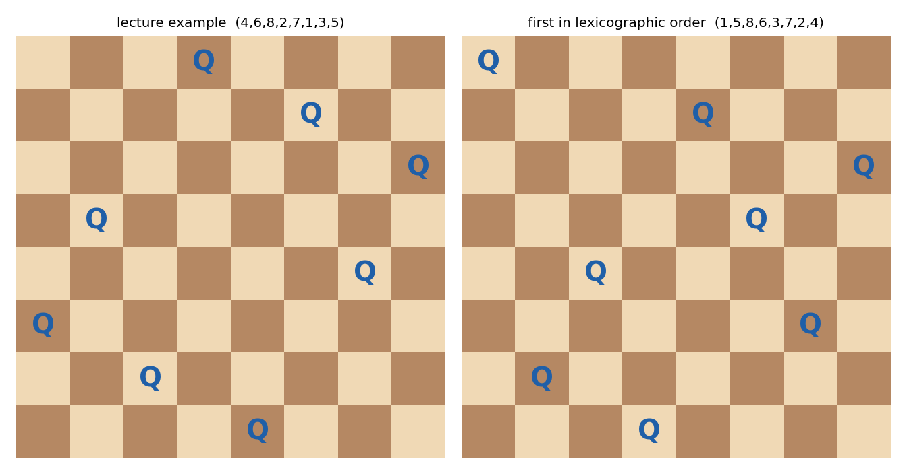
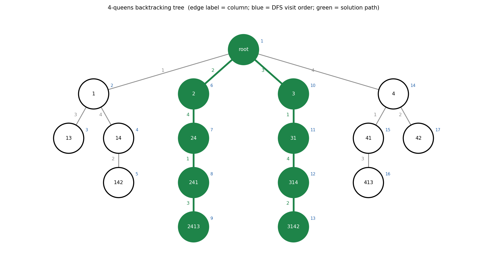
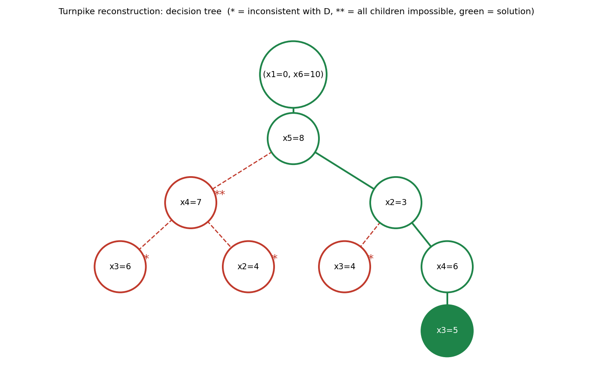
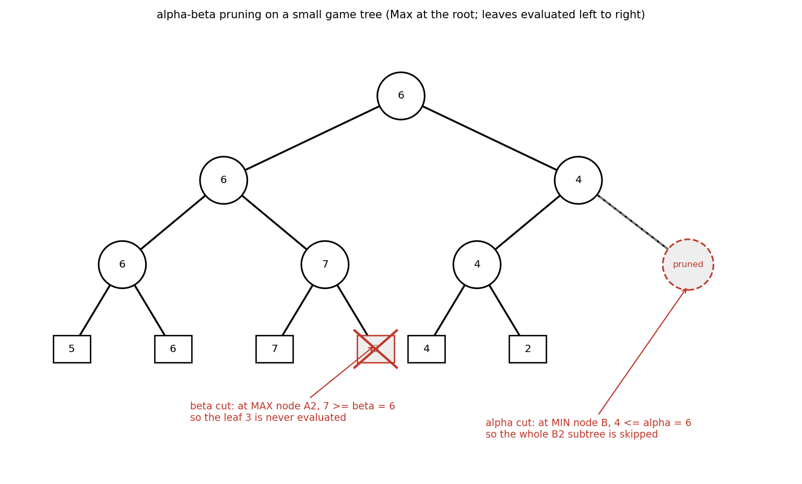

# ADS06 回溯（backtracking）算法 —— 复习笔记

> 来源：`../Materials/Student Slides/ADS06Backtracking_Stu.ppt`（*Backtracking*）
> 教材参考（讲义末页给出）：Weiss《Data Structures and Algorithm Analysis in C》(2nd Ed.) Ch.10 p.403–414
> 整理日期：2026-09-16（2026-10-20 改写为复习笔记：§4 由"课上会看到什么"的清单改成**课上三个例子的完整复盘**，
> 补上 4 皇后的搜索树、收费站重建的逐步回退与井字棋 minimax / α-β 的数值，配图由 `assets/make_ads06_figs.py` 复算生成）
> 说明：本文由 AI 依据讲义幻灯片与教材 Ch.10 整理；博弈树的原始插图为图片，本文用同一套规则**重新算了一遍**并画出结果，
> 数值可由脚本重跑复现。

## 1. 一页速览

| 问题 | 讲义给的答案 |
|---|---|
| 基本想法 | 先有部分解（partial solution） $(x_1,\dots,x_i)$，尝试加入 $x_{i+1}\in S_{i+1}$；满足约束（constraint）就继续，否则**删除（deletion）并回退**（backtrack）——即**剪枝（pruning）** |
| 目标 | 不显式检查全部候选解，但仍保证（跑到底就）能找到答案 |
| 前提 | 候选解集合有限、解可以在有限步内判定、候选不太多（讲义原话 *if the list is finite and it is possible to identify the answer … AND, if there are not too many candidates*） |
| 三个例子 | 八皇后、收费站重建（Turnpike Reconstruction）、井字棋（博弈 + $\alpha$-$\beta$ 剪枝） |
| 复杂度 | 与本讲的三个因素相关：$S$ 的规模、约束函数的复杂度、满足约束的结点（node）数 |
| 一句话 | 回溯 = 深度优先（depth-first search）地**枚举解空间（solution space）** + 在 `Check` 处**整枝剪掉** |

## 2. 核心框架

### 2.1 通用模板【讲义】

```c
bool Backtracking ( int i )
{   Found = false;
    if ( i > N ) return true;                 /* solved with (x1, …, xN) */
    for ( each xi ∈ Si ) {
        OK = Check((x1, …, xi), R );          /* pruning */
        if ( OK ) {
            Count xi in;
            Found = Backtracking( i+1 );
            if ( !Found ) Undo( i );          /* recover to (x1, …, xi-1) */
        }
        if ( Found ) break;
    }
    return Found;
}
```

### 2.2 三个要素与适用前提

1. **解的表示**：$x_i$ 取什么，$S_i$ 是什么。选得好，解空间立刻小一个量级（见 [§2.3](#23-先压缩解空间)）。
2. **约束 / 剪枝函数 `Check`**：决定效率。**它必须"早失败"**——只要当前部分解已经不可能补全，就在这一层返回 `false`，让整棵子树（subtree）都不必展开。
3. **撤销（undo）`Undo`**：**必须与"做选择时修改的状态"严格对称**。递归返回时若忘了恢复，下一次尝试就是在被污染的状态上进行的。

【讲义】另外提示：当不同 $S_i$ 的大小差异较大时，**先试规模小的 $S_i$**——同样的解空间，先剪掉大的分支。

> 【讲义】*No tree is actually constructed. The game tree is just an abstract concept.*
> 回溯不建搜索树，递归调用栈（stack）本身就是那条深度优先的路径；"树"只是分析用的说法。

### 2.3 先压缩解空间

以八皇后为例，三层约束依次生效：

| 约束 | 解空间 |
|---|---|
| $x_i\in\{1,\dots,8\}$ | $8^8=16{,}777{,}216$ |
| 不同列 $x_i\neq x_j$ | $8!=40{,}320$（解变成 $1..8$ 的**排列（permutation）**） |
| 不同对角线 $(x_i-x_j)/(i-j)\neq\pm1$ | 实际展开的结点数远小于 $8!$（[§4.1](#41-八皇后eight-queens) 实测 2{,}057，含根） |

**先压缩、再搜索**是回溯的第一生产力：能在建模阶段砍掉的对称性，比在搜索里剪枝便宜得多。

## 3. 效率由什么决定（讲义备注）

- 回溯的效率与三个因素相关：
  1. **$S$ 的规模**；
  2. **约束函数 `Check` 的复杂度**——它决定剪枝的效率，但函数本身太复杂也未必划算；
  3. **满足约束条件的结点数**——这一项最难估计，**所以回溯算法的复杂度分析通常很难做完整**。
- 由此得出一条实践结论：回溯的复杂度一般只能给出**指数级的上界**（最坏情况要枚举整个解空间），实际快慢取决于剪枝把树砍掉了多少。

## 4. 课上示例完整复盘

> 本节把课上真正走一遍的三个例子写全：图由 [`assets/make_ads06_figs.py`](assets/make_ads06_figs.py) 按讲义规则**真跑**后绘制（不是讲义截图），
> 文中的计数也由同一脚本输出，可重跑核对。

### 4.1 八皇后（Eight Queens）

**问题**：在 $8\times8$ 棋盘放 8 个皇后，任意两个不能同行、同列、同对角线（diagonal）。

**解的表示【讲义】**：$x_i$ = 第 $i$ 行皇后所在的列号。三条 `Check`：

1. $x_i\in\{1,\dots,8\}$；
2. $x_i\neq x_j$（不同列）；
3. $(x_i-x_j)/(i-j)\neq\pm1$（不同对角线）。



- 左：**讲义给出的解** $(4,6,8,2,7,1,3,5)$；
- 右：按"逐行、每行从第 1 列试到第 8 列"的深度优先顺序，**第一个**被找到的解 $(1,5,8,6,3,7,2,4)$。

**把问题缩到 4 皇后**：8 皇后的树画不下，4 皇后的树小到可以整棵画出来，剪枝发生在哪一层一目了然。



图的读法：

- 边上的数字 = 这一行放的列号；结点里的数字 = 到目前为止的部分解（如 `241` = 第 1、2、3 行分别放在第 2、4、1 列）；
- 蓝色小数字 = **深度优先的访问顺序**（1 → 17）；
- 绿色 = 通向解的那条路径。两个解：(2,4,1,3) 与 (3,1,4,2)。

课上会强调的两个动作：

1. **失败就回退**：例如路径 `1 → 14 → 142` 在第 4 行没有任何合法列，于是退回到 `14`、再退回到 `1`，改试 `2` 开头的分支——这就是模板里的 `Undo`。
2. **`Check` 在放下的那一刻就做**：例如 `1` 之后第 2 行只剩第 3、4 列可用（第 1 列同列、第 2 列对角线），第 3 行又会继续砍，所以真正展开的结点远少于 $4!$。

**实测规模**（脚本输出）：

| $n$ | 候选排列 $n!$ | 实际展开结点（含根） | `Check` 次数 | 解数 |
|---|---|---|---|---|
| 4 | 24 | 17 | 60 | 2 |
| 8 | 40,320 | 2,057 | 15,720 | 92 |

- 8 皇后一共 **92** 个解；讲义只给了其中一个。
- 对比不剪枝的 $8^8$：搜索规模从 1.6 千万降到两千个结点，**全部收益来自"放下即检查"**。

### 4.2 收费站重建（Turnpike Reconstruction）

**问题**：$N$ 个点在 $x$ 轴上，$x_1=0$；已知两两距离共 $N(N-1)/2$ 个，恢复点集坐标。

讲义用的一组数据：

$$D=\{1,2,2,2,3,3,3,4,5,5,5,6,7,8,10\}$$

**第一步（不用搜索）**：

- $N(N-1)/2=15\Rightarrow N=6$；
- $x_1=0$；$x_6=\max D=10$（最远的两点必然是两端）。

**接下来每一步都是"取当前最大距离 $d_{\max}$，试两个分支"**：

- 分支 1：$x_{\text{right}}=d_{\max}$（这个距离是"新点 ↔ $x_1=0$"）；
- 分支 2：$x_{\text{left}}=x_N-d_{\max}$（这个距离是"新点 ↔ $x_N$"）。

把新点放下之前，用 `Check` 验算：**它与所有已放好的点的距离都必须还在 $D$ 里（数量也要够）**。通过就删除这些距离并递归；不通过或递归失败，就把删掉的距离**原样插回**（`Insert`），再试另一个分支。



> 这棵树就是教材 Fig 10.63：`*` = 该点与距离集矛盾；`**` = 它的子结点全错，因此整条路径作废。

**课上逐步走一遍**（$D$ 只列剩下的部分）：

| 步 | 当前 $d_{\max}$ | 试的分支 | `Check` | 结果与 $D$ 的变化 |
|---|---|---|---|---|
| 0 | — | — | — | $x_1=0,\ x_6=10$，删去 10 |
| 1 | 8 | $x_5=8$ | $8,2\in D$ ✓ | 删 8、2；$D$ 剩 $\{1,2,2,3,3,3,4,5,5,5,6,7\}$ |
| 2 | 7 | $x_4=7$ | $7,1,3\in D$ ✓ | 删 7、1、3；$D$ 剩 $\{2,2,3,3,4,5,5,5,6\}$ |
| 3 | 6 | $x_3=6$ | $6\in D$，但 $\lvert6-7\rvert=1\notin D$ ✗ | 分支 1 失败，改分支 2 |
| 4 | 6 | $x_2=10-6=4$ | 需要**两个** 4（$\lvert4-0\rvert$、$\lvert8-4\rvert$），$D$ 只有一个 ✗ | 两条分支都失败，**回退** $x_4=7$，把 7、1、3 插回 |
| 5 | 7 | $x_2=10-7=3$ | $3,5,7\in D$ ✓ | 删 3、5、7；$D$ 剩 $\{1,2,2,3,3,4,5,5,6\}$ |
| 6 | 6 | $x_4=6$ | $6,3,2,4\in D$ ✓ | 删 6、3、2、4；$D$ 剩 $\{1,2,3,5,5\}$ |
| 7 | 5 | $x_3=5$ | $5,2,1,3,5\in D$ ✓ | $D$ 空，得到 $(0,3,5,6,8,10)$ |

两处"课上会停一下"的判断：

- **第 3 步**：$x_3=6$ 时，新点与 $x_4=7$ 的距离是 1，而 1 在放 $x_4=7$ 时已经被删掉了——**距离集不只是"集合"，还要记数量**，这正是 `Check` 要按重数比较的原因。
- **第 4 步**：$x_2=4$ 需要两个 4（到 0 和到 8 各一个），$D$ 里只剩一个 4，所以直接剪掉。教材这里还写了另一条候选 $x_3=4$（图里带 `*` 的那个），也是同一个理由被否决；程序按"先试分支 1"的顺序，试到 $x_4=6$ 就成功了。
- **回退的作用**：第 4 步失败后必须把第 2 步删掉的 7、1、3 插回 $D$，否则第 5 步的 $x_2=3$ 就无从判断——这就是 §2.2 说的"`Undo` 与做选择时修改的状态对称"。

### 4.3 井字棋（tic-tac-toe）与 $\alpha$-$\beta$ 剪枝

讲义用 AlphaGo 开场（*Games – how did AlphaGo win?*），落到井字棋这个"最小可玩的博弈"上。

**记号【讲义】**：X 是计算机（computer），O 是人（human）；*A "win" is a win line*——连成一条线即胜。

**规模【讲义】**：井字棋有 $3^9=19{,}683$ 种局面、$9!=362{,}880$ 种下棋序列。

> 研习室勘误（p.13）：$3^9=19{,}683$ 只是**格子的标记方式数**，其中包括轮流落子、胜负即止等规则不允许的局面；
> $9!$ 也不能直接解释为全部合法完整对局数。该站把它当作"搜索规模"的示意，而不是合法局面 / 对局的精确计数。

#### 4.3.1 Minimax 策略

- **评价函数（evaluation function）** 给局面打分：计算机胜 $+1$、平局 $0$、计算机负 $-1$；非终局则用"潜在获胜线数 $W$"之类的启发式估计。
- 计算机**最大化**、人**最小化**：轮到计算机走，取所有后继局面的**最大值**；轮到人走，取**最小值**——双方都假设对手最优，这就是 **minimax**。
- 与回溯的关系：minimax 就是"在博弈树（game tree）上做深度优先搜索"，只是"`Check`"换成了"这步棋是否已经分出胜负"。

#### 4.3.2 α 剪枝与 β 剪枝

| 剪枝 | 在哪里触发 | 条件 | 被剪掉的是 | 直觉 |
|---|---|---|---|---|
| $\alpha$ 剪枝（alpha pruning） | **min 结点**（$\alpha$ 由上层 max 传下来） | min 结点的当前值 $\le\alpha$ | 它剩下的 **max 子树** | max 已经保证拿到 $\alpha$，这个 min 分支不可能更好 |
| $\beta$ 剪枝（beta pruning） | **max 结点**（$\beta$ 由上层 min 传下来） | max 结点的当前值 $\ge\beta$ | 它剩下的 **min 子树** | min 已能把值压到 $\beta$，这个 max 分支不可能更差 |

教材 Fig 10.69–10.72 的例子（根的值是 **44**）：

- **节点 D**：它的 min 父结点已经确定 $\le 40$，而这个 min 结点的 max 父结点已经找到保证 44 的下界（lower bound）。$40<44$，所以 **D 不必再算**——这是 $\alpha$ 剪枝。
- **节点 C**：min 层已经能保证 $\le 44$，而 C 的 max 父结点当前的暂定最大值是 68（$\ge 44$），所以 **C 不必再算**——这是 $\beta$ 剪枝。

用一棵小树把顺序走一遍（叶子从左到右求值）：



- 求值顺序 $5,6,7,4,2$，根值 6；
- 左半：A2 是 **max 结点**，第一个叶子 7 已经 $\ge\beta=6$（$\beta$ 由 min 结点 A 传下来），第二个叶子 3 **不再求值**——这是 $\beta$ 剪枝；
- 右半：B1 求完得 4，B 是 **min 结点**，此时 $B\le4<6=\alpha$（$\alpha$ 由根传下来），它剩下的 max 子结点 B2 **直接跳过**——这是 $\alpha$ 剪枝；
- 8 个叶子里只算了 5 个，结论（根 = 6）不变——这就是"剪掉的分支不影响根值"。

#### 4.3.3 课上给的量级与实际计数

- 【讲义】*α-β pruning: when both techniques are combined. In practice, it limits the searching to only $O(\sqrt{N})$ nodes, where N is the size of the full game tree.*——整棵树有 $N$ 个结点时，最好情况下只需搜 $\sqrt{N}$ 个，**搜索深度差不多可以翻倍**。
- 教材的井字棋实测（含非终局结点）：
  - 计算机先手：不剪枝 **97,162** 个局面，$\alpha$-$\beta$ 后 **4,493** 个（VAX 8800 上约 2.5 秒）；
  - 计算机后手：人下中心 5,185、角 9,761、边 13,233。
- 井字棋的"值"重复太多，剪枝效果并不理想；换到国际象棋这种分支因子大的博弈，$\alpha$-$\beta$ 的收益才真正体现出来。

#### 4.3.4 课堂 Discussion：最优情况下 α-β 能把搜索降到多少？

> 下面这条推导来自课堂讨论（原文整理，保留推导），结论是最好情况下只需约 $O(b^{d/2})$ 个结点：$b$ 为分支因子（branching factor），$d$ 为深度（depth）。

最好的情况是：

- max 层，第一个结点就是最大的；
- min 层，第一个结点就是最小的。

于是只要完整评估第一个结点，就足以判定其余分支可以剪掉。以 max 层为例，完整评估第一个结点需要 $N(d-1)$；剩下的 $(b-1)$ 个结点要证明"必然小于第一个结点"，需要对它们的 min 子结点各自再评估下一层，每个需要 $N(d-2)$，共 $(b-1)$ 次。因此

$$N(d)=N(d-1)+(b-1)\,N(d-2),$$

解这个常系数线性递推得

$$N(d)=\frac{\alpha^{d+2}-\beta^{d+2}}{\alpha-\beta},\qquad
\alpha=\frac{1+\sqrt{4b-3}}{2},\quad \beta=\frac{1-\sqrt{4b-3}}{2}.$$

由于 $\alpha\approx\sqrt{b}$，所以 $N(d)=O\!\left(b^{d/2}\right)$——正是"只搜整棵树的平方根"这一量级。

## 5. 听课重点与易混点

1. **"剪枝"发生在 `Check`**：一旦部分解不满足约束，整棵子树都不用看——这是回溯比穷举（brute force）快的原因。
2. **`Undo` 必须与"做选择时修改的状态"严格对称**（收费站问题里是距离集合的删除 / 回插）。
3. **解空间要先压缩**（八皇后用"不同列 ⇒ 排列"把 $8^8$ 压成 $8!$），这是回溯的第一生产力。
4. **$\alpha$ 在 min 结点触发、$\beta$ 在 max 结点触发**（触发点和被剪掉的孩子在相反的层），别只背「α 管 max、β 管 min」。
5. 回溯是**深度优先**，不是广度优先（breadth-first search）；讲义强调"后序遍历（postorder traversal）"即此意。
6. **`Check` 要按"数量"判**：收费站重建里同一个距离可能出现多次，少算一个就会把可行的分支误剪（或把不可行的分支放过）。
7. **复杂度只能给上界**：回溯最坏是指数级，"剪枝后很快"是经验结论，不是可以写进 $\Theta$ 的保证。
8. **博弈树不是建出来的**：minimax 的递归调用就是搜索本身，"树"只是抽象说法；$\alpha$-$\beta$ 省的是"节点求值次数"，不是"树的大小"。

## 6. 复习要点

> 每道题后面给出**本讲对应小节**的链接（点击跳回），以及可以顺带回查的**关联知识点**。

| # | 问题 | 本讲对应小节 | 关联知识点 |
|---|---|---|---|
| 1 | 写出回溯的通用模板，并指出 `Check` 与 `Undo` 各自的作用。 | [§2.1 通用模板](#21-通用模板讲义) | 模板里 `Check` / `Undo` 的成对出现与 DFS 的「撤销」是同一件事；图的搜索见 [`13_ADS12` §2 局部搜索框架](13_ADS12_局部搜索.md#2-局部搜索框架) |
| 2 | 八皇后的三个约束分别把解空间缩小到多少？实际展开多少个结点？ | [§2.3 先压缩解空间](#23-先压缩解空间)、[§4.1 八皇后](#41-八皇后eight-queens) | 「冲突约束 + 剪枝」的思路与 [§4.2 收费站重建](#42-收费站重建turnpike-reconstruction) 的距离约束同类 |
| 3 | 在 $D=\{1,2,2,2,3,3,3,4,5,5,5,6,7,8,10\}$ 上，说明为什么第一步只能得到 $N=6$、$x_6=10$。 | [§4.2 收费站重建](#42-收费站重建turnpike-reconstruction) | 「先删距离再递归、失败再插回」＝模板里的 `Check` / `Undo`；详细步骤见 [§2.1](#21-通用模板讲义) |
| 4 | 收费站重建里，$x_4=7$ 这条分支为什么失败？失败后为什么要"插回去"？ | [§4.2 收费站重建](#42-收费站重建turnpike-reconstruction) | 递归结构的代价分析可参考 [`08_ADS07` §4 解递归式的三种方法](08_ADS07_分治法与递归式.md#4-解递归式的三种方法讲义主线) |
| 5 | minimax 中"人"与"计算机"分别在最大化还是最小化？$\alpha$、$\beta$ 各在哪里触发、剪掉谁的子树？ | [§4.3.1 Minimax 策略](#431-minimax-策略)、[§4.3.2 α 剪枝与 β 剪枝](#432-α-剪枝与-β-剪枝) | minimax 是「对抗式搜索」，与 [§2.1 通用模板](#21-通用模板讲义) 的区别在于：价值由双方交替取值决定 |
| 6 | 用教材 44 的那棵树说明节点 D、C 为什么可以不算。 | [§4.3.2 α 剪枝与 β 剪枝](#432-α-剪枝与-β-剪枝) | 自己动手时看 [§4.3.2 的小树](#432-α-剪枝与-β-剪枝)：5 个叶子就得出了根值 |
| 7 | 为什么回溯算法的复杂度分析往往只能给出粗略估计？ | [§3 效率由什么决定](#3-效率由什么决定讲义备注) | 复杂度的粗估与剪枝效果，可与 [`11_ADS10` §2.1 不可判定性](11_ADS10_NP完全性.md#21-不可判定性) 一起看 |
| 8 | *Discussion*：最优情况下 $\alpha$-$\beta$ 为什么只要 $O(b^{d/2})$ 个结点？ | [§4.3.4 课堂 Discussion](#434-课堂-discussion最优情况下-α-β-能把搜索降到多少) | 递推式的解法（特征方程）见 [`08_ADS07` §4](08_ADS07_分治法与递归式.md#4-解递归式的三种方法讲义主线) |

### 6.1 关联知识点（跨讲 / 跨资料）

- **三种「搜索解空间」的框架对照**：本讲的回溯（[§2 核心框架](#2-核心框架)）vs [`09_ADS08_动态规划.md`](09_ADS08_动态规划.md#1-一页速览) 的填表（用重叠子问题换时间）vs [`13_ADS12_局部搜索.md`](13_ADS12_局部搜索.md#2-局部搜索框架)（从任意解出发逐步改进）。讲义在 DP 一讲里也专门回看「决策问题更容易」，见 [`09_ADS08` §3 听课重点](09_ADS08_动态规划.md#3-听课重点与易混点)。
- **NP 难问题上回溯的位置**：回溯是精确算法，最坏情况仍是指数级——为什么会有指数级，见 [`11_ADS10_NP完全性.md`](11_ADS10_NP完全性.md#3-np-与-np-完全)；不想精确求解时的两条路：近似算法 [`12_ADS11_近似算法.md`](12_ADS11_近似算法.md#2-基本定义)、局部搜索 [`13_ADS12_局部搜索.md`](13_ADS12_局部搜索.md#2-局部搜索框架)。
- **独立集类问题（RP2 Safe Fruit）**：与顶点覆盖互补——见 [`13_ADS12` §2.1 例子：顶点覆盖](13_ADS12_局部搜索.md#21-例子顶点覆盖vertex-cover)；讲义把「选尽可能多的不相克果子」归到这一类（[§7 来源与延伸阅读](#7-来源与延伸阅读)）。
  > 研习室（p.18）：该站只保留这个故事的**一般冲突图建模思想**（选尽可能多的互不相克对象），不把它当作营养学结论。
- **教材**：Weiss Ch.10（p.403–414）；博弈树的 α-β 剪枝是「对抗搜索」的标准手段，教材 Fig 10.69–10.73 给出完整的树、剪枝过程与代码。

## 7. 来源与延伸阅读

- 讲义：`ADS06Backtracking_Stu.ppt`（含讲稿备注：效率与 $S$ 规模、约束函数复杂度、满足约束的结点数相关；*also known as noughts and crosses*）。
- 教材：Weiss Ch.10（p.403–414）：§10.5.1 Turnpike Reconstruction（Fig 10.63–10.65）、§10.5.2 Games（Fig 10.66–10.73）。
- 本讲配套的研究项目：*Research Project 2 — Safe Fruit*（从一堆"相克"的果子中选尽可能多的安全子集，本质是图上的极大独立集类问题）。
- 配图与复算脚本：[`assets/make_ads06_figs.py`](assets/make_ads06_figs.py)（4 皇后搜索树、8 皇后两个解、收费站决策树、α-β 小树；图中的计数与断言都由脚本跑出）。
- 待确认：井字棋评价函数的具体表达式与 3 层数值标注在幻灯片中是图片，本文只复述教材中的结论与计数。
