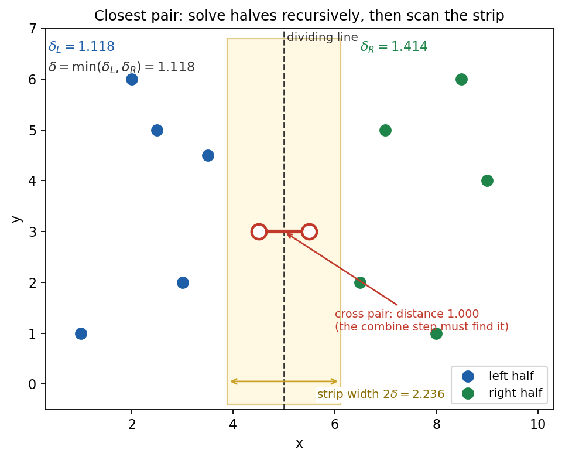
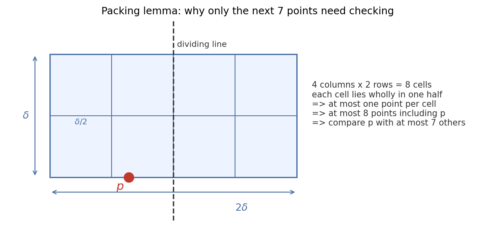
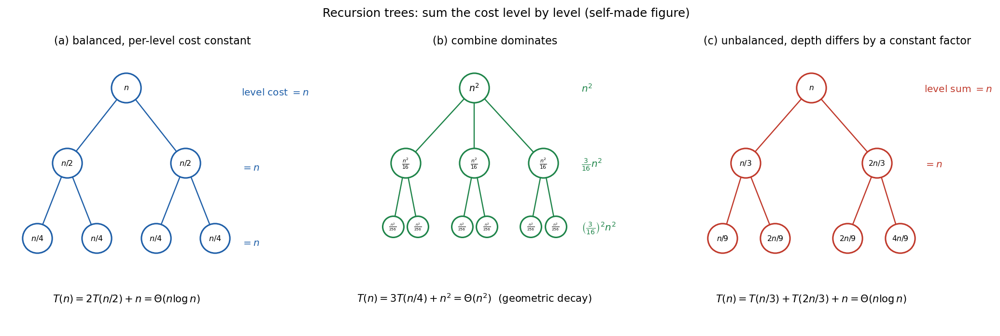
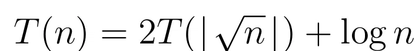

# ADS07 分治法（divide and conquer）与递归式（recurrence） —— 复习笔记

> 来源：`../Materials/Student Slides/ADS07Divide Conquer_Stu.ppt`（*Divide and Conquer*）
> 教材参考（讲义末页给出）：CLRS 3rd Ch.4 p.65–113；Weiss《Data Structures and Algorithm Analysis in C》(2nd Ed.) Ch.10 p.370–375；Jeff Erickson *Notes on Solving Recurrence Relations* p.10–13
> 整理日期：2026-09-16
> 2026-10-27 改写为复习笔记：补全分治模板与正确性、最近点对的完整算法与“7 点引理”、递归树的代入法验证、主定理三种情形的证明思路与 *Discussion 9*，并把课堂讨论 $T(n)=2T(\lfloor\sqrt n\rfloor)+\log n$ 整理成完整推导；新增 3 张自绘图、1 张课堂公式图与脚本 `assets/make_ads07_figs.py`
> 说明：本文由 AI 依据讲义幻灯片与教材 CLRS Ch.4 整理；图中的数值与最近点对示例由脚本复算，可重跑核对。

## 1. 一页速览

| 问题 | 本讲要记住的答案 |
|---|---|
| 分治三步 | **划分（divide）** → **递归求解（conquer）** → **合并（combine）** |
| 通用递归式 | $T(n)=a\,T(n/b)+f(n)$（等比例划分）；不平衡划分写成 $T(n)=T(n_1)+T(n_2)+f(n)$ |
| 本讲主角 | **最近点对（closest pair）**：穷举（brute force） $O(n^2)$ → 分治 $O(n\log n)$ |
| 核心技术 | 只检查分界线两侧宽 $2\delta$ 的**条带（strip）**，并用**7 点引理**让合并线性完成 |
| 解递归式 | **代入法（substitution method）**、**递归树法（recursion-tree method）**、**主方法（master theorem）** |
| 最易错处 | 最近点对每层重新排序会退化成 $O(n\log^2 n)$；主定理要求 $f(n)$ 与 $n^{\log_b a}$ 有**多项式级别的差距** |
| 一句话 | 分治的骨架很容易写，真正决定复杂度的是**合并能否在线性时间内完成**；递归式则要“先看出量级，再严格验证” |

## 2. 分治法：模板、正确性与复杂度

### 2.1 三步与通用伪代码

【讲义】分治法的三个动作：

1. **划分（divide）**：把规模为 $n$ 的原问题分成 $a$ 个规模更小的子问题（subproblem），通常每个规模约为 $n/b$；
2. **递归求解（conquer）**：递归地解决每个子问题；规模足够小时直接调用基例（base case）；
3. **合并（combine）**：把子问题的解拼成原问题的解。

通用伪代码：

```text
Solve(P):
    if |P| <= n0:
        return BaseSolve(P)              # 基例
    split P into P1, P2, ..., Pa          # 划分
    for i = 1 .. a:
        Si = Solve(Pi)                    # 递归求解
    return Combine(S1, ..., Sa)           # 合并
```

若每次划分都是“均分”，且合并代价为 $f(n)$，就得到最常见的递归式：

$$T(n)=a\,T(n/b)+f(n),\qquad a\ge 1,\ b>1. \tag{1}$$

讲义约定两个可以暂时忽略的细节：

- 不纠结 $n/b$ 是否为整数（严格写法用 $\lfloor n/b\rfloor$ 或 $\lceil n/b\rceil$，只影响常数）；
- 小规模时一律假设 $T(n)=\Theta(1)$。

> 注意：式 (1) 只是**等比例划分**的写法。快速排序（quicksort）的划分可能极不平衡，最近点对内部还可能同时出现 $n/3$ 与 $2n/3$，这时要写更一般的
> $$T(n)=\sum_{i=1}^{a}T(n_i)+f(n),\qquad \sum_i n_i=n.$$
> 不要一看到“递归”就硬套主方法。

### 2.2 分治正确性要检查什么

一个分治算法要证明正确，通常要分别说明三件事：

1. **基例正确**：规模 $n\le n_0$ 时直接求解的答案是对的；
2. **划分不漏不重**：每个输入实例恰好落入一个子问题，或跨越子问题的情形被 `Combine` 单独处理；
3. **合并保持正确性**：假设子问题的解都正确，`Combine` 能推出原问题的最优解 / 正确解。

最近点对就是典型例子：左右两半的最近点对由递归保证，真正需要额外证明的是“**跨界最近点对一定落在 strip 内，且扫描 7 个点足够**”。

### 2.3 什么时候适合分治

- 子问题**相互独立**：解左半时不需要知道右半的选择；若子问题大量重叠，应该考虑动态规划（dynamic programming）或记忆化（memoization）。
- **合并足够便宜**：如果合并要 $O(n^2)$，即使划分很漂亮，总复杂度也未必改善。
- **划分尽量平衡**：平衡划分（balanced partition）让递归树浅；不平衡划分（unbalanced partition）可能退化成 $O(n^2)$（如最坏情况下的快速排序）。
- **递归深度可接受**：递归深度是调用栈（call stack）的深度；在 $n$ 很大时要考虑栈空间，或改写成迭代（iteration）。

### 2.4 讲义里作为“老朋友”出现的例子

| 问题 | 划分 / 合并 | 递归式 | 结果 |
|---|---|---|---|
| 最大子列和（maximum subarray sum） | 左半、右半、跨中点三种情况；跨中点用线性扫描求“左半最大后缀 + 右半最大前缀” | $T(n)=2T(n/2)+\Theta(n)$ | $\Theta(n\log n)$ |
| 树的遍历（traversal） | 递归遍历左子树（left subtree）与右子树（right subtree），访问根 | $T(n)=T(L)+T(R)+\Theta(1)$ | $\Theta(n)$ |
| 归并排序（merge sort） | 均分后递归排序，再线性归并 | $T(n)=2T(n/2)+\Theta(n)$ | $\Theta(n\log n)$ |
| 快速排序（quicksort） | 按枢轴（pivot）分成两段，递归排序 | $T(n)=T(k)+T(n-k-1)+\Theta(n)$ | 最好 / 平均 $\Theta(n\log n)$，最坏 $\Theta(n^2)$ |

> 快速排序的“平均”口径：若枢轴把区间分成左右两段，平均情况下递归树深度为 $\Theta(\log n)$，每层总代价为 $\Theta(n)$；
> 最坏情况是每次只分出一个元素，递归式变成 $T(n)=T(n-1)+\Theta(n)=\Theta(n^2)$。讲义此处只作回顾，不展开概率证明。

## 3. 最近点对（closest pair problem）

### 3.1 问题与穷举

给定平面上 $n$ 个点，找距离最近的一对点；若允许重合点，最小距离为 $0$。

**穷举**：检查所有 $\binom n2=n(n-1)/2$ 对，时间复杂度 $O(n^2)$。

**分治目标**：先按 $x$ 坐标（coordinate）排序，一分为二，分别求左右两半的最近距离；再处理“一个点在左半、一个点在右半”的跨界情形。

### 3.2 完整算法：预排序（presorting）与递归

只做“递归 + 暴力检查 strip”还不够：如果每个递归结点都把 strip 重新排序，复杂度会多一个 $\log$。为了做到 $O(n\log n)$，需要在递归过程中维护按 $y$ 排好序的点表。

记号：

- $P_x$：当前点集按 $x$ 排序；
- $P_y$：当前点集按 $y$ 排序；
- $x_{\text{mid}}$：分界线（dividing line）的 $x$ 坐标；
- $\delta$：当前已知的最小距离。

```text
ClosestPair(Px, Py):
    n = |Px|
    if n <= 3:
        return (BruteForce(Px), SortByY(Px))       # 基例：直接算，并返回按 y 排序的表

    mid = floor(n / 2)
    x_mid = Px[mid].x
    Lx = Px[0 .. mid-1];  Rx = Px[mid .. n-1]
    Ly = [p in Py if p belongs to Lx]              # 用点的编号/排名判断归属
    Ry = [p in Py if p belongs to Rx]

    (delta_L, Ly) = ClosestPair(Lx, Ly)
    (delta_R, Ry) = ClosestPair(Rx, Ry)
    delta = min(delta_L, delta_R)

    Py = MergeByY(Ly, Ry)                          # 线性归并，返回给上一层
    strip = [p in Py if |p.x - x_mid| < delta]     # 只保留分界线两侧宽 2δ 的条带

    for i = 0 .. |strip|-1:
        for j = i+1 .. min(i+7, |strip|-1):        # 7 点引理
            if strip[j].y - strip[i].y >= delta:
                break
            delta = min(delta, Dist(strip[i], strip[j]))

    return (delta, Py)
```

关键点：

- `Ly`、`Ry` 是通过“点属于左半还是右半”从 $P_y$ 中筛出来的，不需要在每层重新排序；
- 每层只做一次线性归并 `MergeByY`，所以合并代价是 $O(n)$；
- 基例 $n\le 3$ 时直接暴力，避免递归到 $n=1,2$ 的边界讨论；
- **预排序（presorting）**按 $x$、$y$ 各做一次，之后每层只做线性归并，不再重新排序。

### 3.3 为什么只看宽 $2\delta$ 的 strip

设左右两半各自的最近距离为 $\delta_L,\delta_R$，令

$$\delta=\min(\delta_L,\delta_R).$$

若最近点对**完全在左半或完全在右半**，递归已经找到它。若它是**跨界点对** $(p,q)$，且距离 $d<\delta$，则：

- $p,q$ 的 $x$ 坐标都必须落在分界线两侧 $\delta$ 以内，否则两点的 $x$ 差至少为 $\delta$，距离不可能小于 $\delta$；
- 因而 $p,q$ 都在宽 $2\delta$ 的 strip 中；
- 同时它们的 $y$ 差也小于 $\delta$，所以只需检查 $y$ 方向相距小于 $\delta$ 的点。



*图 1　左右两半的最近距离分别为 $\delta_L=1.118$、$\delta_R=1.414$，取 $\delta=1.118$；跨界点对 $(4.5,3)$ 与 $(5.5,3)$ 的距离为 $1.000<\delta$，所以合并时必须检查 strip。图中点集与 $\delta$ 由 `assets/make_ads07_figs.py` 计算生成，不是手画的数值。*

### 3.4 7 点引理：strip 内为什么是线性扫描

**引理（packing lemma）**：在当前递归结点，设 $\delta=\min(\delta_L,\delta_R)$。对 strip 中任一点 $p$，在 $y$ 坐标不低于 $p$、且与 $p$ 的 $y$ 差小于 $\delta$ 的点中，最多只有 $7$ 个候选点需要检查。

**证明**：只考虑 $p$ 上方（$y\ge p.y$）的候选点。取矩形

$$R=[x_{\text{mid}}-\delta,\ x_{\text{mid}}+\delta]\times[p.y,\ p.y+\delta],$$

它宽 $2\delta$、高 $\delta$，包含所有“在 strip 内、位于 $p$ 上方且 $y$ 差小于 $\delta$”的点。把 $R$ 分成 $4\times 2=8$ 个边长为 $\delta/2$ 的网格（grid）小方格：

- 分界线 $x=x_{\text{mid}}$ 正好是中间两列的分界，所以每个小方格**完整落在左半或右半**；
- 同一半内任意两点的距离至少为 $\delta$（因为 $\delta_L,\delta_R\ge\delta$），而小方格的对角线只有 $\delta/\sqrt2<\delta$，所以每个小方格内至多有一个点；
- 因此 $R$ 内至多有 $8$ 个点；去掉 $p$ 自己，至多 $7$ 个其他点。

于是把 strip 按 $y$ 排序后，对每个 $p$ 只需向后检查 $7$ 个点；一旦 $y$ 差达到 $\delta$ 就 `break`。每个点最多做常数次距离计算，所以扫描 strip 的总代价为 $O(n)$。



*图 2　宽 $2\delta$、高 $\delta$ 的矩形分成 8 个边长 $\delta/2$ 的小格；分界线是中间两列的分界，每个小格完整落在某一半内，因此每格至多一个点。$p$ 自己占一个位置，所以最多再检查 7 个点。*

> 边界细节：若点恰好落在网格线上，可用半开区间或把 $\delta$ 略微放大来避免“边界上挤了多个点”的退化情况；这只影响常数，不影响 $O(n)$ 结论。

### 3.5 正确性与复杂度

**正确性**（对 $n$ 归纳）：

- 基例 $n\le 3$ 由暴力枚举保证；
- 归纳假设左右两半的递归调用返回各自的最小距离；
- 若全局最近点对在同一半，递归已找到；若跨界，3.3 说明它落在 strip 中，3.4 说明扫描 7 个点不会漏掉它。因此返回的 $\delta$ 是全局最小距离。

**复杂度**：

- 预排序按 $x$、$y$ 各一次：$O(n\log n)$；
- 递归式 $T(n)=2T(n/2)+O(n)$，由主方法 Case 2 得 $T(n)=O(n\log n)$；
- 空间：递归栈 $O(\log n)$；若每层归并后及时释放子层数组，峰值可做到 $O(n)$。若实现时把所有层的 $L_x,R_x,L_y,R_y$ 都同时保留，峰值可能达到 $O(n\log n)$——这是实现细节，不影响时间界。

> **实现陷阱**：如果每个递归结点都把 strip 重新 `sort` 一次，递推式会变成
> $$T(n)=2T(n/2)+O(n\log n),$$
> 解为 $O(n\log^2 n)$。讲义的“strip 按 $y$ 排序”默认了排序信息可以高效维护；上面的算法用 `MergeByY` 把这一步摊到线性时间，才真正达到 $O(n\log n)$。

> **重合点**：若允许两点重合，最小距离可以是 $0$。一旦某次递归或扫描得到 $0$，可以直接返回；也可以用哈希表（hash table）先查重。此时“距离 $<\delta$”的严格不等号要配合“找到 0 立即停止”处理，避免在 $\delta=0$ 时把条带筛空。

## 4. 解递归式的三种方法（【讲义】主线）

### 4.0 先看展开：两种手感

【讲义】先用展开法演示两个典型：

$$
T(n)=2T(n/2)+cn
\;\Rightarrow\;
T(n)=2^kT(n/2^k)+kcn
=\Theta(n\log n), \tag{2}
$$

$$
T(n)=2T(n/2)+cn^2
\;\Rightarrow\;
T(n)=2^kT(n/2^k)+cn^2\left(1+\frac12+\cdots+\frac1{2^{k-1}}\right)
=O(n^2). \tag{3}
$$

直觉：**把每一层的代价加起来，看哪一层占主导**。第一式的每层代价相同，共有 $\Theta(\log n)$ 层；第二式的每层代价按 $1/2$ 衰减，几何级数（geometric series）由根节点主导。

### 4.1 代入法（substitution method）——先猜，再归纳证明

**步骤**：

1. 猜一个界，例如 $T(n)=O(n\log n)$；
2. 假设对所有 $m<n$ 成立（强归纳假设（strong induction hypothesis））；
3. 代入递归式，验证对 $n$ 也成立；
4. 选足够大的常数，处理基例。

**例子【讲义】**：$T(n)=2T(\lfloor n/2\rfloor)+n$，猜 $T(n)=O(n\log n)$。

假设对所有 $m<n$ 有 $T(m)\le c\,m\log_2 m$。取 $m=\lfloor n/2\rfloor$，则

$$
\begin{aligned}
T(n)
&\le 2c\left\lfloor\frac n2\right\rfloor
      \log_2\left\lfloor\frac n2\right\rfloor+n\\
&\le c\,n(\log_2 n-1)+n\\
&=c\,n\log_2 n+(1-c)n\\
&\le c\,n\log_2 n \qquad (c\ge 1).
\end{aligned}
$$

基例 $T(2),T(3)$ 取足够大的 $c$ 即可；讲义强调**不必纠结 $T(1)$**，因为渐进记号（asymptotic notation）只关心足够大的 $n$。

**猜错会怎样？** 若猜 $T(n)=O(n)$，写成 $T(m)\le cm$，代入得

$$T(n)\le 2c\left\lfloor\frac n2\right\rfloor+n\le (c+1)n,$$

得到的是 $(c+1)n$，不是原来的 $cn$。这里的问题不是“推出 $O(n)$ 所以 $O(n)$ 成立”，而是**归纳假设没有闭合**：常数从 $c$ 变成了 $c+1$，无法证明存在一个固定的 $c$ 让不等式对所有 $n$ 成立。事实上由递归树可知 $T(n)=\Omega(n\log n)$，所以 $O(n)$ 本来就是错的。

> 代入法的价值：它不依赖主定理的“多项式差距”条件，能处理主定理覆盖不到的缺口，例如 $T(n)=2T(n/2)+n\log n$。

### 4.2 递归树法（recursion-tree method）

递归树（recursion tree）把递归展开画成一棵树：每个结点（node）写子问题的规模，根结点（root）旁边写这一层（或这个结点）的代价；把每层代价求和，再把所有层相加。



*图 3　(a) 平衡划分，每层代价相同；(b) 合并代价按 $3/16$ 几何衰减，根节点主导；(c) 不平衡划分，每层总规模仍为 $n$，但最短路径与最长路径只差常数倍。图由 `assets/make_ads07_figs.py` 生成。*

#### 4.2.1 几何衰减：$T(n)=3T(n/4)+\Theta(n^2)$

第 $j$ 层有 $3^j$ 个结点，每个子问题规模为 $n/4^j$，该层代价为

$$3^j\left(\frac{n}{4^j}\right)^2
=\left(\frac{3}{16}\right)^j n^2.$$

因此总代价为

$$T(n)=n^2\sum_{j\ge0}\left(\frac{3}{16}\right)^j
<n^2\cdot\frac{1}{1-3/16}
=\frac{16}{11}n^2=O(n^2).$$

叶结点（leaf）总数为 $3^{\log_4 n}=n^{\log_4 3}\approx n^{0.792}$，低于 $n^2$；根结点贡献 $\Theta(n^2)$，所以 $T(n)=\Theta(n^2)$。

#### 4.2.2 不平衡划分：$T(n)=T(n/3)+T(2n/3)+cn$

这棵树**不平衡**：最短路径每次取 $n/3$，深度为 $\log_3 n$；最长路径每次取 $2n/3$，深度为 $\log_{3/2}n$。两者只差常数倍，因为

$$\frac{\log_{3/2}n}{\log_3 n}
=\frac{\log_2 n/\log_2(3/2)}{\log_2 n/\log_2 3}
=\frac{\log_2 3}{\log_2(3/2)}
\approx 2.71.$$

在每一层，左右子问题的规模之和仍为 $n$，所以每层总代价为 $\Theta(n)$，共有 $\Theta(\log n)$ 层：

$$T(n)=\Theta(n\log n).$$

讲义该页的递归树写着“Not complete!”，因为树形不对称，不能像完全二叉树那样直接数层数。可以用代入法验证上界（upper bound）。设 $T(m)\le d\,m\log m$（用自然对数），则

$$
\begin{aligned}
T(n)
&\le d\frac n3\log\frac n3
   +d\frac{2n}{3}\log\frac{2n}{3}+cn\\
&=d\,n\log n-d\,n\left(\log 3-\frac23\log 2\right)+cn.
\end{aligned}
$$

括号中的常数 $\log 3-\frac23\log2\approx0.637>0$，所以只要 $d\ge c/0.637$，就有 $T(n)\le d\,n\log n$。下界同理，取足够小的 $d$ 即可；因此 $T(n)=\Theta(n\log n)$。

### 4.3 主方法（master theorem）

【讲义】按 CLRS 的形式给出。设 $T(n)=aT(n/b)+f(n)$，其中 $a\ge1$、$b>1$，令

$$p=\log_b a.$$

| 情形 | 条件 | 结论 |
|---|---|---|
| Case 1 | $f(n)=O\big(n^{p-\varepsilon}\big)$，对某个常数 $\varepsilon>0$ | $T(n)=\Theta\big(n^{p}\big)$ |
| Case 2 | $f(n)=\Theta\big(n^{p}\big)$ | $T(n)=\Theta\big(n^{p}\log n\big)$ |
| Case 3 | $f(n)=\Omega\big(n^{p+\varepsilon}\big)$，对某个 $\varepsilon>0$，且满足**正则性条件（regularity condition）** $a f(n/b)\le c f(n)$（某个 $c<1$、足够大的 $n$） | $T(n)=\Theta\big(f(n)\big)$ |

> 讲义注释：$f(n)$ 与 $n^{\log_b a}$ 中较大的那个决定 $T(n)$，而且必须“严格大”，即大出某个**多项式**阶。
> $n\log n$ 只比 $n$ 大一个 $\log$ 因子，不属于“多项式级别”，所以 $T(n)=2T(n/2)+n\log n$ **不能**直接用上面的主方法；要用扩展形式或递归树。

**三种情形的直觉**：

- Case 1：叶子层占主导。第 $j$ 层代价至多按 $b^\varepsilon$ 增长，几何级数求和后由叶子 $n^p$ 决定；
- Case 2：每层代价都是 $\Theta(n^p)$，共 $\Theta(\log n)$ 层；
- Case 3：根节点占主导。正则性条件保证每层代价按常数比例衰减，几何级数求和后仍是 $\Theta(f(n))$。

#### 4.3.1 主定理为什么成立（证明思路）

设 $n=b^k$（忽略取整），第 $j$ 层有 $a^j$ 个结点，每个子问题规模为 $n/b^j$。

**Case 1**：若 $f(n)\le c\,n^{p-\varepsilon}$，则第 $j$ 层代价至多

$$a^j f(n/b^j)
\le c\,a^j\left(\frac{n}{b^j}\right)^{p-\varepsilon}
=c\,n^{p-\varepsilon}\left(b^\varepsilon\right)^j.$$

对 $j=0,\dots,k$ 求和，得到 $O(n^{p-\varepsilon}\cdot n^\varepsilon)=O(n^p)$；叶子层有 $a^k=n^p$ 个结点，代价 $\Theta(n^p)$，所以 $T(n)=\Theta(n^p)$。

**Case 2**：若 $f(n)=\Theta(n^p)$，则第 $j$ 层代价为

$$a^j\Theta\left(\left(\frac{n}{b^j}\right)^p\right)
=\Theta\left(n^p\left(\frac{a}{b^p}\right)^j\right)
=\Theta(n^p).$$

共有 $k+1=\Theta(\log n)$ 层，所以 $T(n)=\Theta(n^p\log n)$。这就是讲义 *Discussion 9* 要证的结论。

**Case 3**：根结点贡献 $f(n)$，给出 $\Omega(f(n))$；正则性条件 $a f(n/b)\le c f(n)$ 使第 $j$ 层代价至多 $c^j f(n)$，所以总代价

$$T(n)\le f(n)\sum_{j\ge0}c^j=\frac{f(n)}{1-c}=O(f(n)).$$

两边合起来即 $T(n)=\Theta(f(n))$。

> **Discussion 9 的完整答案**：Case 2 的证明就是上面的“每层代价相同 + 层数 $\Theta(\log n)$”。若 $f(n)=\Theta(n^p)$，第 $j$ 层的 $a^j$ 个结点各付 $\Theta((n/b^j)^p)$，相乘恰好消去 $a^j$，得到每层 $\Theta(n^p)$；再乘层数 $\Theta(\log n)$。

#### 4.3.2 主方法的另一种形式（Weiss）

【讲义】还给出了 Weiss 教材的写法：设 $T(n)=aT(n/b)+f(n)$，比较 $a f(n/b)$ 与 $f(n)$：

| 条件 | 结论 | 直觉 |
|---|---|---|
| $a f(n/b)=\kappa f(n)$，某常数 $\kappa<1$ | $T(n)=\Theta(f(n))$ | 合并代价逐层按 $\kappa$ 衰减，根节点主导 |
| $a f(n/b)=K f(n)$，某常数 $K>1$ | $T(n)=\Theta(n^{\log_b a})$ | 子问题代价逐层放大，叶子层主导 |
| $a f(n/b)=f(n)$ | $T(n)=\Theta(f(n)\log_b n)$ | 每层代价相同，共 $\log_b n$ 层 |

例：

- $T(n)=2T(n/2)+n$：$a f(n/2)=2\cdot(n/2)=n=f(n)$，得 $\Theta(n\log n)$；
- $T(n)=2T(n/2)+n^2$：$a f(n/2)=2\cdot(n/2)^2=n^2/2=\kappa f(n)$（$\kappa=1/2$），得 $\Theta(n^2)$；
- $T(n)=4T(n/2)+n$：$a f(n/2)=4\cdot(n/2)=2n=K f(n)$（$K=2$），得 $\Theta(n^{\log_2 4})=\Theta(n^2)$。

> 这只是一个便于快速判断的**充分条件**版本；遇到 $a f(n/b)$ 与 $f(n)$ 只差对数因子时，仍要回到递归树或扩展定理。

### 4.4 含 $n^k\log^p n$ 的扩展定理

【讲义】给出：若

$$T(n)=aT(n/b)+\Theta\big(n^k\log^p n\big),\qquad a\ge1,\ b>1,\ p\ge0,$$

则

| 条件 | 结论 |
|---|---|
| $a>b^k$ | $T(n)=\Theta\big(n^{\log_b a}\big)$ |
| $a=b^k$ | $T(n)=\Theta\big(n^k\log^{p+1}n\big)$ |
| $a<b^k$ | $T(n)=\Theta\big(n^k\log^p n\big)$ |

这一定理补上了标准主方法处理不了的一些情形。例如：

- 归并排序：$a=b=2,\ k=1,\ p=0$，属于 $a=b^k$，得 $\Theta(n\log n)$；
- 每次分 3 份、线性合并：$a=3,\ b=2,\ k=1,\ p=0$，$a>b^k$，得 $\Theta(n^{\log_2 3})\approx\Theta(n^{1.585})$；
- 合并代价 $n^2$：$a=b=2,\ k=2,\ p=0$，$a<b^k$，得 $\Theta(n^2)$；
- $T(n)=2T(n/2)+n\log n$：$a=b^k=2,\ k=1,\ p=1$，得 $\Theta(n\log^2 n)$；
- $T(n)=4T(n/2)+n\log n$：$a=4>b^k=2$，得 $\Theta(n^2)$；
- $T(n)=4T(n/2)+n^2$：$a=b^k=4$，得 $\Theta(n^2\log n)$；
- $T(n)=4T(n/2)+n^3$：$a<b^k$，得 $\Theta(n^3)$。

### 4.5 常用递归式速查

| 递归式 | 解 | 用哪一招 |
|---|---|---|
| $T(n)=2T(n/2)+n$ | $\Theta(n\log n)$ | 主方法 Case 2 |
| $T(n)=2T(n/2)+n^2$ | $\Theta(n^2)$ | 主方法 Case 3 |
| $T(n)=3T(n/2)+n$ | $\Theta(n^{\log_2 3})$ | 主方法 Case 1 |
| $T(n)=4T(n/2)+n^2$ | $\Theta(n^2\log n)$ | 主方法 Case 2 |
| $T(n)=4T(n/2)+n^3$ | $\Theta(n^3)$ | 主方法 Case 3 |
| $T(n)=3T(n/4)+n^2$ | $\Theta(n^2)$ | 递归树 / 主方法 Case 3 |
| $T(n)=T(n/3)+T(2n/3)+n$ | $\Theta(n\log n)$ | 递归树 + 代入法 |
| $T(n)=2T(n/2)+n\log n$ | $\Theta(n\log^2 n)$ | 扩展定理 / 递归树 |
| $T(n)=2T(n/2)+n/\log n$ | $\Theta(n\log\log n)$ | 递归树（主方法有缺口） |

> 最后一行是“主定理缺口”的经典例子：$f(n)=n/\log n$ 既不是 $O(n^{1-\varepsilon})$，也不是 $\Omega(n^{1+\varepsilon})$，标准主方法三档都不适用。递归树第 $j$ 层代价为 $n/(\log n-j)$，求和得到 $n\sum_{k=1}^{\log n}1/k=\Theta(n\log\log n)$。

### 4.6 变量代换（variable substitution）：课堂讨论的根号递归式



课堂讨论要求解

$$T(n)=2T(\lfloor\sqrt n\rfloor)+\log n.$$

**第一步：换变量。** 令 $n=2^m$（严格说取 $m=\log_2 n$；取整只影响常数），则

$$\sqrt n=2^{m/2},\qquad \log_2 n=m.$$

定义 $S(m)=T(2^m)$，原式变成

$$S(m)=2S(m/2)+m. \tag{4}$$

这一步消掉了根号：**指数上的 $\sqrt n$ 变成了规模上的 $m/2$**。

**第二步：解 $S(m)$。** 式 (4) 是标准形式，$a=2$、$b=2$、$f(m)=m$，且

$$m^{\log_b a}=m^{\log_2 2}=m.$$

属于主方法 Case 2：

$$S(m)=\Theta(m\log m).$$

**第三步：换回 $n$。** 由 $m=\log_2 n$，

$$T(n)=S(\log_2 n)=\Theta\big(\log n\cdot\log\log n\big).$$

换底只改变常数因子，所以 $\log$ 的底数不影响 $\Theta$ 结果；但表达式中的“$\log\log n$”要求 $n>1$，小规模由基例处理。

> 同类练习：$T(n)=T(\lfloor\sqrt n\rfloor)+1$。令 $n=2^m$，得 $S(m)=S(m/2)+1=\Theta(\log m)$，所以 $T(n)=\Theta(\log\log n)$。

## 5. 听课重点与易混点

1. **分治的难点通常在合并**：最近点对写起来简单，真正的工作是证明“strip 内只需看 7 个点”。
2. **7 点引理依赖两个条件**：分界线在网格中间（每格完整落在某一半）+ 每一半内部的最近距离至少为 $\delta$。缺一不可。
3. **最近点对的 $O(n\log n)$ 依赖预排序 / 归并维护 $y$ 序**：每层重新排序会变成 $O(n\log^2 n)$。
4. **代入法要先猜，再让常数闭合**：猜 $O(n)$ 时得到 $(c+1)n$，说明假设没有闭合，不是“证出了 $O(n)$”。
5. **主方法不能乱用**：$f(n)$ 与 $n^{\log_b a}$ 必须差一个多项式因子；$n\log n$ 与 $n$ 的差距不够，落在主方法的缺口中。
6. **Case 3 要检查正则性条件**：不是只要 $f(n)$ 大就能用，还要 $a f(n/b)\le c f(n)$（$c<1$）。
7. **递归树不是证明本身**：递归树帮你猜出答案；严格结论还要用代入法或主定理验证。
8. **不平衡递归式要看“层代价”和“层数”两个量**：$T(n)=T(n/3)+T(2n/3)+n$ 的每层代价是 $n$，最短/最长路径只差常数倍，所以仍是 $\Theta(n\log n)$。
9. **取整、边界、重合点**：讲义允许忽略取整；但写论文级证明时要补 $\lfloor\cdot\rfloor$、基例与退化情形。

## 6. 复习要点

> 每道题后面给出**本讲对应小节**的链接，以及可以顺带回查的**关联知识点**。

| # | 问题 | 本讲对应小节 | 关联知识点 |
|---|---|---|---|
| 1 | 写出分治三步与通用递归式；说明哪一步最容易导致复杂度失控。 | [§2.1 三步与通用伪代码](#21-三步与通用伪代码)、[§2.3 什么时候适合分治](#23-什么时候适合分治) | 分治与 DP 的分界：[`09_ADS08` §2.5 DP 的设计方法论](09_ADS08_动态规划.md#25-流水线装配product-assemblydp-的设计方法论) |
| 2 | 最大子列和、树遍历、归并排序、快速排序的递归式分别是什么？ | [§2.4 讲义里的老朋友](#24-讲义里作为老朋友出现的例子) | 排序的下界与比较模型：[`16_ADS15` §2.1](16_ADS15_外部排序.md#21-两阶段生成-run--多趟归并) |
| 3 | 最近点对为什么要保留宽 $2\delta$ 的 strip？跨界点对为什么一定在 strip 内？ | [§3.3 为什么只看宽 $2\delta$ 的 strip](#33-为什么只看宽-2delta-的-strip) | “先排除不可能更优的区域”与分支限界（branch and bound）的剪枝同型 |
| 4 | 证明 7 点引理；解释为什么每个小格完整落在某一半内。 | [§3.4 7 点引理](#34-7-点引理strip-内为什么是线性扫描) | 网格（grid）划分与 [`07_ADS06` §4.2 收费站重建](07_ADS06_回溯算法.md#42-收费站重建turnpike-reconstruction) 的“按数量检查”都是常数规模论证 |
| 5 | 最近点对的完整算法为什么是 $O(n\log n)$？每层重新排序会怎样？ | [§3.2 完整算法](#32-完整算法预排序presorting与递归)、[§3.5 正确性与复杂度](#35-正确性与复杂度) | 归并排序的“线性合并”：[`16_ADS15` §2.1](16_ADS15_外部排序.md#21-两阶段生成-run--多趟归并) |
| 6 | 用代入法证明 $T(n)=2T(\lfloor n/2\rfloor)+n=O(n\log n)$；猜 $O(n)$ 为什么失败？ | [§4.1 代入法](#41-代入法substitution-method先猜再归纳证明) | 归纳证明的写法与 [`02_ADS001` §8 为什么 AVL 树高是对数级的](02_ADS001_伸展树与摊还分析.md#8-补充为什么-avl-树高是对数级的) 同型 |
| 7 | 画出 $T(n)=3T(n/4)+n^2$ 与 $T(n)=T(n/3)+T(2n/3)+n$ 的递归树，并求渐近界。 | [§4.2 递归树法](#42-递归树法recursion-tree-method) | 递归树的“层求和”与 [`15_ADS14` §3.1 求和](15_ADS14_并行算法.md#31-求和summation) 的 work-depth 分析同型 |
| 8 | 写出主定理三种情形（含正则性条件），并证明 Case 2（*Discussion 9*）。 | [§4.3 主方法](#43-主方法master-theorem)、[§4.3.1 证明思路](#431-主定理为什么成立证明思路) | 主方法在树高 / 深度分析中的用法：[`03_ADS02` §3.5](03_ADS02_红黑树与B+树.md#35-复杂度与参数选择讲义结论) |
| 9 | 用扩展定理解 $T(n)=2T(n/2)+n\log n$ 与 $T(n)=4T(n/2)+n^2$。 | [§4.4 扩展定理](#44-含-nklogp-n-的扩展定理) | 随机化快排的期望分析：[`14_ADS13` §4](14_ADS13_随机化算法.md#4-随机化快速排序randomized-quicksort) |
| 10 | 用变量代换解 $T(n)=2T(\lfloor\sqrt n\rfloor)+\log n$，并说明为什么不是 $\Theta(\log n)$。 | [§4.6 变量代换](#46-变量代换variable-substitution课堂讨论的根号递归式) | 递归式的“换变量”与 [`09_ADS08` §2.1 Fibonacci](09_ADS08_动态规划.md#21-fibonacci先看清重复计算有多贵) 的“先看清重复计算”都是先化简结构 |

### 6.1 关联知识点（跨讲 / 跨资料）

- **分治 ↔ 动态规划**：分治要求子问题**不重叠**，DP 恰恰利用重叠——对照 [`09_ADS08_动态规划.md`](09_ADS08_动态规划.md#1-一页速览) 与它的 [§2.1 Fibonacci](09_ADS08_动态规划.md#21-fibonacci先看清重复计算有多贵)；OBST 的 $O(n^2)$ 改进（四边形不等式）见 [`09_ADS08` §2.3](09_ADS08_动态规划.md#23-最优二叉搜索树optimal-binary-search-tree) 与 `../Materials/Further Reading/Efficient Dynamic Programming Using Quadrangle Inequalities.pdf`。
- **递归式量级在各讲里的用场**：红黑树 / B+ 树的树高与深度 [`03_ADS02` §2.2](03_ADS02_红黑树与B+树.md#22-黑高black-height与高度上界upper-bound)、[§3.5](03_ADS02_红黑树与B+树.md#35-复杂度与参数选择讲义结论)；并行算法的 $W/T$ 界 [`15_ADS14` §2.2](15_ADS14_并行算法.md#22-work-depthwd)；随机化算法的期望代价 [`14_ADS13` §4 随机化快排](14_ADS13_随机化算法.md#4-随机化快速排序randomized-quicksort)；回溯与 DFS 的指数级代价 [`07_ADS06` §3 效率由什么决定](07_ADS06_回溯算法.md#3-效率由什么决定讲义备注)。
- **分治思想用得最多的地方**：并行算法的“划分范式” [`15_ADS14` §3.3 归并](15_ADS14_并行算法.md#33-归并merging划分partition范式partitioning)、外部排序的“生成 run + 多趟归并” [`16_ADS15` §2.1](16_ADS15_外部排序.md#21-两阶段生成-run--多趟归并)。
- **拓展阅读与教材**：`../Materials/Further Reading/Some Notes on the Master Methods.pdf`；CLRS Ch.4（p.65–113）；Erickson 的递推式笔记（讲义末页列出）。

## 7. 来源与延伸阅读

- 讲义：`ADS07Divide Conquer_Stu.ppt`（含讲稿备注：$f(n)$ 和 $n^{\log_b a}$ 中较大者决定 $T(n)$，且必须严格大；$T(n)=T(n/3)+T(2n/3)+cN$ 可用代入法验证；*Discussion 9: Please prove case 2*）。
- 教材：CLRS Ch.4（p.65–113）、Weiss Ch.10（p.370–375）、Erickson 的递推式（recurrence）笔记（讲义末页列出）。
- 拓展阅读：`../Materials/Further Reading/Some Notes on the Master Methods.pdf`。
- 配图脚本：`assets/make_ads07_figs.py`（最近点对示例、7 点引理、三棵递归树）；课堂讨论公式原图另存为 `assets/fig_sqrt_recurrence.png`（原始上传文件 `image.png` 未改动）。
- 待确认：讲义中 $T(n)=T(n/3)+T(2n/3)+cN$、$T(n)=3T(n/4)+\Theta(N^2)$ 的递归树图与主定理公式在 `.ppt` 中是图片，本文按 CLRS 口径重写并补了证明思路；若老师课堂上的记号与此不同，以课堂板书为准。
