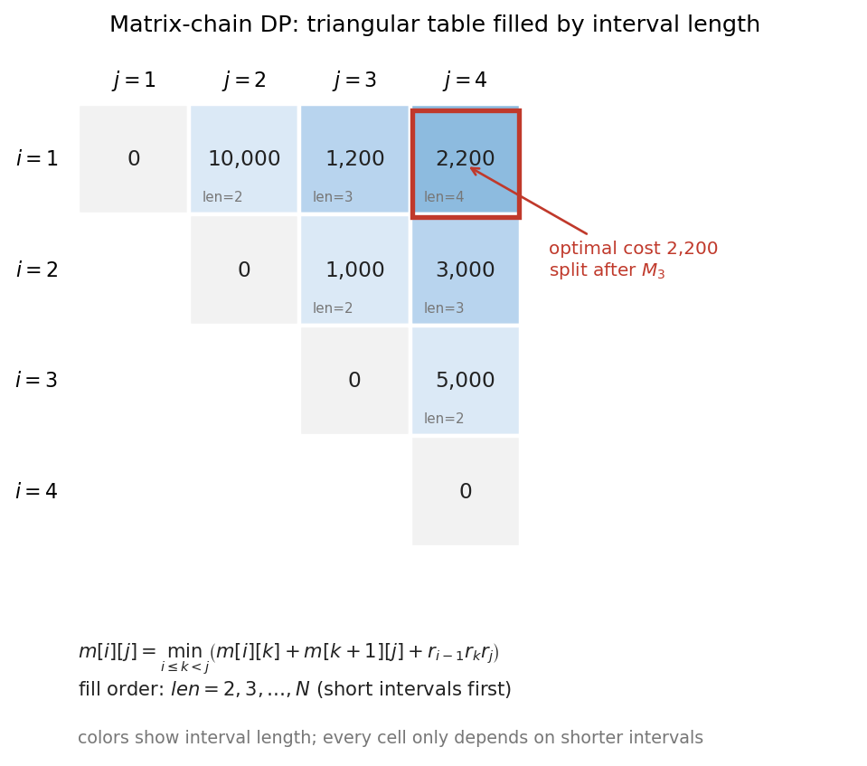
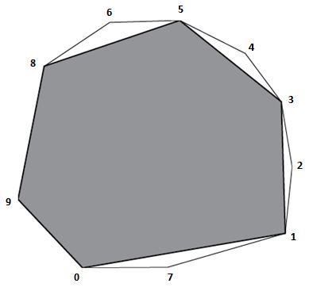

# ADS08 动态规划（dynamic programming） —— 复习笔记

> 来源：`../Materials/Student Slides/ADS08DynamicProgramming_Stu.ppt`（*Dynamic Programming*）
> 教材参考（讲义末页给出）：CLRS 3rd Ch.15 p.359–413；Weiss《Data Structures and Algorithm Analysis in C》(2nd Ed.) 的图号见各例
> 整理日期：2026-09-16
> 2026-11-03 改写为复习笔记：补上 DP 的适用条件、复杂度估算、真题题型、矩阵连乘填表、OBST 小例子、LIS / 解码计数程序模板，以及凸多边形最大内接 $n$ 边形的完整建模；新增配图 `assets/fig_dp_interval_order.png`
> 考试权重：期中范围到 DP，期中归纳占 **8.7%**；2025 陈昊卷中 DP 与回溯各约 **15.8%**；期末函数 / 编程题里 DP 有 **6 题**（归纳口径见 `../期中/README.md` 与 `../期末/README.md`）
> 说明：本文由 AI 依据讲义幻灯片、教材与历年题整理；矩阵连乘表中的数值由脚本 `assets/make_ads08_figs.py` 复算，凸多边形配图是题目原图。

## 1. 一页速览

| 问题 | 状态（state） | 转移（transition） | 典型代价 |
|---|---|---|---|
| Fibonacci | $F_n$ | $F_n=F_{n-1}+F_{n-2}$ | 朴素递归指数级；填表 $O(n)$ |
| 矩阵连乘（matrix-chain multiplication） | $m[i][j]$：$M_i\cdots M_j$ 的最优代价 | 枚举最后的分割点 $k$ | $O(n^3)$ 时间，$O(n^2)$ 空间 |
| 最优二叉搜索树（optimal binary search tree, OBST） | $c(i,j)$：区间 $w_i\cdots w_j$ 的最优期望代价 | 枚举根 $r$，左右子树代价相加 | $O(n^3)$ 时间，$O(n^2)$ 空间 |
| 全源最短路（all-pairs shortest path） | $D^{(k)}[i][j]$：只允许前 $k$ 个中间点 | 用不用顶点 $k$ | $O(n^3)$ 时间，$O(n^2)$ 空间 |
| 流水线装配（assembly-line scheduling） | $f[\text{line}][j]$：到第 $j$ 站的最短时间 | 同线继续或换线 | $O(n)$ 时间与空间 |

一句话：**动态规划不是“把递归改写成循环”，而是先证明最优解由最优子解组成，再把重复子问题的答案存起来，并按依赖顺序计算。**

复习优先级：

1. 会写 **状态定义**，能说清“这个数表示哪个前缀 / 区间 / 集合上的最优值”；
2. 会写 **转移**，尤其是“最后一步有哪几种选择”；
3. 会定 **边界**、**填表顺序**、**答案位置**；
4. 会从状态数 × 单次转移代价估复杂度；
5. 需要方案时，另开一张 `parent / split / root / next` 表重建解。

## 2. 五个经典例子

### 2.1 Fibonacci：先看清“重复计算”有多贵

讲义先用最朴素的递归（recursion）版本说明问题：

```c
int Fib( int N )
{
    if ( N <= 1 ) return 1;          /* 本讲约定 F(0)=F(1)=1 */
    else return Fib( N - 1 ) + Fib( N - 2 );
}
```

调用 `Fib(6)` 时，`Fib(4)`、`Fib(3)` 等子问题会被反复展开，递归树（recursion tree）里同一批结点出现多次。递推式是

$$T(N)=T(N-1)+T(N-2)+O(1)=\Theta(F_N),$$

也就是指数级；重复计算的增长是爆炸式的。

**改进 1：记忆化（memoization）**。递归形式不变，只是第一次算出答案后存进数组：

```c
int memo[N + 1];                     /* 先全部置 -1 */
int FibMemo( int N )
{
    if ( N <= 1 ) return 1;
    if ( memo[N] != -1 ) return memo[N];
    return memo[N] = FibMemo( N - 1 ) + FibMemo( N - 2 );
}
```

**改进 2：自底向上（bottom-up）填表**。只保留最近两个值即可：

```c
int Fibonacci( int N )
{
    int i, Last, NextToLast, Answer;
    if ( N <= 1 ) return 1;
    Last = NextToLast = 1;
    for ( i = 2; i <= N; i++ ) {
        Answer = Last + NextToLast;
        NextToLast = Last;
        Last = Answer;
    }
    return Answer;
}
```

时间 $O(N)$，空间 $O(1)$。这是 DP 的最基本形态：**子问题重叠（overlapping subproblems）**，所以“存答案”能立刻把指数级压到线性级。

> 研习室勘误（p.2–3）：这段 Fibonacci 示例采用 $F(0)=F(1)=1$ 的约定，
> 与第 1 讲（AVL 高度界）里 $F_0=0,F_1=1$ 的标准约定**不同**。引用 $F(N)$ 的具体数值前先确认用的是哪一套。

### 2.2 矩阵连乘次序（Ordering Matrix Multiplications）

给定 $n$ 个矩阵 $M_1,\dots,M_n$，其中 $M_i$ 的维度是 $r_{i-1}\times r_i$。矩阵乘法满足结合律，但不同的加括号（parenthesization）方式，标量乘法次数差很多。

【讲义】例子：

$$M_1[10\times20]\cdot M_2[20\times50]\cdot M_3[50\times1]\cdot M_4[1\times100].$$

三种算法对比：

- $M_1(M_2(M_3M_4))$：$50\cdot1\cdot100+20\cdot50\cdot100+10\cdot20\cdot100=125{,}000$；
- $((M_1M_2)(M_3M_4))$：$10\cdot20\cdot50+50\cdot1\cdot100+10\cdot50\cdot100=65{,}000$；
- $(M_1(M_2M_3))M_4$：$20\cdot50\cdot1+10\cdot20\cdot1+10\cdot1\cdot100=2{,}200$。

方案总数是 **Catalan 数（Catalan number）**，$b_n=\sum_{i=1}^{n-1}b_i b_{n-i}$，且 $b_n=\Omega(4^n/n^{1.5})$，穷举不可行。

**状态**：令 $m[i][j]$ 表示计算 $M_iM_{i+1}\cdots M_j$ 的最少标量乘法次数，$1\le i\le j\le n$。边界是 $m[i][i]=0$。

**转移**：最后一步一定是在某个 $k$（$i\le k<j$）处把区间分成左右两段：

$$m[i][j]=\min_{i\le k<j}\left\{m[i][k]+m[k+1][j]+r_{i-1}r_k r_j\right\}. \tag{1}$$

其中 $r_{i-1}r_k r_j$ 是“左段结果（$r_{i-1}\times r_k$）乘右段结果（$r_k\times r_j$）”这一次合并的代价。

**填表顺序**：$m[i][j]$ 只依赖比它短的区间，所以按区间长度

$$\text{len}=j-i+1=2,3,\dots,n$$

从小到大填。不能按行或按列随意填，否则会用到还没算的格子。



*图 1　矩阵连乘的三角表。颜色表示区间长度，$m[1][4]=2{,}200$，最优分割在 $M_3$ 之后；数值由 `assets/make_ads08_figs.py` 复算。*

完整表（只列上三角）：

| $i\backslash j$ | 1 | 2 | 3 | 4 |
|---|---:|---:|---:|---:|
| 1 | 0 | 10,000 | 1,200 | **2,200** |
| 2 |  | 0 | 1,000 | 3,000 |
| 3 |  |  | 0 | 5,000 |
| 4 |  |  |  | 0 |

从 $m[1][3]=1{,}200$（$M_1(M_2M_3)$）和 $m[4][4]=0$ 得到

$$m[1][4]=1{,}200+0+10\cdot1\cdot100=2{,}200,$$

即最优加括号为 $(M_1(M_2M_3))M_4$。

```c
/* r[0..n] 是维度数组；m、s 为 1-based 的 n+1 阶数组 */
for ( len = 2; len <= n; len++ )
    for ( i = 1; i <= n - len + 1; i++ ) {
        j = i + len - 1;
        m[i][j] = INF;
        for ( k = i; k < j; k++ ) {
            q = m[i][k] + m[k + 1][j] + r[i - 1] * r[k] * r[j];
            if ( q < m[i][j] ) {
                m[i][j] = q;
                s[i][j] = k;            /* 记录最优分割点 */
            }
        }
    }
```

需要输出加括号方案时，用 `s[i][j]` 递归重建：

```text
Print(i, j):
    if i == j: print "M_i"
    else:
        k = s[i][j]
        print "("
        Print(i, k)
        Print(k + 1, j)
        print ")"
```

时间 $O(n^3)$，空间 $O(n^2)$。**这条“按区间长度递增”的规则，也是 OBST、回文区间 DP、凸多边形 DP 的共同填表顺序。**

### 2.3 最优二叉搜索树（Optimal Binary Search Tree）

场景：$n$ 个有序关键字 $w_1<w_2<\dots<w_n$，查找概率（search probability）为 $p_i$。这是一棵**静态查找（static search）**树：不插入、不删除，只要求期望（expected value）比较次数最小。

记号：

- $w(i,j)=\sum_{k=i}^{j}p_k$，空区间 $w(i,i-1)=0$；
- $c(i,j)$：区间 $w_i\cdots w_j$ 的 OBST 的最小期望代价；
- $r(i,j)$：该区间的根；
- 空区间 $c(i,i-1)=0$。

**转移**：若根取 $r$（$i\le r\le j$），左子树包含 $i..r-1$，右子树包含 $r+1..j$。根一旦确定，左右子树的所有关键字深度都增加 1，所以期望代价要再加一遍整个区间的概率和 $w(i,j)$：

$$c(i,j)=w(i,j)+\min_{i\le r\le j}\left\{c(i,r-1)+c(r+1,j)\right\}. \tag{2}$$

$$r(i,j)=\arg\min_{i\le r\le j}\left\{c(i,r-1)+c(r+1,j)\right\}.$$

**小例子**：$p_1=0.5,p_2=0.2,p_3=0.3$。

| 区间 | $w(i,j)$ | 最优根 | $c(i,j)$ |
|---|---:|---:|---:|
| $[1,1]$ | 0.5 | 1 | 0.5 |
| $[2,2]$ | 0.2 | 2 | 0.2 |
| $[3,3]$ | 0.3 | 3 | 0.3 |
| $[1,2]$ | 0.7 | 1 | $0.7+0.2=0.9$ |
| $[2,3]$ | 0.5 | 3 | $0.5+0.2=0.7$ |
| $[1,3]$ | 1.0 | 1 | $1.0+0.7=1.7$ |

最优树是根 $w_1$，右子树根 $w_3$、$w_2$ 挂在 $w_3$ 左边；期望比较次数为 $1.7$。若根取 $w_2$，代价是 $1.0+0.5+0.3=1.8$，更大。

【讲义】的 7 个关键字例子最后得到 $c(1,7)=2.15$；完整填表数值在课件中以图形呈现，本文只引用这个结论。

**填表顺序**：同样按区间长度 $j-i+1$ 从小到大填。考试里问“OBST 的递推式该按什么顺序填表”，答案就是**按区间长度递增**，不是按行或按列。

复杂度：状态 $O(n^2)$，每个状态枚举 $O(n)$ 个根，时间 $O(n^3)$、空间 $O(n^2)$。利用四边形不等式（quadrangle inequality）可把时间降到 $O(n^2)$，拓展阅读见 §6。

### 2.4 全源最短路（All-Pairs Shortest Path）

方法 1：对每个顶点（vertex）跑一次单源最短路（single-source shortest path），按讲义口径在稠密图上是 $O(|V|^3)$。方法 2 是 Floyd–Warshall。

令 $D^{(k)}[i][j]$ 表示从 $i$ 到 $j$、**中间顶点（intermediate vertex）只允许取 $\{0,1,\dots,k\}$** 的最短路径长度；$D^{(-1)}$ 就是初始边权矩阵。转移只有两种选择：

$$D^{(k)}[i][j]=\min\left(D^{(k-1)}[i][j],\ D^{(k-1)}[i][k]+D^{(k-1)}[k][j]\right). \tag{3}$$

- 不用顶点 $k$：保留 $D^{(k-1)}[i][j]$；
- 用顶点 $k$：路径拆成 $i\to k$ 与 $k\to j$。

```c
/* D[i][j] 初始为边权；无边为 INF；D[i][i]=0 */
for ( k = 0; k < n; k++ )
    for ( i = 0; i < n; i++ )
        for ( j = 0; j < n; j++ )
            if ( D[i][k] + D[k][j] < D[i][j] )
                D[i][j] = D[i][k] + D[k][j];
```

填表顺序是 $k=0,1,\dots,n-1$：**一维一维地放开中间顶点**，不是在每个 $k$ 上“选一次就定下来”。就地更新可行，因为 `D[i][k]`、`D[k][j]` 在本轮不会再被改小（无负权环时）。

允许负权边（negative-weight edge），但不能有负权环（negative-weight cycle）。跑完后若存在 $D[i][i]<0$，就有负权环。需要路径时再维护 `next[i][j]`。

时间 $O(n^3)$、空间 $O(n^2)$。

> 研习室勘误（p.10–11）：“稠密图（dense graph）用 Floyd、稀疏图（sparse graph）用每个顶点各跑一次单源算法”这类比较要结合具体的单源算法与图表示；
> Floyd 本身的 $O(V^3)$ **不随边稀疏而改善**，不能笼统说“稀疏图上 Floyd 更快”。

### 2.5 流水线装配（Product Assembly）——DP 的设计方法论

两条装配线（assembly line），每条有 $n$ 个站（station）；第 $l$ 条线第 $j$ 站的加工时间是 $a[l][j]$，从一条线换到另一条线的转移时间是 $t[l][j]$，进入和离开也有 $e[l]$、$x[l]$。目标是最小化总装配时间。

**四步设计法**（这一页是全讲的方法论总结）：

| 步骤 | 内容 |
|---|---|
| 1. 刻画最优解的结构 | *An optimal solution contains an optimal solution of a sub-problem!* |
| 2. 递归定义最优值 | $f[l][j]$：到达第 $l$ 条线第 $j$ 站的最短时间 |
| 3. 按顺序计算 | 按站号 $j$ 从左到右，每条线只依赖前一站 |
| 4. 重构解 | 用 $L[l][j]$ 记录“从哪条线来”，从最后一站倒推 |

转移：

$$
\begin{aligned}
f[0][0]&=e[0]+a[0][0],\\
f[1][0]&=e[1]+a[1][0],\\
f[0][j]&=a[0][j]+\min\left(f[0][j-1],\ f[1][j-1]+t[1][j-1]\right),\\
f[1][j]&=a[1][j]+\min\left(f[1][j-1],\ f[0][j-1]+t[0][j-1]\right).
\end{aligned}
\tag{4}
$$

最终答案：

$$\min\left(f[0][n-1]+x[0],\ f[1][n-1]+x[1]\right).$$

```c
f[0][0] = e[0] + a[0][0];
f[1][0] = e[1] + a[1][0];
for ( j = 1; j < n; j++ ) {
    if ( f[0][j-1] <= f[1][j-1] + t[1][j-1] ) {
        f[0][j] = f[0][j-1] + a[0][j];
        L[0][j] = 0;
    } else {
        f[0][j] = f[1][j-1] + t[1][j-1] + a[0][j];
        L[0][j] = 1;
    }
    if ( f[1][j-1] <= f[0][j-1] + t[0][j-1] ) {
        f[1][j] = f[1][j-1] + a[1][j];
        L[1][j] = 1;
    } else {
        f[1][j] = f[0][j-1] + t[0][j-1] + a[1][j];
        L[1][j] = 0;
    }
}
answer = min( f[0][n-1] + x[0], f[1][n-1] + x[1] );
```

时间 $O(n)$，空间 $O(n)$；只保留前两列时可以做到 $O(1)$ 额外空间。**这就是“阶段 DP（stage DP）”的典型形态：按阶段推进，状态只保留当前阶段最好的几条线。**

【讲义】结论：能套 DP 的两条性质是 **最优子结构（optimal substructure）** 与 **重叠子问题（overlapping subproblems）**。

课堂讨论 *Discussion 11*：*When can't we apply dynamic programming?*

- 子问题不重叠：应改回分治（divide and conquer），例如归并排序（merge sort）；
- 不满足最优子结构：局部最优拼不出全局最优；
- **状态不够**：决定后续选择的“历史”没有被压进状态。最典型的反例是“带访问集合的最短路 / 旅行商问题（TSP）”：只记“当前在哪个顶点”不够，还要记“哪些顶点已经访问过”，状态变成 $(u,S)$；如果再把 $S$ 压掉，就会允许重复访问，答案不再是原问题。

## 3. 听课重点与易混点

### 3.1 三个前提

1. **最优子结构（optimal substructure）**：原问题的最优解包含子问题的最优解。矩阵连乘的最后一次分割、OBST 的左右子树、Floyd 的“用不用 $k$”都是这个结构。
2. **重叠子问题（overlapping subproblems）**：递归会反复遇到同一批子问题，存表才有收益。如果子问题互不重叠，分治更自然。
3. **状态足够**：状态必须包含影响后续决策的全部历史，常被概括为“无后效性”。状态少一维，转移就可能把不合法的解拼进来。

另外，若按自底向上填表，依赖关系必须构成有向无环图（directed acyclic graph, DAG）。只要每个状态只依赖“更短区间 / 更小下标 / 更小集合”，就存在拓扑序（topological order）；考试里问“哪个递推式不可能按某顺序填”，本质就是问依赖图有没有环。

### 3.2 复杂度怎么估

先数状态，再乘单次转移：

- 矩阵连乘：$O(n^2)$ 个状态，每个枚举 $O(n)$ 个分割点 → $O(n^3)$；
- OBST：$O(n^2)$ 个区间，每个枚举 $O(n)$ 个根 → $O(n^3)$；
- Floyd：$O(n^2)$ 个 $(i,j)$，每个 $O(1)$，但外层有 $n$ 个 $k$ → $O(n^3)$；
- 装配线：$2n$ 个状态，每个 $O(1)$ → $O(n)$；
- LIS 的朴素版：$O(n)$ 个状态，每个看前面 $O(n)$ 个 → $O(n^2)$；用二分优化到 $O(n\log n)$。

**DP 不自动等于多项式时间。** 0-1 背包（0-1 knapsack）的 $O(nW)$ 是伪多项式（pseudo-polynomial）：$W$ 是容量数值，输入若用二进制表示，$W$ 可以指数大；TSP 的 Held–Karp 算法是 $O(n^2 2^n)$，也是指数级。考试里“能被 DP 解的问题一定能在多项式时间解”是错的。

### 3.3 常见错误

| 错误 | 后果 | 修正 |
|---|---|---|
| 递归不记忆化 | 重复子问题反复展开，指数级 | 加 `memo` 或改自底向上 |
| 边界写错 | 空区间、单元素、第一站处理错 | 先把最小规模手算一遍 |
| 填表顺序错 | 用到还没算的格子 | 按区间长度 / 下标 / 集合大小递增 |
| 状态缺历史 | 把不合法路径当成合法解 | 加维度：线号、容量、访问集合、前一个位置 |
| 只算最优值 | 无法输出方案 | 另存 `split / root / parent / next` |
| 把 DP 当贪心 | 局部选择破坏全局最优 | 先验证贪心选择性质；不满足就回到 DP |
| 认为 DP 一定多项式 | 复杂度判断错误 | 看状态数是否含数值参数或指数集合 |

## 4. 复习笔记：从题面到状态

### 4.1 真题题型地图

| 题眼 | 状态 | 转移 / 做法 | 复杂度与易错点 |
|---|---|---|---|
| OBST 填表顺序 | $c(i,j)$ | 按区间长度递增，枚举根 | $O(n^3)$；不要按行填 |
| 切杆（rod cutting） | $R[n]$：长度 $n$ 的最大收益 | $R[n]=\max_{1\le i\le\min(n,M)}(P_i+R[n-i])$ | $O(NM)$；$N>M$ 时仍可切任意 $\le M$ 的段，不能写成 $R_i+R_{N-M}$ |
| 最长递增子序列（longest increasing subsequence, LIS） | $dp[i]$：以 $a_i$ 结尾的 LIS 长度 | $dp[i]=1+\max_{j<i,a_j<a_i}dp[j]$ | $O(n^2)$；二分版 $O(n\log n)$ |
| 解码计数（decoding count） | $dp[i]$：前缀 $s[0..i)$ 的解码数 | 一位合法就加 $dp[i-1]$，两位在 $10..26$ 再加 $dp[i-2]$ | $O(n)$；注意前导零 |
| Programming Contest / 0-1 背包 | $dp[s]$：得到分数 $s$ 的最少时间 | 跳过或做第 $i$ 题；分数超过目标就截到目标 | $O(nH)$；容量维要倒序 |
| Hand-made Cream / 有序配对（ordered pairing） | $dp[i][j]$：两个前缀的最大得分 | 跳过面包、跳过奶油，或配对并加 $a_i b_j$ | $O(NM)$；乘积可能为负，空选择是否允许要看题面 |
| Variable Manipulation | $dp[x]$：从 1 到 $x$ 的最少步数 | 反向看：$x$ 可由 $x-1,\dots,x-10$ 或 $x/K$ 得到 | $O(10N)$；$K=1$ 时乘法是自环 |

这张表对应期中归纳里的高频题眼：OBST 填表、切杆、DP 与递归的区别、LIS、解码计数；期末还会把 DP 包装成新的故事，所以**先写状态定义，再写转移**，不要背某一道题的代码。

### 4.2 完整建模：最大内接多边形

**题目**（课堂 *Discussion*，配图为题目原图）：给定一个凸 $N$ 边形（convex $N$-gon），从它的顶点中选 $n$ 个（假设 $3\le n\le N$），按原来的边界顺序连成一个内接 $n$ 边形（inscribed $n$-gon），使面积最大。要求用伪代码描述算法。



*图 2　题目配图：10 边形中选 6 个顶点，阴影部分为面积最大的 6 边形。原图 `image.png` 与本笔记同目录保留，这里引用的是副本 `assets/fig_best_polygon.png`。*

**第一步：把环拆成链。** 设原顶点按逆时针顺序为 $P_0,P_1,\dots,P_{N-1}$，复制一份接在后面：

$$Q_i=P_{i\bmod N},\qquad i=0,1,\dots,2N-1.$$

任何一个选出的 $n$ 边形，都可以从它的某个顶点 $i\in[0,N-1]$ 开始，写成

$$i=v_0<v_1<\dots<v_{n-1}=j<i+N.$$

复制数组的作用是让“跨过 $N-1$ 回到 0”的多边形也能写成连续下标。

**第二步：定义状态。** 令 $dp[k][i][j]$ 表示：从顶点 $i$ 开始、到顶点 $j$ 结束、共选 $k$ 个顶点（包含 $i,j$）的凸 $k$ 边形最大面积；这个多边形用边 $(j,i)$ 闭合。

**第三步：边界。** $k=2$ 时退化成一条线段，面积为 0：

$$dp[2][i][j]=0,\qquad i<j<i+N.$$

**第四步：转移。** 对 $k\ge3$，枚举倒数第二个顶点 $m$（$i+k-2\le m<j$）。把 $k$ 边形沿对角线 $(i,m)$ 分成一个 $(k-1)$ 边形和一个三角形：

$$dp[k][i][j]=\max_{m}\left\{dp[k-1][i][m]+\operatorname{Area}(Q_i,Q_m,Q_j)\right\}. \tag{5}$$

三角形面积用叉积（cross product）：

$$\operatorname{Area}(A,B,C)=\frac12\left|(B-A)\times(C-A)\right|.$$

**第五步：答案。**

$$\max_{\substack{0\le i<N\\ i+n-1\le j<i+N}}dp[n][i][j].$$

**正确性**：

1. 任取一个最优 $n$ 边形，把它的顶点按环序排列，取最小的下标 $i\in[0,N-1]$ 作为起点，则其余顶点都在 $i+1..i+N-1$ 内，且最后一个顶点 $j$ 满足 $j\ge i+n-1$。
2. 对角线 $(i,v_{n-2})$ 把 $n$ 边形分成 $(n-1)$ 边形与三角形 $(i,v_{n-2},j)$，面积正好相加；所以枚举 $m=v_{n-2}$ 时，转移能取到该最优解。
3. 对 $k$ 归纳：$k=2$ 的边界正确；若 $dp[k-1]$ 已是最优，则式 (5) 枚举所有可能的最后一个三角形，得到 $dp[k]$ 的最优值。最后对所有起点 $i$ 取最大，覆盖所有环状选择。

**伪代码**：

```text
BestPolygon(P, N, n):
    if n < 3: return 0
    Q[0..2N-1] = P[0..N-1] followed by P[0..N-1]

    for i = 0 to N-1:
        for j = i+1 to i+N-1:
            dp[2][i][j] = 0

    for k = 3 to n:
        for i = 0 to N-1:
            for j = i+k-1 to i+N-1:
                dp[k][i][j] = -infinity
                for m = i+k-2 to j-1:
                    if dp[k-1][i][m] is valid:
                        area = abs(cross(Q[i], Q[m], Q[j])) / 2
                        dp[k][i][j] = max(dp[k][i][j],
                                          dp[k-1][i][m] + area)

    answer = 0
    for i = 0 to N-1:
        for j = i+n-1 to i+N-1:
            answer = max(answer, dp[n][i][j])
    return answer
```

若需要输出选中的顶点，增加 `cut[k][i][j]` 记录式 (5) 中取到最大值的 $m$，最后从 $dp[n][i][j]$ 倒推。

复杂度：状态 $O(nN^2)$，每个状态枚举 $O(N)$ 个 $m$，时间 $O(nN^3)$，空间 $O(nN^2)$；只求面积时可以用滚动层把空间降到 $O(N^2)$，要重建方案则保留 `cut`。

**易错点**：

- 只复制数组但忘了限制 $j<i+N$，会把同一个顶点选两次；
- 起点只在 $0..N-1$ 中枚举即可，枚举 $2N$ 个起点会重复计算；
- $k=2$ 的边界要覆盖所有 $i<j<i+N$，不能只写 $j=i+1$；
- 凸多边形的顶点顺序必须按边界顺序，叉积面积才是对的；若输入是顺时针，面积取绝对值即可，但顶点顺序不能乱。

### 4.3 完整建模：Programming Contest

**题目**（期末函数题）：有 $n$ 道题，做第 $i$ 题要花 `time[i]`，得到 `score[i]` 分；可以不做。给定目标分数 `happy_score`，求达到至少这个分数所需的最少时间；做不到返回 $-1$。

这是 0-1 背包的“最小代价达到至少目标”版本。设 $H=\text{happy\_score}$，定义

$$dp[s]=\text{得到“截到 }H\text{ 的分数 }s\text{”的最少时间},\qquad 0\le s\le H.$$

初始 $dp[0]=0$，其余为 $\infty$。对每道题，倒序枚举 $s$：

$$ns=\min(H,\ s+\text{score}[i]),\qquad dp[ns]=\min\left(dp[ns],\ dp[s]+\text{time}[i]\right). \tag{6}$$

分数一旦超过 $H$ 就截到 $H$，因为超过目标的部分不再影响答案。

```c
#define INF 0x3f3f3f3f

int need_time( const int time[], const int score[], int happy_score, int n )
{
    int dp[MAXS + 1];
    int i, s, ns;

    for ( s = 0; s <= happy_score; s++ )
        dp[s] = INF;
    dp[0] = 0;

    for ( i = 0; i < n; i++ ) {
        for ( s = happy_score - 1; s >= 0; s-- ) {
            if ( dp[s] == INF ) continue;
            ns = s + score[i];
            if ( ns > happy_score ) ns = happy_score;
            if ( dp[s] + time[i] < dp[ns] )
                dp[ns] = dp[s] + time[i];
        }
    }
    return dp[happy_score] == INF ? -1 : dp[happy_score];
}
```

**样例走一遍**：`time = {84,87,78,16,94,38}`，`score = {87,93,50,22,63,28}`，`happy_score = 121`。最优解是第 2、6 题：时间 $87+38=125$，分数 $93+28=121$，输出 `125`。

**为什么倒序**：每道题只能做一次。倒序枚举 $s$ 时，$dp[s]$ 还没被本题更新，转移到 $ns>s$ 不会让同一道题被用两次；这与 0-1 背包的一维写法完全一致。

正确性用“处理完前 $i$ 道题”的归纳：每个状态要么不选第 $i$ 题（保留旧值），要么选第 $i$ 题（从某个 $s$ 转移到 $ns$）；两种选择都枚举到，取最小即可。

时间 $O(nH)$，空间 $O(H)$。

### 4.4 程序题模板：LIS 与解码计数

#### LIS：$O(n^2)$ 与 $O(n\log n)$

**状态**：$dp[i]$ 表示以 $a_i$ 结尾的最长递增子序列长度。

$$dp[i]=1+\max_{\substack{0\le j<i\\ a_j<a_i}}dp[j].$$

答案是 $\max_i dp[i]$。

```c
int lis( int a[], int n )
{
    int dp[n], i, j, ans = 0;
    for ( i = 0; i < n; i++ ) {
        dp[i] = 1;
        for ( j = 0; j < i; j++ )
            if ( a[j] < a[i] && dp[j] + 1 > dp[i] )
                dp[i] = dp[j] + 1;
        if ( dp[i] > ans ) ans = dp[i];
    }
    return ans;
}
```

$O(n\log n)$ 版本维护 `tails`：`tails[k]` 是所有长度为 $k+1$ 的递增子序列中，**最小可能的结尾值**。

```c
int lis_fast( int a[], int n )
{
    int tails[n], len = 0, i, p;
    for ( i = 0; i < n; i++ ) {
        p = lower_bound( tails, tails + len, a[i] ) - tails;
        tails[p] = a[i];
        if ( p == len ) len++;
    }
    return len;
}
```

严格递增用 `lower_bound`；非递减用 `upper_bound`。`tails` 不是实际的 LIS，只是用来求长度的“最小结尾”数组。

例子 $a=[3,1,4,1,5,9,2,6]$：

| $i$ | 1 | 2 | 3 | 4 | 5 | 6 | 7 | 8 |
|---|---:|---:|---:|---:|---:|---:|---:|---:|
| $a_i$ | 3 | 1 | 4 | 1 | 5 | 9 | 2 | 6 |
| $dp[i]$ | 1 | 1 | 2 | 1 | 3 | 4 | 2 | 4 |
| `tails` | [3] | [1] | [1,4] | [1,4] | [1,4,5] | [1,4,5,9] | [1,2,5,9] | [1,2,5,6] |

LIS 长度为 4，例如 $1,4,5,9$ 或 $1,2,5,6$。

#### 解码计数

字母 `A..Z` 映射到 `1..26`。给数字串 $s$，求解码方案数。$dp[i]$ 表示前缀 $s[0..i)$ 的方案数：

$$dp[i]=
\begin{cases}
dp[i-1], & s_{i-1}\ne\text{'0'},\\
dp[i-2], & 10\le \overline{s_{i-2}s_{i-1}}\le 26.
\end{cases}
\tag{7}
$$

两项可以同时成立，所以是相加而不是二选一。

```c
int numDecodings( char *s )
{
    int n = strlen(s), i;
    int dp[n + 1];
    if ( n == 0 ) return 0;
    dp[0] = 1;
    dp[1] = ( s[0] != '0' );
    for ( i = 2; i <= n; i++ ) {
        dp[i] = 0;
        if ( s[i - 1] != '0' ) dp[i] += dp[i - 1];
        int two = (s[i - 2] - '0') * 10 + (s[i - 1] - '0');
        if ( two >= 10 && two <= 26 ) dp[i] += dp[i - 2];
    }
    return dp[n];
}
```

例子：`"226"` → `2,2,6`、`22,6`、`2,26`，共 3 种。`"06"` → 0 种（前导零不能单独解码，`06` 也不在 `10..26` 内）。

### 4.5 从题面到代码

拿到一道 DP 题，按下面顺序写，基本不会漏：

1. **一句话状态**：`dp[...]` 表示“前 $i$ 个 / 区间 $[i,j]$ / 集合 $S$ / 容量 $s$ 上的最优值”；
2. **最后一步**：最优解的最后一次选择是什么？分割点、选不选第 $i$ 个、用不用顶点 $k$、从哪条线来；
3. **转移**：把最后一步的所有可能列出来，取 min / max / sum；
4. **边界**：空区间、单元素、容量 0、第一个站；
5. **答案**：是 $dp[n]$、$\max_i dp[i]$、$dp[1][n]$ 还是所有起点取最大；
6. **顺序与复杂度**：状态依赖谁，就按谁的顺序填；最后数状态 × 转移。

## 5. 复习要点

> 每条问题后面给出本讲对应小节；先自己回答，再点回去核对。

| # | 问题 | 本讲对应小节 | 答题要点 |
|---|---|---|---|
| 1 | DP 与分治的分界是什么？为什么重叠子问题是前提？ | [§3.1 三个前提](#31-三个前提) | 子问题重叠才值得存表；不重叠时分治更自然 |
| 2 | 矩阵连乘的递推式、填表顺序和复杂度？ | [§2.2 矩阵连乘](#22-矩阵连乘次序ordering-matrix-multiplications) | 按区间长度递增；$O(n^3)$ |
| 3 | OBST 的 $w(i,j)$ 为什么要再加一遍？ | [§2.3 OBST](#23-最优二叉搜索树optimal-binary-search-tree) | 根确定后左右子树深度整体 +1 |
| 4 | Floyd 的 $D^{(k)}$ 定义、负环判据和复杂度？ | [§2.4 全源最短路](#24-全源最短路all-pairs-shortest-path) | 中间点集合逐步放开；$D[i][i]<0$；$O(n^3)$ |
| 5 | 装配线 DP 的四个设计步骤是什么？ | [§2.5 流水线装配](#25-流水线装配product-assemblydp-的设计方法论) | 结构、递归定义、顺序计算、重构 |
| 6 | 什么时候不能套 DP？举一个“状态不够”的例子。 | [§3.1 三个前提](#31-三个前提)、[§2.5](#25-流水线装配product-assemblydp-的设计方法论) | TSP 要记 $(u,S)$；只记 $u$ 会允许重复访问 |
| 7 | LIS 的 $O(n\log n)$ 版本里 `tails` 表示什么？ | [§4.4 LIS](#44-程序题模板lis-与解码计数) | 各长度的最小结尾，不是实际 LIS |
| 8 | 解码计数为什么要同时看一位和两位？前导零怎么处理？ | [§4.4 解码计数](#44-程序题模板lis-与解码计数) | 两项可同时成立；`0` 不能单独解码 |
| 9 | 最大内接多边形的状态怎么定义？为什么要复制数组？ | [§4.2 最大内接多边形](#42-完整建模最大内接多边形) | 固定起点、终点和顶点数；复制处理环 |
| 10 | Programming Contest 为什么倒序枚举分数？ | [§4.3 Programming Contest](#43-完整建模programming-contest) | 每道题最多用一次，避免同一题重复选 |
| 11 | “DP 能解的问题一定是多项式时间”为什么错？ | [§3.2 复杂度怎么估](#32-复杂度怎么估) | 0-1 背包伪多项式；TSP 指数状态 |

### 5.1 关联知识点（跨讲 / 跨资料）

- **分治 ↔ DP**：分治要求子问题独立，DP 利用重叠；对照 [`08_ADS07_分治法与递归式.md`](08_ADS07_分治法与递归式.md#1-一页速览) 与 [§3.1](#31-三个前提)。
- **贪心 ↔ DP**：贪心要求“贪心选择性质”，不满足时回到 DP；活动选择与带权版本的对照见 [`10_ADS09_贪心算法.md` §2.3](10_ADS09_贪心算法.md#23-与-dp-的对照讲义another-look-at-dp-solution)。
- **回溯 ↔ DP**：回溯枚举解空间（solution space）并剪枝（pruning），DP 用状态压缩重复子问题；见 [`07_ADS06_回溯算法.md` §2](07_ADS06_回溯算法.md#2-核心框架)。
- **NP ↔ DP**：状态数可能指数增长（TSP 的访问集合），这也是 NP 完全性一讲里“决策问题更难”的背景；见 [`11_ADS10_NP完全性.md` §3](11_ADS10_NP完全性.md#3-np-与-np-完全)。
- **近似算法 ↔ DP**：利润太大时先舍入再 DP，见 [`12_ADS11_近似算法.md` §4.3](12_ADS11_近似算法.md#43-精确-dp-解与利润太大时的舍入rounding)。
- **OBST ↔ Huffman**：一个用已知查找概率建最优二叉搜索树，一个用频数建最优前缀码；对照 [`10_ADS09_贪心算法.md` §4](10_ADS09_贪心算法.md#4-huffman-编码huffman-codes1952)。

## 6. 来源与延伸阅读

- 讲义：`ADS08DynamicProgramming_Stu.ppt`（含讲稿备注：*decision problem is easier* 等对 NP 部分的前置铺垫）。
- 教材：CLRS 3rd Ch.15（p.359–413）；Weiss 的 Figure 10.46（p.388，矩阵连乘加括号）、10.53（p.393，Floyd 路径）、10.33（p.419，OBST 的 $O(n^2)$ 改进）。
- 拓展阅读：`../Materials/Further Reading/Efficient Dynamic Programming Using Quadrangle Inequalities.pdf`（与 OBST 的 $O(n^2)$ 改进相关）。
- 真题来源（本仓库内部资料，不随站点发布）：
  - `期中/2021题目列表 - 单选题 - ADS-ZJU-DYE2021-MID (exercise).html`：OBST 递推式与填表顺序；
  - `期中/浙江大学2015-16春夏《高级数据结构与算法分析》期中模拟练习 Apr 19, 2020.html`：切杆的递推与复杂度；
  - `期末/2016-2017-1/浙江大学2016-17春夏《高级数据结构与算法分析》期末模拟练习 Jun 19, 2020.html`：Programming Contest；
  - `期末/2018-2019-1/浙江大学2018-19春夏《高级数据结构与算法分析》期末模拟练习 Jun 17, 2020.html`：Variable Manipulation；
  - `期末/浙江大学2020-21春夏《高级数据结构与算法分析》期末模拟练习 Jun 22, 2022.html`：Hand-made Cream。
- 本讲配套的研究项目：*Research Project 3 — Beautiful Subsequence*。
- 自检脚本：`../assets/check_md_links.py`、`../assets/check_md_anchors.py`。

## 7. 待确认与边界

- 讲义中 OBST 的 7 关键字填表数值、流水线装配的例子参数在幻灯片中以图形呈现；本文只引用结论 $c(1,7)=2.15$ 与通用的四步递推，未逐格转录原图。
- `Programming Contest`、`Variable Manipulation`、`Hand-made Cream` 只按题面归纳了状态与转移，没有把原题的完整输入输出格式抄进笔记；需要时回看 §6 的题面文件。
- 期中归纳还提到“疲劳度调度”，但现有讲义与题面没有展开到可复述转移的程度；本文不猜写它的状态定义，等题面补齐后再补。
- 本文沿用索引中已记录的研习室勘误（Fibonacci 的 $F(0)=F(1)=1$ 约定、Floyd 的稠密 / 稀疏比较）；研习室第 06 章的逐条对照尚未完成。
