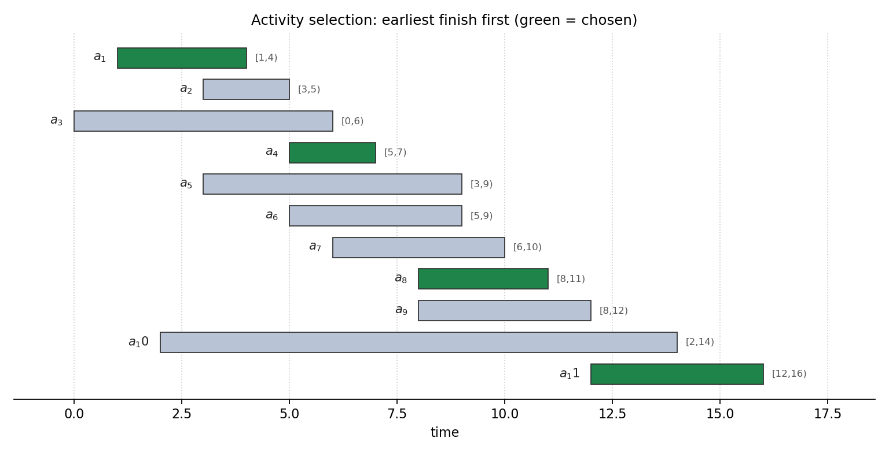
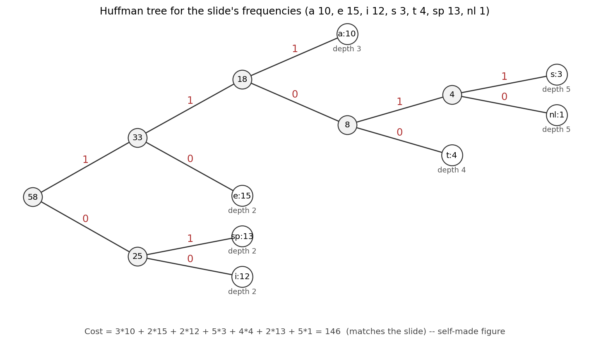

# ADS09 贪心算法（greedy algorithm）—— 复习笔记

> 来源：`../Materials/Student Slides/ADS09Greedy_Stu.ppt`（*Greedy Algorithms*）
> 教材参考（讲义末页给出）：CLRS 3rd Ch.16 p.415–437
> 整理日期：2026-09-16；2026-11-10 按期末权重改写为复习笔记
> 示意图：`assets/fig_activity_selection.png`（讲义 11 个活动，绿色为最早结束策略选出的 4 个）、
> `assets/fig_huffman_tree.png`（按讲义频数表重绘的 Huffman 树）

## 1. 一页速览

| 问题 | 讲义给的答案 |
|---|---|
| 最优化问题的三件套 | **约束（constraint）**、**目标函数（objective function）**、**可行解（feasible solution）**；使目标函数最优的可行解叫**最优解（optimal solution）** |
| 贪心法 | 每一阶段按某个**贪心准则（greedy criterion）**做“当前最好”的决定，且决定**之后不再更改**，但要保证可行性 |
| 何时有效 | **局部最优（local optimum） = 全局最优（global optimum）**时才有效；否则只能当启发式（heuristic） |
| 两个充分条件 | **贪心选择性质（greedy-choice property）**＋**最优子结构（optimal substructure）**，缺一不可 |
| 证明套路 | **交换论证（exchange argument）**：把某个最优解里的元素换成贪心选择，证明不变差；再对子问题归纳 |
| 活动选择 | 只有“**最早结束**”是对的；“最晚开始”由时间反演也正确；最早开始、最短时长、冲突最少（按原始集合静态计数）都有反例 |
| 带权活动 | 贪心失效，回到 DP：$\mathrm{OPT}(j)=\max\{\mathrm{OPT}(j-1),\,w_j+\mathrm{OPT}(p(j))\}$ |
| Huffman 编码 | 反复合并频率最小的两棵树；正确性靠两条引理；总代价 $=\sum_i d_if_i=$ **所有内部节点权重之和** |
| 贪心失效的典型 | 非**规范（canonical）**的硬币系统、0-1 背包、集合覆盖（只能近似） |
| 本讲在期末的位置 | 加权占比约 **7.4%**（322 题中 21 题：判断 12、选择 9）；高频是 **Huffman 码表判定**、**活动选择的概念判断**、**硬币找零** |

> 研习室勘误（p.3）：“贪心通常接近最优”这种说法需要**具体算法的近似比**来支撑——某些自然贪心可以任意差
> （该站的反例：带权活动 $[0,1)$ 权 1 与 $[0,2)$ 权 100，按“最早结束”选会丢掉最优解）。
> 因此本讲的每个贪心策略都要单独证明最优性（或给出近似比），不能靠直觉。
>
> 另外：课件 p.12 标 Huffman 为 1952、p.16 的故事标 1953，两处年份矛盾（研习室因此不依赖年份讲算法）；本笔记按 p.12 的 1952 记，课上可一并对照。

## 2. 活动选择问题（Activity Selection）

- 输入：活动集合 $S=\{a_1,\dots,a_n\}$，$a_i$ 占用时间区间（interval） $[s_i,f_i)$；
- **相容（compatible）**：$s_i\ge f_j$ 或 $s_j\ge f_i$（区间不重叠；端点相接算相容）；
- 目标：选出**最大规模**的互相兼容的活动子集；
- 假设：$f_1\le f_2\le\dots\le f_n$（按结束时间排好序）。

【讲义】给出的例子（$n=11$）：

| $i$ | 1 | 2 | 3 | 4 | 5 | 6 | 7 | 8 | 9 | 10 | 11 |
|---|---|---|---|---|---|---|---|---|---|---|---|
| $s_i$ | 1 | 3 | 0 | 5 | 3 | 5 | 6 | 8 | 8 | 2 | 12 |
| $f_i$ | 4 | 5 | 6 | 7 | 9 | 9 | 10 | 11 | 12 | 14 | 16 |



*图 1　讲义 11 个活动的区间图（自绘）。按“最早结束”依次选中 $a_1[1,4)$、$a_4[5,7)$、$a_8[8,11)$、$a_{11}[12,16)$，共 4 个；这也是最优规模。*

### 2.1 四条候选贪心准则（【讲义】*Discussion 12: How can we be greedy?*）

| 准则 | 结果 | 反例（区间都取 $[s,f)$） |
|---|---|---|
| 1. 选**开始最早**的（不与已选重合） | ✗ | $A=[0,10)$、$B=[1,2)$、$C=[2,3)$：先选 $A$ 只剩 1 个，最优是 $B+C=2$ |
| 2. 选**持续时间最短**的 | ✗ | $x=[1,2)$、$y=[0,1.5)$、$z=[1.5,3)$：$x$ 最短，但同时挡住 $y,z$；最优 $y+z=2$，选 $x$ 只有 1 |
| 3. 选**与其他活动冲突最少**的 | ✗（口径见下） | 7 个区间：$[0,1),[0,2),[1,4),[3,5),[4,6),[5,7),[6,7)$，静态最少冲突会选出 3 个，最优是 4 个 |
| 4. 选**结束最早**的 | ✓ | *Resource becomes free as soon as possible* |

**准则 3 的反例展开**（按“冲突数在原始活动集上算一次，之后不再重算”的常见实现）：

| 活动 | 区间 | 与之冲突的活动 | 冲突数 |
|---|---|---|---|
| A | $[0,1)$ | B | 1 |
| B | $[0,2)$ | A、C | 2 |
| C | $[1,4)$ | B、D | 2 |
| D | $[3,5)$ | C、E | 2 |
| E | $[4,6)$ | D、F | 2 |
| F | $[5,7)$ | E、G | 2 |
| G | $[6,7)$ | F | 1 |

最少冲突的是 A 或 G（各 1 个）。若先选 A，再选 G，最后只能再选 D，得到 $\{A,D,G\}$ 共 3 个；
而 $\{A,C,E,G\}$ 两两端点相接、互相相容，共 4 个，才是最优。

> 注意“冲突数”的口径：上面按**原始集合静态计数**。如果每轮都在**剩余活动**上重新计算冲突数，
> 这个准则在区间图上会变成“反复删最小度点”，结论反而可能变好；课件只写了“✗ 反例存在”，
> 没有规定哪一种实现。考试若考到，按“最早结束才是唯一正确准则”作答，细节见 §10 待确认。

（准则 1 的朴素实现是 $O(N^2)$；准则 4 排序后是 $O(N\log N)$。）

### 2.2 直观：为什么“最早结束”是安全的

“最早结束”把资源尽快释放出来：无论后面怎么选，先选一个结束更早的活动，都不会让剩余可用时间变少。
把任意最优解的第一个活动换成当前结束最早的活动，后面的活动仍然相容，解的规模不变——这就是 §2.4 交换论证的直观版本。
反过来，“最早开始”可能一开始就占住很长一段；“最短时长”可能挡住两个稍长但彼此相容的活动；“冲突最少”也没有保证剩余窗口最大。

### 2.3 与 DP 的对照（【讲义】"Another Look at DP Solution"）

DP 写法：$c_{1,j}$ 表示 $a_1..a_j$ 的最优解，$a_{k(j)}$ 是“结束在 $a_j$ 之前且与 $a_j$ 相容的最近活动”。课堂的两个问题：

- **Q1：这个 DP 还是对的吗？**（讲稿备注：**是**。）
- **Q2：贪心还是对的吗？**（讲稿备注：**否**。）——当每个活动带有**权重（weight）**时，得放弃贪心、回到 DP。

把 $p(j)$ 记成“$j$ 之前最后一个与 $a_j$ 相容的活动”的下标（$p(j)=0$ 表示没有）：

$$
\mathrm{OPT}(j)=\max\{\mathrm{OPT}(j-1),\; w_j+\mathrm{OPT}(p(j))\},\qquad \mathrm{OPT}(0)=0. \tag{1}
$$

$p(j)$ 可以在按结束时间排好序后用二分查找求得，DP 总代价 $O(n\log n)$；若用双指针扫一遍，则 $O(n)$。

**带权贪心失效的例子（权重只有 1 和 2，2017-18 判断题）**：

| 活动 | 区间 | 权重 |
|---|---|---|
| $A_1$ | $[0,10)$ | 2 |
| $A_2$ | $[10,20)$ | 2 |
| $B$ | $[0,6)$ | 1 |
| $C$ | $[6,15)$ | 1 |
| $D$ | $[15,20)$ | 1 |

按最早结束贪心会选 $B,C,D$，总权重 $3$；最优是 $A_1+A_2$，总权重 $4$。
所以“权重只在 $\{1,2\}$ 里”也不能保证贪心最优——这是“加权活动选择不能用无权重贪心”的最小反例之一。

用式 (1) 验证：按结束时间排序为 $B,A_1,C,A_2,D$，
$p(B)=0$、$p(A_1)=0$、$p(C)=B$、$p(A_2)=A_1$、$p(D)=C$，
逐项算得 $\mathrm{OPT}=1,2,2,4,4$，最优值确实是 4。

### 2.4 正确性证明（交换论证，【讲义】）

> **【定理】** 对任意非空子问题 $S_k$（$S_k=\{a_i\in S: s_i\ge f_k\}$），设 $a_m$ 是 $S_k$ 中**结束最早**的活动，
> 则 $a_m$ 一定属于 $S_k$ 的**某个**最大相容活动子集。

**证明（交换论证）**：

1. 设 $A_k$ 是 $S_k$ 的一个最大相容活动子集，$a_{ef}$ 是 $A_k$ 中**结束最早**的活动。
2. 若 $a_m=a_{ef}$，证毕。
3. 否则令 $A_k'=(A_k\setminus\{a_{ef}\})\cup\{a_m\}$。因为 $a_m$ 是 $S_k$ 中结束最早的，$f_m\le f_{ef}$。
4. 对 $A_k$ 中除 $a_{ef}$ 外的任意活动 $a_i$，由于 $a_{ef}$ 是 $A_k$ 中结束最早的，$s_i\ge f_{ef}\ge f_m$，
   所以 $a_m$ 与 $a_i$ 相容。于是 $A_k'$ 仍是相容活动子集，且 $|A_k'|=|A_k|$，也是最大解。

因此“选结束最早”是**安全**的（存在最优解包含它）；对剩余子问题反复做同样的选择，就得到全局最优。
实现时先选第一个活动，再对 $S_k$ 递归；**去掉尾递归改成迭代**后总代价 $O(N\log N)$（排序的开销）。

> **易错：** 定理说的是“属于**某个**最大解”，不是“属于**所有**最大解”。
> 2015-16 判断题就考了这个区别：$[0,1),[1,2),[2,3)$ 的三个活动中，
> 最早结束的 $[0,1)$ 属于最大解 $\{[0,1),[1,2)\}$，但不属于另一个最大解 $\{[1,2),[2,3)\}$。

**对称结论：** 把时间轴反过来，“选**最晚开始**的活动”也等价于“最早结束”，同样正确
（2016-17、2017-18 各考过一次）。但“最早开始”“最短时长”“冲突最少”都不能这样倒过来用。

### 2.5 实现与复杂度

```text
GREEDY-ACTIVITY-SELECTOR(s, f)          // 已按 f 升序，下标从 1 开始
1  n = s.length
2  A = {a_1}
3  k = 1
4  for m = 2 to n
5      if s[m] >= f[k]                  // 与最后一个被选活动相容
6          A = A ∪ {a_m}
7          k = m
8  return A
```

- 排序 $O(n\log n)$；扫描 $O(n)$；总额外空间 $O(1)$（不算输出）。
- 若输入已按结束时间排好，则 $O(n)$。
- 结束时间相同的活动可以任意排序；选出的集合可能不同，但规模相同。

### 2.6 变式：最短优先（shortest-first, SF）的 2-近似

真题（2020-21 判断题）问：按“持续时间最短”选虽然不一定最优，但能否证明它至少拿到 $|\mathrm{OPT}|/2$ 个？
答案是**能**（该判断题选 **T**），而且讲义给的 **charging scheme（记账/收费方案）** 证明是对的。

- 设 SF 的输出为 $A$，最优解为 $O$。给 $O$ 中每个活动发 1 美元；
- 若 $o\in O$ 也被 SF 选中，钱给自己；否则 $o$ 一定与某个被 SF 选中的 $a\in A$ 冲突，把钱给 $a$；
- 关键断言：**每个 $a\in A$ 最多收到 2 美元**。
  - 与 $a$ 冲突的 $o\in O$：若 $o$ 在选 $a$ 时还可用，则 $|o|\ge|a|$（$a$ 是当时最短的）；
    若 $o$ 已被更早的 $a'\in A$ 挡住，则 $o$ 同时压住 $a'$ 和 $a$，长度至少跨过两者，仍有 $|o|\ge|a|$。
  - $O$ 中活动两两相容（互不重叠），而长度都 $\ge|a|$ 的互不重叠区间最多只有 2 个能同时压住 $a$。
- 于是 $|O|\le 2|A|$，即 $|A|\ge|\mathrm{OPT}|/2$。

**紧例：** $a=[4,6)$（长 2）、$B=[0,5)$、$C=[5,10)$（各长 5）。SF 先选 $a$，之后 $B,C$ 都与 $a$ 冲突，
只得到 1 个；最优是 $\{B,C\}$ 共 2 个，比值正好 2。

> 这个证明和摊还分析里的“记账法（accounting method）”是同一个套路：把最优解的钱分摊到贪心解上，
> 只要每个贪心解元素收到的钱有常数上界，就得到常数近似比。

## 3. 贪心策略（greedy strategy）的三个要素（【讲义】*Elements of the Greedy Strategy*）

1. 把问题刻画成“**做一次选择，然后只剩一个子问题**”的形式；
2. 证明**总存在**一个最优解包含这个贪心选择（贪心选择是**安全的**）；
3. 证明**最优子结构**：做了贪心选择之后，剩下的子问题的最优解与原选择组合起来就是原问题的最优解。

【讲义】的原话提醒：*Beneath every greedy algorithm, there is almost always a more cumbersome dynamic-programming solution.*

### 3.1 交换论证的通用模板

要证“贪心选择 $g$ 属于某个最优解”，按下面五步写：

1. 取一个最优解 $O$（不要假设它包含 $g$）；
2. 在 $O$ 中找一个与 $g$ “冲突”的元素 $x$（活动选择里是 $O$ 中结束最早的活动；
   Huffman 里是最深层的某个叶子）；
3. 构造 $O'=(O\setminus\{x\})\cup\{g\}$；
4. 证明 $O'$ **可行**（相容 / 仍是前缀码 / 不超容量），且**不劣于** $O$
   （规模不变、权重不降、代价不增）；
5. 对 $g$ 之后的子问题递归使用同样的论证，得到“贪心选择 + 子问题最优 = 全局最优”。

### 3.2 贪心与 DP 的分界

| 问题 | 贪心？ | 原因 / 正确做法 |
|---|---|---|
| 无权活动选择 | ✓ | 最早结束；交换论证 |
| 带权活动选择 | ✗ | 权重改变“哪个活动值得选”；用式 (1) 的 DP |
| 分数背包（fractional knapsack） | ✓ | 按单位重量价值 $v_i/w_i$ 从大到小装，可分割 |
| 0-1 背包 | ✗ | 不能分割；用 DP（伪多项式） |
| 硬币找零 | 仅 canonical 系统 | 美国硬币、$c^k$ 进制可以；任意面额不行（见 §5.1） |
| Huffman 编码 | ✓ | 合并最小两棵；两条引理 |
| 集合覆盖 | ✗（精确） | 贪心只能给 $H(n)\le\ln n+1$ 近似（见 §5.3） |

判断口诀：**“做了这个选择，后面是不是只剩一个同型的子问题？”** 是 → 可以试贪心；
不是（要同时考虑“选/不选”两个分支）→ 大概率是 DP。

### 3.3 常见证明错误

1. **只证“局部最好”**：说“这一步选最小/最早，所以显然最优”——没有把贪心选择和某个最优解联系起来。
2. **忘了可行性**：交换后没有检查 $O'$ 仍然相容 / 仍是前缀码 / 不超容量。
3. **把“某个最优解”写成“所有最优解”**：活动选择只保证存在，不保证每个最大解都含 $a_m$。
4. **忽略平局（tie）**：Huffman 的码长、活动选择的解都可能不唯一；证明要对任意平局成立，或明确固定一种平局规则。
5. **把最优子结构当成理所当然**：Huffman 的第二条引理、带权活动的 DP 递推都要单独证。

## 4. Huffman 编码（Huffman Codes，1952）

### 4.1 从“定长”到“变长”

- 【讲义】例子：长度为 1000、只含 $a,u,x,z$ 四个字符的文本，按一字节存要 8000 bit；用 2 bit 定长编码（$a=00,u=01,x=10,z=11$）只要 2000 bit + 码表；
- 记 $f(a)=4,f(u)=1,f(x)=2,f(z)=1$，改用**变长**编码 $a=0,\ u=110,\ x=10,\ z=111$，则 `aaaxuaxz` 编码为 `00010110010111`。
- **代价公式**：若字符 $C_i$ 在编码树（**trie**）中的深度（depth）是 $d_i$、出现次数是 $f_i$，

$$
\text{Cost}=\sum_i d_i f_i. \tag{2}
$$

  定长编码（fixed-length code） Cost $=2\cdot4+2\cdot1+2\cdot2+2\cdot1=16$；
  变长编码（variable-length code） Cost $=1\cdot4+3\cdot1+2\cdot2+3\cdot1=14$。
- **能唯一解码的原因**：**没有任何一个编码是另一个编码的前缀**（*No code is a prefix of another*），
  这正是“数据只放在叶子（leaf）上”的 trie 所保证的性质。
- **Kraft 不等式**：长度 $d_1,\dots,d_n$ 能构成前缀码，当且仅当 $\sum_i 2^{-d_i}\le1$；
  最优前缀码对应的树一定是**满二叉树（full binary tree）**，此时取等号。
  若某个内部节点只有一个孩子，把它收缩掉会让所有下方叶子深度减 1、代价严格下降，矛盾。
- 注意【讲义】：若所有字符频率相同，变长编码基本不会有收益（此时 Huffman 树平衡，码长都接近 $\log n$）。

### 4.2 算法【讲义】

```c
void Huffman ( PriorityQueue heap[ ], int C )
{   /* 把 C 个字符看作 C 棵单节点树，放进最小堆 */
    for ( i = 1; i < C; i++ ) {
        create a new node;
        /* be greedy here */
        delete root from min heap and attach it to left_child of node;
        delete root from min heap and attach it to right_child of node;
        weight of node = sum of weights of its children;
        insert node into min heap;
    }
}
```

代价 $T=O(C\log C)$（每轮两次 `deleteMin` + 一次 `insert`，共 $C-1$ 轮）。

**一个重要恒等式**：Huffman 树的总代价等于**所有内部节点权重之和**。因为每次合并把两个子树的权重相加，
而每个叶子 $i$ 会为它的每个祖先内部节点贡献一次 $f_i$，正好贡献 $d_i$ 次。这个恒等式在算总代价、
写 $O(n)$ 构造和检查手算结果时都比逐叶子乘深度更快。

### 4.3 例：7 个符号的编码

【讲义】给出的频数（frequency）表（`a 10, e 15, i 12, s 3, t 4, sp 13, nl 1`，其中 `sp` 是空格、`nl` 是换行）。按频率从小到大合并：

| 轮次 | 取出的两棵 | 新节点权重 |
|---|---|---:|
| 1 | $nl(1)+s(3)$ | 4 |
| 2 | $t(4)+$ 上一轮的 4 | 8 |
| 3 | $a(10)+$ 上一轮的 8 | 18 |
| 4 | $i(12)+sp(13)$ | 25 |
| 5 | $e(15)+$ 上一轮的 18 | 33 |
| 6 | 25 + 33 | 58 |

最终总代价

$$
\text{Cost}=3\cdot10+2\cdot15+2\cdot12+5\cdot3+4\cdot4+2\cdot13+5\cdot1=146. \tag{3}
$$



*图 2　按讲义频数合并出的编码树（encoding tree）：`e`、`i`、`sp` 深度 2，`a` 深度 3，`t` 深度 4，`s`、`nl` 深度 5；代入式 (2) 得 146，与讲义一致。左右孩子（child）可以交换（swap），因此 Huffman 编码**不唯一**。*

一种合法的编码（把图 2 的左分支记 0、右分支记 1）：

| 字符 | e | i | sp | a | t | s | nl |
|---|---|---|---|---|---|---|---|
| 编码 | 10 | 00 | 01 | 110 | 1110 | 11111 | 11110 |

代入式 (2)：$2\cdot15+2\cdot12+2\cdot13+3\cdot10+4\cdot4+5\cdot3+5\cdot1=146$。
左右孩子交换或平局换序会得到别的码表，但**最优总代价不变**。

（讲义该页的“符号↔编码”标签为图片，未能从 `.ppt` 文本提取；上表是按频数表重绘的一种等价结果，深度分布与总代价 146 与讲义一致。）

### 4.4 正确性【讲义】的两条引理（lemma）

**引理 1（贪心选择性质）**：设 $x,y$ 是频率最低的两个字符，则存在一棵最优前缀码（prefix code）树，
其中 $x,y$ 的码长相同、只有最后一位不同（即是兄弟叶子，且在最深处）。

*证明（交换）*：取一棵最优树 $T$，找最深处的两个兄弟叶子 $a,b$（满二叉树一定存在）。
若 $x$ 或 $y$ 已经在最深处，直接把它当作 $a$ 或 $b$；否则 $a,b$ 都不是 $x,y$。
不妨设 $f_x\le f_y$、$f_a\le f_b$。由“$x,y$ 最低”有 $f_x\le f_a$、$f_y\le f_b$。
把 $x$ 与 $a$、$y$ 与 $b$ 交换，代价变化为

$$
\Delta=(f_a-f_x)(d_x-d_a)+(f_b-f_y)(d_y-d_b)\le0,
$$

因为 $f_a\ge f_x$、$d_x\le d_a$（$a$ 在最深处），两项都 $\le0$。交换后仍是最优树，且 $x,y$ 成了最深处的兄弟。

**引理 2（最优子结构）**：把 $x,y$ 合并成一个频率为 $f_x+f_y$ 的新字符 $z$，得到字符集 $C'$。
若 $T'$ 是 $C'$ 的最优前缀码树，则把 $z$ 的叶子替换成以 $x,y$ 为孩子的内部节点（internal node）后得到的 $T$，
是 $C$ 的最优前缀码树。

*证明（反证）*：由构造，$\text{Cost}(T)=\text{Cost}(T')+f_x+f_y$（$x,y$ 比 $z$ 深一层）。
若 $T$ 不是 $C$ 的最优树，设 $T^*$ 更优。由引理 1，可假设 $x,y$ 在 $T^*$ 中是最深处的兄弟；
把它们收缩成 $z$ 得到 $C'$ 的一棵树 $T^{*'}$，则
$\text{Cost}(T^{*'})=\text{Cost}(T^*)-(f_x+f_y)<\text{Cost}(T)-(f_x+f_y)=\text{Cost}(T')$，
与 $T'$ 的最优性矛盾。

> 两条引理合起来就是贪心策略的三要素：引理 1 保证“合并最小两个”是安全选择，
> 引理 2 保证“合并后继续贪心”得到的是原问题最优解。考试若问“为什么贪心是对的”，
> 只写“每次合并最小的，显然”是拿不到分的。

### 4.5 编码不唯一与码长不唯一

- **码表不唯一**：交换任意节点的左右孩子；遇到相同频率时先合并哪两个也有多种选法。
- **每个字符的码长也可能不唯一**（2018-19 判断题，答案是 **F**）：
  反例 $f=(1,1,1,2)$。至少两种合法的 Huffman 合并顺序会得到
  - 平衡树：四个叶子都在深度 2，码长全为 2；
  - 偏斜树：频率 2 的字符深度 1，一个 1 深度 2，另外两个 1 深度 3。
  两种树的代价都是 10（都是最优），但频率 2 的字符码长可以是 1 或 2，频率 1 的字符码长可以是 2 或 3。
  所以“码表不唯一但每个字符码长唯一”是错的。
- **最优总代价唯一**：虽然树和码长可能不同，Huffman 算法得到的 $\sum d_if_i$ 一定相同（都是最优值）。

> 判断题遇到“Huffman 码不唯一，所以码长也不唯一 / 码长一定唯一”要小心：
> 码表一定可能不唯一；码长**不一定**唯一；但最优代价一定唯一。

### 4.6 频率与码长的关系（多选真题）

题目：频率之和为 1，判断下列说法的真假。

| 说法 | 真假 | 反例 / 理由 |
|---|---|---|
| A. 频率 $\ge0.4$ 的字符绝不会用 2 位以上 | **假** | $0.4,0.2,0.2,0.2$：先合并两个 $0.2$ 得 $0.4$，再合并 $0.2$ 与原来的 $0.4$，原来的 $0.4$ 可在深度 2 |
| B. 频率 $\ge0.5$ 的字符绝不会用 2 位以上 | **真** | 其余字符总频率 $\le0.5\le p$；在只剩它和另一棵子树之前，它不会成为“最小的两个”之一，所以最后一步才合并，深度 1 |
| C. 所有频率 $<0.33$，所有字符至少 2 位 | **假** | $0.30,0.25,0.25,0.20$：合并 $0.20+0.25=0.45$，再合并 $0.25+0.45=0.70$，最后 $0.30+0.70$，$0.30$ 深度 1 |
| D. 所有频率 $<0.5$，所有字符至少 2 位 | **假** | $0.40,0.30,0.20,0.10$：合并 $0.10+0.20=0.30$，再合并 $0.30+0.30=0.60$，最后 $0.40+0.60$，$0.40$ 深度 1 |

所以只有 **B** 正确。记结论：**频率 $>0.5$ 一定 1 位；频率恰为 $0.5$ 也一定 1 位；频率 $<0.5$ 完全可能 1 位。**

**平均码长（myc 单选）**：频率 $0.32,0.25,0.20,0.18,0.05$。
合并过程：$0.05+0.18=0.23$，$0.20+0.23=0.43$，$0.25+0.32=0.57$，$0.43+0.57=1$。
深度：$0.25,0.32,0.20$ 为 2，$0.18,0.05$ 为 3。平均码长

$$
2(0.32+0.25+0.20)+3(0.18+0.05)=2.23.
$$

答案 **2.23**。

### 4.7 O(n) 双队列构造（Discussion 8）

> 题目：Suppose that all the characters are sorted by their frequencies. Can you compute the Huffman code in O(n) time?

可以。前提是字符已按频率**非降序**排好。

- 队列 $Q_1$：存放所有叶子结点，已按频率升序排列；
- 队列 $Q_2$：存放合并产生的新结点，初始为空；
- 每次从 $Q_1,Q_2$ 的队首中取两个最小频率结点，合并成新结点，频率为二者之和，并加入 $Q_2$ 队尾；
- 因为每次合并出的权值不会小于之前合并出的权值，所以 $Q_2$ 始终保持非降序；
- 重复 $n-1$ 次即可得到 Huffman 树，再遍历树分配编码。

*$Q_2$ 单调的理由*：设上一次合并出 $z$，下一次取出的两个权值为 $x,y$。
- 若 $x,y$ 都来自 $Q_2$，则 $x,y\ge z$，新权 $x+y\ge z$；
- 若只有一个来自 $Q_1$（记为 $x$），另一个来自 $Q_2$，则 $y\ge z$，而 $x>0$，仍有 $x+y\ge z$；
- 若两个都来自 $Q_1$，说明 $Q_2$ 的队首 $z$ 不比它们小（否则会先取 $z$），所以 $x+y\ge z$。

三种情况都有新权 $\ge z$，所以 $Q_2$ 单调。

```text
Q1 = sorted leaves by frequency
Q2 = empty

for i = 1 to n-1:
    x = extract_min(Q1, Q2)
    y = extract_min(Q1, Q2)
    z = new internal node with frequency x.freq + y.freq
    z.left = x
    z.right = y
    enqueue(Q2, z)

root = last created node
traverse tree to assign codes
```

`extract_min(Q1,Q2)` 只需比较两个队首，时间 $O(1)$；总共合并 $n-1$ 次，所以构造 Huffman 树为 $O(n)$。

注意：如果要求把每个字符的完整编码字符串显式输出，输出本身可能达到 $O(n^2)$（例如频率呈 Fibonacci 式增长时树会退化成链）；
但构造 Huffman 树、得到编码长度或编码树是 $O(n)$。如果频率未排序，则先排序需要 $O(n\log n)$。

## 5. 贪心失效的典型问题

### 5.1 硬币找零（coin change）

问题：用最少的硬币凑出 $n$ 分，硬币面额为正整数，最小面额是 1 分。贪心策略：每次取不超过剩余金额的最大面额。

**真题（2020-21 R2-13）的三条陈述**：

- **(I) 美国硬币 25、10、5、1：贪心总是最优。** 真。
  简证：最优解中 1 分硬币不超过 4 个（5 个 1 分换 1 个 5 分），
  5 分硬币不超过 1 个（2 个 5 分换 1 个 10 分），
  10 分硬币不超过 2 个（3 个 10 分换 25+5，2 枚换 3 枚）。
  于是小于 25 分的部分表示唯一，25 分部分也只能用 25 分硬币，正好是贪心解。
- **(II) 面额为 $c^0,c^1,\dots,c^k$（$c>1$）：贪心总是最优。** 真。
  若某个解用了 $c$ 枚 $c^j$，可换成 1 枚 $c^{j+1}$，硬币数减少；
  所以最优解在每个面额上最多用 $c-1$ 枚，这正是 $n$ 的 $c$ 进制表示，逐位取整就是贪心。
- **(III) 任意包含 1 分的 $k$ 种面额：贪心总是最优。** 假。
  反例：面额 $1,3,4$，$n=6$。贪心取 $4+1+1$（3 枚），最优是 $3+3$（2 枚）。

答案：**C（Statement (III) is false）**。

任意面额时，正确做法是 DP：

$$
dp[0]=0,\qquad dp[x]=\min_{d\le x}\{dp[x-d]+1\}. \tag{4}
$$

### 5.2 分数背包 vs 0-1 背包

- **分数背包（fractional knapsack）**：物品可以切开，按单位重量价值 $v_i/w_i$ 从大到小装，最后一件装剩余容量。
  交换论证：若最优解没有先装比值最高的物品，把等重量的低比值物品换成它，价值不降。
- **0-1 背包**：每件物品只能整件拿，上述交换不合法。反例：容量 10，
  物品 $(w,v)=(6,30),(5,20),(5,20)$。贪心按比值先拿 6（比值 5），剩 4 装不下 5，总价值 30；
  最优是两件 5，总价值 40。
- 0-1 背包是 NP 难，精确解用 DP（伪多项式）或分支限界；不要用贪心当精确算法。

### 5.3 集合覆盖（set cover）

问题：全集 $U$，一族集合 $S_1,\dots,S_m$，选最少的集合覆盖 $U$。贪心：每次选**覆盖未覆盖元素最多**的集合。

反例（贪心不是最优）：$U=\{1,\dots,6\}$，
$S_1=\{1,2,3,4\}$、$S_2=\{1,2,5\}$、$S_3=\{3,4,6\}$。
贪心先选 $S_1$（覆盖 4 个），剩下 $\{5,6\}$ 没有单个集合能同时覆盖，只能再选 $S_2$、$S_3$，共 3 个；
最优是 $S_2\cup S_3=U$，共 2 个。

近似比：设最大集合大小为 $k$，贪心的解不超过 $H(k)=1+\frac12+\dots+\frac1k\le\ln k+1$ 倍最优。
证明思路：每一步至少能覆盖“剩余元素 / OPT”个新元素，把每一步的收益按调和级数摊开。
（这条会在近似算法一讲再出现；考试若只问“能否用贪心精确求解”，答案是不能。）

## 6. 真题题型地图与例题

> 依据：`期末/README.md` 的去重统计（本仓库内部资料，不随站点发布）。
> 贪心相关共 21 题：判断 12、选择 9；加权占比 7.4%，属于期末“≥7% 要给完整例题”的一档。
> 题目集中在 **Huffman 码表/码长判定** 与 **活动选择的概念判断**，计算量不大，但概念陷阱多。
> 下面按题型去重，重复年份的同一道题只列一次；完整题号与文件位置见 §9。

### 6.1 题型地图

| 题型 | 典型问法 | 应对 |
|---|---|---|
| 概念判断 | “最早结束是否属于所有最大解？”“最晚开始是否也正确？”“加权 {1,2} 能否贪心？” | 记“某个 vs 所有”“无权 vs 带权”“时间反演” |
| Huffman 码表 | 给 4 个字符的频率/码表，问是否可能、总位数、平均码长 | 前缀码 + Kraft + 最深兄弟 + 自底向上合并 |
| Huffman 性质 | 码长是否唯一、非满树能否最优、频率与码长 | 记反例 $(1,1,1,2)$、满树收缩、$p\ge0.5$ |
| 活动选择 | 四条准则、交换论证、SF 的 2-近似 | 最早结束；最晚开始对称；SF 记账 |
| 硬币 | 哪些面额系统贪心最优 | 美国硬币、$c^k$ 可以；$1,3,4$ 不行 |

### 6.2 判断题：逐题对照

| 年份 / 题号 | 陈述（缩写） | 答案 | 关键理由 |
|---|---|---|---|
| 2015-16 1-5 | 最早结束的活动属于**所有**最大相容子集 | **F** | 只保证“某个”；反例 $[0,1),[1,2),[2,3)$ |
| 2017-18 1-1 | 持续时间最短的活动属于**某个**最大相容子集 | **F** | $x=[1,2)$ 挡住 $y=[0,1.5),z=[1.5,3)$，含 $x$ 最多 1 个 |
| 2017-18 1-12 | 开始最晚的活动属于**某个**最大相容子集 | **T** | 时间反演后就是“最早结束” |
| 2016-17 1-4 | “选开始最晚”的贪心规则正确 | **T** | 同上；与最早结束对称 |
| 2017-18 1-11 | 权重 $\{1,2\}$ 的带权活动选择可用无权贪心 | **F** | §2.3 的 $A_1,A_2$ 权 2，$B,C,D$ 权 1，贪心 3 < 最优 4 |
| 2018-19 1-10 | Huffman 码不唯一，但每个字符的码长唯一 | **F** | $(1,1,1,2)$ 有平衡树（全深 2）与偏斜树（2 深 1、两个 1 深 3） |
| 2020-21 R1-16 | 非满二叉树不能对应最优前缀码 | **T** | 单孩子内部节点可收缩，代价严格下降 |
| 2020-21 R1-26 | SF 至少拿到 $\lvert\mathrm{OPT}\rvert/2$，讲义记账证明正确 | **T** | 每个 SF 活动最多收 2 美元（§2.6） |

### 6.3 选择题：精讲

#### 6.3.1 哪个码表可能是 Huffman 码（2015-16 2-8 / 2022 R2-7）

四个字符 $a,b,c,d$ 频率互不相同，$a,b$ 频率最低。选项：

- A. `a:000, b:001, c:01, d:1`
- B. `a:000, b:001, c:01, d:11`
- C. `a:000, b:001, c:10, d:1`
- D. `a:010, b:001, c:01, d:1`

**答案 A。**

| 选项 | 判断 | 理由 |
|---|---|---|
| A | ✓ | 前缀码；Kraft 和 $=1$；$a,b$ 是最深兄弟，$c$ 是它们父节点的兄弟，正好是“先合并 $a,b$，再与 $c$ 合并，最后与 $d$ 合并”的形状 |
| B | ✗ | Kraft 和 $=1/8+1/8+1/4+1/4=3/4<1$，不是满树；最优前缀码树必须满 |
| C | ✗ | `d=1` 是 `c=10` 的前缀，不是前缀码 |
| D | ✗ | `c=01` 是 `a=010` 的前缀，不是前缀码 |

**判定流程**（考试可直接套）：
1. 先查**前缀自由**（有没有一个码是另一个的前缀）；
2. 再查 **Kraft 和是否为 1**（最优树满）；
3. 再查**两个最低频字符是否是最深处的兄弟**；
4. 最后自底向上合并，看能否复现这棵树。

#### 6.3.2 给定码表反推频率（2016-17 2-16）

$u:00,\ v:010,\ w:011,\ x:1$，求可能的 $(f_u,f_v,f_w,f_x)$。选项：
$(15,23,16,45)$、$(30,21,12,33)$、$(41,12,20,32)$、$(55,22,18,46)$。

**答案 $(30,21,12,33)$。**

从树形直接读约束：$v,w$ 是兄弟且在最深处，所以 $f_v,f_w$ 必须是**最小的两个**；
合并 $v,w$ 得到 $f_v+f_w$ 后，下一步必须与 $u$ 合并，最后与 $x$ 合并。因此还要满足

$$
f_v,f_w \text{ 是最小两个},\qquad f_u\le f_x,\qquad f_v+f_w\le f_x.
$$

逐项检查：

| 选项 | 最小两个是 $v,w$？ | $f_u\le f_x$？ | $f_v+f_w\le f_x$？ | 结论 |
|---|---|---|---|---|
| $15,23,16,45$ | ✗（$u=15<v=23$） | ✓（$15\le45$） | ✓（$39\le45$） | ✗ |
| $30,21,12,33$ | ✓（$12,21$） | ✓（$30\le33$） | ✓（$33\le33$） | ✓ |
| $41,12,20,32$ | ✓（$12,20$） | ✗（$41>32$） | ✓（$32\le32$） | ✗ |
| $55,22,18,46$ | ✓（$18,22$） | ✗（$55>46$） | ✓（$40\le46$） | ✗ |

#### 6.3.3 Huffman 总位数与等长编码相同（2017-18 两套）

方法：4 个字符的等长编码是 2 位/字符，总位数 $=2\sum f_i$；再跑 Huffman 算 $\sum d_if_i$，逐项比较。

**第一套**：$(1,1,2,4)$、$(1,2,3,4)$、$(2,2,3,3)$、$(2,2,3,4)$。

| 频率 | 一种 Huffman 树（深度） | Huffman 总位数 | 等长总位数 | 相同？ |
|---|---|---:|---:|---|
| $1,1,2,4$ | $1,1$ 深 3；$2$ 深 2；$4$ 深 1 | $3+3+4+4=14$ | 16 | ✗ |
| $1,2,3,4$ | $1,2$ 深 3；$3$ 深 2；$4$ 深 1 | $3+6+6+4=19$ | 20 | ✗ |
| $2,2,3,3$ | 两两合并成 $4,6$，四个都深 2 | $4+4+6+6=20$ | 20 | ✓ |
| $2,2,3,4$ | $2,2$ 深 3；$3$ 深 2；$4$ 深 1 | $6+6+6+4=22$ | 22 | ✓ |

答案：**$(3)$ and $(4)$**。平局可能改变深度分布（例如 $2,2,3,4$ 也可让四个叶子都在深度 2），但 Huffman 总位数不变。

**第二套**：$(1,2,2,3)$、$(1,1,1,2)$、$(2,2,3,5)$、$(1,2,3,4)$。

| 频率 | Huffman 总位数 | 等长总位数 | 相同？ |
|---|---:|---:|---|
| $1,2,2,3$ | $3+6+4+3=16$ | 16 | ✓ |
| $1,1,1,2$ | $3+3+2+2=10$ | 10 | ✓ |
| $2,2,3,5$ | $6+6+6+5=23$ | 24 | ✗ |
| $1,2,3,4$ | 19 | 20 | ✗ |

答案：**$(1)$ and $(2)$**。

> 不要只看“频率是否全相等”。$2,2,3,3$ 和 $2,2,3,4$ 都不全相等，但 Huffman 总位数刚好等于等长编码；
> 反过来，$1,2,2,3$ 也不全相等，却也相等。唯一稳妥的办法是**真的算**。

#### 6.3.4 硬币面额（2020-21 R2-13）

见 §5.1。答案 **C**：只有 (III) 错，(I)(II) 都对。

#### 6.3.5 Huffman 多选（myc 3-3）

见 §4.6。答案 **B**。

### 6.4 自测与变式

> 每题后面给出**本讲对应小节**的链接，以及可以顺带回查的**关联知识点**。

| # | 问题 | 本讲对应小节 | 关联知识点 |
|---|---|---|---|
| 1 | 用讲义的活动表验证：按“开始最早”“最短”“冲突最少（静态）”分别选，能否找到反例？ | [§2.1 四条候选贪心准则](#21-四条候选贪心准则讲义discussion-12-how-can-we-be-greedy) | 「找反例」的思维与 [`13_ADS12` §4.2 别做太小的改进](13_ADS12_局部搜索.md#42-改进一别做太小的改进big-improvement-flip) 里的近似比反例同型 |
| 2 | 复述活动选择定理的交换论证，指出哪一步用了 $f_m\le f_{ef}$。 | [§2.4 交换论证](#24-正确性证明交换论证讲义) | 通用模板见 [§3.1](#31-交换论证的通用模板) |
| 3 | 为什么带权活动选择不能贪心？写出它的 DP 递推。 | [§2.3 与 DP 的对照](#23-与-dp-的对照讲义another-look-at-dp-solution) | 带权版本的 DP 填表见 [`09_ADS08` §2.5 流水线装配](09_ADS08_动态规划.md#25-流水线装配product-assemblydp-的设计方法论) |
| 4 | 用 $a=0,u=110,x=10,z=111$ 解码 `00010110010111`，并说明前缀码的作用。 | [§4.1 从定长到变长](#41-从定长到变长) | 前缀码与压缩的动机对照 [`04_ADS03` §3.7 压缩与阈值化](04_ADS03_倒排文件索引.md#37-压缩compression与阈值化) |
| 5 | 手工执行 Huffman 算法得到图 2 的树，核对 Cost $=146$。 | [§4.2 算法](#42-算法讲义)、[§4.3 例：7 个符号的编码](#43-例7-个符号的编码) | 最小堆实现：`../Materials/Code/binheap.c`；也可对照 [`06_ADS05` §3 二项队列的五种操作](06_ADS05_二项队列.md#3-五种操作) |
| 6 | 写出 Huffman 正确性的两条引理，并说明各自用在哪一步。 | [§4.4 正确性：两条引理](#44-正确性讲义的两条引理lemma) | 与 [§2.4 交换论证](#24-正确性证明交换论证讲义) 是同一件事的两种写法 |
| 7 | 码表 `a:000,b:001,c:01,d:1` 为什么可能，`c:10,d:1` 为什么不可能？ | [§6.3.1 码表判定](#631-哪个码表可能是-huffman-码2015-16-2-8--2022-r2-7) | Kraft 不等式、满二叉树 |
| 8 | 频率 $(1,1,1,2)$ 为什么能说明“码长唯一”是错的？ | [§4.5 编码不唯一](#45-编码不唯一与码长不唯一) | 平局（tie）对码长的影响 |
| 9 | 证明 SF 至少拿到最优的一半，并给出紧例。 | [§2.6 SF 的 2-近似](#26-变式最短优先shortest-first-sf的-2-近似) | 记账法与摊还分析的记账法同型 |
| 10 | 面额 $1,3,4$ 凑 6 分，贪心为什么不是最优？ | [§5.1 硬币找零](#51-硬币找零coin-change) | 任意面额用 DP（式 4） |

## 7. 听课重点与易混点

1. **“局部最优 = 全局最优”是贪心成立的前提**；证明必须落到“存在一个最优解包含贪心选择”，不能只比较这一步。
2. **活动选择按结束时间排序**，不是开始时间、也不是长度；**最晚开始**由时间反演也正确。
3. **“某个最优解”≠“所有最优解”**：最早结束的活动只保证出现在某个最大解里。
4. **有权重时贪心失效**（讲义 Q2 的答案），要回退到 DP；权重只有 1 和 2 也一样。
5. **Huffman 的“合并最小的两个”**是贪心选择，正确性靠两条引理，不是“显然”。
6. **前缀码性质**是唯一可解码（uniquely decodable）的关键；最优前缀码树一定是满二叉树。
7. **Huffman 码表不唯一，码长也可能不唯一，但最优总代价唯一**。
8. **总代价 $=\sum d_if_i=$ 所有内部节点权重之和**；算 146 这类题时两条路可以互相校验。
9. **频率 $\ge0.5$ 一定 1 位；$<0.5$ 完全可能 1 位**；不要凭直觉说“频率大就一定短”。
10. **贪心失效的边界**：非 canonical 硬币、0-1 背包、集合覆盖；看到这三类先想 DP 或近似比。

## 8. 复习要点

- [ ] 能默写活动选择的交换论证，并指出 $f_m\le f_{ef}$ 用在哪一步。
- [ ] 能各举一个“最早开始”“最短时长”“冲突最少（静态）”的反例。
- [ ] 能区分“属于某个最大解”和“属于所有最大解”，并各举一例。
- [ ] 能写出带权活动选择的 DP 递推 (1)，并说明 $p(j)$ 怎么求。
- [ ] 能复述 SF 的 2-近似记账证明，并给出比值正好为 2 的紧例。
- [ ] 能默写 Huffman 算法、两条引理及证明主线。
- [ ] 会用“最深兄弟是最小两个”反推频率或码表（§6.3.2）。
- [ ] 会用前缀码 + Kraft + 满树判断码表是否可能（§6.3.1）。
- [ ] 会算 Huffman 总位数/平均码长，并和等长编码比较（§6.3.3、§4.6）。
- [ ] 知道 $(1,1,1,2)$ 有平衡/偏斜两种最优树、码长不唯一；知道最优总代价唯一。
- [ ] 能说出硬币 (I)(II) 为什么对、(III) 为什么错。
- [ ] 能说出 0-1 背包、集合覆盖为什么不能贪心精确求解。

### 8.1 关联知识点（跨讲 / 跨资料）

- **贪心 ↔ DP ↔ 近似算法**：贪心要求“贪心选择性质”（[§3](#3-贪心策略greedy-strategy的三个要素讲义elements-of-the-greedy-strategy)）；
  不满足时要么上 DP（[`09_ADS08` §2.5](09_ADS08_动态规划.md#25-流水线装配product-assemblydp-的设计方法论)），
  要么接受近似比（贪心给出 2-近似的例子：[`12_ADS11` §5.1 Greedy-2r](12_ADS11_近似算法.md#51-greedy-2r给定-r-的判定版decision-version)）。
- **Huffman 的两处“跨讲”用法**：本讲 [§4](#4-huffman-编码huffman-codes1952) 用最小堆合并频数；
  外部排序 [§6 归并顺序也要贪心：Huffman 树](16_ADS15_外部排序.md#6-归并顺序也要贪心huffman-树) 用同一棵树安排归并顺序——
  把两处的代价公式对照看，能看清“贪心 + 优先队列”这一范式。
- **编码与检索**：前缀码 / 变长编码的思想在倒排索引的压缩里也出现（[`04_ADS03` §3.7](04_ADS03_倒排文件索引.md#37-压缩compression与阈值化)）。
- **交换论证与摊还分析**：SF 的 2-近似用“发美元、每个贪心解元素最多收 2 美元”的记账法，
  与摊还分析的 accounting method 同型（[`02_ADS001` §5 摊还分析](02_ADS001_伸展树与摊还分析.md#5-摊还分析amortized-analysis)）。
- **集合覆盖 ↔ 近似算法**：$H(n)\le\ln n+1$ 的贪心近似是“贪心 + 近似比”的标准例子；
  与 [`12_ADS11` §3 装箱](12_ADS11_近似算法.md#3-装箱问题bin-packing) 的 Next Fit / First Fit 放在一起看。
- **教材、代码与项目**：CLRS Ch.16（p.415–437）；`../Materials/Code/binheap.c`；RP4 Huffman Codes。

## 9. 来源与延伸阅读

- 讲义：`ADS09Greedy_Stu.ppt`（含讲稿备注：*A1: Yes; A2: No.*；*Cumbersome = 笨重的*）。
- 教材：CLRS Ch.16（p.415–437）。
- 配套代码：`../Materials/Code/binheap.c`（Huffman 用的最小堆，另见 `leftheap.c`、`binomial.c` 亦可用于优先队列）。
- 本讲配套的研究项目：*Research Project 4 — Huffman Codes*（判断学生提交的编码是否为合法/最优 Huffman 编码，正因编码不唯一）。
- 真题来源（本仓库内部资料，不随站点发布）：
  - `期末/2015-2016-1/浙江大学2015-16春夏《高级数据结构与算法分析》期末模拟练习 Jun 19, 2020.html`：最早结束“所有最大解”、Huffman 码表；
  - `期末/2016-2017-1/浙江大学2016-17春夏《高级数据结构与算法分析》期末模拟练习 Jun 19, 2020.html`：最晚开始、Huffman 反推频率；
  - `期末/2017-2018-1/`、`2017-2018-2/` 与 `2018-2019-1/`、`2018-2019-2/`：最短时长、加权 {1,2}、等长编码比较、码长唯一性；
  - `期末/浙江大学2020-21春夏《高级数据结构与算法分析》期末模拟练习 Jun 22, 2022.html`：SF 的 2-近似、硬币面额、非满树；
  - `期末/myc/题目列表 - 单选题_dterm.html`、`期末/myc/题目列表 - 多选题_dterm.html`：平均码长、Huffman 频率与码长多选。
- 研习室第 09 章的 `concepts / proofs / extensions / correction / quiz` **尚未逐条对照**（按 2026-09-20 的规则，访问 GitHub Pages 前需先确认 Watt Toolkit 正在运行；本次未联网）。
- 自检脚本：`../assets/check_md_links.py`、`../assets/check_md_anchors.py`。

## 10. 待确认与边界

- 讲义中“符号↔编码”的对应标签为图片，图 2 与 §4.3 的码表是等价重绘；具体的左右孩子分配以上课课件为准。
- 课件 p.12 标 Huffman 为 1952、p.16 的故事标 1953，两处年份矛盾；本文按 p.12 记 1952。
- **“冲突最少”准则的口径**：课件只标“✗ 反例存在”，没有说明冲突数是否每轮重算。本文 §2.1 的反例按“原始集合静态计数”；
  若每轮对剩余活动重算，区间图上的最小度消去可能反而最优（这是弦图/完美消除序的性质，超出本讲范围），
  需与老师或研习室确认课件的本意。考试作答仍以“最早结束才是正确准则”为准。
- **SF 的 2-近似证明**：本文按讲义记账方案复述；如果老师要求严格证明“每个 SF 活动最多收 2 美元”，
  可参考 §2.6 的两类情况（选它时仍可用 / 被更早的 SF 挡住）以及“三个长度 $\ge|a|$ 的互不重叠区间不可能同时压住 $a$”的几何事实。
- 带权活动选择的 DP 递推 (1) 是 CLRS 口径；讲义只留了 Q1/Q2 的结论，没有展开填表，本文补了 $p(j)$ 与复杂度。
- 集合覆盖的 $H(n)$ 近似比只给结论与证明思路，完整证明留给近似算法一讲；本文的例子只说明“贪心不精确”，不构成近似比的下界。
- 本文没有把 `Materials/Code/` 中的 C 代码逐行转抄；需要看实现时按 §9 的文件名回查。
