# 计算机系统 II · 第 4 讲：流水线冒险（Pipeline Hazards）

> 来源：`../lec04-2026.pdf`（Computer Systems II 讲义，浙江大学；主讲：卢立 Li Lu；PDF 共 67 页，本讲覆盖 §4.0–§4.3）
> 整理日期：2026-10-09
> 说明：本文由 AI 依据讲义幻灯片整理，供课前预习与课后复习；只做提炼、串讲与页码对照，不添加讲义之外的结论。
> 文中 `(p.x)` 指 **PDF 页码**；带「【讲义】」的是幻灯片原文或直接提炼；带「待确认」的是讲义未写明或存在疑点之处。
> 图片：`assets/` 下 14 张图均由讲义对应页直接导出（图注注明页码），**不是**自绘插图。
> 与第 3 讲的关系：第 3 讲（§3.1–§3.4）在讲流水线数据通路与控制时已经引出三类冒险、并给出 stall / forwarding 的初步做法；
> 本讲把三类冒险**逐个展开成可实现的判定条件与预测机制**，因此与 [第 3 讲](03_第03讲_流水线冒险与控制.md) 有重叠：
> 重叠的概念段已**压缩为指向第 3 讲的链接**，本讲只保留独有的判据、机制与讲义原页。

## 0. 本讲速览

| 小节 | 页码 | 主题 | 一句话摘要 |
|---|---|---|---|
| §4.0 | p.2 | Hazard | 三类冒险总览；与 [第 3 讲 §1.1](03_第03讲_流水线冒险与控制.md#11-先问一个问题流水线能否保证每条指令都正确执行p4讲义) 是同一张幻灯片，正文不再重复。 |
| §4.1 | p.3–6 | Structural Hazard | 单存储器导致 IF 与 MEM 争用（与 [第 3 讲 §1.2](03_第03讲_流水线冒险与控制.md#12-结构冒险structural-hazardp69讲义) 重复，此处只留结论与两张讲义原页）。 |
| §4.2 | p.7–31 | Data Hazards | 转发的动机与判据（沿流水线传寄存器号、须 `RegWrite` 且 `Rd ≠ x0`）、`ForwardA/B` 的三种取值、双重冒险的修正条件、load-use 必须停一拍、带冒险检测的数据通路。 |
| §4.3 | p.32–67 | Control Hazards | 分支结果在 MEM 才知道 → 冲刷指令；把判断与目标地址提前到 ID 级；分支自身的数据冒险（1 拍 / 2 拍）；predict not taken；延迟槽与代码调度；BHT、1 位 / 2 位预测器；BTB 与取指单元。 |

**本讲主线**：第 2 讲讲「流水线为什么快」，第 3 讲讲「流水线怎么搭、以及会出错的苗头」，本讲把「出错」讲到底——
从**检测**（把寄存器号和控制信号沿流水线传下去）到**修复**（转发 / 停顿 / 冲刷 / 预测），
每一步都落成一组判定条件（如 `EX/MEM.Rd = ID/EX.Rs1`）和一张数据通路图。

---

## 1. §4.0 三类冒险总览（p.2）【讲义】

讲义这一页（p.2）就是 **Pipeline Hazards** 总览：三类冒险（结构 / 数据 / 控制）的讲义原话、成因与最小例子见
[第 3 讲 §1.1 先问一个问题：流水线能否保证每条指令都正确执行](03_第03讲_流水线冒险与控制.md#11-先问一个问题流水线能否保证每条指令都正确执行p4讲义)，
**此处不再重复**。本讲从 §4.1 起把三类冒险逐类展开成可实现的判定条件与预测机制。

---

## 2. §4.1 结构冒险（Structural Hazard，p.3–6）

结构冒险（**A required resource is busy**，需要的资源正忙）的定义、单存储器例子与两种通用解法
已在 [第 3 讲 §1.2 结构冒险](03_第03讲_流水线冒险与控制.md#12-结构冒险structural-hazardp69讲义) 讲过，**正文不重复**：
第 4 讲只是把同一件事用时间轴图（p.4 争用 → p.5 分开后无需停顿）再演示一次，并给出结论句

> **Can always solve a structural hazard by adding more hardware**（结构冒险总能用加硬件解决）。

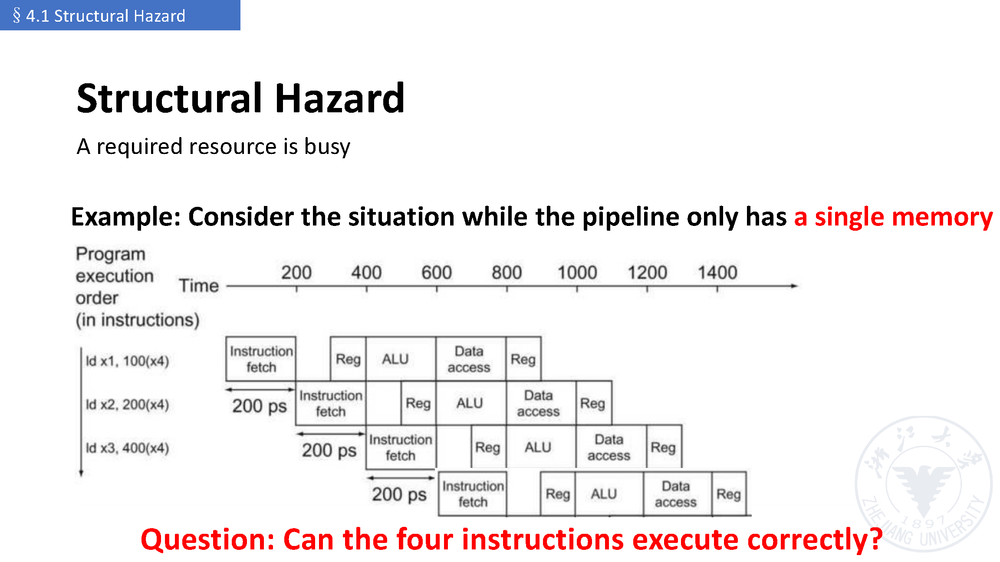

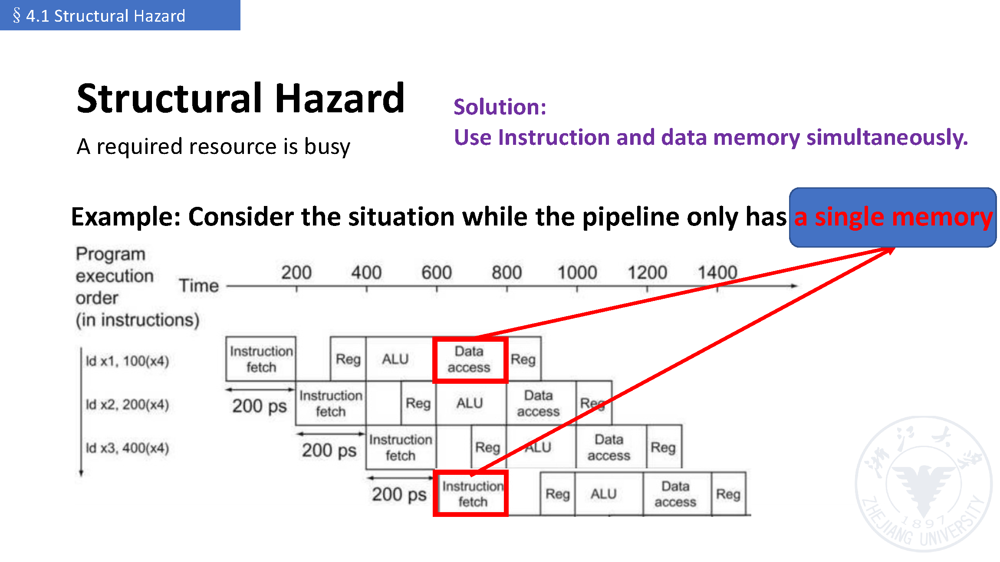

> 与第 2 讲的接口：讲义 p.47 的「访存冲突 → 哈佛结构」是同一件事的更早一次出现，见
> [第 2 讲 §2.9 访存冲突与哈佛结构](02_第02讲_流水线概念分类与性能评价.md#29-访存冲突与哈佛结构p47讲义)。

---

## 3. §4.2 数据冒险（Data Hazards，p.7–31）

### 3.1 数据冒险是什么（p.7–9）【讲义】

数据冒险的定义（**Data dependency between instructions**，要等前一条把数据读完 / 写完）、最小的
`add x1, x2, x3` / `sub x4, x1, x5` 例子，以及「转发（forwarding）＝加硬件把缺的数据提前取出来」这个基本动机，
已在 [第 3 讲 §1.3 数据冒险](03_第03讲_流水线冒险与控制.md#13-数据冒险data-hazardp1017讲义)（含
[§1.3.1 最基础例子](03_第03讲_流水线冒险与控制.md#131-最基础例子)、
[§1.3.3 forwarding / bypass](03_第03讲_流水线冒险与控制.md#133-forwarding--bypass)）讲过，**这里不重复正文**；
第 4 讲补充的是 p.9 这张转发示意图与 p.10 的新问题。

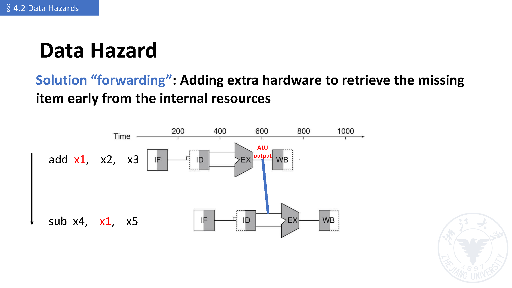

- p.10 把问题推进成一段更像真实程序的序列，并提出本节的中心问题：

```asm
sub  x2, x1, x3
and  x12, x2, x5
or   x13, x6, x2
add  x14, x2, x2
sd   x15, 100(x2)
```

  **We can resolve hazards with forwarding** —— 那 **how do we detect when to forward?**（怎么知道什么时候该转发？）

### 3.2 转发的判据：把寄存器号沿流水线传下去（p.10–14）【讲义】

检测的关键动作（p.12，与 [第 3 讲 §4.1 数据冒险如何检测](03_第03讲_流水线冒险与控制.md#41-数据冒险如何检测p7779讲义) 是同一件事）：
**pass register numbers along pipeline**，即让各级流水寄存器把寄存器号一起带着走：

- `ID/EX.Rs1` = 正待在 `ID/EX` 流水寄存器里的 `Rs1` 的寄存器号；
- EX 段的 ALU 两个操作数寄存器号就是 **`ID/EX.Rs1`、`ID/EX.Rs2`**。

于是「要转发」的条件写成四行对照（p.12）：

```text
1a. EX/MEM.Rd = ID/EX.Rs1   → 从 EX/MEM 转发（前一条是 R 型指令时它停在 EX/MEM）
1b. EX/MEM.Rd = ID/EX.Rs2   → 同上（对应第二个操作数）
2a. MEM/WB.Rd = ID/EX.Rs1   → 从 MEM/WB 转发（前一条是 load 时它停在 MEM/WB）
2b. MEM/WB.Rd = ID/EX.Rs2   → 同上（对应第二个操作数）
```

两条附加条件（p.13）——**光编号相等还不够**：

- **But only if forwarding instruction will write to a register!** → 要 `EX/MEM.RegWrite`、`MEM/WB.RegWrite` 为真；
- **And only if Rd for that instruction is not x0** → 要 `EX/MEM.Rd ≠ 0`、`MEM/WB.Rd ≠ 0`（`x0` 恒为 0，写 `x0` 不算依赖）。

p.14 给出实现位置：在 EX 段的两个输入前面各加一个多路选择器，由 **Forwarding unit** 依据
`ID/EX.Rs1`、`ID/EX.Rs2` 与流水寄存器里的 `EX/MEM.Rd`、`MEM/WB.Rd` 来选。

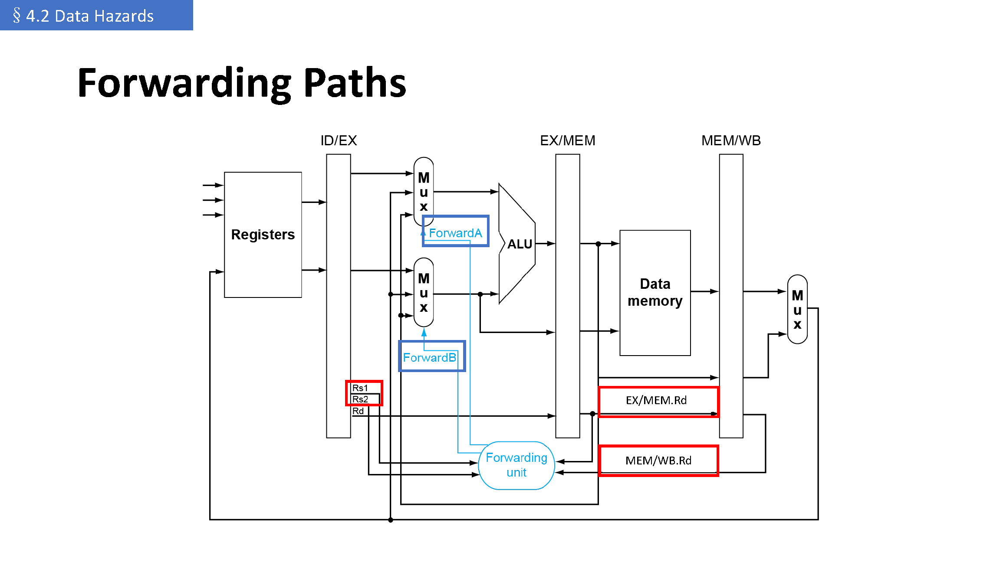

### 3.3 转发条件与 ForwardA / ForwardB（p.15–19）【讲义】

讲义的转发条件表（p.15 / p.18）：

| Mux 控制 | 数据来源 | 说明 |
|---|---|---|
| `ForwardA/B = 00` | `ID/EX` | 不转发，操作数来自寄存器堆 |
| `ForwardA/B = 10` | `EX/MEM` | 有数据冒险，从 `EX/MEM`（上一条 ALU 结果）转发 |
| `ForwardA/B = 01` | `MEM/WB` | 有数据冒险，从 `MEM/WB`（更早的 ALU 结果或数据存储器）转发 |

写成判定式（p.19）——讲义把它分成 **EX hazard** 与 **MEM hazard** 两类：

```text
EX hazard
  if (EX/MEM.RegWrite and (EX/MEM.Rd ≠ 0) and (EX/MEM.Rd = ID/EX.Rs1))  ForwardA = 10
  if (EX/MEM.RegWrite and (EX/MEM.Rd ≠ 0) and (EX/MEM.Rd = ID/EX.Rs2))  ForwardB = 10

MEM hazard
  if (MEM/WB.RegWrite and (MEM/WB.Rd ≠ 0) and (MEM/WB.Rd = ID/EX.Rs1))  ForwardA = 01
  if (MEM/WB.RegWrite and (MEM/WB.Rd ≠ 0) and (MEM/WB.Rd = ID/EX.Rs2))  ForwardB = 01
```

讲义用两页「Examples」把判定式拆开练（p.16、p.17）：
**Example 1** 的答案就是 `EX/MEM.Rd = ID/EX.Rs1`（EX hazard），**Example 2** 的答案是 `MEM/WB.Rd = ID/EX.Rs2`（MEM hazard）。


### 3.4 双重数据冒险：只转发最近的那一条（p.20–25）【讲义】

考虑这段**连续写同一个寄存器**的序列（p.20）：

```asm
add x1, x1, x2
add x1, x1, x3
add x1, x1, x4
```

- **Both hazards occur**（两条冒险同时存在）：对第三条 `add` 来说，`EX/MEM.Rd` 与 `MEM/WB.Rd` **都**等于 `x1`；
- 讲义点出目标：**Want to use the most recent**（要用**最近**那个结果，即 `EX/MEM` 里的）——
  p.21 直接在图上问「which one?」，并写 **Such an exception should be added into MEM hazards!**。
- 修正办法（p.22）：**Revise MEM hazard condition — only fwd if EX hazard condition isn't true**
  （只有 EX hazard 不成立时才做 MEM 转发），于是条件里多了一项 `not(EX hazard)`：

```text
MEM hazard（修正后）
  if (MEM/WB.RegWrite and (MEM/WB.Rd ≠ 0) and not(EX hazard) and (MEM/WB.Rd = ID/EX.Rs1))  ForwardA = 01
  if (MEM/WB.RegWrite and (MEM/WB.Rd ≠ 0) and not(EX hazard) and (MEM/WB.Rd = ID/EX.Rs2))  ForwardB = 01
```

> 直觉：`EX/MEM` 比 `MEM/WB` 更「新」，同时命中时优先用新的那条，否则会把旧值转发给指令。

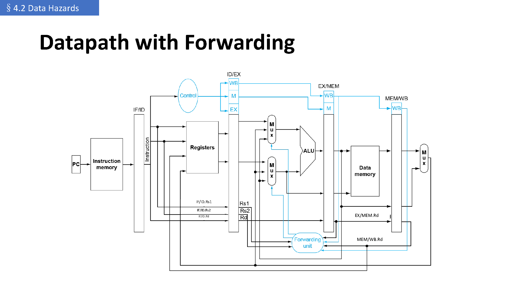

### 3.5 load-use 冒险：必须停一拍（p.26–28）【讲义】

load-use 的场景（`ld` 后紧跟要用它的指令、数据要到 MEM 段末才出来）与「必须停一拍」的结论见
[第 3 讲 §1.3.4 不能完全靠转发：Load-Use Hazard](03_第03讲_流水线冒险与控制.md#134-不能完全靠转发load-use-hazard) 与
[§4.3 对 load-use hazard 的特殊处理](03_第03讲_流水线冒险与控制.md#43-对-load-use-hazard-的特殊处理p82讲义)，**这里不重复**；
第 4 讲补的是可实现的检测式（p.27）——检测发生在**后一条指令在 ID 段译码时**：

```text
load-use hazard when
  ID/EX.MemRead and
  ((ID/EX.Rd = IF/ID.Rs1) or (ID/EX.Rd = IF/ID.Rs2))

If detected, stall and insert bubble
```

  注意这里的寄存器号取自 **ID 段**（`IF/ID.Rs1`、`IF/ID.Rs2`），因为要被停顿的那条指令此时还在 ID。

- 怎么停（p.28）：**Force control values in `ID/EX` register to 0**（让 EX、MEM、WB 三段做 `nop`）＋
  **Prevent update of PC and IF/ID register**；三件套的完整说明见
  [第 3 讲 §4.2 方式 1：stall](03_第03讲_流水线冒险与控制.md#方式-1stall)。
  结果：**1-cycle stall allows MEM to read data for ld**，之后 **can subsequently forward to EX stage**。

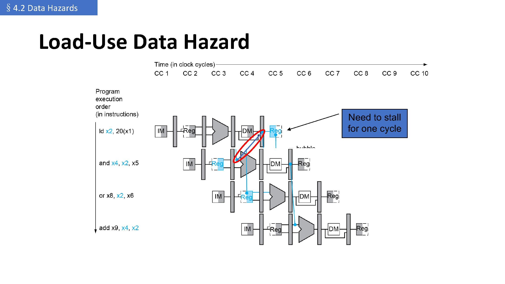

### 3.6 带冒险检测的数据通路（p.29）【讲义】

p.29 把上面的机制画成一张完整图：

- **Hazard detection unit** 接收 `ID/EX.MemRead` 以及 IF/ID 里的 `Rs1 / Rs2`、`Rd`；
- 它的输出是 **PCWrite** 与 **IF/IDWrite**（决定「PC 与 IF/ID 是否更新」）；
- 同时它把 `ID/EX` 的控制位清 0（图中 `0 →` 那个 mux），即插入 bubble；
- **Forwarding unit** 则继续按 [§3.3](#33-转发条件与-forwarda--forwardbp1519讲义) 的条件选 `ForwardA / ForwardB`。

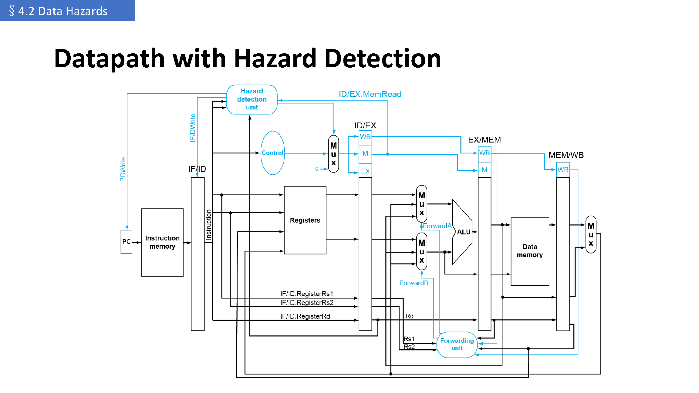

### 3.7 停顿与性能；本节小结（p.30–31）【讲义】

- p.30（Stalls and Performance）：
  - **Stalls reduce performance** —— 停顿会降低性能；
  - **But are required to get correct results** —— 但为了结果正确必须要有；
  - **Compiler can arrange code to avoid hazards and stalls**、前提是 **requires knowledge of the pipeline structure**
    —— 即「编译器重排代码」这条路，已在 [第 3 讲 §1.3.5 代码重排（reordering）](03_第03讲_流水线冒险与控制.md#135-代码重排reordering) 讲过，这里不重复。
- p.31（Summary of Data Hazards）三类要点：

| 情况 | 处理 |
|---|---|
| EX hazard & MEM hazard | 转发（forwarding） |
| Double hazard | 修正转发条件（`not(EX hazard)`） |
| Load-use hazard | 停一拍（one stall is needed），之后仍可转发 |

---

## 4. §4.3 控制冒险（Control Hazards，p.32–67）

### 4.1 问题：下一条指令是哪一条（p.32–35）【讲义】

- 定义（p.33）：**Flow of execution depends on previous instruction**；
  问题出在 **the conditional branch instruction**——流水线不可能知道下一条指令该是什么。
- 如果分支结果要到 **MEM** 段才知道（p.34），那么已经取进来、正在流水的 **3 条**指令都是错的，
  只能把它们**冲刷掉**：**Flush these instructions (set control values to 0)**，同时把 PC 拨到分支目标。
  讲义图用的例子正是 p.48 那段代码：`40: beq x1, x0, 16` 后面 `44: and`、`48: or`、`52: add` 全被冲刷，PC 指向 `72`。
- p.35 的小结与提问：分支决定控制流 → 取指依赖分支结果 → 流水线**取不到正确的指令**（因为分支还在 ID 段）；
  「等结果出来再取」的代价很大：**How many clock cycles does the stall waste?**
  讲义自答：**3 clock cycles! Almost downgrading to single-cycle CPU!**（整整 3 个周期，几乎退化回单周期 CPU）。

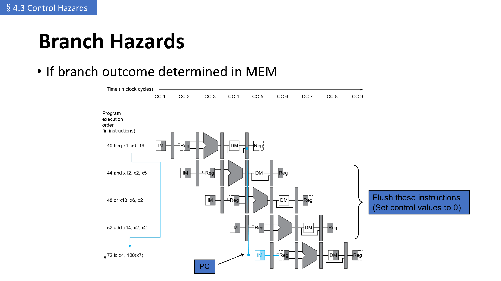

### 4.2 停顿的代价：3 个时钟周期（p.35–36）【讲义】

p.36 用两张时空表把「taken / untaken」摊开：

| 情况 | 时空图（讲义原表） |
|---|---|
| **Branch taken** | `Branch: IF ID EX MEM WB`；`Object: (空) IF stall stall IF ID EX MEM WB`；`Object+1: … IF ID EX MEM WB`；`Object+2: … IF ID EX MEM`；`Object+3: … IF ID EX` |
| **Branch untaken** | `Branch: IF ID EX MEM WB`；`subsequent: (空) IF ID EX MEM WB`；之后依次后移一格，**没有任何停顿** |

也就是说：分支**跳转**时要等结果、要冲刷；分支**不跳转**时按顺序取指，代价为零。

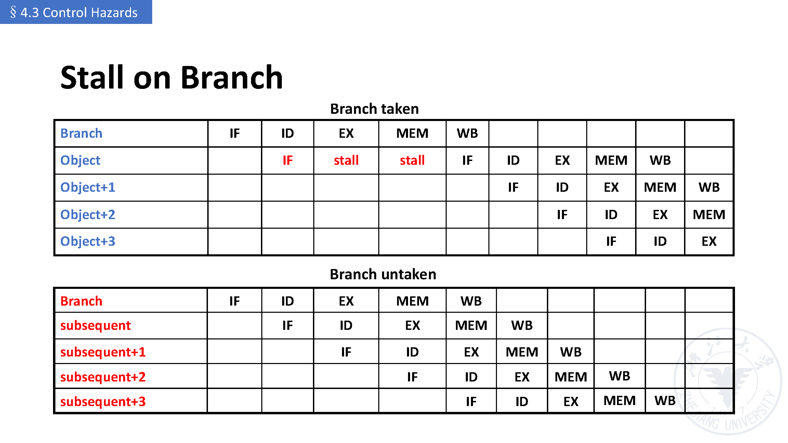

### 4.3 把判断与目标地址提前到 ID 级（p.37–38）【讲义】

既然「等」很贵，就**把硬件搬早**（p.37）：

- 关键动作是两件事：**compute the branch target address**（算目标地址）与 **judge if the branch success**（判断是否跳转）；
- 做法：**move hardware to determine outcome to ID stage**，即
  - **target address adder**（目标地址加法器）；
  - **register comparator**（寄存器比较器）。
- 讲义还留了一个反问页（p.38）：「Forwarding Branch to Earlier Stage —— **Anything wrong?**」（提前到 ID 就万事大吉了吗？）
  答案在 p.43：**No! Branch still causes a stall**（仍要停一拍），因为分支本身也可能是数据冒险的消费者。

### 4.4 分支的数据冒险：1 拍 / 2 拍（p.39–43）【讲义】

分支要比较寄存器，比较的寄存器同样可能来自前一条指令——按「离得多远」分三档（p.39–41）：

| 情形 | 代价 | 说明 |
|---|---|---|
| 比较寄存器是**前第 2 或第 3 条** ALU 指令的目的 | 0 拍 | **can resolve using forwarding**（转发即可解决） |
| 比较寄存器是**前一条** ALU 指令（或**前第 2 条** load）的目的 | **1 拍** | 需停 1 个 stall cycle |
| 比较寄存器是**紧前一条 load** 的目的 | **2 拍** | 需停 2 个 stall cycle |

讲义的例子：

```asm
# 0 拍：可纯转发
add x1, x2, x3
add x4, x5, x6
...
beq x1, x4, disp

# 1 拍：前一条 ALU
lw  x1, addr
add x4, x5, x6
beq x1, x4, disp        # beq 需 stall 1 拍

# 2 拍：紧前一条 load
lw  x1, addr
beq x1, x0, disp        # beq 需 stall 2 拍
```

p.43 的时空图给出「优化后」的结果：`Branch` 后紧跟的 `subsequent` 只被挤掉 **1 拍**（`IF` 之后要等一拍），
其余指令正常流水——比 §4.2 的 3 拍好得多，但**仍然不是 0 拍**。

### 4.5 分支预测：predict not taken（p.44–47）【讲义】

- 动机（p.44）：**longer pipelines can't readily determine branch outcome early**，停顿的代价 **becomes unacceptable**，
  于是：**predict outcome of branch**，**only stall if prediction is wrong**。
- RISC-V 的做法：**can predict branches not taken**，即先**无条件取下一条顺序指令**（fetch instruction after branch, with no delay）。
- p.45 / p.51 把可选的思路列成三条：**predict branch taken / predict branch untaken / delay branch**。
- p.46 的时空图把 taken / untaken 两种结局画在一起（taken 时后续指令要连停 4 拍，untaken 时不停）。
- p.47 是 RISC-V predict-not-taken 的两种结局：

```asm
add x4, x5, x6
beq x1, x2, 40      # 预测「不跳转」→ 按顺序取指
lw  x3, 300(x0)     # 预测正确：继续执行
```

```asm
add x4, x5, x6
beq x1, x2, 40      # 预测「不跳转」
or  x7, x8, x9      # 预测错误：这条要作废，改从目标取指
```

### 4.6 延迟槽（delay slot）与代码调度（p.48–55）【讲义】

- p.48 给出贯穿本节的例子（**PC 相对分支**，注意 `40 + 16*2 = 72`，即立即数按**字节的一半 / 2 字节**为单位）：

```asm
36: sub  x10, x4, x8
40: beq  x1, x3, 16      // PC-relative branch to 40+16*2=72
44: and  x12, x2, x5
48: or   x13, x2, x6
52: add  x14, x4, x2
56: sub  x15, x6, x7
...
72: ld   x4, 50(x7)
```

- p.52 / p.54 给出 **branch delay slot** 的时空图：分支后面那个槽位（`i+1`）一定被执行，于是
  - 若分支**失败**：`Branch delay slot i+1` 里的指令「白干」——时空图上写成 `IF idle idle idle idle`（讲义用 idle 表示空转）；
  - 若分支**成功**：槽位正好用来放目标处的第一条指令 `Object j`，**1 拍也不浪费**；
- 配套的是 **code scheduling**（p.53 是一张示意性的调度图，p.54 是其时空图）：**编译器**把有用的指令填进延迟槽，
  从而「隐藏」这一拍。
- p.55 的复习页给这套设计定性——引 **《The RISC-V Instruction Set Manual Volume I》**：

  > “A RISC-V ISA is defined as a base integer ISA, which must be present in any implementation, plus optional extensions to the base ISA.
  > The base integer ISAs are very similar to that of the early RISC processors **except with no branch delay slots** and with support for optional variable-length instruction encodings.”

  也就是说：**RISC-V 的基础整数 ISA 里没有分支延迟槽**（那个槽位是早期 RISC 的做法），
  因此讲义把 「Is delay slot a really good design?」 留成讨论题。

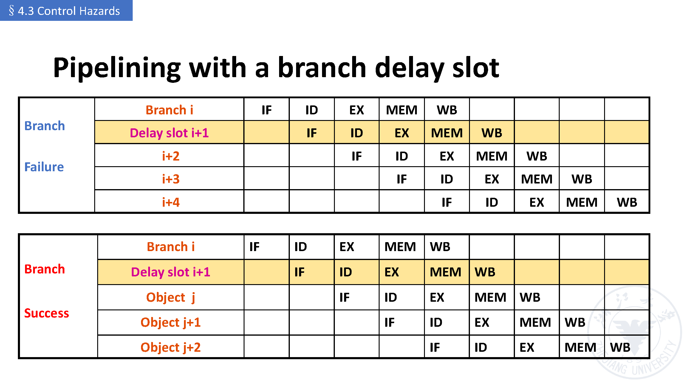

### 4.7 动态分支预测：BHT、1 位与 2 位预测器（p.56–61）【讲义】

- p.56（Dynamic Branch Prediction）：
  - **In deeper and superscalar pipelines, branch penalty is more significant** → **use dynamic prediction**；
  - 硬件叫 **branch prediction buffer**，又叫 **branch history table**；
  - **Indexed by recent branch instruction addresses**，**stores outcome (taken / not taken)**；
  - 执行一条分支时：**check table, expect the same outcome** → **start fetching from fall-through or target**；
  - **If wrong, flush pipeline and flip prediction**（错了就冲刷，并把预测位翻过来）。
- **1 位预测器**（p.57 的状态图）：只有两个状态
  `History: 1 / Predict: Success` ↔ `History: 0 / Predict: Failure`，
  成功即保持、失败即翻转（图上 `Success` 回环、`Failure` 与 `Success` 两条互转箭头）。
- **1 位预测器的缺点**（p.58）：在**循环**里会错两次——以

  ```text
  outer: …  inner: …  beq …, …, inner  …  beq …, …, outer
  ```

  为例：**mispredict as taken on last iteration of inner loop**（最后一次跳出时还以为要跳），
  紧接着 **mispredict as not taken on first iteration of inner loop next time around**（下一轮第一次进来时又以为不跳）。
- **2 位预测器**（p.59）：**only change prediction on two successive mispredictions**
  （要**连续两次**预测失败才改变预测方向），状态图变成四个状态：
  `Predict taken ↔ Predict taken ↔ Predict not taken ↔ Predict not taken`
  （深浅两档 `taken` 之间、两档 `not taken` 之间各有一条 `Taken` / `Not taken` 的自环与互转箭头）。
- 效果（p.61）：同一段双重循环，**inner loop branches mispredicted only once**（只在跳出循环时错一次，比 1 位预测器少一次）。

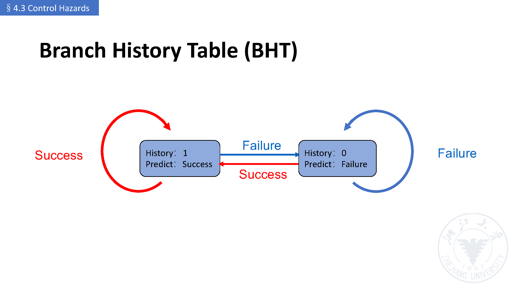

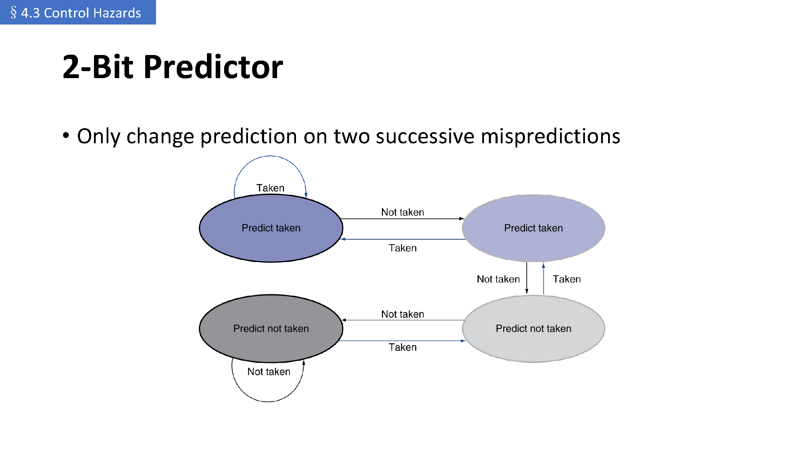

### 4.8 分支目标缓冲（BTB）与取指单元（p.62–67）【讲义】

- p.62 列出《计算机体系结构》里「指令供给与推测」的四类进阶技术：
  **increasing instruction fetch bandwidth**、**branch-target buffers**、
  **specialized branch predictors**（procedure returns、indirect jumps、loop branches）、**integrated instruction fetch units**。
- p.65–66（Calculating the Branch Target）：
  - **Even with predictor, still need to calculate the target address** —— 预测只解决「跳不跳」，不解决「跳哪里」；
  - 取一次目标地址仍有 **1-cycle penalty for a taken branch**；
  - 于是有 **branch target buffer**：**cache of target addresses**，
    **indexed by PC when instruction fetched**；**if hit and instruction is branch predicted taken, can fetch target immediately**。
- p.63 的图把这个流程画成 BTB 表 + IF/ID/EX 判定流程：
  「用 PC 查 BTB」→ 命中则直接送出 predicted PC；未命中则照常执行，并在确认是 taken branch 时把地址写入 BTB；
  预测错误则 kill 已取指令、从真正的目标重取，并从 BTB 里删除该表项；预测正确则**with no stalls**。
- p.67 给出 BTB 的收益：**get instructions at branch target faster**；
  能**一次给出目标处的多条指令**（对多发射 / multiprocessor 场景是必要的）；
  以及 **branch folding**——**可能实现无延迟的无条件跳转，有时也能无延迟地处理条件跳转**。
- p.64（Integrated Instruction Fetch Units）：一体化的取指单元把
  **integrated branch prediction**、**instruction prefetch**、**instruction memory access and buffering** 合在一起；
  讲义强调：在多发射的复杂度下，**instruction fetch as a simple single pipe stage 不再成立**。

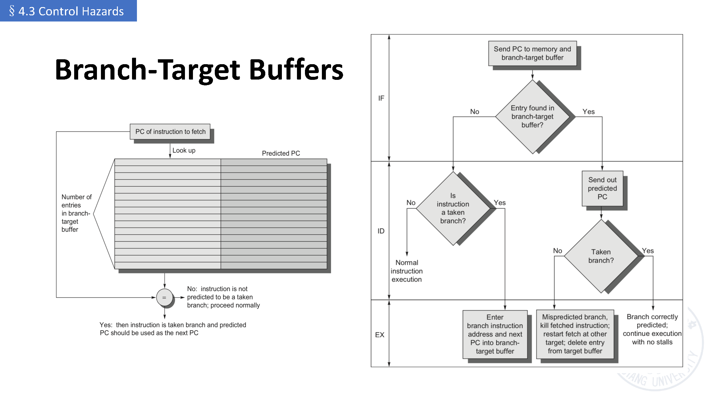

---

## 5. 听课重点与易混点

1. **三类冒险一句话记法**：结构 = 部件忙；数据 = 结果还没写回就被用；控制 = 下一条指令还不知道在哪。
2. **转发是「加法」不是「省事」**：讲义的原话是 *adding extra hardware to retrieve the missing item early*——
   转发靠**额外的硬件通路 + Forwarding unit**，不是靠改程序。
3. **转发条件的三个条件缺一不可**：编号相等（`EX/MEM.Rd = ID/EX.Rs1`）、目标寄存器**要写**（`RegWrite`）、目标**不是 `x0`**。
4. **`ForwardA/B` 的取值别记反**：`10` → 来自 **EX/MEM**（新的），`01` → 来自 **MEM/WB**（旧的），`00` → 不转发。
5. **双重冒险的修正只在 MEM hazard 上加一项 `not(EX hazard)`**：同时命中时**优先用最近（EX/MEM）**那条。
6. **load-use 是「转发救不了」的典型**：数据在 MEM 末尾才出来，所以**至少停 1 拍**；
   检测要看 `ID/EX.MemRead`，且比较的是 **ID 段**的 `IF/ID.Rs1 / IF/ID.Rs2`。
7. **停顿的三件套动作**：`ID/EX` 控制位清 0（EX/MEM/WB 变 `nop`）、PC 不更新、`IF/ID` 不更新。
8. **控制冒险的代价随「什么时候知道结果」变化**：MEM 才知道 → 冲刷 3 条（3 拍）；把判断搬到 ID → 仍要 1 拍；
   预测 + 预测正确 → 0 拍。
9. **分支自己也会遇到数据冒险**：前一条 ALU → 停 1 拍；紧前一条 load → 停 2 拍；前第 2/3 条 → 纯转发即可。
10. **静态预测只是「先猜」**：predict not taken 在 RISC-V 里就是**先按顺序取下一条**；
    猜错才冲刷并翻转预测位。
11. **1 位预测器的经典缺陷是循环边界**（进出循环各错一次），**2 位预测器靠「连续两次失败才改」**把这个代价减半。
12. **预测 ≠ 目标地址**：即使预测 taken，也还要算目标地址（taken 分支 1 拍），
    这才需要 **BTB**（按 PC 索引、缓存目标地址，命中即可立刻取指）。
13. **本讲与第 3 讲不矛盾、是加详**：第 3 讲已经出现 stall / forwarding / bubble，
    本讲把它变成可实现的判定条件与硬件单元（Forwarding unit、Hazard detection unit）。

## 6. 课前自测 / 复习清单

| # | 问题 | 回查 |
|---|---|---|
| 1 | 三类流水线冒险各是什么？各举一个本讲的例子。 | [§1 §4.0 总览](#1-40-三类冒险总览p2讲义)、[第 3 讲 §1.2 结构冒险](03_第03讲_流水线冒险与控制.md#12-结构冒险structural-hazardp69讲义) |
| 2 | 为什么「只有一块存储器」会造成冒险？两种解法分别是什么？ | [第 3 讲 §1.2 结构冒险](03_第03讲_流水线冒险与控制.md#12-结构冒险structural-hazardp69讲义)、本讲 [§2 §4.1](#2-41-结构冒险structural-hazardp36) 的两张讲义原页 |
| 3 | `add x1, x2, x3` 后接 `sub x4, x1, x5`，为什么会出错？转发把哪个信号送给了谁？ | [§3.1 数据冒险是什么](#31-数据冒险是什么p79讲义) |
| 4 | 判定「该不该转发」需要哪几类信息？写出 `ForwardA` 的 EX hazard 条件。 | [§3.2 转发的判据](#32-转发的判据把寄存器号沿流水线传下去p1014讲义)、[§3.3 转发条件](#33-转发条件与-forwarda--forwardbp1519讲义) |
| 5 | 为什么转发还要看 `RegWrite` 和 `Rd ≠ x0`？ | [§3.2 转发的判据](#32-转发的判据把寄存器号沿流水线传下去p1014讲义) |
| 6 | `ForwardA/B = 10` 与 `01` 分别从哪来？为什么不能反？ | [§3.3 转发条件](#33-转发条件与-forwarda--forwardbp1519讲义) |
| 7 | 三条连续 `add x1, x1, x?` 为什么叫双重冒险？修正办法是什么？ | [§3.4 双重数据冒险](#34-双重数据冒险只转发最近的那一条p2025讲义) |
| 8 | `ld` 后紧跟使用它的指令，为什么要停一拍？这一拍里 PC 与 IF/ID 怎么处理？ | [§3.5 load-use 冒险](#35-load-use-冒险必须停一拍p2628讲义) |
| 9 | load-use 的检测式里为什么用 `ID/EX.MemRead` 和 `IF/ID.Rs1/Rs2`？ | [§3.5 load-use 冒险](#35-load-use-冒险必须停一拍p2628讲义) |
| 10 | 带冒险检测的数据通路里，Hazard detection unit 的输出是哪两个写信号？它怎么插入 bubble？ | [§3.6 带冒险检测的数据通路](#36-带冒险检测的数据通路p29讲义) |
| 11 | 停顿为什么「必须要有」？编译器又能帮什么忙（前提是什么）？ | [§3.7 停顿与性能](#37-停顿与性能本节小结p3031讲义) |
| 12 | 分支结果在 MEM 才知道时要停几个周期？为什么要「冲刷」？ | [§4.1 问题](#41-问题下一条指令是哪一条p3235讲义)、[§4.2 停顿的代价](#42-停顿的代价3-个时钟周期p3536讲义) |
| 13 | 把分支判断搬到 ID 级需要加哪两个硬件？搬早之后为什么还是有 1 拍停顿？ | [§4.3 把判断与目标地址提前到 ID 级](#43-把判断与目标地址提前到-id-级p3738讲义)、[§4.4 分支的数据冒险](#44-分支的数据冒险1-拍--2-拍p3943讲义) |
| 14 | 分支的「数据冒险」有哪三档代价？各对应什么情形？ | [§4.4 分支的数据冒险](#44-分支的数据冒险1-拍--2-拍p3943讲义) |
| 15 | predict not taken 具体「预测」的是什么动作？猜错时发生什么？ | [§4.5 分支预测](#45-分支预测predict-not-takenp4447讲义) |
| 16 | 延迟槽在分支失败 / 成功时分别发生什么？RISC-V 为什么不用它？ | [§4.6 延迟槽与代码调度](#46-延迟槽delay-slot与代码调度p4855讲义) |
| 17 | BHT 按什么索引、存什么？1 位预测器在循环里为什么错两次？ | [§4.7 动态分支预测](#47-动态分支预测bht1-位与-2-位预测器p5661讲义) |
| 18 | 2 位预测器的状态迁移规则是什么？比 1 位好在哪里？ | [§4.7 动态分支预测](#47-动态分支预测bht1-位与-2-位预测器p5661讲义) |
| 19 | 有了分支预测，为什么还需要 BTB？BTB 命中时能省掉什么？ | [§4.8 BTB 与取指单元](#48-分支目标缓冲btb与取指单元p6267讲义) |

### 6.1 关联知识点（本讲 / 跨讲）

- **与第 3 讲（直接续接）**：本讲的检测式几乎逐条对应第 3 讲
  [§3.4 用 stall 处理流水线冒险](03_第03讲_流水线冒险与控制.md#41-数据冒险如何检测p7779讲义)（那里的 `Stall Condition Detection` 就是本讲 [§3.2](#32-转发的判据把寄存器号沿流水线传下去p1014讲义)）；
  第 3 讲的 [§3.4.3 对 load-use hazard 的特殊处理](03_第03讲_流水线冒险与控制.md#43-对-load-use-hazard-的特殊处理p82讲义)
  与 [§3.4.4 bubble 的本质](03_第03讲_流水线冒险与控制.md#44-bubble-的本质p8385讲义) 是本讲 [§3.5](#35-load-use-冒险必须停一拍p2628讲义) 的前身。
  两讲的这处**口径差异已按老师确认定在 `ID/EX`**（见待确认第 1 条，第 3 讲那页的 `EX/MEM` 已标注为旧写法）。
- **与第 3 讲的三类冒险概述**：[§1 本讲总览](#1-40-三类冒险总览p2讲义) =
  [第 3 讲 §3.1.1 Pipeline Hazards](03_第03讲_流水线冒险与控制.md#1-31-流水线概览为什么流水线会出错p224)；
  本讲 [§2 §4.1 结构冒险](#2-41-结构冒险structural-hazardp36) 用的是同一组幻灯片。
- **与第 2 讲**：
  本讲 [§2 §4.1 结构冒险](#2-41-结构冒险structural-hazardp36) 里讲义 p.5 的「指令 / 数据存储器分开」对应
  [第 2 讲 §2.9 访存冲突与哈佛结构](02_第02讲_流水线概念分类与性能评价.md#29-访存冲突与哈佛结构p47讲义)；
  本讲的冒险全都建立在 [第 2 讲 §2.4 的五级流水（IF/ID/EX/MEM/WB）](02_第02讲_流水线概念分类与性能评价.md#41-五个阶段p62讲义) 之上，
  而第 2 讲结尾的 [§2.4.5 路线图](02_第02讲_流水线概念分类与性能评价.md#45-本讲的路线图p66讲义) 指的正是本讲这三类冒险。
- **本讲内部的三条线**：
  - 数据冒险：检测（[§3.2](#32-转发的判据把寄存器号沿流水线传下去p1014讲义)）→ 条件（[§3.3](#33-转发条件与-forwarda--forwardbp1519讲义)）→ 修正（[§3.4](#34-双重数据冒险只转发最近的那一条p2025讲义)）→ 例外（[§3.5](#35-load-use-冒险必须停一拍p2628讲义)）→ 硬件（[§3.6](#36-带冒险检测的数据通路p29讲义)）；
  - 控制冒险：代价（[§4.2](#42-停顿的代价3-个时钟周期p3536讲义)）→ 提前判断（[§4.3](#43-把判断与目标地址提前到-id-级p3738讲义)、[§4.4](#44-分支的数据冒险1-拍--2-拍p3943讲义)）→ 预测（[§4.5](#45-分支预测predict-not-takenp4447讲义)）→ 动态预测（[§4.7](#47-动态分支预测bht1-位与-2-位预测器p5661讲义)）；
  - 取指侧：延迟槽与调度（[§4.6](#46-延迟槽delay-slot与代码调度p4855讲义)）→ BTB / 取指单元（[§4.8](#48-分支目标缓冲btb与取指单元p6267讲义)）。
- **讲义原件**：`../lec04-2026.pdf`（本讲 PDF）；配图清单见 [§7](#7-来源页码对照与待确认)；课程索引见 [`00_索引.md`](00_索引.md)。

## 7. 来源、页码对照与待确认

**来源**：`../lec04-2026.pdf`（Computer Systems II，浙江大学，主讲 卢立 Li Lu），第 4 讲全部 67 页（§4.0–§4.3）。

**页码对照**：

| 内容 | 页码 |
|---|---|
| §4.0 三类冒险总览 | p.2 |
| §4.1 结构冒险（问题、单存储器例子、解法） | p.3–6 |
| §4.2 数据冒险（动机、检测、转发条件、双重冒险、load-use、数据通路、小结） | p.7–31 |
| §4.3 控制冒险（冲刷、3 拍代价、搬到 ID、分支数据冒险、预测、延迟槽、动态预测、BTB） | p.32–67 |

**讲义图片导出清单**（`assets/`，均为讲义原页，非自绘）：

| 文件 | 页码 | 内容 |
|---|---|---|
| `fig_p4_structural_hazard.png` | p.4 | 结构冒险：单存储器，4 条 `ld` 的 IF 与 MEM 争用（每段 200 ps） |
| `fig_p5_structural_hazard_solution.png` | p.5 | 结构冒险的解法：指令存储器与数据存储器分开同时工作 |
| `fig_p9_data_hazard_forwarding.png` | p.9 | 转发的基本动作：`add` 的 ALU output 直接送到 `sub` 的 EX |
| `fig_p11_dependencies_forwarding.png` | p.11 | 依赖与转发：`sub / and / or / add / sd` 的时空图与转发路径 |
| `fig_p14_forwarding_paths.png` | p.14 | 转发通路：Forwarding unit、ForwardA / ForwardB、`EX/MEM.Rd`、`MEM/WB.Rd` |
| `fig_p25_datapath_forwarding.png` | p.25 | 带转发的数据通路（标注 `IF/ID.Rs1/Rs2/Rd`、`EX/MEM.Rd`、`MEM/WB.Rd`） |
| `fig_p26_load_use_stall.png` | p.26 | load-use 数据冒险：need to stall for one cycle |
| `fig_p29_datapath_hazard_detection.png` | p.29 | 带冒险检测的数据通路：Hazard detection unit + Forwarding unit |
| `fig_p34_branch_flush.png` | p.34 | 分支结果在 MEM 才知道：冲刷已取指令（set control values to 0） |
| `fig_p36_stall_on_branch.png` | p.36 | 分支停顿时空图：Branch taken / untaken 对照 |
| `fig_p52_branch_delay_slot.png` | p.52 | 分支延迟槽的时空图（失败时空转、成功时填入目标指令） |
| `fig_p57_bht_1bit.png` | p.57 | Branch History Table：1 位预测器的两个状态 |
| `fig_p59_two_bit_predictor.png` | p.59 | 2 位预测器的四个状态与迁移条件 |
| `fig_p63_branch_target_buffer.png` | p.63 | 分支目标缓冲：BTB 表与 IF / ID / EX 判定流程 |

**待确认清单**：

1. **停顿时要清零的是哪一级的流水寄存器？（已向老师确认）** 本讲 p.28 写 **Force control values in `ID/EX` register to 0**，
   而 [第 3 讲](03_第03讲_流水线冒险与控制.md#42-处理方法stall-或-forwardingp8082讲义) 的同一页（lec03 p.80–82）写的是 `EX/MEM` register。
   **确认结论：清零的是 EX 这一级所需的那组控制信号，也就是把 `ID/EX` 流水寄存器清 0，使 EX / MEM / WB 三段都做 `nop`；
   以本讲 p.28 的 `ID/EX` 为准，第 3 讲那页的 `EX/MEM` 是旧写法**（`03_…` 的对应小节已同步更正）。
2. **「3 个时钟周期」与时空图的口径不一致**：p.35 说分支停顿浪费 **3 clock cycles**，
   而 p.36 的表里 taken 情形是 `Object` 停 **2 拍**、p.43 的「优化后」只停 **1 拍**，p.46 的图里 `i+1` 连停 **4 拍**。
   四页的前提（分支结果在哪一级确定、是否把判断提前）不同，但页面本身没有写明前提，待确认。
3. **同一主题的幻灯片在讲义中反复出现且逐次加详**，本笔记按小节做了合并，页码在正文与上表中保留：
   §4.2 的双重冒险 p.20 → p.21 → p.22 与转发条件 p.15 / p.18 / p.19 / p.23 / p.24；
   §4.3 的「Reducing Branch Delay」p.45 与 p.51；p.31 与 p.55 均为 Summary / Review 页。
4. **p.21 的措辞**「Such an exception should be added into MEM hazards!」比较口语（指双重冒险要在 MEM hazard 上加例外），
   按原文记录；其正式写法见 p.23 / p.24 的条件式。
5. **p.13 用逗号连接** `EX/MEM.RegWrite , MEM/WB.RegWrite`（同页第二行用的是 `≠`），
   按上下文应是「两者都要求成立」，疑为板书简写，待确认。
6. **p.53 的 Code Scheduling 图**（画面为 `U B U / abD …` 一类字母块）为示意图，PDF 文本层无法可靠转写，
   本笔记只按 p.54 的时空图说明其含义（把有用指令填进延迟槽）。
7. **p.48 的 PC 相对分支**写作 `40+16*2=72`，即立即数按 2 字节为单位缩放；RISC-V 实际实现里分支立即数本身已左移 1 位，
   这里的 `*2` 与讲义原文一致，按原文记录（第 1 讲 [§4 指令格式](01_第01讲_课程介绍与ISA设计原理.md) 可对照）。
8. **p.44 / p.47 的「predict not taken」**与 p.45 / p.51 的「predict branch taken / untaken」是同一组选项的两种表述，
   讲义未说明 RISC-V 的默认预测器到底是哪一档（讲 p.44 说 can predict not taken），待确认。
