# 计算机系统 II · 第 5 讲：非线性流水线调度与多发射（Multiple Issue）

> 来源：`../lec05.pptx`（Computer Systems II 讲义，浙江大学；主讲：卢立 Li Lu；共 78 张幻灯片，本讲覆盖 §5.1 与 §5.2）
> 整理日期：2026-10-17
> 说明：本文由 AI 依据讲义幻灯片整理，供课前预习与课后复习；只做提炼、串讲与页码对照，不添加讲义之外的结论。
> 文中 `(s.x)` 指 **PPTX 幻灯片页码**（第 x 张），与 PDF 讲义的 `(p.x)` 区分；`【讲义】` 为幻灯片原文或直接提炼，`【备注】` 为讲稿备注页，`整理者注` 为整理时的推导或补算（已在文中标明）。
> 图片：`assets/fig_s*.png` 均由幻灯片整页导出（1600×900，白底、正立），**不是**自绘插图，图注注明来源页。
> 与前后讲的关系：第 2 讲 §3.4 只把「线性 / 非线性」作为分类提了一句（见 [第 2 讲 §3.4 线性 / 非线性](02_第02讲_流水线概念分类与性能评价.md#34-线性--非线性p5859讲义)），本讲前半把它**做成一套可执行的调度算法**；第 3、4 讲解决「一条流水线如何正确运行」，本讲后半解决「一个周期如何启动多条指令」，两者在**冒险检测**处接上。

## 0. 本讲速览

| 小节 | 幻灯片 | 主题 | 一句话摘要 |
|---|---|---|---|
| §5.1 | s.2–12 | 非线性流水线的调度问题 | 线性 = 无反馈、每段最多流过一次；非线性 = 有反馈回路、同一任务可多次使用同一段。用**预约表**描述占用，用「下一个任务何时送入」描述调度；固定间隔总会在某个倍数上撞段。 |
| §5.2（前半） | s.13–24 | 非线性流水线的调度方法 | 五步法：预约表 → **禁止表 F** → **初始冲突向量 C₀** → **冲突向量递推** → **状态图** → **循环队列**；本例最优为 3、4 交替，平均启动间隔 **3.5 拍**。 |
| §5.2（后半） | s.25–78 | 多发射（Multiple Issue） | 提高 ILP 的两条路（加深流水 / 多发射）；静态 vs 动态、超标量 vs VLIW vs 超流水；RISC-V 静态双发射的打包、冒险与循环展开；Tomasulo 双发射例题；乱序执行、寄存器重命名、推测；A53 / Core i7 实例与性能。 |

**本讲主线**：
前半段回答「**一条非线性流水线，任务该隔几拍送入**」——先承认试错（s.7–12）不行，再把问题化成一张**冲突向量**的有限状态机，用图中的**环**枚举所有可循环的调度，取平均间隔最小者。
后半段换问题：「**一个周期能不能启动多条指令**」——单发射 CPI ≥ 1，多发射要让 CPI < 1（改用 IPC 衡量）；发射条数由编译器固定（VLIW）还是由硬件每拍决定（超标量），决定了冒险由谁检测、调度在编译期还是运行期完成。

---

## 1. §5.1 非线性流水线的调度问题（s.2–12）

### 1.1 线性 vs 非线性（s.3–4）【讲义】

- **线性流水线（linear pipelining）**：各段**串行连接、没有反馈回路**；数据流过每段时，**每段最多只流过一次**。
- **非线性流水线（nonlinear pipelining）**：除串行连接外，还存在**反馈回路（feedback loop）**。
- 由此产生的**调度问题（scheduling problem）**，讲义原话是：

> **Determine when to introduce a new task to the pipelining, so that the task will not conflict with the task previously entering the pipelining.**
> （决定何时把新任务送入流水线，使它不与先前进入流水线的任务冲突。）

「冲突」的具体含义是：**同一个功能段在同一拍被两个任务同时占用**。

> 第 2 讲的分类只到这里为止（[第 2 讲 §3.4](02_第02讲_流水线概念分类与性能评价.md#34-线性--非线性p5859讲义) 给出过一张带反馈与 `Exit` 的结构图）；本节开始讲**怎么排**。

### 1.2 一个 4 段非线性流水线与它的预约表（s.5–6）【讲义】

讲义的例子是一条 4 段流水线 S1–S4，带三条反馈回路（S1 的输出回送 S1、S2 的输出回送 S1、S4 的输出回送 S1），入口 `In`、出口 `Out`：

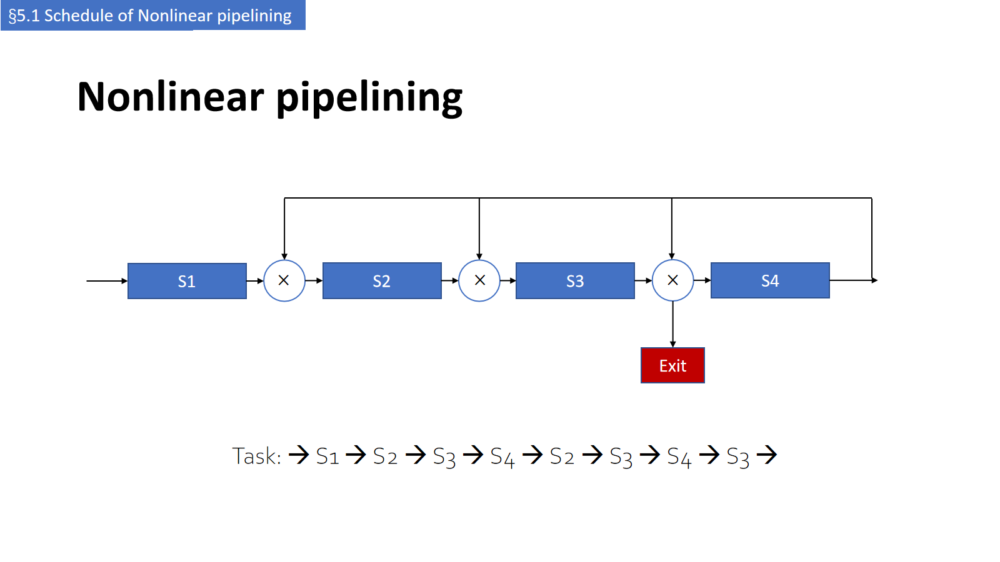

幻灯片给出任务通路（原文，末尾被截断）：

```text
Task: → S1 → S2 → S3 → S4 → S2 → S3 → S4 → S3 → …
```

**预约表（reservation table）** 是描述「一个任务占用哪些段、在第几拍占用」的二维表：行是段，列是从任务进入流水线算起的**拍号**，`√` 表示该段在该拍被占用。

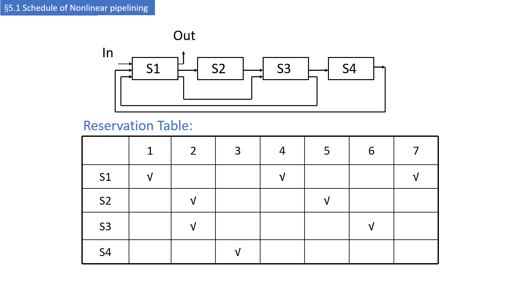

| 段 | 1 | 2 | 3 | 4 | 5 | 6 | 7 |
|---|---|---|---|---|---|---|---|
| S1 | √ | | | √ | | | √ |
| S2 | | √ | | | √ | | |
| S3 | | √ | | | | √ | |
| S4 | | | √ | | | | |

读表要点：

- **同一行可以有多个 √**——非线性流水线的任务会**多次**经过同一段（本例 S1 三次，S2、S3 各两次）。这正是「非线性」与「线性」在表上的区别：线性流水线每行恰好一个 √。
- 拍号是**相对任务起点**的，不是绝对时间；绝对时间 = 任务启动时刻 + 相对拍号。

> **待确认**：s.5 的任务通路只写了 S1 一次（`S1→S2→S3→S4→S2→…`），而 s.6 的预约表要求 S1 在第 1、4、7 拍各用一次。两者对不上，可能是 s.5 的文字被截断或两张幻灯片取自不同例子，详见文末待确认清单第 2 条。

### 1.3 为什么需要调度：先试「固定间隔」（s.7–9）【讲义】

最朴素的想法是：**相邻任务之间固定隔 k 拍送入**。

- s.7 把同一任务的预约表用 `1` 标出（只有第一个任务），标题是 **“Why Need Scheduling? Let’s extend the clock cycle!”**；
- s.8 送入第 2 个任务（表中用 `2` 标出），**间隔 1 拍**；
- s.9 继续送入第 3 个任务（`3`），仍是间隔 1 拍。

到 s.10，表里开始出现**同一格写两个任务号**的情况（如 `14`、`25`）——这就是冲突（hazard）：

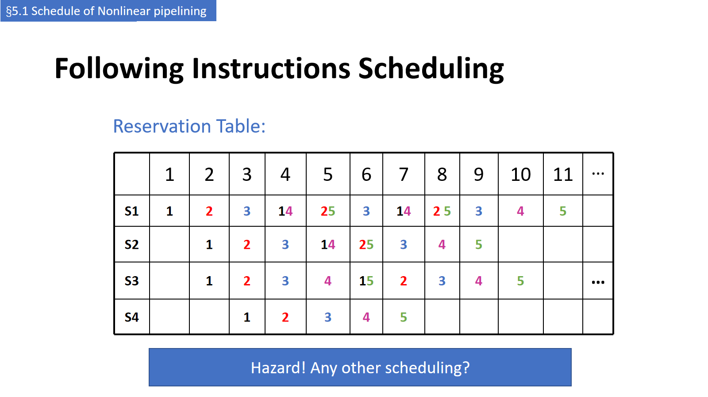

s.11 换成**间隔 2 拍**再试，表面上看前两个任务没有重叠；s.12 继续送入更多任务，又出现 `1 4`、`2 5`、`1 3` 等重叠，讲义下结论：

> **Still hazard! Need scheduling**（还是冲突！需要（系统的）调度。）

### 1.4 冲突的本质：看「任意两个任务的距离」，而不只是相邻两个（整理者注）

设任务 A 在时刻 $s$ 启动、任务 B 在时刻 $s+d$ 启动；A 在第 $t_1$ 拍用段 $S$，B 在第 $t_2$ 拍用段 $S$。二者撞段 ⇔

$$
s+t_1 = (s+d)+t_2 \;\Longleftrightarrow\; d = t_1-t_2 .
$$

所以：

> **只要「两个任务的启动间隔」等于「同一段内两次使用的时间差」，就一定会撞段；与这两个任务是否相邻无关。**

这解释了三件事：

1. 为什么固定间隔 1 拍时前几步没事、后面突然撞——距离 3、6 要等第 4、7 个任务才出现；
2. 为什么 s.11 的间隔 2 拍「看起来没事」——第 3 个任务才出现距离 4，第 4 个才出现距离 6；
3. 为什么必须**系统化**地调度，而不是逐个试。

后面的算法就是把「所有可能撞段的距离」收进一个集合，再在「不撞」的间隔里找平均最小的循环。

---

## 2. §5.2 非线性流水线的调度方法（s.13–24）

### 2.1 五步法总览（s.14）【讲义】

幻灯片把方法拆成一条流水线式的流程：

```text
预约表（reservation table）
  → 初始冲突向量（initial conflict vector）
  → 冲突向量（conflict vector，移位 + 或）
  → 状态图（state transition graph）
  → 循环队列（circular queue）
  → 最短平均间隔（shortest average interval）
```

### 2.2 第一步：预约表 → 禁止表 F → 初始冲突向量 C₀（s.15–16）【讲义】

讲义给出一条 **5 段、9 拍**的非线性流水线预约表：

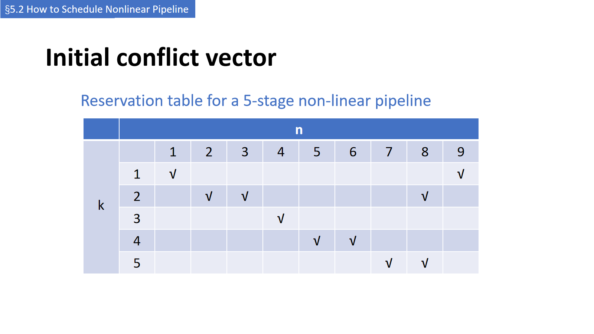

| 段 \ 拍 | 1 | 2 | 3 | 4 | 5 | 6 | 7 | 8 | 9 |
|---|---|---|---|---|---|---|---|---|---|
| S1 | √ | | | | | | | | √ |
| S2 | | √ | √ | | | | | √ | |
| S3 | | | | √ | | | | | |
| S4 | | | | | √ | √ | | | |
| S5 | | | | | | | √ | √ | |

**求禁止表（prohibit set）F**：对每一行，取**任意两次使用的时间差**（正差），全部收集起来：

| 段 | 使用拍 | 时间差 |
|---|---|---|
| S1 | 1, 9 | $9-1=8$ |
| S2 | 2, 3, 8 | $3-2=1$，$8-2=6$，$8-3=5$ |
| S3 | 4 | 无 |
| S4 | 5, 6 | $6-5=1$ |
| S5 | 7, 8 | $8-7=1$ |

$$
F=\{1,5,6,8\}.
$$

**初始冲突向量**：取 $N-1$ 位（这里 $N=9$，故 8 位），第 $i$ 位 $C_i=1$ ⇔ $i\in F$：

$$
C_0=(C_8C_7C_6C_5C_4C_3C_2C_1)=(10110001).
$$

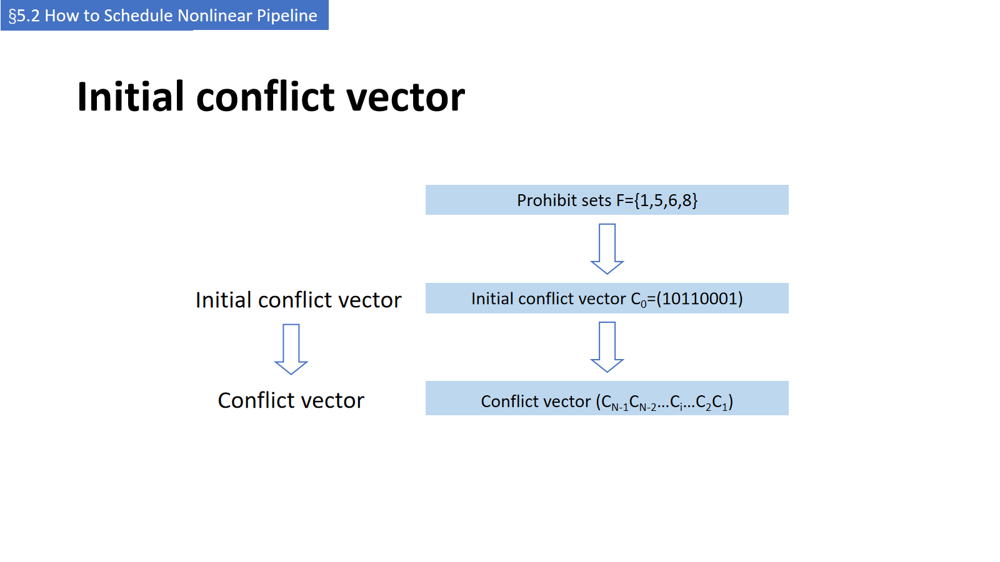

读法与含义：

- **左边是高位 C₈，右边是 C₁**——不要把它当二进制数读成 177；
- $C_i=1$ 表示「若新任务与当前任务的启动间隔为 $i$ 拍，就会撞段」；
- $C_i=0$ 表示「间隔 $i$ 拍是安全的，可以作为状态图的一条出边」。

> **待确认**：s.16 的文字写作 $(C_{N-1}C_{N-2}\cdots C_i\cdots C_2C_1)$，与本表的 $N=9$、8 位一致；但 s.23 的状态图直接写 8 位串，未再注明位序，阅读时按「左 C₈、右 C₁」对照即可。

### 2.3 第二步：冲突向量的递推（s.17–22）【讲义】

设当前冲突向量为 $C$，若第 $k$ 位 $C_k=0$，就可以在 **$k$ 拍后**送入下一个任务；送入后新的冲突向量为

$$
\boxed{\,C' = C_0 \;\lor\; (C \gg k)\,}
$$

其中 $\gg$ 是**逻辑右移**（高位补 0），$\lor$ 是按位或。

物理含义（讲义没有展开，这里补上推导）：

- 时间前进 $k$ 拍后，原来「距离为 $i+k$ 的约束」变成「距离为 $i$ 的约束」→ 整体右移 $k$ 位；
- 距离 $\le k$ 的约束已经过期 → 右移时被移出、自然消失；
- 新任务本身又会带来一整套 $C_0$ 约束 → 最后再与 $C_0$ 相或。

**例：从 $C_0=(10110001)$ 出发**

```text
k=2 : 10110001 >> 2 = 00101100 ;  ∨ 10110001 = 10111101
k=3 : 10110001 >> 3 = 00010110 ;  ∨ 10110001 = 10110111
k=4 : 10110001 >> 4 = 00001011 ;  ∨ 10110001 = 10111011
k=7 : 10110001 >> 7 = 00000001 ;  ∨ 10110001 = 10110001   ← 回到初始状态
```

s.17–20 用一张表把「连续取同一个间隔」时的每次移位列出来（表中 `1→`、`2→`… 就是依次右移得到的各个加数，最后一列的和即 CCV）：

| Interval | Initial | 2 | 2 | 7 |
|---|---|---|---|---|
| **CCV** | 10110001 | 10111101 | 10111111 | 10110001 |
| 1→ | 10110001 | 00101100 | 00001011 | 00000000 |
| 2→ | | 10110001 | 00101100 | 00000000 |
| 3→ | | | 10110001 | 00000001 |
| 4→ | | | | 10110001 |

- 连续两次取间隔 2：$C_0$、$C_0\gg2$、$C_0\gg4$ 三者相或 → $10111111$；
- 再取间隔 7：只剩 $C_0\gg7=00000001$ 这条最「远」的约束，与 $C_0$ 相或 → 回到 $10110001$。

> **整理者注（重要）**：不少教材把递推写成 $C' = C \lor (C\gg k)$。这两种写法在 $C=C_0$ 时结果相同，但多步之后不同：
> 例如从 $C=10111111$ 取 $k=7$，$C\lor(C\gg7)=10111111$ 仍是原状态，而讲义 s.20 的 CCV 与 s.23 的状态图都要求回到 $10110001$。
> 因此**本讲义的图只能用 $C_0\lor(C\gg k)$ 复现**：右移让旧约束过期，$C_0$ 代表新任务自己的预约模式。若按 $C\lor(C\gg k)$，状态只会单调增，状态图里不可能出现环。

### 2.4 第三步：状态图（s.23）【讲义】

以冲突向量为**节点**，以「可用的间隔 $k$」为**有向边**（$C_k=0$ 才有这条边），边指向更新后的向量：

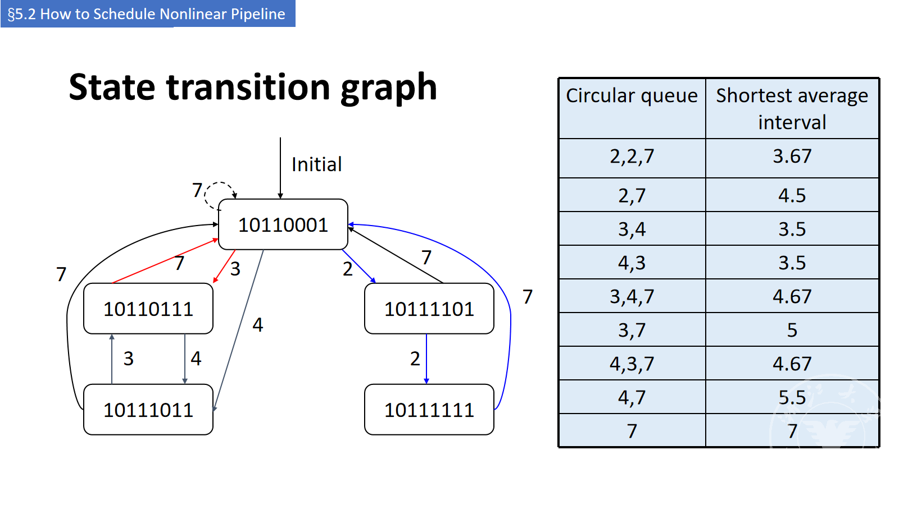

按 $C'=C_0\lor(C\gg k)$ 可逐条核对：

| 起点 | 可用 $k$（该位为 0） | 转移 |
|---|---|---|
| `10110001`（初始） | 2, 3, 4, 7 | 2→`10111101`；3→`10110111`；4→`10111011`；7→自身 |
| `10111101` | 2, 7 | 2→`10111111`；7→`10110001` |
| `10111111` | 7 | 7→`10110001` |
| `10110111` | 4, 7 | 4→`10111011`；7→`10110001` |
| `10111011` | 3, 7 | 3→`10110111`；7→`10110001` |

- 图中 `10110111 ⇄ 10111011` 的 4、3 两条边，就是「3、4 交替」这个循环；
- `10110001 → 10111101 → 10111111 → 10110001` 是「2、2、7」这个循环；
- 所有节点都有 `7` 这条边回到初始状态（等 7 拍后，旧的 8 条约束里只剩「距离 8」这条还没过期，正好由 $C_0$ 的 $C_8$ 覆盖）。

### 2.5 第四步：循环队列与最短平均间隔（s.23–24）【讲义】

状态图里的**环**就是可以无限重复的调度方案，讲义称**循环队列（circular queue）**；一个环的平均启动间隔为

$$
\text{平均间隔}=\frac{\sum k_i}{m}\quad(m=\text{环上的边数}).
$$

s.23 把所有环列成表：

| 循环队列 | 最短平均间隔 |
|---|---|
| 2, 2, 7 | 3.67 |
| 2, 7 | 4.5 |
| **3, 4** | **3.5** |
| **4, 3** | **3.5** |
| 3, 4, 7 | 4.67 |
| 3, 7 | 5 |
| 4, 3, 7 | 4.67 |
| 4, 7 | 5.5 |
| 7 | 7 |

**结论**：最短平均间隔为 **3.5 拍**，对应 **3、4 交替**（`3,4` 与 `4,3` 只是循环的起点不同，是同一个方案）。

> **整理者注（自查）**：3、4 交替意味着启动时刻为 0, 3, 7, 10, 14, 17, …，周期 $L=7$。
> 一个周期内的启动时刻为 $\{0,3\}$，两两距离为 3、4，跨周期再看 7、10、11…；
> $F=\{1,5,6,8\}$，而 $\{3,4,7,10,11\}\cap F=\varnothing$，所以确实永不撞段。
> 反过来看固定间隔为什么不行：$k=2$ 的倍数出现 6；$k=3$ 的倍数出现 6；$k=4$ 的倍数出现 8——**都落进 F**；
> 只有 $k=7$ 永远安全，但平均要 7 拍。这正是「混合间隔」比「固定间隔」好的原因。

### 2.6 本节的小结与一个练习（s.24）

s.24 用一张图回顾 §5.1 的 4 段例子，并提问：

> **How to determine the scheduling of the previous pipeline?**（上一条流水线该怎么调度？）

用本节方法可以自己算（**以下为整理者补算，幻灯片未给答案**）：

- 4 段预约表（§1.2）的时间差：S1 的 $4-1=3$、$7-4=3$、$7-1=6$；S2 的 $5-2=3$；S3 的 $6-2=4$ ⇒ $F=\{3,4,6\}$；
- 初始冲突向量（$C_6\cdots C_1$）：$C_3=C_4=C_6=1$ ⇒ $(100110)$；
- 固定间隔：$k=1,2,3,4$ 的某个倍数都会落进 $F$，$k=5$ 安全但平均 5 拍；
- 混合间隔：2、5 交替（周期 7，启动时刻 0,2,7,9,14,…，两两距离 2、5、7、9…）不撞 $F$，平均 **3.5 拍**，优于固定 5 拍。

---

## 3. 多发射：让 CPI 小于 1（s.25–38）

### 3.1 提高 ILP 的两条路（s.26）【讲义】

- 流水线本身就是「并行执行多条指令」；要提高 **ILP（Instruction-Level Parallelism）**，讲义给出两条路：
  1. **加深流水线（deeper pipeline）**：每段做得更少 → 时钟周期更短；
  2. **多发射（multiple issue）**：复制流水段 → 多条流水线；**每个时钟周期启动多条指令**。
- 多发射后 **CPI < 1**，所以改用 **IPC（Instructions Per Cycle）** 衡量：
  - 例：4 GHz、4 路多发射 → 峰值 **16 BIPS**（billion instructions per second），**peak CPI = 0.25**，**peak IPC = 4**；
  - **But dependencies reduce this in practice**（实际会被依赖拉低）。

【备注】BIPS = billion instructions per second；「流水线的 CPI 仍然大于 1」——指**实际** CPI，峰值只是上限。

> 换算：$\mathrm{IPC}=1/\mathrm{CPI}$；$n$ 路发射的峰值 $\mathrm{CPI}=1/n$、峰值 $\mathrm{IPC}=n$。

### 3.2 单发射 vs 多发射的时空图（s.27）【讲义】

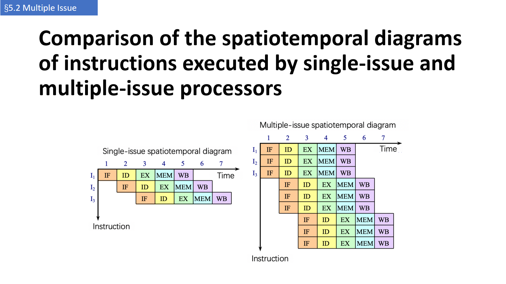

- 单发射：I1、I2、I3 依次每拍进入 IF，稳态每拍完成 1 条；
- 多发射：每拍同时取 3 条（I1/I2/I3 同拍 IF），稳态每拍完成 3 条；
- 注意两者的**流水深度没变**，变的是「每拍能塞进几条」——所以是「横向加宽」，不是「纵向加深」。

### 3.3 静态 vs 动态多发射（s.28）【讲义】

| | 静态多发射（static multiple issue） | 动态多发射（dynamic multiple issue） |
|---|---|---|
| 谁决定这一拍发哪几条 | **编译器**把指令分组、打包成 **issue slot** | **CPU** 每拍检查指令流，自行选择发射 |
| 谁检测 / 避免冒险 | 编译器 | 硬件（编译器可用重排帮忙） |
| 典型代表 | VLIW、静态调度超标量 | 动态超标量（Tomasulo / 乱序执行） |

【备注】「多发射会遇到冲突，处理冲突的方式决定了分类」——即**按「谁来解决冒险」分类**，而不是按「每拍几条」分类。

### 3.4 推测（Speculation，s.29–30）【讲义】

推测的通用套路：

1. **猜（guess）** 一条指令该怎么处理，目标是「尽早开始」；
2. **检查猜得对不对**；
3. 猜对了就完成；猜错了就 **roll-back** 再做正确的事。

两个典型：

- **分支结果推测**：猜分支走向，猜错就回滚；
- **load 推测**：猜要读的值 / 地址，若之后发现位置被改写就回滚。

实现分工（s.30）：

| 谁做推测 | 做法 |
|---|---|
| 编译器 | 重排指令（如把 load 提前到分支之前）；插入 **fix-up** 指令以便猜错时恢复 |
| 硬件 | 提前看指令流（look ahead）；把结果放缓冲区，确定需要时才写回；猜错时 **flush buffers** |

【备注】「调度的关键是预测」。

### 3.5 两类多发射处理器：超标量 vs VLIW（s.31–33）【讲义】

| | **超标量（superscalar）** | **VLIW（Very Long Instruction Word）** |
|---|---|---|
| 每拍发射条数 | **不固定**，取决于代码情况（1–8 条，有上限） | **固定**（4–16 条），打包成一条长指令 / 指令包 |
| 上限为 $n$ 时 | 称为 **$n$-issue** | — |
| 并行性怎么表达 | 由硬件在运行时发现 | 在指令包中**显式**表达（哪些操作并行） |
| 调度由谁做 | 编译器静态调度，或基于 **Tomasulo** 的动态调度 | **编译器静态**完成 |
| 典型应用 | 通用计算（讲义称「目前最成功的方法」） | DSP、多媒体 |

### 3.6 超流水线（Super-Pipeline，s.34–36）【讲义】

- 做法：把**每个流水段再细分**，使**多条指令在一个时钟周期内分时（time-shared）**通过；
- 若每拍流出 $n$ 条，这 $n$ 条**不是同时**流出，而是**每隔 $1/n$ 个时钟周期流出一条**；
- 因此超流水的**流水周期是 $1/n$ 个时钟周期**（等价于时钟频率提高 $n$ 倍；整理者注）。

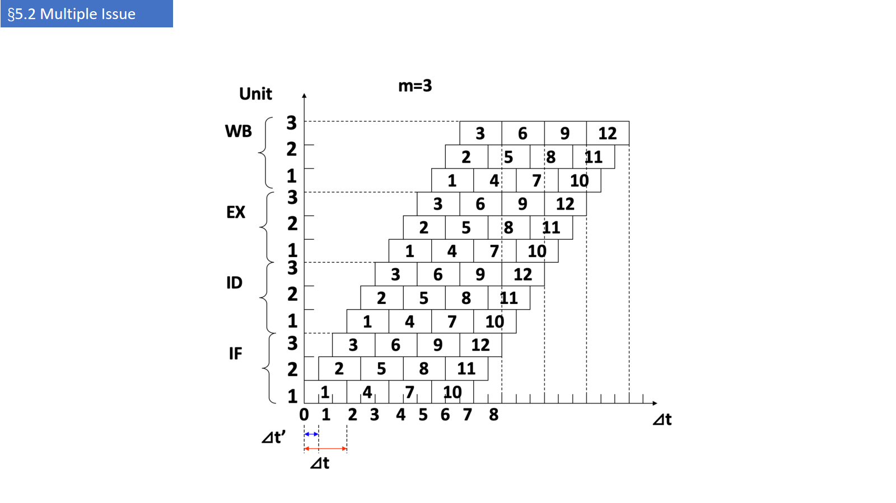

### 3.7 四种结构放在一起看（s.37）【讲义】

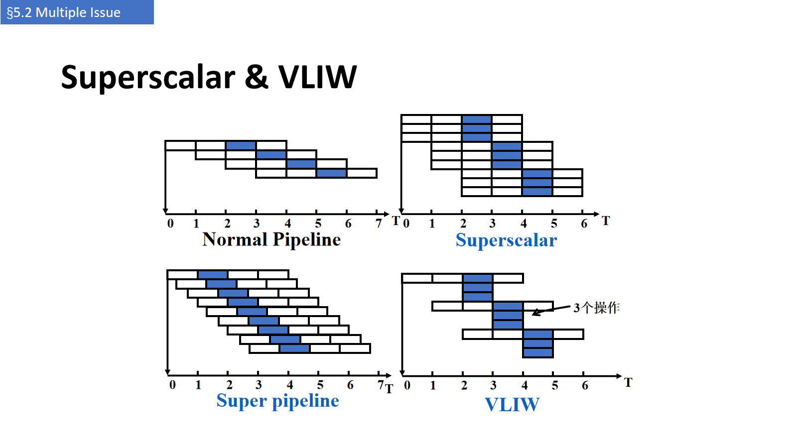

| 结构 | 「多」在哪里 | 代价 |
|---|---|---|
| 正常流水 | 每拍 1 条，靠重叠 | 流水深度决定时钟 |
| **超标量** | 每拍**同时**发射多条（条数可变） | 复制执行部件 / 端口，硬件冒险检测 |
| **超流水** | 每拍**分时**流出多条（时间片细分） | 时钟更快、流水更深，分支代价更大 |
| **VLIW** | 一条长指令里**打包**多个操作槽 | 代码膨胀、槽可能填不满、机器码不兼容 |

【备注】VLIW 的 IF/ID 阶段可以一次取出并译码 3 条指令，随后并行执行各自的操作。

### 3.8 五种结构的职责划分（s.38）【讲义】

| Common name | Issue structure | Hazard detection | Scheduling | 区别特征 | 例子 |
|---|---|---|---|---|---|
| Superscalar (static) | Dynamic | Hardware | Static | 顺序执行 | 嵌入式居多：MIPS、ARM（含 Cortex-A8） |
| Superscalar (dynamic) | Dynamic | Hardware | Dynamic | 有一定乱序执行，但**不推测** | 讲义称「目前没有」 |
| Superscalar (speculative) | Dynamic | Hardware | Dynamic + speculation | 乱序执行 + 推测 | Intel Core i3/i5/i7、AMD Phenom、IBM Power 7 |
| VLIW / LIW | Static | 主要靠软件 | Static | 所有冒险由编译器确定并（常常隐式地）标注 | 信号处理，如 TI C6x |
| EPIC | 主要静态 | 主要靠软件 | 主要静态 | 所有冒险由编译器**显式**标注 | Itanium |

> **待确认**：表中的 `Issue structure` 一列，静态超标量也写作 `Dynamic`。按上下文应理解为「**发射结构由硬件动态决定**（哪几条能一起发），而**调度**是编译期静态完成的」；若按字面读会与「static」矛盾。

---

## 4. 静态多发射的实现（s.39–55）

### 4.1 静态调度超标量的取指与发射（s.39–41）【讲义】

- 典型超标量每拍可发 **1–8 条**；指令**按序流出**，在流出时做冲突检测；
- 取指阶段一次取来 **1–4 条**（称为 **issue packet**，发射包）；
- 一个时钟内，包里的指令**可能全部流出，也可能只流出一部分**。

**冒险检测分两级**（s.40）：

1. **包内**：先检查同一个发射包内的指令之间有没有结构 / 数据冒险，挑出这一拍能发的指令；
2. **包间**：再检查选出的指令与**已经在执行**的指令是否冲突。

【备注】「先看包里是否冲突，再看和包前面的指令是否冲突」。

**RISC-V 的具体假设**（s.40–41）：

- 每拍流出 **2 条**：**1 条整数指令 + 1 条浮点指令**；
- **load / store / branch 都算整数指令**；
- 同时取 2 条（64 位）、译码 2 条（64 位）；
- 处理步骤：取 2 条 → 判断哪几条能流出（0–2 条）→ 送到对应功能部件。

【备注】这里的「memory」在实际系统中其实是 **cache**。

### 4.2 双发射流水线的时空图（s.42）【讲义】

假设所有浮点指令都是加法、执行时间为 **2 拍**，且图中整数指令总排在浮点指令前面：

| 类型 | 1 | 2 | 3 | 4 | 5 | 6 | 7 | 8 |
|---|---|---|---|---|---|---|---|---|
| 整数 | IF | ID | EX | MEM | WB | | | |
| 浮点 | IF | ID | EX | EX | MEM | WB | | |
| 整数 | | IF | ID | EX | MEM | WB | | |
| 浮点 | | IF | ID | EX | EX | MEM | WB | |
| 整数 | | | IF | ID | EX | MEM | WB | |
| 浮点 | | | IF | ID | EX | EX | MEM | WB |
| 整数 | | | | IF | ID | EX | MEM | WB |
| 浮点 | | | | IF | ID | EX | EX | MEM |

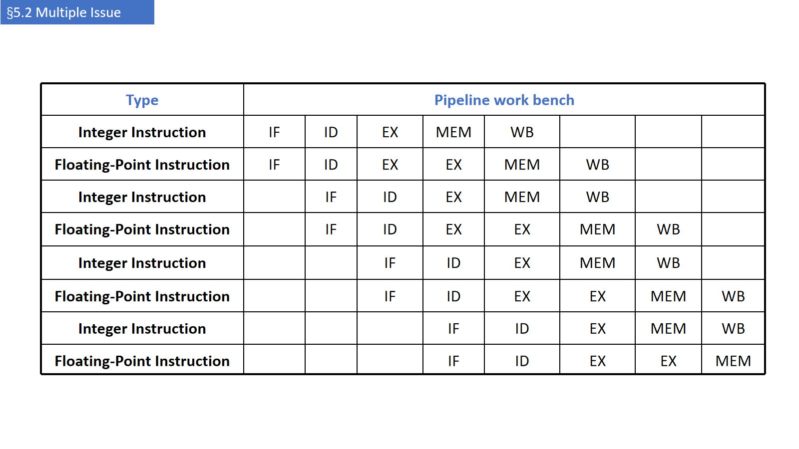

### 4.3 硬件要加多少（s.43）【讲义】

「1 整数 + 1 浮点」这种并行流出方式，**需要增加的硬件不多**，但有三个具体改动：

1. **浮点寄存器堆加一个读 / 写端口**——因为浮点的 load/store 会用到整数部分，增加了对浮点寄存器的访问冲突；
2. **定向（forwarding）通路要加倍**——流水线里的指令数翻倍了；
3. 相应的冒险检测与选择逻辑（s.40 的两级检测）。

### 4.4 编译器如何打包 issue packet（s.44）【讲义】

- 把指令分成**能在同一拍发射的一组**（issue packet）；
- 分组由**流水线资源**决定；
- 编译器必须**消除包内（部分或全部）冒险**：重排指令，确保**包内无依赖**，包与包之间**可以**有依赖；
- 规则**随 ISA 而变，编译器必须知道**；
- 必要时用 **nop** 填充空槽。

### 4.5 RISC-V 静态双发射的格式（s.45–46）【讲义】

- 每个包 **2 条**：**1 条 ALU/branch + 1 条 load/store**；
- **64 位对齐**；
- 顺序固定：**ALU/branch 在前，load/store 在后**；
- 用不到的槽填 **nop**。

| 地址 | 类型 | 1 | 2 | 3 | 4 | 5 | 6 |
|---|---|---|---|---|---|---|---|
| n | ALU/branch | IF | ID | EX | MEM | WB | |
| n+4 | Load/store | IF | ID | EX | MEM | WB | |
| n+8 | ALU/branch | | IF | ID | EX | MEM | WB |
| n+12 | Load/store | | IF | ID | EX | MEM | WB |
| n+16 | ALU/branch | | | IF | ID | EX | MEM |
| n+20 | Load/store | | | IF | ID | EX | MEM |

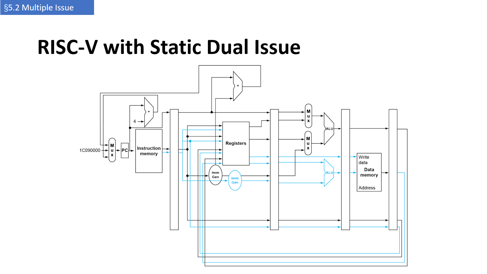

### 4.6 双发射带来的新冒险（s.47）【讲义】

指令并行度越高，冲突越多。两类典型：

1. **EX 数据冒险**：单发射时可以用转发消除停顿；**双发射时，同一条包内的 ALU 结果不能直接给 load/store 用**。

```asm
add x10, x0, x1
ld  x2, 0(x10)      # 同包内：x10 还没算出来
```

只能**拆成两个包**，效果等于停 1 拍。

2. **load-use 冒险**：延迟仍是 1 拍，但现在是**两条指令**一起等，因此需要**更激进的调度**（例如把无关指令填进空槽、循环展开）。

### 4.7 调度示例：5 条指令压到 4 拍（s.48）【讲义】

原循环：

```asm
Loop: ld   x31, 0(x20)      # x31 = 数组元素
      add  x31, x31, x21    # 加标量（x21）
      sd   x31, 0(x20)      # 存回
      addi x20, x20, -8     # 指针减 8
      blt  x22, x20, Loop   # x22 < x20 则继续
```

双发射调度结果：

| | ALU/branch | Load/store | cycle |
|---|---|---|---|
| Loop: | nop | `ld x31, 0(x20)` | 1 |
| | `addi x20, x20, -8` | nop | 2 |
| | `add x31, x31, x21` | nop | 3 |
| | `blt x22, x20, Loop` | `sd x31, 8(x20)` | 4 |

$$
\mathrm{IPC}=\frac{5}{4}=1.25\quad(\text{峰值 }2).
$$

两个容易看漏的点：

- `add` 必须等 `ld` 的结果（load-use），所以排在第 3 拍，而不是第 2 拍；
- **`sd` 的偏移从 0 改成了 8**：因为 `addi` 被提前到第 2 拍执行，`x20` 已经减了 8，原来 `0(x20)` 的地址现在是 `8(x20)`。

【备注】「addi 和 sd 的倒置按 5 级流水线来说不会发生冲突，但对其他情况可能仍然会；因此从解耦的角度说，用 8 作为 sd 的偏移更保险。」

### 4.8 循环展开与寄存器重命名（s.49–50）【讲义】

**循环展开（loop unrolling）**：

- 复制循环体，暴露更多并行性；
- 减少循环控制开销；
- 每次复制用**不同的寄存器**——这就是**寄存器重命名（register renaming）**；
- 目的之一是避开**循环携带的反相关（loop-carried anti-dependency）**：store 后紧跟对同一寄存器的 load，属于**名相关（name dependence）**，只是复用了寄存器名。

4 次展开后的调度（14 条指令 / 8 拍）：

| cycle | ALU/branch | Load/store |
|---|---|---|
| 1 | `addi x20,x20,-32` | `ld x28, 0(x20)` |
| 2 | nop | `ld x29, 24(x20)` |
| 3 | `add x28,x28,x21` | `ld x30, 16(x20)` |
| 4 | `add x29,x29,x21` | `ld x31, 8(x20)` |
| 5 | `add x30,x30,x21` | `sd x28, 32(x20)` |
| 6 | `add x31,x31,x21` | `sd x29, 24(x20)` |
| 7 | nop | `sd x30, 16(x20)` |
| 8 | `blt x22,x20,Loop` | `sd x31, 8(x20)` |

$$
\mathrm{IPC}=\frac{14}{8}=1.75 \quad(\text{更接近峰值 }2).
$$

代价：**寄存器用量**和**代码体积**都增加。

### 4.9 VLIW 的指令格式与例子（s.51–54）【讲义】

- 把多条能并行执行的指令**拼成一条超长指令**（100 多位到几百位）；
- 指令字分成若干**操作槽（operation slot）**，每个槽**直接、独立**地控制一个功能部件；
- **所有处理和指令编排都由编译器完成**：编译时把互不相关、可并行的操作拼进同一条长指令。

s.53 的例子：VLIW 每拍可同时流出 **5 条**——2 条访存、2 条浮点、1 条整数 / 分支。原始代码序列（17 条）：

```text
1  ld f0, 0(x1)        7  add f8, f6, f2       13 add f16, f14, f2
2  add f4, f0, f2      8  sd f8, -8(x1)        14 sd f16, -24(x1)
3  sd f4, 0(x1)        9  ld f10, -16(x1)      15 ld f18, -32(x1)
4  addiu x1, x1, -40  10  add f12, f10, f2     16 add f20, f18, f2
5  bne x1, x2, Loop   11  sd f12, -12(x1)      17 sd f20, -32(x1)
6  ld f6, -8(x1)      12  ld f14, -24(x1)
```

编译后的 VLIW 调度（8 拍）：

| 拍 | L/S 1 | L/S 2 | FP 1 | FP 2 | 整数 / 分支 |
|---|---|---|---|---|---|
| 1 | `ld f0,0(x1)` | `ld f6,-8(x1)` | nop | nop | nop |
| 2 | `ld f10,-16(x1)` | `ld f14,-24(x1)` | nop | nop | nop |
| 3 | `ld f18,-32(x1)` | nop | `add f4,f0,f2` | `add f8,f6,f2` | nop |
| 4 | nop | nop | `add f12,f10,f2` | `add f16,f14,f2` | nop |
| 5 | nop | nop | `add f20,f18,f2` | nop | nop |
| 6 | `sd f4,0(x1)` | `sd f8,-8(x1)` | nop | nop | nop |
| 7 | `sd f12,-16(x1)` | `sd f16,-24(x1)` | nop | nop | `addiu x1,x1,-40` |
| 8 | `sd f20,-32(x1)` | nop | nop | nop | `bne x1,x2,Loop` |

讲义的统计：

- 运行时间 **8 拍**；
- **17 条指令 / 8 拍 ⇒ 2.1 条/拍**；
- 8 拍 × 5 槽 = **40 个槽**，有效槽比例 $17/40=42.5\%$。

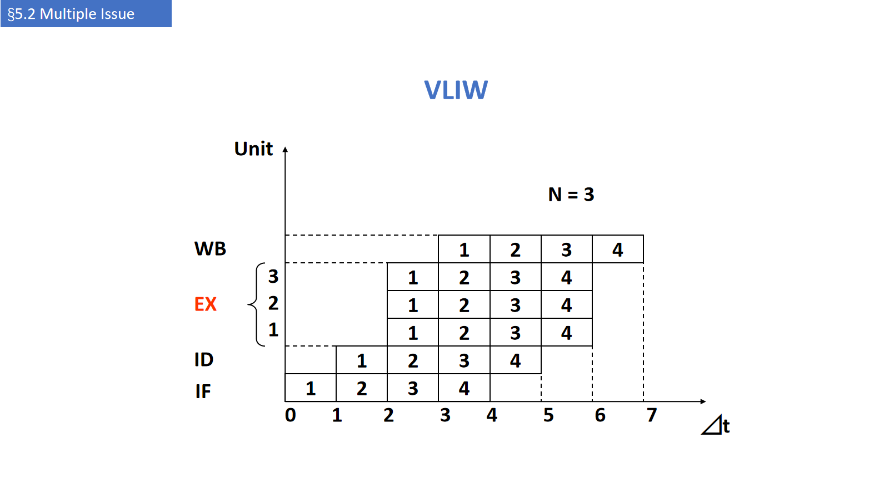

### 4.10 VLIW 的问题与多发射的极限（s.55–56）【讲义】

**VLIW 的四个问题**：

1. **程序代码变长**：为提高并行性要做大量循环展开；
2. **操作槽常常填不满**（本例有效槽只有 42.5%）；缓解办法：共享立即数字段、压缩存储、装入 Cache 或译码时展开；
3. **机器码不兼容**：不同实现的操作槽数 / 延迟不同；
4. **lockstep（同步步进）机制**：任何一个操作部件暂停，整个处理器都必须暂停。

【备注】lockstep 是 VLIW 的硬伤：没有硬件动态调度，一条指令包里的某个操作等数据，整包都得等。

**多发射处理器的三大限制**（s.56）：

1. 程序**固有的指令级并行度**；
2. **硬件实现的难度**；
3. 超标量与 VLIW 自身的**技术限制**。

---

## 5. 动态多发射（s.57–73）

### 5.1 从静态走向动态（s.57–58）【讲义】

- 超标量结构对程序员**透明**：处理器自己检测下一条能不能流出，**不需要重排指令**；
- 即使代码没经过编译器调度优化、甚至是老编译器生成的代码，也能跑（**兼容性好**），只是**效果不一定好**；
- 想跑好，一条路是用**动态超标量调度**。

「Superscalar」处理器的动态版本（s.58）：

- CPU 每拍自行决定发 **0、1、2、…** 条；
- 由硬件避免结构冒险与数据冒险；
- **不需要编译器调度**（编译器帮忙仍然有益）；
- **代码语义由 CPU 保证**。

### 5.2 扩展 Tomasulo：支持双发射（s.59–62）【讲义】

讲义的方案：

- 每拍发 **2 条**：**1 条整数 + 1 条浮点**；
- 指令**按序进入保留站（RS）**，否则会破坏程序语义；
- 把**整数用的表结构**与**浮点用的表结构**分开、分别处理，这样一条浮点指令和一条整数指令可以**同时**送进各自的保留站。

**例题（Example 4.4）**：用 Tomasulo + 多流出执行下面的循环（把 F2 中的标量加到向量每个元素上）：

```asm
Loop: L.D    F0, 0(R1)        # 取数组元素到 F0
      ADD.D  F4, F0, F2       # 加标量 F2
      S.D    F4, 0(R1)        # 存回
      DADDIU R1, R1, #-8      # 指针减 8（每个数据 8 字节）
      BNE    R1, R2, Loop     # 未结束则继续
```

**假设**（s.61）：

- 每拍可流出 1 条整数 + 1 条浮点，**即使两者相关**；
- 有整数部件做整数 ALU 运算与地址计算；每类浮点运算有独立的流水化功能部件；
- **指令流出**与**写结果**各占 1 拍；
- 有动态分支预测部件与独立的分支条件计算部件；
- 分支**单独流出**，不用延迟槽，但**分支预测完美**；分支完成之前，其后的指令**只能取指和流出，不能执行**。

**结果延迟**（s.62）：写结果占 1 拍，所以产生结果的延迟为——整数 **1 拍**、load **2 拍**、浮点加法 **3 拍**。

### 5.3 前三个循环的流出 / 执行 / 写 CDB（s.63）【讲义】

| 轮 | 指令 | IS | EX | MEM | Write CDB | 说明 |
|---|---|---|---|---|---|---|
| 1 | `L.D F0, 0(R1)` | 1 | 2 | 3 | 4 | 流出第 1 条 |
| 1 | `ADD.D F4, F0, F2` | 1 | 5 | | 8 | 等 L.D 的结果 |
| 1 | `S.D F4, 0(R1)` | 2 | 3 | 9 | | 等 ADD.D 的结果 |
| 1 | `DADDIU R1, R1, #-8` | 2 | 4 | | 5 | 等 ALU |
| 1 | `BNE R1, R2, Loop` | 3 | 6 | | | 等 DADDIU 的结果 |
| 2 | `L.D F0, 0(R1)` | 4 | 7 | 8 | 9 | 等 BNE 的结果 |
| 2 | `ADD.D F4, F0, F2` | 4 | 10 | | 13 | 等 L.D 的结果 |
| 2 | `S.D F4, 0(R1)` | 5 | 8 | 14 | | 等 ADD.D 的结果 |
| 2 | `DADDIU R1, R1, #-8` | 5 | 9 | | 10 | 等 ALU |
| 2 | `BNE R1, R2, Loop` | 6 | 11 | | | 等 DADDIU 的结果 |
| 3 | `L.D F0, 0(R1)` | 7 | 12 | 13 | 14 | 等 BNE 的结果 |
| 3 | `ADD.D F4, F0, F2` | 7 | 15 | | 18 | 等 L.D 的结果 |
| 3 | `S.D F4, 0(R1)` | 8 | 13 | 19 | | 等 ADD.D 的结果 |
| 3 | `DADDIU R1, R1, #-8` | 8 | 14 | | 15 | 等 ALU |
| 3 | `BNE R1, R2, Loop` | 9 | 16 | | | 等 DADDIU 的结果 |

**怎么读这张表**（整理者注）：

- `IS` 是流出发射，`EX` 是开始执行，`MEM` 是访存，`Write CDB` 是把结果写到公共数据总线；
- `ADD.D` 第 1 拍就流出，但要等 `L.D` 在第 4 拍写 CDB，所以 `EX` 拖到第 5 拍——**流出早 ≠ 执行早**；
- `S.D` 的 `EX=3` 只算地址，真正的 `MEM=9` 要等 `ADD.D` 在第 8 拍给出数据；
- 第 2 轮的 `L.D` 在第 4 拍流出（分支在第 3 拍流出），但 `EX=7` 要等 `BNE` 在第 6 拍执行完——**控制相关**；
- 第 2、3 轮的 `DADDIU` 与 `BNE` 形成整数链：`DADDIU` 的 CDB 分别在 5、10、15 拍，`BNE` 的 `EX` 就分别在 6、11、16 拍——**整数部件被这两条辅助指令串行占用**，是后面分析中「整数部件成瓶颈」的根源。

### 5.4 结果分析：发射率高 ≠ 执行效率高（s.64–65）【讲义】

- 程序基本能做到「**3 拍 5 条指令**」⇒ $\mathrm{IPC}=5/3=1.67$ 条/拍（**发射率**）；
- 但执行效率不高：**15 条指令在 16 拍内执行完**，平均 $15/16=0.94$ 条/拍（**完成率**）；
- 原因：**浮点运算太少，整数 ALU 成了瓶颈**（地址计算与整数运算挤在一起）；
- 解决办法之一：**加一个加法器，把 ALU 功能与地址计算功能分开**。

**双发射动态调度性能的三个限制**（s.65）：

1. **整数部件与浮点部件负载不平衡**，浮点部件没被充分利用 → 应设法减少循环里的整数指令；
2. **每次循环的控制开销太大**（5 条里有 2 条是辅助指令）→ 设法减少或消除；
3. **控制相关**：必须等分支结果出来，才能开始下一轮的 `L.D`。

> **待确认**：s.64 说「15 条指令在 16 拍内执行完」，但 s.63 表中最后一条 `ADD.D` 写 CDB 在第 **18** 拍，两者口径不一致（可能「16 拍」只统计到第 3 轮 `BNE` 执行完，或按教材原图统计）。引用具体数字时以表为准并注明出处。

### 5.5 动态调度：乱序执行、顺序提交（s.66–67）【讲义】

允许 CPU **乱序执行**以免停顿，但**按序提交（commit）结果到寄存器**：

```asm
ld   x31, 20(x21)
add  x1, x31, x2      # 等 ld
sub  x23, x23, x3     # 与 add 无关，可以先做
andi x5, x23, 20
```

`add` 在等 `ld` 时，`sub` 可以开始执行。

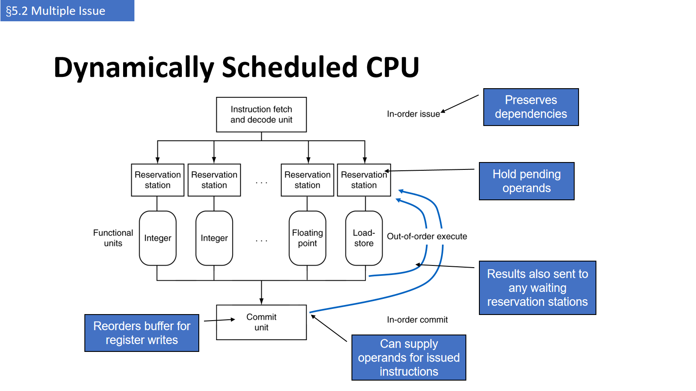

图中四个蓝框就是四个关键机制：

| 机制 | 作用 |
|---|---|
| **Reservation station** | 保存待执行的指令与**待取的操作数** |
| **Functional units** | 乱序执行；结果**同时送给所有等待的保留站**（相当于广播 / 转发） |
| **Commit unit（ROB）** | 为寄存器写入**重排序**，保证按序提交 |
| **Issue（顺序）** | 按序发射，从而**保持依赖关系**（preserves dependencies） |

### 5.6 寄存器重命名（s.68）【讲义】

保留站 + 重排序缓冲**共同实现了寄存器重命名**：

- 指令发射到保留站时，若操作数已在寄存器堆或 ROB 中，就**复制到保留站**；
- 复制后寄存器里的旧值**不再被需要，可以被覆盖**；
- 若操作数还没算出来，功能部件算好后会**直接送给保留站**；
- 因此可能**根本不需要更新寄存器**（结果只被后续指令消费）。

这就把「WaW / WaR 名相关」与「真相关（RaW）」分开了：只有真相关必须等。

### 5.7 推测：分支与 load（s.69）【讲义】

- **分支推测**：预测分支并继续发射；**在分支结果确定前不提交**；
- **load 推测**：为避免 load 和 cache miss 的延迟，
  - 预测有效地址；
  - 预测要读的值；
  - 在未完成的 store 之前就 load；
  - 把已存的值 **bypass** 给 load 单元；
  - **在推测清除前不提交** load。

### 5.8 为什么不能只让编译器调度（s.70）【讲义】

1. 不是所有停顿都可预测（如 **cache miss**）；
2. 不可能总绕过分支（分支结果**动态**决定）；
3. 同一 ISA 的**不同实现**有不同的延迟与冒险。

### 5.9 多发射到底有用吗（s.71–72）【讲义】

**有用，但没想象中多**：

- 程序有**真实依赖**，限制 ILP；
- 有些依赖很难消除（如**指针别名** pointer aliasing）；
- 有些并行性难以暴露；
- **发射窗口有限**；
- 内存延迟与带宽有限；
- 流水线很难一直填满；
- 推测做得好会有帮助。

**功耗**（s.72）：动态调度与推测的复杂性**需要功耗**；「多个更简单的核」可能更好。

| 微处理器 | 年份 | 时钟 | 流水段 | 发射宽度 | 乱序 / 推测 | 核数 | 功耗 |
|---|---|---|---|---|---|---|---|
| i486 | 1989 | 25 MHz | 5 | 1 | No | 1 | 5 W |
| Pentium | 1993 | 66 MHz | 5 | 2 | No | 1 | 10 W |
| Pentium Pro | 1997 | 200 MHz | 10 | 3 | Yes | 1 | 29 W |
| P4 Willamette | 2001 | 2000 MHz | 22 | 3 | Yes | 1 | 75 W |
| P4 Prescott | 2004 | 3600 MHz | 31 | 3 | Yes | 1 | 103 W |
| Core | 2006 | 2930 MHz | 14 | 4 | Yes | 2 | 75 W |
| UltraSparc III | 2003 | 1950 MHz | 14 | 4 | No | 1 | 90 W |
| UltraSparc T1 | 2005 | 1200 MHz | 6 | 1 | No | 8 | 70 W |

### 5.10 真实处理器：Cortex-A53 与 Core i7（s.73–78）【讲义】

| 项目 | ARM A53 | Intel Core i7 920 |
|---|---|---|
| 市场 | 个人移动设备 | 服务器、云 |
| 热设计功耗 | 100 mW /（1 核 @ 1 GHz） | 130 W |
| 时钟 | 1.5 GHz | 2.66 GHz |
| 核数 / 芯片 | 4（可配置） | 4 |
| 浮点 | 有 | 有 |
| 多发射 | 动态 | 动态 |
| 峰值指令 / 拍 | 2 | 4 |
| 流水段 | 8 | 14 |
| 流水调度 | **静态顺序** | **动态乱序 + 推测** |
| 分支预测 | 混合（hybrid） | 两级（2-level） |
| L1 / 核 | 16–64 KiB I，16–64 KiB D | 32 KiB I，32 KiB D |
| L2 / 核 | 128–2048 KiB | 256 KiB |
| L3（共享） | 视平台 | 2–8 MB |

**Cortex-A53 的流水线**（s.74）：表 73 标称 **8 段**；s.74 的图把取指细分为 F1–F4（AGU + TLB、指令 Cache、混合预测器、间接跳转预测器），译码细分为 D1–D3（Early Decode、13 项指令队列、Main Decode、Late Decode），并标出 Iss、Ex1、Ex2、Wr 等流水级；整数侧有 2 条 ALU 流水、MAC、除法、load、store；浮点侧有 NEON 寄存器堆与 MUL/DIV/SQRT、ALU 两条流水。

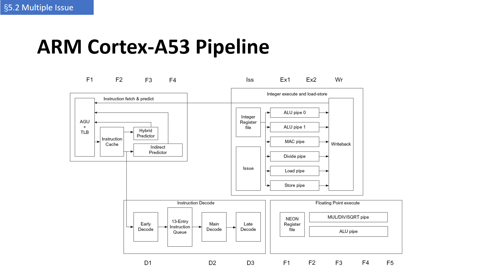

**Core i7（Nehalem）的流水线**（s.76）：128 项指令 TLB、32 KB 指令 Cache、16 B 预译码 + 宏操作融合、18 项指令队列、4 个译码器（1 复杂 + 3 简单）、28 项微操作循环流检测缓冲、寄存器别名表与分配器、128 项 ROB、36 项保留站、多个执行端口（ALU / shift、SSE shuffle、128-bit FMUL/FDIV、load / store address、store data）、Memory Order Buffer，以及 32 KB L1D、256 KB L2、8 MB 共享 L3。

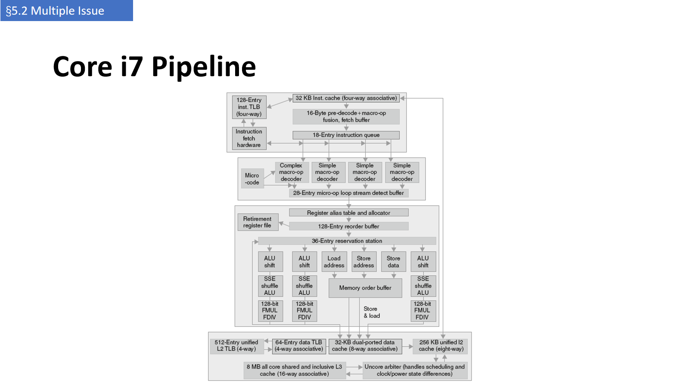

**性能**（s.75、s.77）：

- A53 的 CPI：多数 benchmark 在 1.0–2.1 之间，`mcf` 高达 **8.56**（内存层次停顿为主）；
- i7 的 CPI：0.44–2.67，柱状图把 CPI 拆成 **ideal CPI + 停顿 / 误预测**；`astar` 的「无效工作」比例最高（约 38%），`mcf` 次之（约 37%）；分支误预测最高的是 `gobmk`（约 10%）。

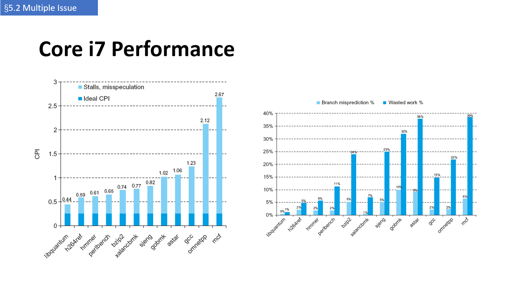

**Performance Impact（s.78）**：同一段程序，未优化 **1.7 GFLOPS** → 用 **AVX** **6.4 GFLOPS** → **AVX + 循环展开** **14.6 GFLOPS**。说明「指令级并行 + 数据级并行（SIMD）+ 展开」要一起用，硬件能力才能兑现。

---

## 6. 听课重点与易混点

### 6.1 预约表 vs 时空图

- **预约表**：**一个任务**在各段、各拍的占用（行=段，列=相对拍号，可多次 √）；
- **时空图**：**多个任务**在各段、各绝对拍的占用（行=段/指令，列=绝对时间）。
- 预约表是「任务模板」，时空图是「调度结果」；前者与后者按启动时刻平移叠加。

### 6.2 禁止表 F 的含义（最容易错）

- $F$ 里的数是**同一任务内同一段两次使用的时间差**；
- 它同时是「**任意两个任务的启动间隔**」的禁区——不是「相邻任务」的禁区；
- 因此判断一个调度是否安全，要看**所有任务对**的距离，不能只看相邻两个。

### 6.3 为什么固定间隔迟早冲突

若每隔 $k$ 拍送一个任务，则任务间距离取遍 $k,2k,3k,\dots$。只要某个倍数落进 $F$，迟早撞段；$k$ 的倍数永不落进 $F$ 时，固定间隔才长期安全（本例只有 $k=7$）。混合间隔可以把平均值压到 3.5。

### 6.4 冲突向量的位序与递推

- $C=(C_{N-1}\cdots C_1)$，**左高右低**；$N-1$ 是预约表里最大的时间差；
- $C_k=0$ 才可选中间隔 $k$；
- 递推 $\;C'=C_0\lor(C\gg k)\;$：右移让旧约束过期，$C_0$ 加入新任务的自身约束；
- 若写成 $C\lor(C\gg k)$，状态单调不减，画不出状态图里的环（见 §2.3 的整理者注）。

### 6.5 状态图与循环队列

- 节点 = 冲突向量，边 = 可选间隔；
- **环** = 可以永远重复的调度；环的平均边权 = 平均启动间隔；
- 同一个环的不同起点（3,4 与 4,3）是同一方案，不能重复计数。

### 6.6 超标量 / VLIW / 超流水（三者的「多」不同）

| | 多在哪 | 条数 | 谁调度 | 硬件代价 |
|---|---|---|---|---|
| 超标量 | 每拍**同时**发多条 | 可变（≤ n） | 编译器（静态）或硬件（动态） | 多套执行部件 + 冒险检测 |
| VLIW | 一条**长指令**打包多个槽 | 固定（4–16） | 编译器 | 编译器复杂，硬件简单 |
| 超流水 | 每拍**分时**流出多条 | 固定（时间片 1/n） | 编译器 / 硬件均可 | 时钟更快、流水更深 |

### 6.7 静态 vs 动态多发射

- 静态：编译器保证「包内无依赖」，硬件只做检查；代码依赖编译器与 ISA；
- 动态：硬件每拍看指令流、自行决定发几条；对旧代码兼容，但功耗高、逻辑复杂。

### 6.8 顺序发射 / 乱序执行 / 顺序提交

- **顺序发射**：保持程序语义与依赖关系；
- **乱序执行**：谁的操作数先到谁先算，避免停顿；
- **顺序提交**：结果按程序顺序写回寄存器 / 内存，保证异常与推测回滚的正确性。

### 6.9 多发射下的「新」冒险

- **同包内不能转发**：ALU 结果来不及给同包的 load/store 用 → 拆包（等于停 1 拍）；
- **load-use 仍要等**：延迟没变，但现在是两条指令一起等 → 调度要更激进；
- **控制相关更贵**：一条分支耽误的是一整包的发射机会。

### 6.10 峰值 IPC ≠ 实际 IPC

- 峰值 IPC = 发射宽度（2 路 → 2，4 路 → 4）；
- 实际 IPC 被依赖、nop 填充、控制开销、cache miss 拉低；
- 因此「发射率（issue rate）」与「完成率（completion rate）」要分开看：s.64 的 1.67 是前者，0.94 是后者。

---

## 7. 课前自测 / 复习清单

1. 线性与非线性流水线的区别是什么？为什么非线性流水线的预约表一行会有多个 √？（[§1.1](#11-线性-vs-非线性s34讲义)、[§1.2](#12-一个-4-段非线性流水线与它的预约表s56讲义)）
2. 给定一张预约表，怎样求禁止表 $F$？$F$ 里的数物理意义是什么？为什么它约束的是「任意两个任务」而不只是相邻任务？（[§2.2](#22-第一步预约表--禁止表-f--初始冲突向量-c₀s1516讲义)、[§1.4](#14-冲突的本质看任意两个任务的距离而不只是相邻两个整理者注)）
3. 初始冲突向量为什么是 $N-1$ 位？位序为什么是「左高右低」？（[§2.2](#22-第一步预约表--禁止表-f--初始冲突向量-c₀s1516讲义)）
4. 写出冲突向量的递推式，并说明右移与「或 $C_0$」各自的物理含义。（[§2.3](#23-第二步冲突向量的递推s1722讲义)）
5. 状态图的节点、边、环分别对应什么？怎样从环求平均启动间隔？本例的最优解是多少？（[§2.4](#24-第三步状态图s23讲义)、[§2.5](#25-第四步循环队列与最短平均间隔s2324讲义)）
6. 为什么固定间隔 2 拍「前两个任务没事、后面会撞」？用 $F$ 解释。（[§1.4](#14-冲突的本质看任意两个任务的距离而不只是相邻两个整理者注)）
7. 提高 ILP 的两条路是什么？多发射为什么改用 IPC 衡量？（[§3.1](#31-提高-ilp-的两条路s26讲义)）
8. 静态多发射与动态多发射，分别由谁检测冒险、谁决定发射哪几条？（[§3.3](#33-静态-vs-动态多发射s28讲义)）
9. 超标量、VLIW、超流水三者的「多」分别多在哪里？各有什么代价？（[§6.6](#66-超标量--vliw--超流水三者的多不同)）
10. RISC-V 静态双发射的包格式是什么？为什么要 64 位对齐、为什么用 nop 填充？（[§4.5](#45-risc-v-静态双发射的格式s4546讲义)）
11. 双发射下 `add x10,x0,x1` 后紧跟 `ld x2,0(x10)` 为什么要拆包？这相当于几拍停顿？（[§4.6](#46-双发射带来的新冒险s47讲义)）
12. s.48 的调度里，`sd` 的偏移为什么从 0 改成 8？（[§4.7](#47-调度示例5-条指令压到-4-拍s48讲义)）
13. 循环展开为什么能提高 IPC？寄存器重命名在这里解决的是什么相关？（[§4.8](#48-循环展开与寄存器重命名s4950讲义)）
14. VLIW 的有效槽利用率怎么算？本例为什么只有 42.5%？（[§4.9](#49-vliw-的指令格式与例子s5154讲义)）
15. Tomasulo 双发射为什么要求「按序进入保留站」？整数表与浮点表为什么要分开？（[§5.2](#52-扩展-tomasulo支持双发射s5962讲义)）
16. s.63 的表里，为什么 `ADD.D` 第 1 拍就流出、却到第 5 拍才执行？（[§5.3](#53-前三个循环的流出--执行--写-cdbs63讲义)）
17. 「15 条指令 16 拍完成」与「5 条 3 拍」分别衡量什么？为什么两者不矛盾？（[§5.4](#54-结果分析发射率高--执行效率高s6465讲义)）
18. 动态调度为什么能做到「乱序执行、顺序提交」？ROB 与保留站各起什么作用？（[§5.5](#55-动态调度乱序执行顺序提交s6667讲义)）
19. 保留站 + ROB 怎样实现寄存器重命名？它消除了哪类相关？（[§5.6](#56-寄存器重命名s68讲义)）
20. 为什么不能只靠编译器调度？动态调度付出了什么代价？（[§5.8](#58-为什么不能只让编译器调度s70讲义)、[§5.9](#59-多发射到底有用吗s7172讲义)）

### 7.1 关联知识点（本讲 / 跨讲）

- **本讲前半 → 后半**：非线性流水线的调度关心「同一段会不会被两个任务同时占用」，多发射关心「同一拍能不能启动多条指令」——两者本质都是**资源冲突**，只是前者用预约表 / 冲突向量离线求解，后者用硬件在线检测。
- **第 2 讲**：[§3.4 线性 / 非线性](02_第02讲_流水线概念分类与性能评价.md#34-线性--非线性p5859讲义)（本讲 §5.1 的出处）；[§5.3 吞吐率 TP](02_第02讲_流水线概念分类与性能评价.md#53-吞吐率-tpp7477讲义)（平均启动间隔的倒数就是吞吐率）。
- **第 3 讲**：[§1.2 结构冒险](03_第03讲_流水线冒险与控制.md#12-结构冒险structural-hazardp69讲义)（多发射把「一个部件」变成「多个部件」，结构冒险的形态随之改变）。
- **第 4 讲**：[§3.3 转发条件与 ForwardA / ForwardB](04_第04讲_流水线冒险.md#33-转发条件与-forwarda--forwardbp1519讲义)（同包内无法转发的原因）；[§3.5 load-use 冒险](04_第04讲_流水线冒险.md#35-load-use-冒险必须停一拍p2628讲义)（多发射下仍是 1 拍延迟）。
- **第 2 讲配图**：[非线性流水线结构](02_第02讲_流水线概念分类与性能评价.md#34-线性--非线性p5859讲义) 的 `assets/fig_p59_nonlinear_pipeline.png` 可与本讲 s.5 的图对照。

---

## 8. 来源、页码对照与待确认

### 8.1 页码对照

| 主题 | 幻灯片 | 本文章节 |
|---|---|---|
| 标题、教师信息 | s.1 | — |
| 线性 vs 非线性 | s.2–4 | [§1.1](#11-线性-vs-非线性s34讲义) |
| 4 段非线性流水线与预约表 | s.5–6 | [§1.2](#12-一个-4-段非线性流水线与它的预约表s56讲义) |
| 试排：间隔 1 / 2 / 3 与冲突 | s.7–12 | [§1.3](#13-为什么需要调度先试固定间隔s79讲义)、[§1.4](#14-冲突的本质看任意两个任务的距离而不只是相邻两个整理者注) |
| 五步法总览 | s.13–14 | [§2.1](#21-五步法总览s14讲义) |
| 5 段预约表、禁止表、$C_0$ | s.15–16 | [§2.2](#22-第一步预约表--禁止表-f--初始冲突向量-c₀s1516讲义) |
| 冲突向量递推与表格 | s.17–22 | [§2.3](#23-第二步冲突向量的递推s1722讲义) |
| 状态图、循环队列、平均间隔 | s.23–24 | [§2.4](#24-第三步状态图s23讲义)、[§2.5](#25-第四步循环队列与最短平均间隔s2324讲义) |
| ILP 与多发射 | s.25–27 | [§3.1](#31-提高-ilp-的两条路s26讲义)、[§3.2](#32-单发射-vs-多发射的时空图s27讲义) |
| 静态 / 动态多发射、推测 | s.28–30 | [§3.3](#33-静态-vs-动态多发射s28讲义)、[§3.4](#34-推测speculations2930讲义) |
| 超标量 / VLIW | s.31–33 | [§3.5](#35-两类多发射处理器超标量-vs-vliws3133讲义) |
| 超流水 | s.34–36 | [§3.6](#36-超流水线super-pipelines3436讲义) |
| 四种结构对比、五种结构表 | s.37–38 | [§3.7](#37-四种结构放在一起看s37讲义)、[§3.8](#38-五种结构的职责划分s38讲义) |
| 静态调度取指 / 发射、双发射时空图 | s.39–42 | [§4.1](#41-静态调度超标量的取指与发射s3941讲义)、[§4.2](#42-双发射流水线的时空图s42讲义) |
| 硬件改动、issue packet | s.43–44 | [§4.3](#43-硬件要加多少s43讲义)、[§4.4](#44-编译器如何打包-issue-packets44讲义) |
| RISC-V 静态双发射 | s.45–46 | [§4.5](#45-risc-v-静态双发射的格式s4546讲义) |
| 双发射冒险 | s.47 | [§4.6](#46-双发射带来的新冒险s47讲义) |
| 调度示例 | s.48 | [§4.7](#47-调度示例5-条指令压到-4-拍s48讲义) |
| 循环展开 | s.49–50 | [§4.8](#48-循环展开与寄存器重命名s4950讲义) |
| VLIW 格式、例子、问题 | s.51–55 | [§4.9](#49-vliw-的指令格式与例子s5154讲义)、[§4.10](#410-vliw-的问题与多发射的极限s5556讲义) |
| 多发射的限制 | s.56 | [§4.10](#410-vliw-的问题与多发射的极限s5556讲义) |
| 静态 → 动态 | s.57–58 | [§5.1](#51-从静态走向动态s5758讲义) |
| Tomasulo 双发射与例题 | s.59–63 | [§5.2](#52-扩展-tomasulo支持双发射s5962讲义)、[§5.3](#53-前三个循环的流出--执行--写-cdbs63讲义) |
| 结果分析、三个限制 | s.64–65 | [§5.4](#54-结果分析发射率高--执行效率高s6465讲义) |
| 乱序执行 / 顺序提交、ROB | s.66–67 | [§5.5](#55-动态调度乱序执行顺序提交s6667讲义) |
| 寄存器重命名 | s.68 | [§5.6](#56-寄存器重命名s68讲义) |
| 推测、为什么动态 | s.69–70 | [§5.7](#57-推测分支与-loads69讲义)、[§5.8](#58-为什么不能只让编译器调度s70讲义) |
| 多发射的极限、功耗 | s.71–72 | [§5.9](#59-多发射到底有用吗s7172讲义) |
| A53 / i7 与性能 | s.73–78 | [§5.10](#510-真实处理器cortex-a53-与-core-i7s7378讲义) |

### 8.2 待确认清单

1. **小节编号重复**：s.13–24 标 `§5.2 How to Schedule Nonlinear Pipeline`，s.25–78 又标 `§5.2 Multiple Issue`；后者按顺序应为 §5.3。本文按「§5.2 前半 / 后半」称呼，未擅自改号。
2. **s.5 的任务通路与 s.6 的预约表不一致**：s.5 只写 S1 一次（`S1→S2→S3→S4→S2→…`），s.6 的预约表要求 S1 在第 1/4/7 拍出现三次。可能是文字被截断，或两页取自不同例子。
3. **s.7 的标题「Let's extend the clock cycle!」与内容的关系**：表中只是把同一预约表用任务号 `1` 标出，未见「延长时钟」的具体操作；可能与后面 s.8 的「每拍送入一个新任务」合起来理解。
4. **s.16 的位序**：文字写 $(C_{N-1}\cdots C_1)$，表给 8 位；按 $N=9$ 计算一致，但状态图（s.23）未再标位序，容易误读成二进制数。
5. **s.18–22 表中 `1→`、`2→`… 行的含义**：讲义只给数字，没有文字说明；本文按「依次右移得到的 OR 加数」解释。
6. **递推式写法**：本文用 $C'=C_0\lor(C\gg k)$ 才能复现 s.20 的 CCV 与 s.23 的状态图（特别是 `10111111 --7--> 10110001`、`10110111 --4--> 10111011`、`10111011 --3--> 10110111`）；若教材写作 $C\lor(C\gg k)$，则与讲义图不符，需对照教材原文确认。
7. **状态图与循环队列的对应**：s.23 的图没有标出每条边的完整起止（部分箭头重叠），本文的转移表按公式逐条重算，可能与原图的画法略有出入。
8. **s.35 的时空图口径**：标题说「每时钟周期按时间片流出 2 条」，图中横轴标 1–7、每条指令仍占 5 段；若横轴是 $\Delta t$ 而非 $\Delta t/2$，则与「超流水」定义不符。s.36 明确标了 $\Delta t'$ 与 $m=3$，可对照理解。
9. **s.54 的「平均每条指令 1.6 个时钟周期」**：与「17 条 / 8 拍 ⇒ 2.1 条/拍」不自洽（$8/17\approx0.47$ 拍/条，$17/8\approx2.1$ 条/拍）。疑为「平均每个槽 1.6 拍」或沿用其他例子，需对照原文。
10. **s.64 的「15 条指令 16 拍」与 s.63 的表**：表中最后一条 `ADD.D` 写 CDB 在第 18 拍；「16 拍」可能是只统计到第 3 轮 `BNE` 执行完，或按教材原图统计。
11. **s.63 表中 `S.D` 的 `MEM` 列有值而 `Write CDB` 列为空、`BNE` 无 `MEM` 列**：store 不写寄存器、分支不访存，属正常，但讲义未说明列的含义（本文按 IS / EX / MEM / 写 CDB 解释）。
12. **s.38 表中「Superscalar (static)」的 `Issue structure` 也写 `Dynamic`**：按字面与「static」矛盾；本文按「发射结构由硬件动态决定、调度在编译期静态完成」理解。
13. **s.41 的「memory」**：讲义备注说明实际系统中指 cache，正文表格仍写 memory，注意区分。
14. **s.73 的 A53「多发射：Dynamic」与 s.74 的「静态顺序」**：表中写 Dynamic，流水调度行写 Static in-order；按 ARM 官方口径，A53 是 2 路**顺序**发射（静态调度），此处的 `Dynamic` 可能指「由硬件动态选择发射哪几条」。另外，s.73 标称 8 段，而 s.74 图中还标出 Iss / Ex1 / Ex2 / Wr 等级，段数口径需对照教材确认。

### 8.3 原始资料与图片

- 原始讲义 `../lec05.pptx`（78 张幻灯片）**只读**，未修改、未移动；
- 本文配图 17 张，均由幻灯片整页导出（WPS 演示 → PNG，1600×900），命名 `fig_s<幻灯片页码>_<主题>.png`，**图注已注明页码**；
- 本讲没有 PDF 版本，故页码用 `(s.x)`；若后续拿到 PDF，再补 `(p.x)` 对照。
