# 计算机系统 II · 第 6 讲：异常、软硬件接口与操作系统简介

> 来源：`../lec06-software-hardware-interface.pdf`（Computer Systems II 讲义，浙江大学；PDF 共 65 页，标题页署 Haifeng Liu；本讲覆盖 §6.1–§6.3）
> 整理日期：2026-10-20
> 说明：本文由 AI 依据讲义幻灯片整理，供课前预习与课后复习；只做提炼、串讲与页码对照，不添加讲义之外的结论。公式、编码与细节以讲义和教材为准，可能有遗漏。
> 文中 `(p.x)` 指 **PDF 页码**；`【讲义】` 为幻灯片原文或直接提炼，`整理者注` 为整理时的推导或补算（已在文中标明）。
> 图片：`assets/fig_p*.png` 均由 PDF 对应页整页导出（白底、正立），**不是**自绘插图，图注注明来源页。
> 与前后讲的关系：第 5 讲讲完「一个周期发多条指令」后，本讲先处理它带来的**异常 / 中断**问题（§6.1），再从异常回到整台机器的**软硬件接口**（§6.2），最后用操作系统（§6.3）说明接口之上还站着谁。

## 0. 本讲速览

| 小节 | 页码 | 主题 | 一句话摘要 |
|---|---|---|---|
| §6.1 | p.2–27 | 异常与中断（Exceptions and Interrupts） | Exception 来自 CPU 内部，Interrupt 来自外部 I/O；RISC-V 用 M/S/U 三种特权级与一组 CSR（`mstatus`、`mie`、`mtvec`、`mepc`、`mcause`、`mtval`、`mip`）保存现场、跳转 handler、`mret` 返回；流水线中的异常是**另一种控制冒险**，要冲刷后续指令，并区分**精确 / 不精确异常**。 |
| §6.2 | p.28–52 | 软硬件接口（Software-Hardware Interface） | 从「CPU 里有什么」讲到「CPU 只是把一种内存状态变成另一种内存状态」；程序从 C → 汇编 → 机器码 → 目标模块 → 链接 → 加载；静态链接 vs 动态链接 / 懒绑定；ISA 是软件与硬件之间的合同。 |
| §6.3 | p.53–65 | 操作系统简介（Brief Introduction of OS） | OS 是用户与硬件之间的中介，既是**资源分配器**也是**控制程序**；多道程序 / 分时；中断驱动；五大任务：进程、内存、存储、I/O、保护与安全。 |

**本讲主线**：

1. **异常是控制流的「意外分支」**：硬件要保存「下一条该执行哪」和「为什么异常」，跳到 handler，处理完再回来；在流水线里，这等价于一次**冲刷 + 重定向**。
2. **软硬件接口不是一句口号**：它具体落在 ISA、寄存器约定、调用约定、可执行文件格式、系统调用上；程序能跑起来，是编译器、汇编器、链接器、加载器、OS、CPU 共同完成的。
3. **OS 是接口的使用者与管理者**：它用中断 / 异常拿回控制权，再负责进程、内存、存储、I/O 与保护。

---

## 1. §6.1 异常与中断（p.2–27）

### 1.1 术语：Exception vs Interrupt（p.3）【讲义】

「需要改变控制流的意外事件」统称异常事件，但不同 ISA 的用词不一样。讲义按**来源**区分：

- **Exception（异常）**：来自 **CPU 内部**，如未定义操作码、`syscall`；
- **Interrupt（中断）**：来自**外部 I/O 控制器**。

| 事件类型 | 来自哪里 | RISC-V 术语 |
|---|---|---|
| System reset | External | Exception |
| I/O device request | External | Interrupt |
| 用户程序调用操作系统 | Internal | Exception |
| 使用未定义指令 | Internal | Exception |
| Hardware malfunctions | Either | Either |

> **整理者注**：RISC-V 特权规范里，`mcause` 的最高位（`Interrupt` 位）区分「中断 / 异常」，但两者进入 handler 的机制相同；日常说「异常处理」时往往把中断也包含在内。

### 1.2 处理异常的三步（p.4–5）【讲义】

讲义把处理过程分成三段：

1. **保护 CPU 现场，进入异常**
   - 保存出错（或被中断）指令的 PC：RISC-V 用 **SEPC**（Supervisor Exception Program Counter）；
   - 保存问题原因：RISC-V 用 **SCAUSE**（Supervisor Exception Cause Register）；
   - `SCAUSE` 是 64 位，但大部分位不用；异常码字段例如 **2 = 未定义操作码**、**12 = 硬件故障**；
   - 跳到 handler：**`mtvec`** 提供入口地址（讲义假设 `0000 0000 1C09 0000`）。
2. **处理中断事件**
   - 根据 cause 转到对应的处理分支；
   - 若是**可重启（restartable）**异常，采取纠正动作，然后用 SEPC 返回；
   - 否则终止程序，用 SEPC、SCAUSE 等报告错误。
3. **退出异常，恢复正常操作**
   - 处理完后从异常服务程序退出；
   - 机器模式下用 **`MRET`** 指令，返回到 SEPC 保存的 PC 继续执行。

> **待确认**：p.4 写的是 **SEPC / SCAUSE**（Supervisor 级），但 p.11 的表和 p.15–18 用的是 **`mepc` / `mcause`**（Machine 级）。RISC-V 中两套 CSR 都存在：M 模式用 `mepc/mcause`，S 模式用 `sepc/scause`。本文在讲 M 模式流程时以 `mepc/mcause` 为准；引用 p.4 原文时保留 SEPC/SCAUSE 的写法。

### 1.3 RISC-V 特权级（p.7–8）【讲义】

- **M 模式（Machine）**：最高特权，**所有硬件实现都必须提供**；只有它能不受限制地访问整台机器；通常被认为是可信的；可用来管理安全执行环境。
- **U 模式（User）**：普通应用程序使用。
- **S 模式（Supervisor）**：操作系统使用。

| Level | Encoding | Name | Abbreviation | 中文 |
|---|---|---|---|---|
| 0 | 00 | User/Application | U | 用户模式 |
| 1 | 01 | Supervisor | S | 监督模式 |
| 2 | 10 | Reserved | — | 保留 |
| 3 | 11 | Machine | M | 机器模式 |

实现可以提供 1–3 种特权级（p.8）：

| 级数 | 支持的组合 | 典型用途 |
|---|---|---|
| 1 | M | 简单嵌入式系统 |
| 2 | M、U | 安全嵌入式系统 |
| 3 | M、S、U | 运行类 Unix 操作系统的系统 |

> **整理者注**：级数越少，隔离越弱、实现成本越低；「M 是唯一必须提供的级别」是本节的硬结论。

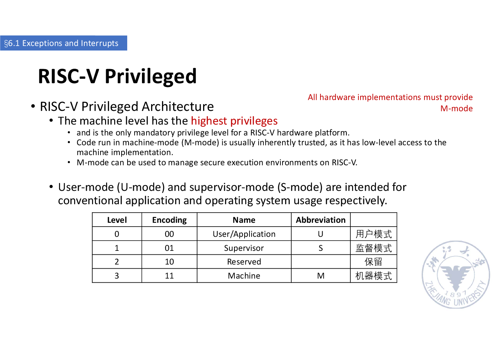

### 1.4 控制与状态寄存器（CSR，p.9–10）【讲义】

- RISC-V 有 **4096 个 CSR**（12 位编码空间 `csr[11:0]`），类似 MIPS 的 CP0；
- CSR 是**额外的一组寄存器**，由某些特权级通过 **CSR 指令**访问；
- 所有 CSR 指令都**原子地读-改-写**一个 CSR；
- 所有特权指令都用 **SYSTEM 主操作码**（`1110011`）编码；
- CSR 与指令都关联一个特权级，并可在**更高特权级**访问。

CSR 指令的通用格式（p.10）：

| 字段 | `csr` | `rs1` | `funct3` | `rd` | `opcode` |
|---|---|---|---|---|---|
| 位宽 | 12 | 5 | 3 | 5 | 7 |
| 含义 | CSR 编号 | 源寄存器 / 立即数 | 操作 | 目标寄存器 | `1110011` |

### 1.5 异常 / 中断相关寄存器（p.11）【讲义】

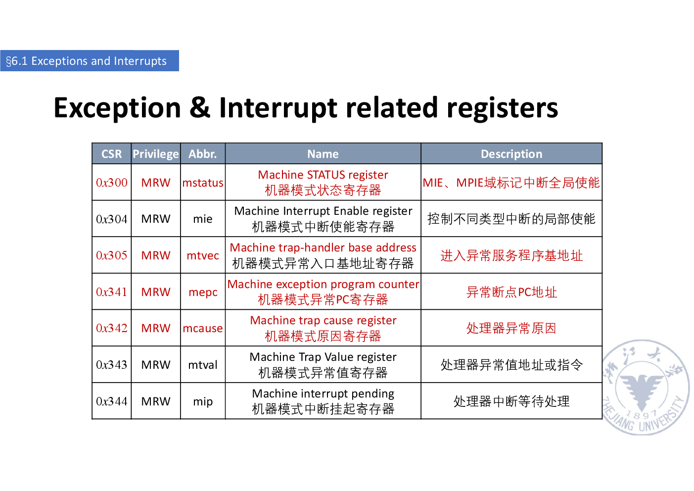

| CSR | 特权 | 缩写 | 名称 | 作用 |
|---|---|---|---|---|
| `0x300` | MRW | `mstatus` | Machine STATUS register | `MIE`、`MPIE` 等域标记中断全局使能 |
| `0x304` | MRW | `mie` | Machine Interrupt Enable register | 控制不同类型中断的**局部**使能 |
| `0x305` | MRW | `mtvec` | Machine trap-handler base address | 异常服务程序入口基地址 |
| `0x341` | MRW | `mepc` | Machine exception program counter | 异常断点 PC |
| `0x342` | MRW | `mcause` | Machine trap cause register | 异常 / 中断原因 |
| `0x343` | MRW | `mtval` | Machine Trap Value register | 异常相关的地址或指令 |
| `0x344` | MRW | `mip` | Machine interrupt pending | 哪些中断正在等待处理 |

**记忆抓手**：

- `mstatus`：**总开关**（`MIE`）与「之前是否开中断」（`MPIE`）；
- `mie` / `mip`：**每一类中断的使能 / 挂起位**；
- `mtvec`：**去哪里**；
- `mepc`：**回到哪里**；
- `mcause`：**为什么**；
- `mtval`：**出错的地址 / 指令**。

### 1.6 `mcause` 编码（p.12）【讲义】

`mcause` 的最高位是 **Interrupt 位**：`1` 表示中断，`0` 表示异常；低位是异常码。常见编码：

| INT | Code | 含义 | INT | Code | 含义 |
|---|---|---|---|---|---|
| 1 | 0 | User software interrupt | 0 | 0 | Instruction address misaligned |
| 1 | 1 | Supervisor software interrupt | 0 | 1 | Instruction access fault |
| 1 | 3 | Machine software interrupt | 0 | 2 | Illegal instruction |
| 1 | 4 | User timer interrupt | 0 | 3 | Breakpoint |
| 1 | 5 | Supervisor timer interrupt | 0 | 4 | Load address misaligned |
| 1 | 7 | Machine timer interrupt | 0 | 5 | Load access fault |
| 1 | 8 | User external interrupt | 0 | 6 | Store/AMO address misaligned |
| 1 | 9 | Supervisor external interrupt | 0 | 7 | Store/AMO access fault |
| 1 | 11 | Machine external interrupt | 0 | 8 | Environment call from U-mode |
| 1 | ≥16 | Reserved for platform use | 0 | 9 | Environment call from S-mode |
| 0 | 16–23 | Reserved | 0 | 11 | Environment call from M-mode |
| 0 | 32–47 | Reserved | 0 | 12 | Instruction page fault |
| 0 | 14/≥64 | Reserved | 0 | 13 | Load page fault |
|  |  |  | 0 | 15 | Store/AMO page fault |

> **整理者注**：`INT` 列就是 `mcause` 的最高位；读表时先看这一位，再看 code。`0/3` 在不同表里分别出现「Breakpoint」与「Load/Store/AMO address breakpoint」，以讲义 p.12 的完整表为准。

### 1.7 中断与同步异常的优先级（p.13）【讲义】

- **中断优先级**：**External interrupt > Software interrupt > Timer interrupt**；
- **同步异常优先级**（从高到低）：

| 优先级 | 异常码 | 含义 |
|---|---|---|
| Highest | 3 | Instruction address breakpoint |
|  | 12 | Instruction page fault |
|  | 1 | Instruction access fault |
|  | 2 | Illegal instruction |
|  | 0 | Instruction address misaligned |
|  | 8, 9, 11 | Environment call |
|  | 3 | Environment break |
|  | 3 | Load/Store/AMO address breakpoint |
|  | 6 | Store/AMO address misaligned |
|  | 4 | Load address misaligned |
|  | 15 | Store/AMO page fault |
|  | 13 | Load page fault |
|  | 7 | Store/AMO access fault |
| Lowest | 5 | Load access fault |

> **待确认**：表中异常码 `3` 出现多次（Instruction address breakpoint、Environment break、Load/Store/AMO address breakpoint），讲义未解释如何区分；引用时以教材 / 特权规范为准。

### 1.8 CSR 指令（p.14）【讲义】

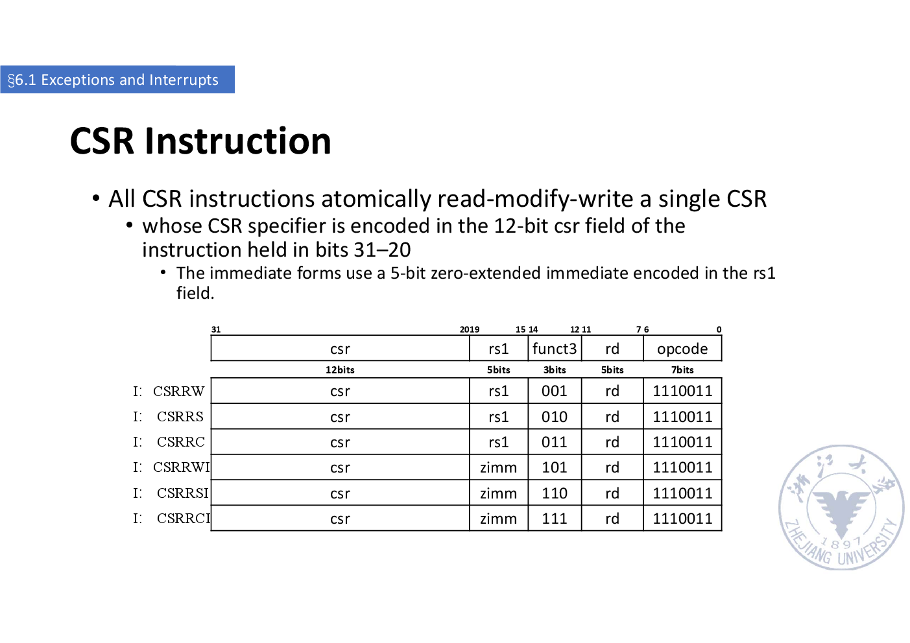

| 指令 | `funct3` | 语义 |
|---|---|---|
| `CSRRW` | `001` | 读 CSR 到 `rd`，并把 `rs1` 写入 CSR |
| `CSRRS` | `010` | 读 CSR 到 `rd`，并把 `rs1` 的位**置 1** |
| `CSRRC` | `011` | 读 CSR 到 `rd`，并把 `rs1` 的位**清 0** |
| `CSRRWI` | `101` | 立即数版 `CSRRW`（`zimm` 零扩展 5 位） |
| `CSRRSI` | `110` | 立即数版 `CSRRS` |
| `CSRRCI` | `111` | 立即数版 `CSRRC` |

- 所有 CSR 指令都是**原子**的读-改-写；
- 立即数形式用 `rs1` 字段的 5 位零扩展立即数；
- 操作码固定 `1110011`（SYSTEM）。

### 1.9 异常相关指令（p.15）【讲义】

| 指令 | 编码要点 | 作用 |
|---|---|---|
| `MRET` | `0011000 00010 00000 000 00000 1110011` | 从 M 模式异常返回：`PC ← MEPC`，并更新 `mstatus` |
| `SRET` | `0001000 00010 00000 000 00000 1110011` | 从 S 模式异常返回 |
| `WFI` | `0001000 00101 00000 000 00000 1110011` | 等待中断 |
| `ECALL` | `0000000 00000 00000 000 00000 1110011` | 环境调用（系统调用） |
| `EBREAK` | `0000000 00001 00000 000 00000 1110011` | 断点 |

- `ECALL` / `EBREAK` 的 `mepc` 保存的是**这条指令本身的 PC**（不是下一条），这样返回时可以重新执行或跳过；
- `MRET` 返回时还会恢复中断使能状态（见 §1.11）。

### 1.10 控制逻辑如何检测与进入异常（p.16–17）【讲义】

**要加的硬件**：

- **测试逻辑**：非法指令、load/store 地址未对齐等；
- **控制信号**：`CauseWrite`（写 `mcause`）、`EPCWrite`（写 `mepc`）、`TVALWrite`（写 `mtval`）。

**进入异常时的动作**（p.16）：

```text
mepc        ← pc（异常）或 pc+4（中断）
mcause      ← 置对应位
mtval       ← 出错的内存地址或非法指令
mstatus.mpie ← mstatus.mie
mstatus.mie  ← 0
mstatus.mpp  ← mstatus.mp（当前特权级）
mstatus.mp   ← 11（进入 M 模式）
PC          ← mtvec（异常服务程序入口，如 0000 0000 1C09 0000）
```

**什么时候跳转到 handler**（p.17）：

$$
\text{跳转} \iff \texttt{mstatus.mie}=1 \;\land\; \texttt{mie}[i]=1 \;\land\; \texttt{mip}[i]=1 .
$$

即「全局开中断 + 该类中断局部使能 + 该类中断挂起」三者同时成立。

### 1.11 返回：`mret`（p.18）【讲义】

```text
PC          ← CSRs[mepc]
mstatus.MIE ← mstatus.MPIE
mstatus.MP  ← mstatus.MPP
```

> **整理者注**：进入异常时把 `MIE` 存进 `MPIE` 并关中断，返回时再恢复；这样 handler 内部不会被同级中断打断，返回后又能回到原来的开关状态。

### 1.12 向量中断（Vectored Interrupts，p.19）【讲义】

- 另一种机制（如 x86、ARM）：**handler 地址由 cause 决定**；
- 把「异常向量地址」加到向量表基址寄存器上；
  - 未定义操作码：`00 0100 0000two`
  - 硬件故障：`01 1000 0000two`
  - …
- 向量表里的指令可以**直接处理**该中断，也可以**跳转到真正的 handler**。

> **对比**：RISC-V 的 `mtvec` 是「统一入口 + 软件读 `mcause` 分派」；向量中断是「硬件按 cause 直接选中入口」。两者可以结合（`mtvec` 的 mode 位支持向量模式）。

### 1.13 流水线中的异常（p.20–27）【讲义】

**异常是另一种控制冒险**（p.20）。以 `add x1, x2, x1` 在 **EX 段**发生故障为例：

1. **防止 `x1` 被写坏**（不要让它写回）；
2. **完成前面的指令**（它们已经更靠后，必须让它们提交）；
3. **冲刷 `add` 及其后续指令**；
4. **设置 SEPC 和 SCAUSE**；
5. **把控制权转给 handler**。

这与**分支误预测**非常像，可以复用大部分硬件（p.20）。

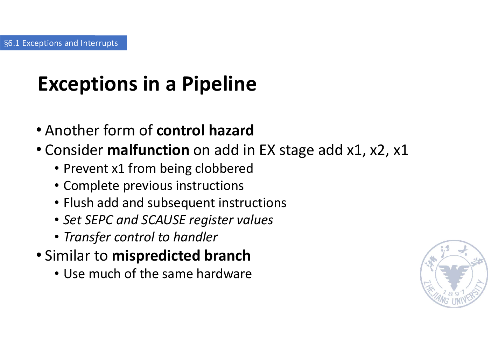

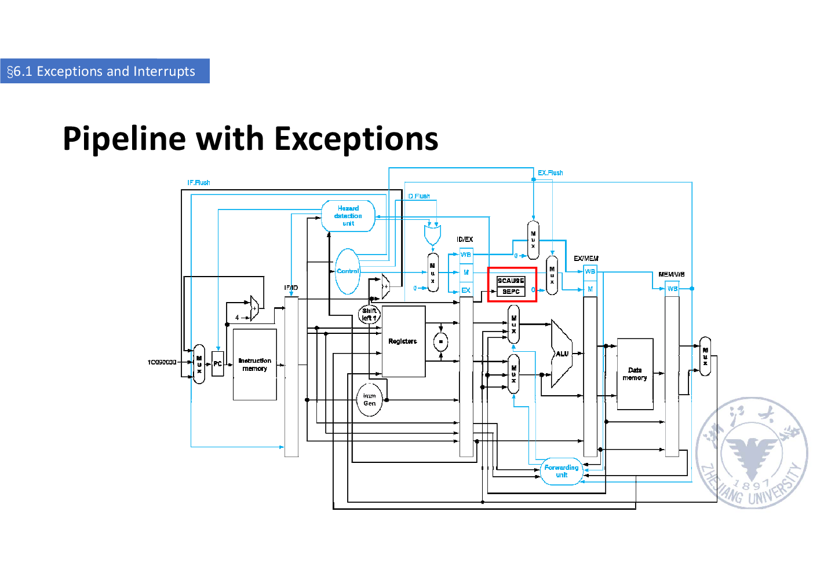

**可重启异常（restartable exceptions）**（p.22）：

- 流水线可以冲刷出错的指令；
- handler 执行完后**返回到该指令**；
- 该指令被**重新取指、从头执行**；
- PC 保存在 SEPC 中，能标识「是哪条指令出的错」。

**例子**（p.23–25）：`add x1,x2,x1` 在地址 `4c` 处发生异常；handler 从 `1C090000` 开始。p.24 是 **Clock 6**：`add` 在 EX 段，异常被检测到，IF/ID 与 ID/EX 被冲刷，SEPC 写入 `4c`；p.25 是 **Clock 7**：PC 已指向 handler，流水线里填入 bubble。

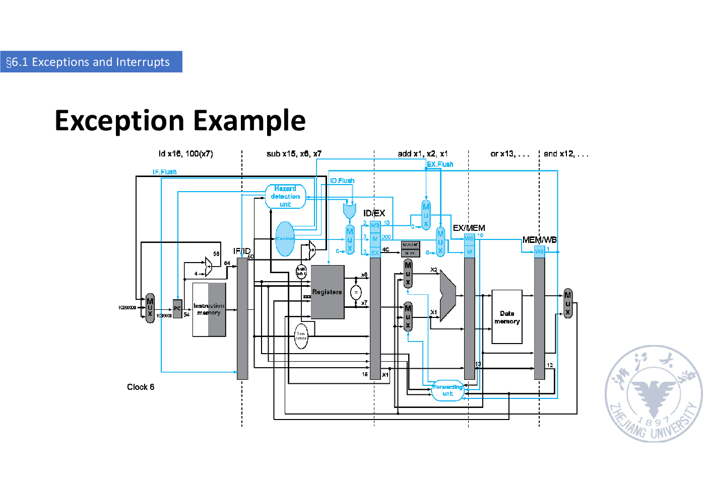

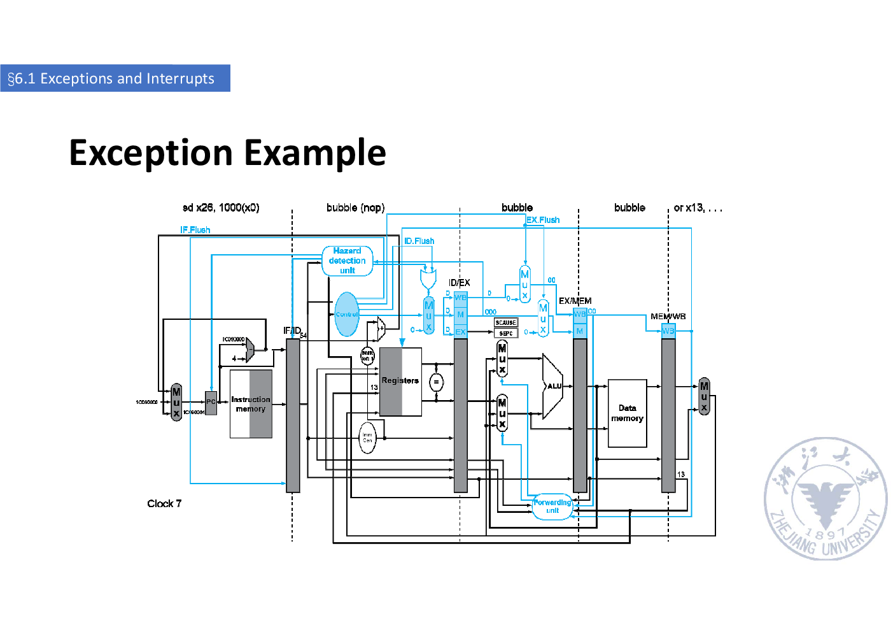

**多个异常**（p.26）：

- 流水线同时重叠多条指令，可能**同时**有多个异常；
- 简单做法：**处理最早那条指令的异常**，冲刷后续指令 → **精确异常（precise）**；
- 复杂流水线（每拍多发射、乱序完成）要维持精确异常**很难**。

**不精确异常（imprecise）**（p.27）：

- 直接**停止流水线并保存状态**（包括所有异常原因）；
- 让 handler 自己判断：哪些指令出了异常、哪些要完成、哪些要冲刷；
- 可能需要「手工」完成某些指令；
- **简化硬件，但 handler 软件更复杂**；
- 对复杂的多发射乱序流水线**不可行**。

> **整理者注**：第 5 讲的「顺序提交 / ROB」正是为了在乱序执行下仍能维持**精确异常**——只有按程序顺序提交，才能保证「异常发生时，它前面的指令都完成、后面的都没生效」。

---

## 2. §6.2 软硬件接口（p.28–52）

### 2.1 系统分层（p.29）【讲义】

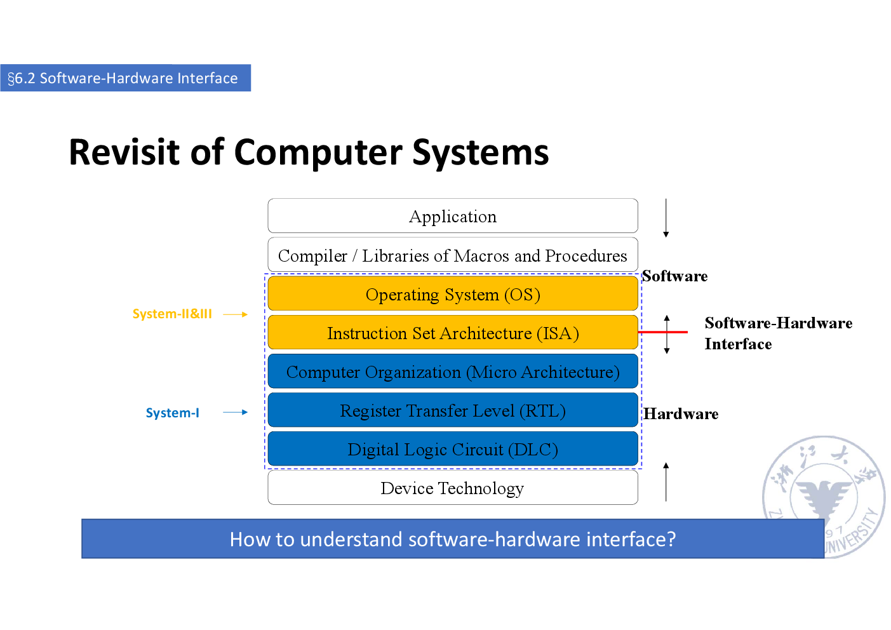

从上到下：

| 层次 | 内容 |
|---|---|
| Application | 应用程序 |
| Compiler / Libraries of Macros and Procedures | 编译器、宏与过程库 |
| Operating System (OS) | 操作系统 |
| **Instruction Set Architecture (ISA)** | **指令集体系结构**——软硬件接口 |
| Computer Organization (Micro Architecture) | 微体系结构 |
| Register Transfer Level (RTL) | 寄存器传输级 |
| Digital Logic Circuit (DLC) | 数字逻辑电路 |
| Device Technology | 器件工艺 |

讲义用红字标出：**OS 与 ISA 之间**就是「Software-Hardware Interface」；`System-II&III` 关注 OS + ISA，`System-I` 关注 Organization / RTL / DLC。

> **整理者注**：严格说，ISA 是软件与硬件之间的**合同**；OS 是「使用这份合同的系统软件」。讲义把 OS 与 ISA 一起框进接口，是为了强调「OS 必须按 ISA 的约定管理硬件」。

### 2.2 CPU 里有什么（p.31–33）【讲义】

| 部件 | 作用 |
|---|---|
| **Program Counter（PC）** | 指向**下一条**要执行指令在内存中的地址；每条指令后自增，控制流改变时被写入新值 |
| **Current Instruction Register** | 保存**当前正在执行**的指令 |
| **Registers** | 硬件指令直接操作的「变量」；可从内存 load 到寄存器、从寄存器 store 回内存；运算的操作数与结果都在寄存器；访问很快，但数量有限 |
| **ALU** | 做算术 / 逻辑运算（`+`、`*`、`/`、`-`、`OR`、`AND`、`XOR` 等），结果写回寄存器 |
| **Control Unit** | 译码指令（根据指令的位），向 CPU 各部件发出相应的电信号 |
| **Memory / I/O System** | 指令与数据的来源 / 去处 |

### 2.3 已经见过的软硬件协作（p.34–36）【讲义】

CPU 设计里已经出现过不少「软硬件接口」：

| 冒险 | 硬件方案 | 软件方案 | 协作 |
|---|---|---|---|
| **数据冒险（Data hazards）** | **Forwarding**（转发） | **Code reordering**（指令重排） | 硬件尽量转发，编译器尽量排开 |
| **控制冒险（Control hazards）** | **Prediction**（分支预测） | **Code scheduling**（代码调度，如延迟槽） | 硬件猜，编译器填 |

> **整理者注**：这就是「软硬件接口」的第一层含义——同一个问题，硬件和软件各承担一部分；接口规定了「硬件保证什么、软件必须保证什么」。

### 2.4 CPU 到底在做什么（p.38–39）【讲义】

- 内存里存放着一堆字节：整数、ASCII 字符、浮点数、RGB 值，以及**指令**；
- 指令的含义由**厂商定义的指令集**决定（例如 `0010 1101` 可能表示「某个计数器加一」）；
- CPU 是**修改这些字节的硬件**；
- 因此可以把 CPU 看成一台**把一种内存状态变成另一种内存状态**的设备。

p.39 的例子：

```text
00: addi r5, r0, 10      # r5 = r0 + 10
04: muli r5, r5, 2       # r5 = r5 * 2
08: addi r5, r5, 15      # r5 = r5 + 15
```

硬件按 PC 取指、译码、读寄存器、ALU 运算、写回；`r0` 恒为 0，`r5` 依次变成 10、20、35。

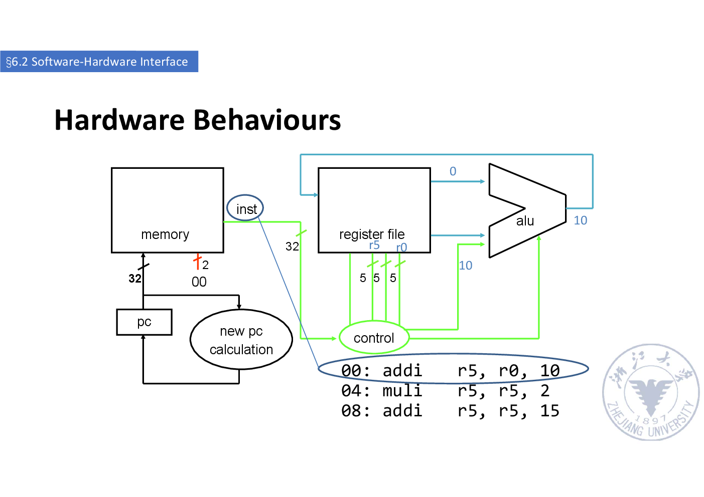

### 2.5 程序代码的层次（p.40）【讲义】

| 层次 | 形式 | 由谁产生 |
|---|---|---|
| **硬件表示（hardware representation）** | 二进制位；编码后的指令与数据 | 汇编器 / 编译器 |
| **汇编语言（assembly language）** | 指令的文本表示 | 编译器 / 人 |
| **高级语言（high-level language）** | 更接近问题域的抽象；提高生产率与可移植性 | 人 |

### 2.6 从 C 到机器码（p.41–44）【讲义】

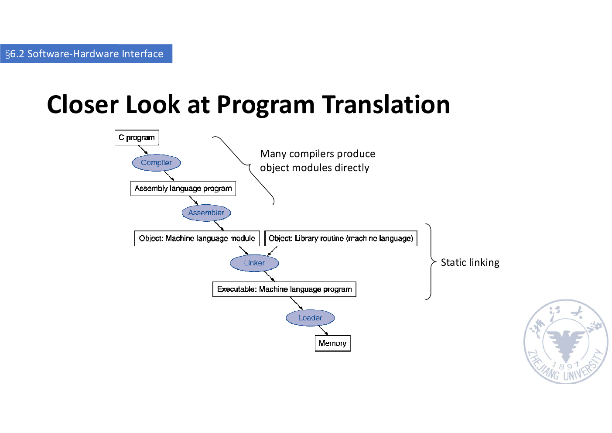

典型流程：

```text
C program
  → Compiler（编译器）
  → Assembly language program（汇编）
  → Assembler（汇编器）
  → Object: Machine language module（目标模块）
  + Object: Library routine（库例程目标模块）
  → Linker（链接器）
  → Executable: Machine language program（可执行文件）
  → Loader（加载器）
  → Memory
```

讲义特别指出：**很多编译器直接产生目标模块**，不一定显式落一份汇编文件；图中的「静态链接（static linking）」是把库例程目标模块一起链接进可执行文件。

**例子**（p.44）：

```c
int x = 10;
x = 2 * x + 15;
```

编译成 RISC-V 汇编：

```asm
addi r5, r0, 10      # r5 = r0 + 10
multi r5, r5, 2      # r5 = r5 * 2
addi r5, r5, 15      # r5 = r5 + 15
```

再汇编成机器码（p.44 给出了三条 32 位编码）。讲义用红字总结：**Everything is a number!**——指令、寄存器号、立即数最终都是二进制数。

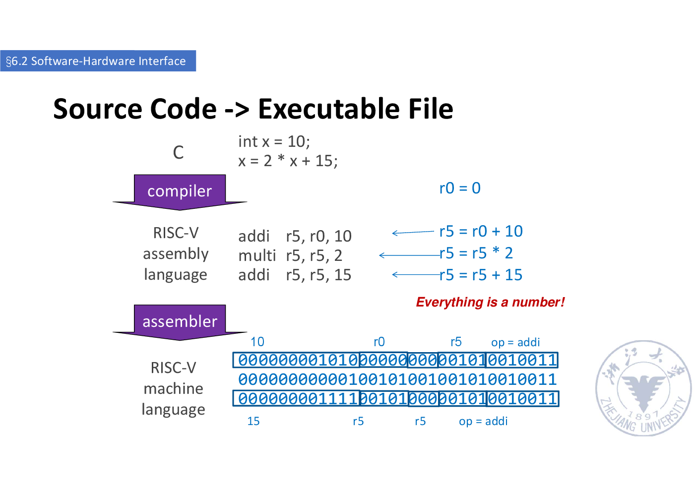

> **待确认**：p.44 写作 `multi`（p.39 写作 `muli`），RISC-V 标准乘法指令是 `mul`；这里可能是伪指令或讲义笔误，考试时以教材 / 汇编器为准。

### 2.7 汇编伪指令（p.45）【讲义】

- 大多数汇编指令与机器指令**一一对应**；
- **伪指令（pseudo-instruction）** 是汇编器「想象出来的」指令，会被展开成一条或多条真实指令：

```asm
mov x5, x6          →  add x5, x0, x6
blt x5, x6, L       →  slt x1, x5, x6
                       bne x1, x0, L
```

- 其中 `x1` 是**汇编器临时寄存器（assembler temporary）**，程序员不应依赖它的值。

### 2.8 目标模块（p.46）【讲义】

汇编器（或编译器）把程序翻译成机器指令，同时提供「把各个片段拼成完整程序」所需的信息：

| 部分 | 内容 |
|---|---|
| **Object file header** | 目标模块的描述：名称、text 大小、data 大小 |
| **Text segment** | 翻译后的机器指令 |
| **Static data segment** | 程序生命周期内分配的数据 |
| **Relocation information** | 依赖「加载后绝对地址」的内容 |
| **Symbol table** | 全局定义与外部引用 |
| **Debug info** | 与源代码的对应关系 |

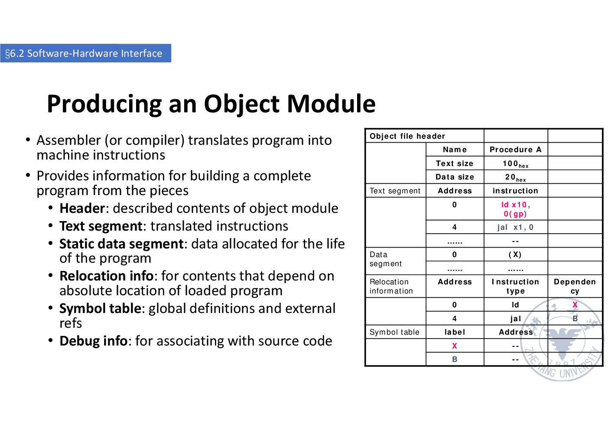

### 2.9 链接（p.47–48）【讲义】

链接器把多个目标模块拼成**可执行映像**：

1. **合并段（merges segments）**；
2. **解析符号（resolve labels）**——确定它们的地址；
3. **修补位置相关引用与外部引用**（patch location-dependent and external refs）。

- 也可以把位置相关的修补留给**可重定位加载器（relocating loader）**；
- 但有**虚拟内存**后就不必这样做：程序可以加载到虚拟地址空间中的**绝对位置**。

p.48 用 Procedure A / Procedure B 两个目标模块演示：合并 text / data 段、更新 relocation 信息、填好 symbol table 的地址，最后得到 executable file header + 合并后的段。

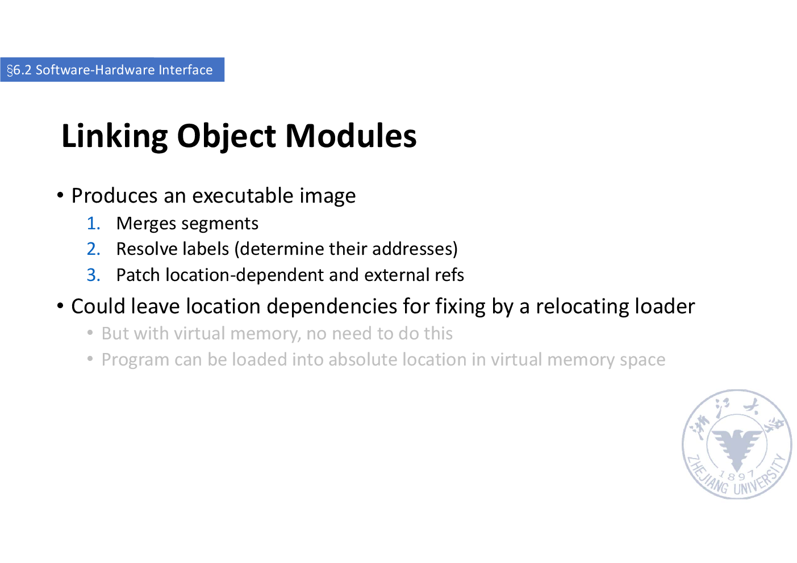

### 2.10 加载程序（p.49）【讲义】

加载器把磁盘上的映像文件装入内存：

1. 读 header，确定各段大小；
2. 创建**虚拟地址空间**；
3. 把 text 与已初始化数据复制到内存（或设置页表项，让它按需缺页装入）；
4. 在栈上设置参数；
5. 初始化寄存器（包括 `x2` 栈指针、`x3` 全局指针）；
6. 跳到启动例程（startup routine）：把参数复制到 `x10` 等寄存器并调用 `main`；`main` 返回后执行 `exit` 系统调用。

### 2.11 动态链接与懒绑定（p.50–51）【讲义】

**动态链接（dynamic linking）**：

- 只在库过程**被调用时**才链接 / 加载；
- 要求库代码**可重定位**；
- 避免静态链接所有（传递引用的）库造成的**映像膨胀**；
- 能自动使用**新的库版本**。

**懒绑定（lazy linkage）**（p.51）：

- 每个库过程在调用点先经过一张**间接表（indirection table）**；
- 第一次调用时，表项指向一段 **stub**：stub 把例程 ID 装入，跳转到**链接器 / 加载器**；
- 链接器 / 加载器解析出真正地址，改写间接表；
- 之后的调用直接通过间接表跳到**动态映射的代码**，不再经过 stub。

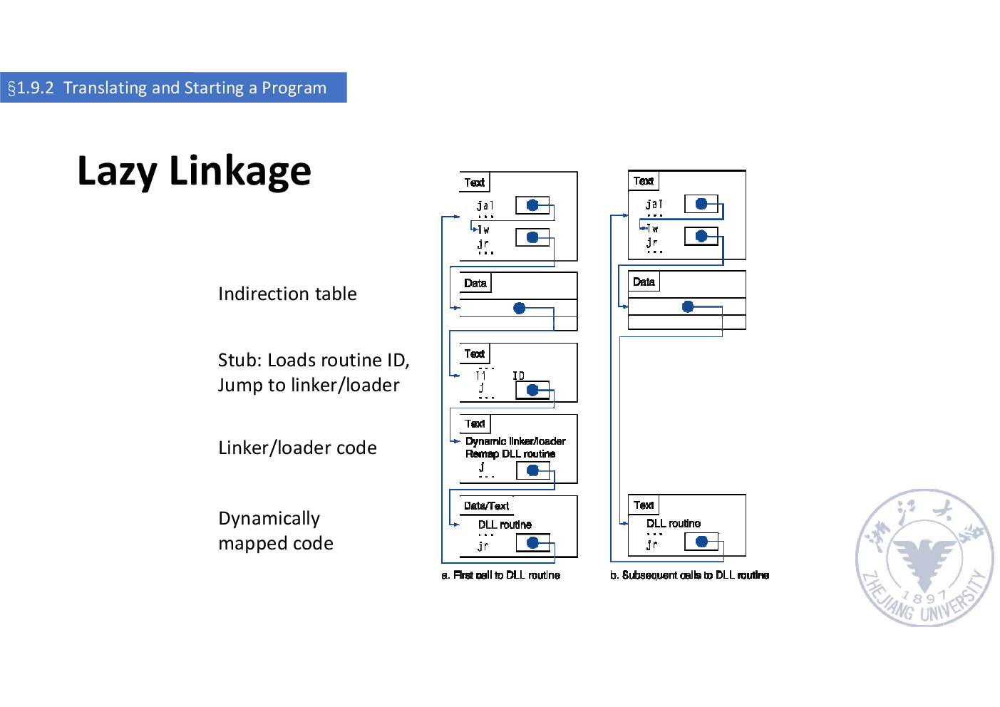

### 2.12 程序之下（p.52）【讲义】

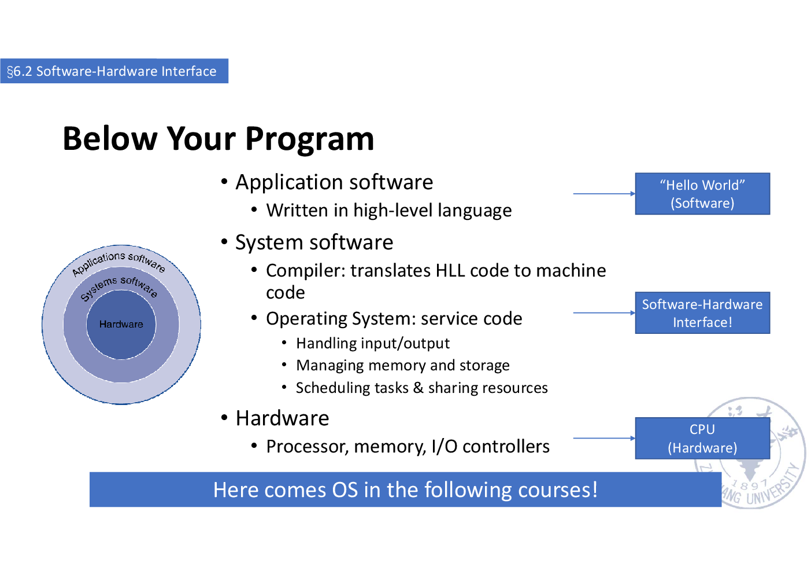

| 层 | 内容 | 例子 |
|---|---|---|
| **Application software** | 高级语言写的程序 | “Hello World” |
| **System software** | 编译器；操作系统（服务代码） | 编译：HLL → 机器码；OS：I/O、内存与存储管理、任务调度与资源共享 |
| **Hardware** | 处理器、内存、I/O 控制器 | CPU |

讲义在 OS 一栏标出 **Software-Hardware Interface!**，并提示「Here comes OS in the following courses!」——下一节就是 OS 的快速导览。

---

## 3. §6.3 操作系统简介（p.53–65）

### 3.1 什么是操作系统（p.54）【讲义】

- OS 是**用户与计算机硬件之间的中介**；
- 目标：
  1. **执行用户程序**，让用户解决问题更容易；
  2. 让计算机系统**方便使用**；
  3. **高效利用**硬件。

### 3.2 OS 做什么：取决于视角（p.55）【讲义】

- **用户**想要方便、易用、性能好，并不关心资源利用率；
- **共享计算机**（大型机 / 小型机）必须让所有用户都满意；
- **专用系统**（工作站）有专用资源，但经常使用服务器上的共享资源；
- **手持设备**资源贫乏，优化可用性与电池寿命；
- **嵌入式**计算机可能几乎没有用户界面（设备、汽车）。

### 3.3 OS 的定义（p.56–57）【讲义】

- **资源分配器（resource allocator）**：管理所有资源，在冲突请求之间做决定，追求高效与公平；
- **控制程序（control program）**：控制程序执行，防止错误与不当使用；
- 没有普遍接受的定义；
- 「厂商交付操作系统时附带的一切」是一个不错的近似，但差异极大；
- 「**始终在计算机上运行的那一个程序**」是**内核（kernel）**；
- 其余要么是**系统程序**（随 OS 交付），要么是**应用程序**。

### 3.4 OS 的结构：多道程序与分时（p.58）【讲义】

- **多道程序（multiprogramming / batch system）**：为了提高效率；
  - 单个用户无法让 CPU 与 I/O 设备始终忙碌；
  - 把作业（代码与数据）组织起来，使 CPU 总有活干；
  - 内存中只保留作业的一个子集，通过 **job scheduling** 选一个运行；
  - 当它等待 I/O 时，OS 切换到另一个作业。
- **分时（timesharing / multitasking）**：多道程序的逻辑扩展；
  - CPU 频繁切换作业，用户能与正在运行的作业交互 → **交互式计算**；
  - 响应时间应 **< 1 秒**；
  - 每个用户至少有一个程序在内存中执行 → **进程（process）**；
  - 多个作业同时就绪 → **CPU scheduling**；
  - 进程放不下内存 → **swapping** 换入换出。

### 3.5 OS 的操作：中断驱动（p.59）【讲义】

- OS 是**中断驱动**的（硬件与软件）；
- **硬件中断**：某个设备发出；
- **软件中断（异常 / 陷阱）**：
  - 软件错误（如除零）；
  - 请求 OS 服务（系统调用）；
  - 其他进程问题：死循环、进程互相修改或修改 OS。

### 3.6 OS 的任务（p.60–65）【讲义】

| 任务 | 要点 |
|---|---|
| **进程管理（Process Management）** | 进程是**执行中的程序**，是系统的工作单位；程序是被动实体，进程是主动实体；进程需要 CPU、内存、I/O、文件与初始化数据；多个进程在一个或多个 CPU 上并发，通过**多路复用 CPU** 实现并发 |
| **内存管理（Memory Management）** | 程序要执行，全部（或部分）指令与数据必须在内存；决定**什么在内存、何时在内存**，以优化 CPU 利用率与响应时间 |
| **存储管理（Storage Management）** | OS 提供统一、逻辑的信息存储视图；把物理属性抽象为**文件**；每种介质由设备控制（磁盘、磁带），属性包括访问速度、容量、传输率、访问方式（顺序 / 随机）；文件系统管理目录与访问控制 |
| **I/O 子系统（I/O Subsystem）** | 对用户**隐藏硬件设备的特殊性**；负责 I/O 的内存管理：**buffering**（传输时暂存）、**caching**（把部分数据放更快存储）、**spooling**（一个作业的输出与另一个作业的输入重叠）；提供通用设备驱动接口与具体设备驱动 |
| **保护与安全（Protection and Security）** | **Protection**：控制进程 / 用户对 OS 定义资源的访问；**Security**：防御内部与外部攻击（DoS、蠕虫、病毒、身份盗用、服务盗用）；系统通常先区分用户，再决定谁能做什么 |

---

## 4. 听课重点与易混点

### 4.1 Exception vs Interrupt

- **Exception**：CPU **内部**（未定义指令、`ecall`、地址未对齐……）；
- **Interrupt**：**外部** I/O 控制器；
- RISC-V 用 `mcause` 最高位区分两者，但进入 handler 的流程相同。

### 4.2 SEPC/SCAUSE vs mepc/mcause

- p.4 写的是 **SEPC/SCAUSE**（Supervisor 级）；
- p.11–18 用的是 **`mepc/mcause`**（Machine 级）；
- 记法：**M 模式用 m\*，S 模式用 s\***；考试时看清题目问的是哪个特权级。

### 4.3 进入异常 vs 返回异常的寄存器动作

| 动作 | 进入异常 | `mret` 返回 |
|---|---|---|
| PC | `mepc ← pc`（异常）或 `pc+4`（中断） | `PC ← mepc` |
| 原因 | `mcause ← cause` | — |
| 值 | `mtval ← 地址 / 指令` | — |
| 中断使能 | `MPIE ← MIE`，`MIE ← 0` | `MIE ← MPIE` |
| 特权级 | `MPP ← MP`，`MP ← 11` | `MP ← MPP` |

### 4.4 精确异常 vs 不精确异常

- **精确（precise）**：只处理最早一条指令的异常，冲刷后续；前面的指令都完成、后面的都没生效；
- **不精确（imprecise）**：停流水线、保存全部状态，让 handler 自己判断；硬件简单、软件复杂；
- 多发射 + 乱序完成的流水线很难维持精确异常，ROB / 顺序提交是常见解法。

### 4.5 异常 vs 分支误预测

- 两者都是**控制冒险**；
- 异常要额外保存 `mepc/mcause/mtval`，并冲刷出错指令及其后续；
- 可以复用分支冲刷的大部分硬件。

### 4.6 编译 / 汇编 / 链接 / 加载的分工

| 阶段 | 输入 | 输出 | 主要工作 |
|---|---|---|---|
| 编译 | C 源码 | 汇编 | 语义分析、优化、代码生成 |
| 汇编 | 汇编 | 目标模块 | 指令编码、伪指令展开、生成符号表 / 重定位信息 |
| 链接 | 多个目标模块 + 库 | 可执行文件 | 合并段、解析符号、修补引用 |
| 加载 | 可执行文件 | 内存中的进程 | 建地址空间、复制 / 映射段、设参数、初始化寄存器、跳启动例程 |

### 4.7 静态链接 vs 动态链接

- **静态**：库代码复制进可执行文件；映像大，但运行时不需要找库；
- **动态**：调用时才链接 / 加载；映像小、可共享、自动升级，但需要间接表 / stub 与可重定位代码；
- **懒绑定**：第一次调用才解析，之后直接走间接表。

### 4.8 「Everything is a number」

- 指令、寄存器号、立即数、地址，最终都是二进制；
- 但**同样的位模式**可以有不同解释（指令 / 整数 / 浮点 / 字符 / RGB），取决于**谁在用它**；
- 这就是 ISA 作为「合同」的意义：硬件按约定的编码解释位。

### 4.9 OS 的三个视角

- **用户视角**：方便、易用、性能；
- **资源视角**：分配器，公平高效；
- **控制视角**：防止错误与不当使用；
- 三者不总一致，OS 要在冲突目标之间折中。

---

## 5. 课前自测 / 复习清单

1. Exception 与 Interrupt 的区别是什么？各举两个例子。（[§1.1](#11-术语exception-vs-interruptp3讲义)）
2. 处理异常的三步是什么？RISC-V 分别用哪些寄存器保存 PC 与原因？（[§1.2](#12-处理异常的三步p45讲义)）
3. RISC-V 有哪几种特权级？哪一种是必须实现的？1/2/3 级分别适合什么场景？（[§1.3](#13-risc-v-特权级p78讲义)）
4. CSR 是什么？CSR 指令的通用格式与六种 `funct3` 分别是什么？（[§1.4](#14-控制与状态寄存器csrp910讲义)、[§1.8](#18-csr-指令p14讲义)）
5. `mstatus`、`mie`、`mtvec`、`mepc`、`mcause`、`mtval`、`mip` 各起什么作用？（[§1.5](#15-异常--中断相关寄存器p11讲义)）
6. `mcause` 的最高位与低位分别表示什么？中断与同步异常的优先级如何？（[§1.6](#16-mcause-编码p12讲义)、[§1.7](#17-中断与同步异常的优先级p13讲义)）
7. 进入异常时，`mepc`、`mcause`、`mtval`、`mstatus` 分别怎么变？`mret` 又怎么恢复？（[§1.10](#110-控制逻辑如何检测与进入异常p1617讲义)、[§1.11](#111-返回mretp18讲义)）
8. 什么时候会跳转到 handler？三个条件分别是什么？（[§1.10](#110-控制逻辑如何检测与进入异常p1617讲义)）
9. 向量中断与 RISC-V 的统一入口 + `mcause` 分派有什么不同？（[§1.12](#112-向量中断vectored-interruptsp19讲义)）
10. 流水线中的异常为什么要冲刷？它与分支误预测有什么相似之处？（[§1.13](#113-流水线中的异常p2027讲义)）
11. 精确异常与不精确异常的区别是什么？为什么多发射乱序流水线更难维持精确异常？（[§4.4](#44-精确异常-vs-不精确异常)、[§1.13](#113-流水线中的异常p2027讲义)）
12. 画出计算机系统的分层图，并指出软硬件接口在哪一层。（[§2.1](#21-系统分层p29讲义)）
13. CPU 里有哪些主要部件？PC、IR、寄存器、ALU、控制单元各做什么？（[§2.2](#22-cpu-里有什么p3133讲义)）
14. 数据冒险与控制冒险分别有哪些硬件 / 软件协作方案？（[§2.3](#23-已经见过的软硬件协作p3436讲义)）
15. 为什么说 CPU 是「把一种内存状态变成另一种内存状态」的设备？（[§2.4](#24-cpu-到底在做什么p3839讲义)）
16. 从 C 源码到可执行文件，要经过哪些阶段？每个阶段的输入 / 输出是什么？（[§2.6](#26-从-c-到机器码p4144讲义)、[§4.6](#46-编译--汇编--链接--加载的分工)）
17. 什么是伪指令？`mov`、`blt` 会被展开成什么？（[§2.7](#27-汇编伪指令p45讲义)）
18. 目标模块包含哪些部分？链接器做哪三件事？（[§2.8](#28-目标模块p46讲义)、[§2.9](#29-链接p4748讲义)）
19. 加载器做哪六步？启动例程如何调用 `main`？（[§2.10](#210-加载程序p49讲义)）
20. 动态链接与懒绑定分别解决什么问题？stub 与间接表如何配合？（[§2.11](#211-动态链接与懒绑定p5051讲义)）
21. OS 的定义有哪两个视角？内核与系统程序 / 应用程序如何区分？（[§3.3](#33-os-的定义p5657讲义)）
22. 多道程序与分时有什么区别？响应时间、进程、swapping 各指什么？（[§3.4](#34-os-的结构多道程序与分时p58讲义)）
23. OS 的五大任务是什么？进程与程序的区别是什么？（[§3.6](#36-os-的任务p6065讲义)）
24. Protection 与 Security 的区别是什么？（[§3.6](#36-os-的任务p6065讲义)）

### 5.1 关联知识点（本讲 / 跨讲）

- **第 4 讲**：控制冒险与分支冲刷见 [第 4 讲 §4.3 控制冒险](04_第04讲_流水线冒险.md#4-43-控制冒险control-hazardsp3267)；本讲的异常冲刷与它复用同一套硬件。
- **第 5 讲**：多发射 / 乱序执行使精确异常变难，见 [第 5 讲 §3.17 动态多发射与乱序执行](05_第05讲_非线性流水线调度与多发射.md#317-动态多发射与乱序执行p6971讲义)；ROB 的顺序提交是维持精确异常的关键。
- **第 1 讲**：ISA 作为软硬件接口、RISC-V 指令格式与过程调用，见 [第 1 讲 §1.4 / §1.5 RISC-V](01_第01讲_课程介绍与ISA设计原理.md#5-14--15-risc-与-risc-vp82108)；本讲的 CSR 指令与异常指令是 ISA 的特权部分。
- **第 2 讲**：流水线性能与时空图，见 [第 2 讲 §5 性能评价](02_第02讲_流水线概念分类与性能评价.md#5-25-流水线性能评价p6792)；本讲的异常开销也要按「冲刷了几拍」来算。
- **后续课程**：OS 的进程 / 内存 / 存储 / I/O / 保护将在操作系统课程展开；本讲只建立「OS 是中断驱动的资源管理者」这一层直觉。

---

## 6. 来源、页码对照与待确认

### 6.1 页码对照

| 主题 | 页码 | 本文章节 |
|---|---|---|
| 标题、教师信息 | p.1 | — |
| 异常 / 中断术语 | p.2–3 | [§1.1](#11-术语exception-vs-interruptp3讲义) |
| 处理异常的三步、handler 动作 | p.4–5 | [§1.2](#12-处理异常的三步p45讲义) |
| RISC-V 特权级 | p.7–8 | [§1.3](#13-risc-v-特权级p78讲义) |
| CSR 与 CSR 格式 | p.9–10 | [§1.4](#14-控制与状态寄存器csrp910讲义) |
| 异常 / 中断相关 CSR | p.11 | [§1.5](#15-异常--中断相关寄存器p11讲义) |
| `mcause` 编码 | p.12 | [§1.6](#16-mcause-编码p12讲义) |
| 中断 / 异常优先级 | p.13 | [§1.7](#17-中断与同步异常的优先级p13讲义) |
| CSR 指令 | p.14 | [§1.8](#18-csr-指令p14讲义) |
| MRET / SRET / WFI / ECALL / EBREAK | p.15 | [§1.9](#19-异常相关指令p15讲义) |
| 控制逻辑与跳转条件 | p.16–17 | [§1.10](#110-控制逻辑如何检测与进入异常p1617讲义) |
| `mret` 返回 | p.18 | [§1.11](#111-返回mretp18讲义) |
| 向量中断 | p.19 | [§1.12](#112-向量中断vectored-interruptsp19讲义) |
| 流水线中的异常 | p.20–25 | [§1.13](#113-流水线中的异常p2027讲义) |
| 多个异常、不精确异常 | p.26–27 | [§1.13](#113-流水线中的异常p2027讲义) |
| 系统分层 | p.29 | [§2.1](#21-系统分层p29讲义) |
| CPU 组成 | p.31–33 | [§2.2](#22-cpu-里有什么p3133讲义) |
| 软硬件协作（数据 / 控制冒险） | p.34–36 | [§2.3](#23-已经见过的软硬件协作p3436讲义) |
| CPU 的行为 | p.38–39 | [§2.4](#24-cpu-到底在做什么p3839讲义) |
| 程序代码层次 | p.40 | [§2.5](#25-程序代码的层次p40讲义) |
| 程序翻译流程 | p.41–44 | [§2.6](#26-从-c-到机器码p4144讲义) |
| 伪指令 | p.45 | [§2.7](#27-汇编伪指令p45讲义) |
| 目标模块 | p.46 | [§2.8](#28-目标模块p46讲义) |
| 链接 | p.47–48 | [§2.9](#29-链接p4748讲义) |
| 加载 | p.49 | [§2.10](#210-加载程序p49讲义) |
| 动态链接、懒绑定 | p.50–51 | [§2.11](#211-动态链接与懒绑定p5051讲义) |
| 程序之下 | p.52 | [§2.12](#212-程序之下p52讲义) |
| OS 是什么、目标 | p.54 | [§3.1](#31-什么是操作系统p54讲义) |
| OS 的视角 | p.55 | [§3.2](#32-os-做什么取决于视角p55讲义) |
| OS 定义、内核 | p.56–57 | [§3.3](#33-os-的定义p5657讲义) |
| 多道程序 / 分时 | p.58 | [§3.4](#34-os-的结构多道程序与分时p58讲义) |
| OS 操作：中断驱动 | p.59 | [§3.5](#35-os-的操作中断驱动p59讲义) |
| OS 五大任务 | p.60–65 | [§3.6](#36-os-的任务p6065讲义) |

### 6.2 待确认清单

1. **p.4 的 SEPC / SCAUSE 与 p.11–18 的 mepc / mcause**：前者是 Supervisor 级 CSR，后者是 Machine 级 CSR；讲义混用。按 RISC-V 规范，M 模式异常用 `mepc/mcause`，S 模式用 `sepc/scause`。本文在 M 模式流程中以 `mepc/mcause` 为准。
2. **p.4 的「64 bits」**：RISC-V 的 CSR 位宽取决于实现（RV32/RV64），`mcause` 在 RV32 上为 32 位；讲义按 64 位描述，可能是面向 RV64。引用时注意。
3. **p.12 的 `INT` 列**：讲义表头写作 `INT`，实际是 `mcause` 的 Interrupt 位；`1` 为中断、`0` 为异常。表中 `0/3` 同时出现 Breakpoint 与 Load/Store/AMO address breakpoint，需对照完整表。
4. **p.13 的异常码 3 重复**：Instruction address breakpoint、Environment break、Load/Store/AMO address breakpoint 都写 3，讲义未解释区分方式；以特权规范为准。
5. **p.16 的 `mstatus.mpp ← mp, mp ← 11`**：讲义用 `mp` 表示当前特权级、`mpp` 表示之前特权级；不同版本的 CSR 字段名可能写作 `MPP` / `MPP`，以规范为准。
6. **p.19 的向量表地址**：讲义只给「未定义操作码 `00 0100 0000two`」「硬件故障 `01 1000 0000two`」两个例子，未给完整表；不要据此推断所有 cause 的偏移。
7. **p.24–25 的 SEPC 值**：图中 SEPC 写入 `4c`（出错 `add` 的地址），与「精确异常返回到出错指令」一致；若题目按「返回到下一条」问，需看清是 exception 还是 interrupt（p.16 写 `pc` vs `pc+4`）。
8. **p.39 / p.44 的 `muli` / `multi`**：RISC-V 标准乘法指令是 `mul`；`muli` / `multi` 可能是伪指令或讲义笔误，考试以教材 / 汇编器为准。
9. **p.44 的机器码**：讲义给出三条 32 位编码，但 `multi` 不是标准 RISC-V 指令，其编码需按实际汇编器展开结果核对；不要直接把图中的位串当作标准 `mul` 编码。
10. **p.46 的目标模块图**：图中 `Object file header` 与 `Text segment` 的表格有重叠，部分字段（如 `Procedure A`、`100hex`）以讲义原图为准；本文只保留字段含义。
11. **p.48 的链接例子**：左上角有一个多余的蓝色矩形遮挡了标题，疑似模板残留；不影响 Procedure A/B 的合并逻辑。
12. **p.51 的页脚写成 `§1.9.2 Translating and Starting a Program`**：与本节 `§6.2` 不一致，疑为沿用旧版章节号；本文按 `§6.2` 称呼。
13. **p.58 的「response time < 1 second」**：讲义给的是分时系统的经验值，不是硬性标准；不同系统可能不同。
14. **p.65 的 Protection / Security**：讲义把两者分开定义；考试时不要混用「保护」与「安全」。

### 6.3 原始资料与图片

- 原始讲义 `../lec06-software-hardware-interface.pdf`（65 页）**只读**，未修改、未移动、未改名；
- 本文配图 15 张，均由 PDF 对应页整页导出（120 dpi，白底、正立），命名 `fig_p<PDF 页码>_<主题>.png`，图注已注明页码；
- 本讲没有 PPTX 版本，故页码统一用 `(p.x)`；
- 图中文字若与正文不一致，以讲义原页为准；正文中的表格是整理者按原页转录的，可能有排版误差。
