# 计算机系统 II · 第 5 讲：非线性流水线调度与多发射（Multiple Issue）

> 来源：`../lec/lec05-advanced pipeline.pdf`（Computer Systems II 讲义，浙江大学；PDF 共 76 页，标题页署 Haifeng Liu；本讲覆盖 §5.1–§5.3）
> 整理日期：2026-10-17（2026-10-20 按新上传的 PDF 重排：页码改为 **PDF 页码**；补入 §5.1 的流水线分类；旧版 `lec05.pptx` 独有的 Tomasulo 例题移到文末附录）
> 说明：本文由 AI 依据讲义幻灯片整理，供课前预习与课后复习；只做提炼、串讲与页码对照，不添加讲义之外的结论。公式、编码与细节以讲义和教材为准，可能有遗漏。
> 文中 `(p.x)` 指 **PDF 页码**；`【讲义】` 为幻灯片原文或直接提炼，`整理者注` 为整理时的推导或补算（已在文中标明）。
> 图片：`assets/fig_p*.png` 均由 PDF 对应页整页导出（白底、正立），**不是**自绘插图，图注注明来源页。
> 与前后讲的关系：第 2 讲 §3.4 只把「线性 / 非线性」作为分类提了一句（见 [第 2 讲 §3.4 线性 / 非线性](hardware-02_第02讲_流水线概念分类与性能评价.md#34-线性--非线性p5859讲义)），本讲 §5.1 先复习整组分类，§5.2 把「非线性」做成一套可执行的调度算法；§5.3 则解决「一个周期如何启动多条指令」，在**冒险检测**处与第 3、4 讲接上。

## 0. 本讲速览

| 小节 | 页码 | 主题 | 一句话摘要 |
|---|---|---|---|
| §5.1 | p.2–11 | 流水线的分类（复习） | 单功能 / 多功能；静态 / 动态；部件级 / 处理器级 / 处理器间；线性 / 非线性；有序 / 无序；标量 / 向量。重点是**线性 = 无反馈、每段最多流过一次**，**非线性 = 有反馈回路、同一任务可多次使用同一段**。 |
| §5.2 | p.12–34 | 非线性流水线的调度 | 用**预约表**描述占用；固定间隔总会在某个倍数上撞段；五步法：预约表 → **禁止表 F** → **初始冲突向量 C₀** → **冲突向量递推** → **状态图** → **循环队列**；本例最优为 3、4 交替，平均启动间隔 **3.5 拍**。 |
| §5.3 | p.35–76 | 多发射（Multiple Issue） | 提高 ILP 的两条路（加深流水 / 多发射）；静态 vs 动态、超标量 vs VLIW vs 超流水；RISC-V 静态双发射的打包、冒险与循环展开（IPC 1.25 → 1.75）；VLIW 例子（17 条 / 8 拍、有效槽 42.5%）；动态调度、乱序执行 + 顺序提交、寄存器重命名、推测；A53 / Core i7 实例。 |

**本讲主线**：

- 前半段回答「**一条非线性流水线，任务该隔几拍送入**」——先承认试错不行，再把问题化成一张**冲突向量**的有限状态机，用图中的**环**枚举所有可循环的调度，取平均间隔最小者。
- 后半段换问题：「**一个周期能不能启动多条指令**」——单发射 CPI ≥ 1，多发射要让 CPI < 1（改用 IPC 衡量）；发射条数由编译器固定（VLIW）还是由硬件每拍决定（超标量），决定了冒险由谁检测、调度在编译期还是运行期完成。

---

## 1. §5.1 流水线的分类（p.2–11）

> 这一节是第 2 讲 §2.3 分类的**复习与展开**，新 PDF 把它放在第 5 讲开头。与第 2 讲重复的定义这里只留要点，详细对照见 [第 2 讲 §3 流水线的分类](hardware-02_第02讲_流水线概念分类与性能评价.md#3-23-流水线的分类p5361)。

### 1.1 单功能与多功能（p.2–3）【讲义】

- **单功能流水线（single function pipelining）**：只能完成**一种固定功能**。
- **多功能流水线（multi function pipelining）**：各段可以按**不同连接方式**组合，完成多种功能。
- p.3 用同一组段画了三种连接：**分段（segmentation）**、**浮点加减**、**乘法**——说明「段相同、连线不同」就是多功能。

### 1.2 静态与动态多功能流水线（p.4–5）【讲义】

| | 静态流水线（static） | 动态流水线（dynamic） |
|---|---|---|
| 同一时刻各段的连接 | 只能按**同一种功能**的连接方式工作 | 各段可以按**不同方式**连接，**同时**执行多种功能 |
| 适用情况 | 只有连续送入**同一类操作**时，效率才能充分发挥 | 灵活，但控制复杂 |
| 好处 | 控制简单 | 提高功能部件的**利用率** |

p.5 的时空图把差别画得很直白：静态流水线先做完一批浮点加法、再做一批乘法；动态流水线则把两类操作**交错**填进同一批段。

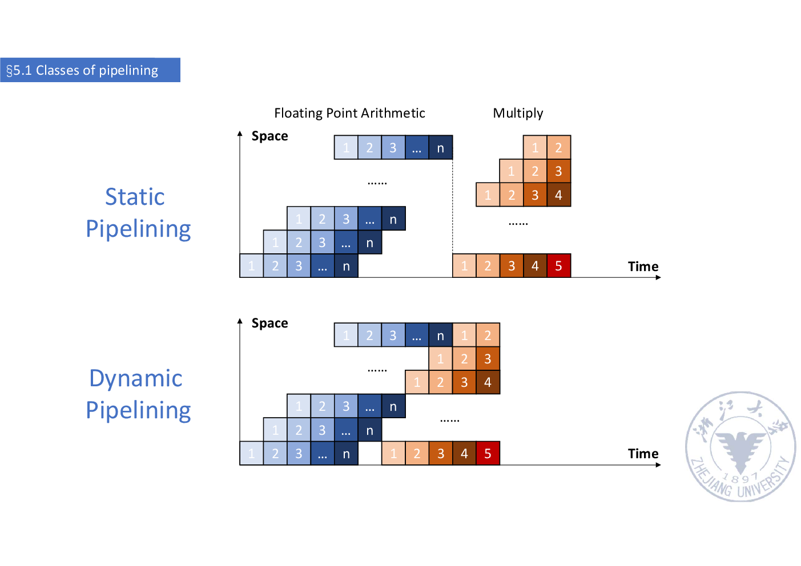

### 1.3 部件级、处理器级与处理器间（p.6–7）【讲义】

- **部件级流水线（component-level / in-component operation pipelining）**：把处理器内部的**算术逻辑部件**再分段，使多种运算可以流水化。
- **处理器级流水线（processor-level / inter-component instruction pipelining）**：把**指令的解释与执行**分成若干子过程，每个子过程在独立的功能部件中完成——这就是通常说的「指令流水线」。
- **处理器间流水线（inter-processor / macro pipelining）**：两个或多个处理器**串行连接**，处理同一数据流，每个处理器完成整个任务的一部分。

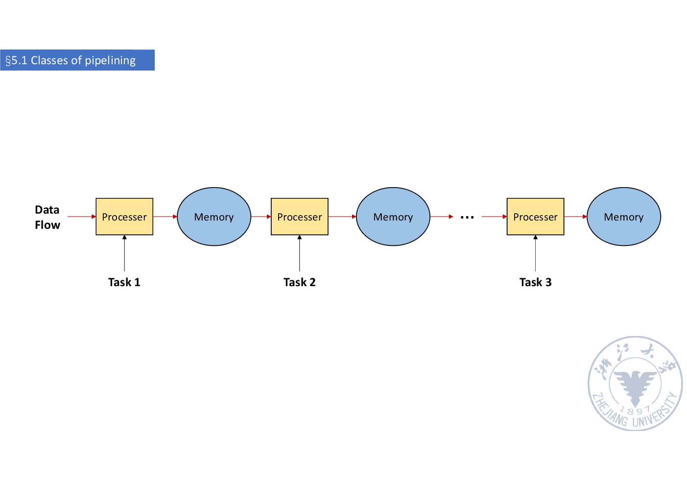

### 1.4 线性与非线性（p.8–9）【讲义】

- **线性流水线（linear pipelining）**：各段**串行连接、没有反馈回路**；数据流过每段时，**每段最多只流过一次**。
- **非线性流水线（nonlinear pipelining）**：除串行连接外，还存在**反馈回路（feedback loop）**；同一任务可以**多次**经过同一段。

由此产生**调度问题**，讲义原话是：

> **Determine when to introduce a new task to the pipelining, so that the task will not conflict with the task previously entering the pipelining.**
> （决定何时把新任务送入流水线，使它不与先前进入流水线的任务冲突。）

「冲突」的具体含义是：**同一个功能段在同一拍被两个任务同时占用**。

p.9 的四段例子：入口 `In`、出口 `Out`，S1–S4 之间有三条反馈线；任务通路为

```text
Task: → S1 → S2 → S3 → S4 → S2 → S3 → S4 → S3 → …
```

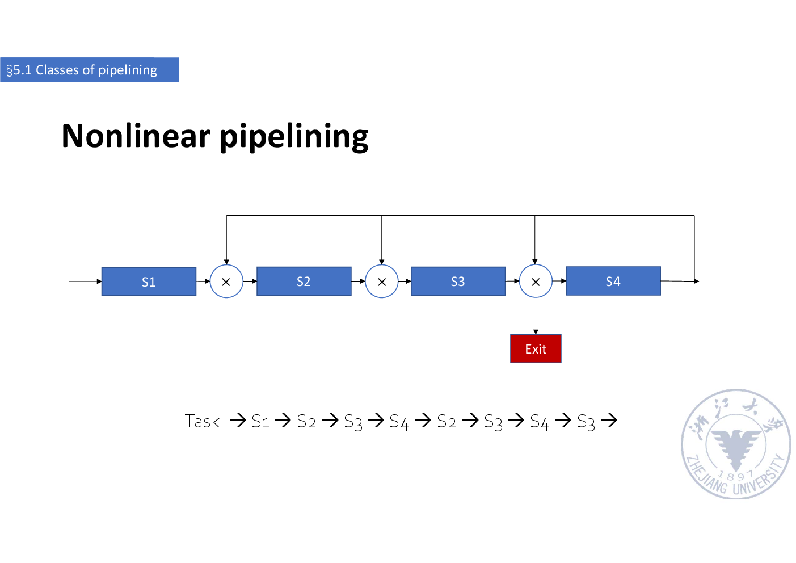

### 1.5 有序与无序、标量与向量（p.10–11）【讲义】

- **有序流水线（ordered）**：任务的**流出顺序与流入顺序完全相同**，每个任务按顺序流过各段。
- **无序流水线（disordered）**：流出顺序可以与流入顺序不同，**后进入的任务允许先完成**。
- **标量处理器（scalar）**：没有向量数据表示与向量指令，只处理标量数据（可以流水化）。
- **向量流水线处理器（vector）**：有向量数据表示与向量指令，是**向量数据表示 + 流水线技术**的结合。

### 1.6 小结：六组分类

| 分类角度 | 两类（或多类） | 关键区别 |
|---|---|---|
| 功能 | 单功能 / 多功能 | 是否只能完成一种固定功能 |
| 多功能流水线的连接 | 静态 / 动态 | 同一时刻能否按不同功能连接 |
| 层次 | 部件级 / 处理器级 / 处理器间 | 流水发生在 ALU 内部、指令之间，还是处理器之间 |
| 连接拓扑 | 线性 / 非线性 | 有无反馈回路、同一段能否多次使用 |
| 任务流出顺序 | 有序 / 无序 | 流出顺序是否等于流入顺序 |
| 数据类型 | 标量 / 向量 | 有无向量数据与向量指令 |

> **整理者注**：第 5 讲真正的考点在「线性 / 非线性」这一组；其余五组是第 2 讲已经考过的概念，这里只要能把术语对上即可。

---

## 2. §5.2 非线性流水线的调度（p.12–34）

### 2.1 四段例子与预约表（p.15–16）【讲义】

讲义先用一条四段非线性流水线说明「怎么描述占用」。**预约表（reservation table）** 的行是段，列是从任务进入流水线算起的**相对拍号**，`√` 表示该段在该拍被占用。

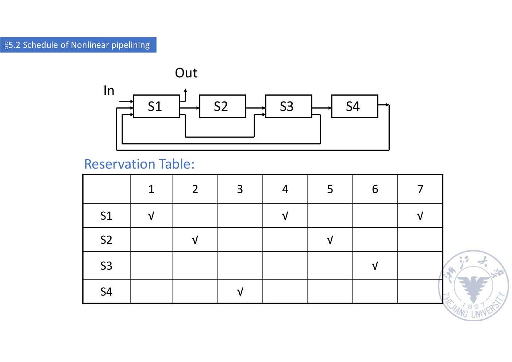

| 段 \ 拍 | 1 | 2 | 3 | 4 | 5 | 6 | 7 |
|---|---|---|---|---|---|---|---|
| S1 | √ | | | √ | | | √ |
| S2 | | √ | | | √ | | |
| S3 | | √ | | | | √ | |
| S4 | | | √ | | | | |

读表要点：

- **同一行可以有多个 √**——非线性流水线的任务会**多次**经过同一段（本例 S1 三次，S2、S3 各两次）。线性流水线每行恰好一个 √。
- 拍号是**相对任务起点**的，不是绝对时间；绝对时间 = 任务启动时刻 + 相对拍号。
- 预约表描述的是**一个任务**的占用模板；把模板按启动时刻平移叠加，才得到多个任务的时空图。

> **待确认**：p.15 的任务通路写作 `S1→S2→S3→S4→S2→S3→S4→S3`（S1 只出现一次），而 p.16 的预约表要求 S1 在第 1/4/7 拍出现三次。两页对不上，可能是文字被截断或取自不同例子；后续计算以 **p.16 的表**为准。

### 2.2 固定间隔为什么不行（p.17–22）【讲义】

最朴素的想法是：**相邻任务之间固定隔 k 拍送入**。

- p.17 先把同一任务的预约表用任务号 `1` 标出，标题是 **“Why Need Scheduling? Let’s extend the clock cycle!”**；
- p.18 送入第 2 个任务（表中用 `2` 标出），p.19 再送入第 3 个任务（`3`）；
- p.20 继续送入后，表里开始出现**同一格写两个任务号**的情况（如 `14`、`25`）——这就是冲突（hazard）：

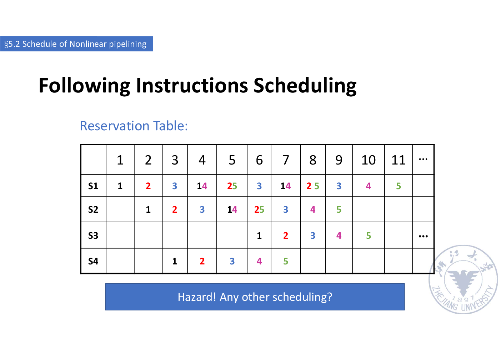

- p.21 换一个间隔再试，p.22 仍然出现重叠，讲义下结论：

> **Still hazard! Need scheduling**（还是冲突！需要（系统的）调度。）

**结论**：固定间隔只能保证「前几个任务」不撞；只要某个倍数落进禁止距离，迟早会撞。必须系统化地找一组**可循环的混合间隔**。

### 2.3 冲突的本质：看「任意两个任务的距离」（整理者注）

设任务 A 在时刻 $s$ 启动、任务 B 在时刻 $s+d$ 启动；A 在第 $t_1$ 拍用段 $S$，B 在第 $t_2$ 拍用段 $S$。二者撞段 ⇔

$$
s+t_1 = (s+d)+t_2 \;\Longleftrightarrow\; d = t_1-t_2 .
$$

所以：

> **只要「两个任务的启动间隔」等于「同一段内两次使用的时间差」，就一定会撞段；与这两个任务是否相邻无关。**

这解释了三件事：

1. 为什么固定间隔时前几步没事、后面突然撞——较大的距离要等第 4、7 个任务才出现；
2. 为什么换一个间隔「看起来没事」——只是还没走到会撞的那个倍数；
3. 为什么必须**系统化**地调度，而不是逐个试。

后面的算法就是把「所有可能撞段的距离」收进一个集合，再在「不撞」的间隔里找平均最小的循环。

### 2.4 五步法总览（p.24）【讲义】

幻灯片把方法拆成一条流水线式的流程：

```text
预约表（reservation table）
  → 禁止表 F（forbidden list）
  → 初始冲突向量 C₀（initial conflict vector）
  → 冲突向量递推（conflict vector）
  → 状态图（state transition graph）
  → 循环队列（circular queue）
  → 最短平均间隔（shortest average interval）
```

### 2.5 禁止表与初始冲突向量（p.25–26）【讲义】

讲义给出一条 **5 段、9 拍**的非线性流水线预约表：

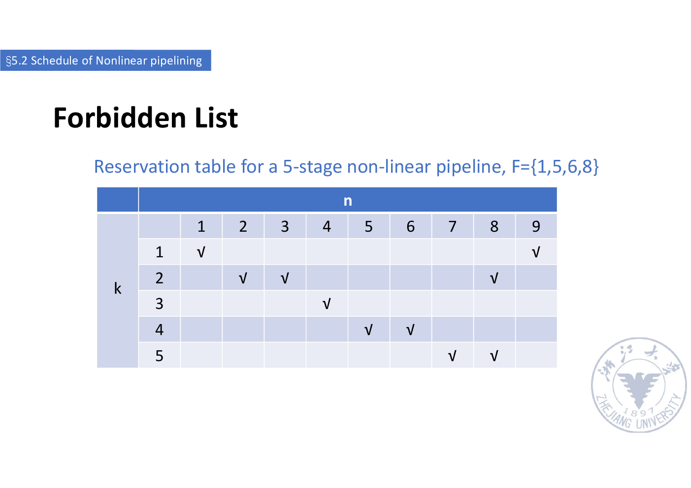

| 段 \ 拍 | 1 | 2 | 3 | 4 | 5 | 6 | 7 | 8 | 9 |
|---|---|---|---|---|---|---|---|---|---|
| S1 | √ | | | | | | | | √ |
| S2 | | √ | √ | | | | | √ | |
| S3 | | | | √ | | | | | |
| S4 | | | | | √ | √ | | | |
| S5 | | | | | | | √ | √ | |

**求禁止表 F**：对每一行，取**任意两次使用的时间差**（正差），全部收集起来：

| 段 | 使用拍 | 时间差 |
|---|---|---|
| S1 | 1, 9 | $9-1=8$ |
| S2 | 2, 3, 8 | $3-2=1$，$8-2=6$，$8-3=5$ |
| S3 | 4 | 无 |
| S4 | 5, 6 | $6-5=1$ |
| S5 | 7, 8 | $8-7=1$ |

$$
F=\{1,5,6,8\}.
$$

**初始冲突向量**：取 $N-1$ 位（这里最大时间差 $N=9$，故 8 位），第 $i$ 位 $C_i=1$ ⇔ $i\in F$：

$$
C_0=(C_8C_7C_6C_5C_4C_3C_2C_1)=(10110001).
$$

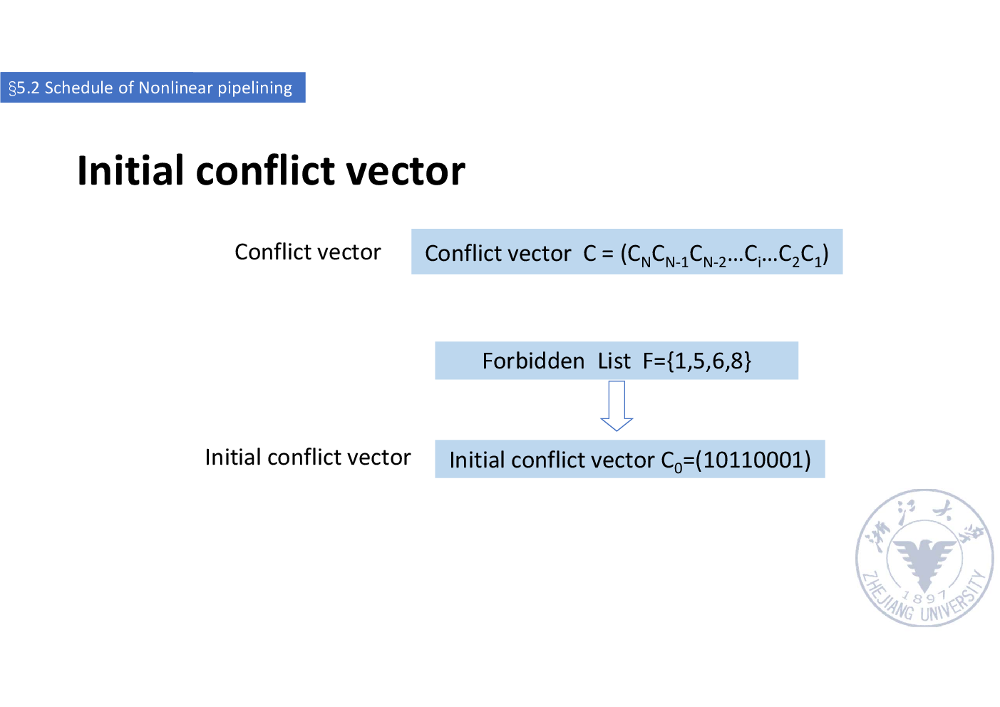

读法与含义：

- **左边是高位 $C_8$，右边是 $C_1$**——不要把它当二进制数读成 177；
- $C_i=1$ 表示「若新任务与当前任务的启动间隔为 $i$ 拍，就会撞段」；
- $C_i=0$ 表示「间隔 $i$ 拍是安全的，可以作为状态图的一条出边」。

### 2.6 冲突向量的递推（p.27–32）【讲义】

设当前冲突向量为 $C_k$，若第 $j$ 位 $C_k(j)=0$，就可以在 **$j$ 拍后**送入下一个任务。讲义给出的更新公式是

$$
\boxed{\,C_{k+1}=C_0\;\lor\;\bigl(C_k \gg j\bigr)\,}
$$

其中 $\gg$ 是**逻辑右移**（高位补 0），$\lor$ 是按位或。

物理含义（讲义没有展开，这里补上推导）：

- 时间前进 $j$ 拍后，原来「距离为 $i+j$ 的约束」变成「距离为 $i$ 的约束」→ 整体右移 $j$ 位；
- 距离 $\le j$ 的约束已经过期 → 右移时被移出、自然消失；
- 新任务本身又会带来一整套 $C_0$ 约束 → 最后再与 $C_0$ 相或。

**例：从 $C_0=(10110001)$ 出发，连续取 2、2、7 拍**

| 间隔 | 初始 | 2 | 2 | 7 |
|---|---|---|---|---|
| $C_{k+1}$ | 10110001 | 10111101 | 10111111 | **10110001** |
| $\mathrm{SHR}^{(j)}C_k$ | 10110001 | 00101100 | 00101111 | 00000001 |
| $C_0$ | — | 10110001 | 10110001 | 10110001 |

逐列验算：

```text
k=2 : 10110001 >> 2 = 00101100 ;  ∨ 10110001 = 10111101
k=2 : 10111101 >> 2 = 00101111 ;  ∨ 10110001 = 10111111
k=7 : 10111111 >> 7 = 00000001 ;  ∨ 10110001 = 10110001   ← 回到初始状态
```

> **整理者注（重要）**：不少教材把递推写成 $C' = C \lor (C\gg j)$。这两种写法在 $C=C_0$ 时结果相同，但多步之后不同：
> 例如从 $C=10111111$ 取 $j=7$，$C\lor(C\gg7)=10111111$ 仍是原状态，而讲义 p.30 的 CCV 与 p.33 的状态图都要求回到 $10110001$。
> 因此**本讲义的图只能用 $C_0\lor(C\gg j)$ 复现**：右移让旧约束过期，$C_0$ 代表新任务自己的预约模式。若按 $C\lor(C\gg j)$，状态只会单调增，状态图里不可能出现环。

### 2.7 状态图与循环队列（p.33）【讲义】

以冲突向量为**节点**，以「可用的间隔 $j$」为**有向边**（$C_k(j)=0$ 才有这条边），边指向更新后的向量：

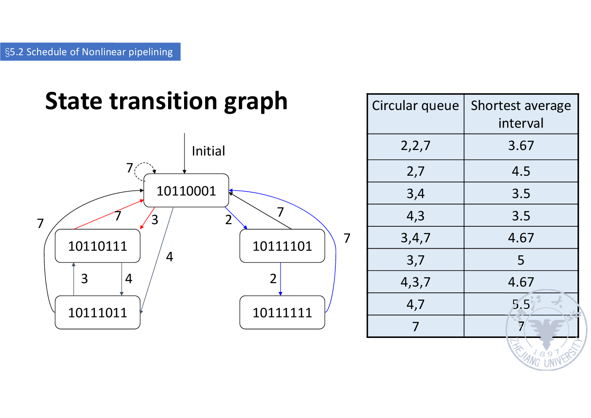

按 $C_{k+1}=C_0\lor(C_k\gg j)$ 可逐条核对：

| 起点 | 可用 $j$（该位为 0） | 转移 |
|---|---|---|
| `10110001`（初始） | 2, 3, 4, 7 | 2→`10111101`；3→`10110111`；4→`10111011`；7→自身 |
| `10111101` | 2, 7 | 2→`10111111`；7→`10110001` |
| `10111111` | 7 | 7→`10110001` |
| `10110111` | 4, 7 | 4→`10111011`；7→`10110001` |
| `10111011` | 3, 7 | 3→`10110111`；7→`10110001` |

- 图中 `10110111 ⇄ 10111011` 的 4、3 两条边，就是「3、4 交替」这个循环；
- `10110001 → 10111101 → 10111111 → 10110001` 是「2、2、7」这个循环；
- 所有节点都有 `7` 这条边回到初始状态（等 7 拍后，旧的 8 条约束里只剩「距离 8」这条还没过期，正好由 $C_0$ 的 $C_8$ 覆盖）。

状态图里的**环**就是可以无限重复的调度方案，讲义称**循环队列（circular queue）**；一个环的平均启动间隔为

$$
\text{平均间隔}=\frac{\sum j_i}{m}\quad(m=\text{环上的边数}).
$$

p.33 右侧的表把所有环列了出来：

| 循环队列 | 最短平均间隔 |
|---|---|
| 2, 2, 7 | 3.67 |
| 2, 7 | 4.5 |
| **3, 4** | **3.5** |
| **4, 3** | **3.5** |
| 3, 4, 7 | 4.67 |
| 3, 7 | 5 |
| 4, 3, 7 | 4.67 |
| 4, 7 | 5.5 |
| 7 | 7 |

**结论**：最短平均间隔为 **3.5 拍**，对应 **3、4 交替**（`3,4` 与 `4,3` 只是循环的起点不同，是同一个方案）。

> **整理者注（自查）**：3、4 交替意味着启动时刻为 0, 3, 7, 10, 14, 17, …，周期 $L=7$。
> 一个周期内的启动时刻为 $\{0,3\}$，两两距离为 3、4，跨周期再看 7、10、11…；
> $F=\{1,5,6,8\}$，而 $\{3,4,7,10,11\}\cap F=\varnothing$，所以确实永不撞段。
> 反过来看固定间隔为什么不行：$k=2$ 的倍数出现 6；$k=3$ 的倍数出现 6；$k=4$ 的倍数出现 8——**都落进 F**；
> 只有 $k=7$ 永远安全，但平均要 7 拍。这正是「混合间隔」比「固定间隔」好的原因。

### 2.8 练习：四段流水线怎么排（p.34）

p.34 用一张图回顾 §2.1 的四段例子，并提问：

> **How to determine the scheduling of the previous pipeline?**（上一条流水线该怎么调度？）

用本节方法可以自己算（**以下为整理者补算，幻灯片未给答案**）：

- 四段预约表（p.16）的时间差：
  - S1：$4-1=3$、$7-4=3$、$7-1=6$；
  - S2：$5-2=3$；
  - S3：$6-2=4$；
  - S4：只有一次，无时间差。
  ⇒ $F=\{3,4,6\}$。
- 初始冲突向量（$C_6\cdots C_1$）：$C_6=C_4=C_3=1$ ⇒ $(101100)$。
- 固定间隔：$k=1,2,3,4,6$ 的某个倍数都会落进 $F$；$k=5$ 安全，但平均要 5 拍。
- 混合间隔：**2、5 交替**（启动时刻 0, 2, 7, 9, 14, …）的所有两两距离为 2, 5, 7, 9, 12, …，都不在 $F$ 中，平均 **3.5 拍**，优于固定 5 拍。

> **修订说明**：旧版笔记此处曾把 $C_0$ 写成 `100110`；按「左 $C_6$、右 $C_1$」的位序，$F=\{3,4,6\}$ 应为 `101100`。本次按新 PDF p.16 的表重算并修正。
>
> **待确认**：讲义没有证明 2、5 交替是全局最优；若按状态图枚举，可能还有同样 3.5 拍的其他环，需对照教材确认。

---

## 3. §5.3 多发射（p.35–76）

### 3.1 ILP 与多发射（p.36）【讲义】

- 流水线本身就是「并行执行多条指令」；要提高 **ILP（Instruction-Level Parallelism）**，讲义给出两条路：
  1. **加深流水线（deeper pipeline）**：每段做得更少 → 时钟周期更短；
  2. **多发射（multiple issue）**：复制流水段 → 多条流水线；**每个时钟周期启动多条指令**。
- 多发射后 **CPI < 1**，所以改用 **IPC（Instructions Per Cycle）** 衡量：
  - 例：4 GHz、4 路多发射 → 峰值 **16 BIPS**（billion instructions per second），**peak CPI = 0.25**，**peak IPC = 4**；
  - **But dependencies reduce this in practice**（实际会被依赖拉低）。

> 换算：$\mathrm{IPC}=1/\mathrm{CPI}$；$n$ 路发射的峰值 $\mathrm{CPI}=1/n$、峰值 $\mathrm{IPC}=n$。

### 3.2 单发射与多发射的时空图（p.37）【讲义】

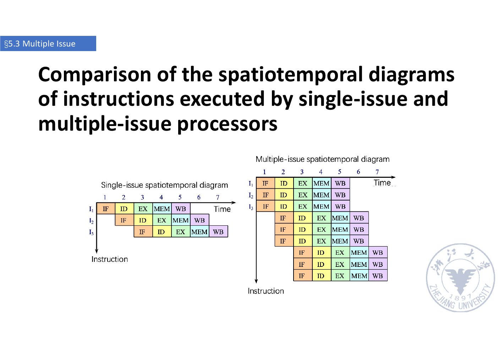

- 单发射：I1、I2、I3 依次每拍进入 IF，稳态每拍完成 1 条；
- 多发射：每拍同时取 3 条（I1/I2/I3 同拍 IF），稳态每拍完成 3 条；
- 两者的**流水深度没变**，变的是「每拍能塞进几条」——所以是「横向加宽」，不是「纵向加深」。

### 3.3 静态与动态多发射（p.38）【讲义】

| | 静态多发射（static multiple issue） | 动态多发射（dynamic multiple issue） |
|---|---|---|
| 谁决定这一拍发哪几条 | **编译器**把指令分组、打包成 **issue slot** | **CPU** 每拍检查指令流，自行选择发射 |
| 谁检测 / 避免冒险 | 编译器 | 硬件（编译器可用重排帮忙） |
| 典型代表 | VLIW、静态调度超标量 | 动态超标量（Tomasulo / 乱序执行） |

> **整理者注**：分类的关键不是「每拍几条」，而是**「谁来解决冒险」**。

### 3.4 推测（Speculation，p.39–40）【讲义】

推测的通用套路：

1. **猜（guess）** 一条指令该怎么处理，目标是「尽早开始」；
2. **检查猜得对不对**；
3. 猜对了就完成；猜错了就 **roll-back** 再做正确的事。

两个典型：

- **分支结果推测**：猜分支走向，猜错就回滚；
- **load 推测**：猜要读的值 / 地址，若之后发现位置被改写就回滚。

实现分工（p.40）：

| 谁做推测 | 做法 |
|---|---|
| 编译器 | 重排指令（如把 load 提前到分支之前）；插入 **fix-up** 指令以便猜错时恢复 |
| 硬件 | 提前看指令流（look ahead）；把结果放缓冲区，确定需要时才写回；猜错时 **flush buffers** |

### 3.5 超标量与 VLIW（p.41、p.43）【讲义】

| | **超标量（superscalar）** | **VLIW（Very Long Instruction Word）** |
|---|---|---|
| 每拍发射条数 | **不固定**，取决于代码情况（1–8 条，有上限） | **固定**（4–16 条），打包成一条长指令 / 指令包 |
| 上限为 $n$ 时 | 称为 **$n$-issue** | — |
| 并行性怎么表达 | 由硬件在运行时发现 | 在指令包中**显式**表达（哪些操作并行） |
| 调度由谁做 | 编译器静态调度，或基于 **Tomasulo** 的动态调度 | **编译器静态**完成 |
| 典型应用 | 通用计算（讲义称「目前最成功的方法」） | DSP、多媒体 |

### 3.6 超标量的时空图（p.42）【讲义】

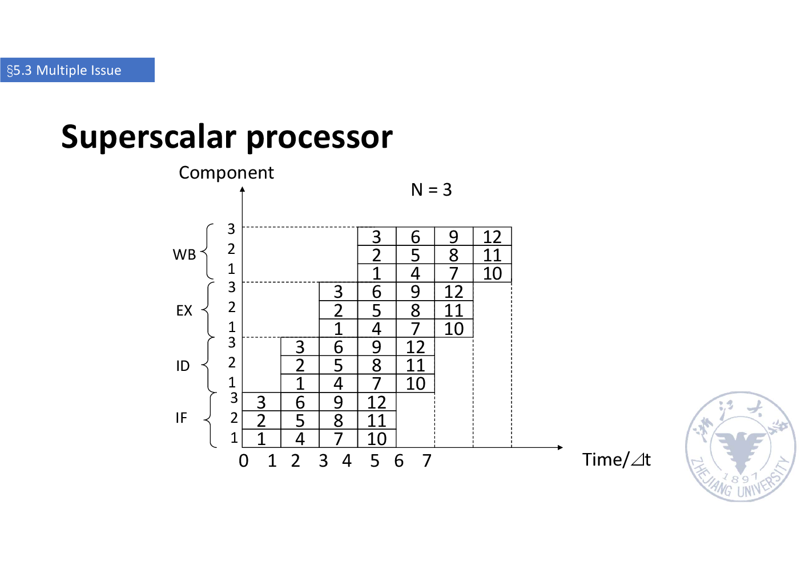

图中每个时钟周期有 3 条指令同时处于 IF / ID / EX / WB 的不同段；稳态下每拍完成 3 条。注意纵轴是**功能部件（Component）**，横轴是时间。

### 3.7 超流水线（Super-Pipeline，p.44–46）【讲义】

- 做法：把**每个流水段再细分**，使**多条指令在一个时钟周期内分时（time-shared）**通过；
- 若每拍流出 $n$ 条，这 $n$ 条**不是同时**流出，而是**每隔 $1/n$ 个时钟周期流出一条**；
- 因此超流水的**流水周期是 $1/n$ 个时钟周期**（等价于时钟频率提高 $n$ 倍；整理者注）。

p.45 是「每拍分时流出 2 条」的示意图；p.46 把时钟再切成 3 个时间片（$m=3$）：

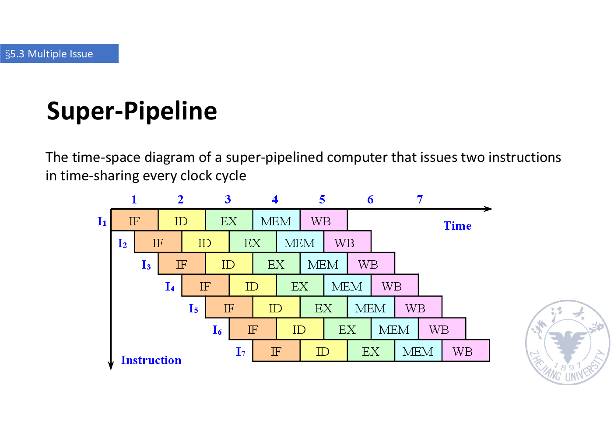

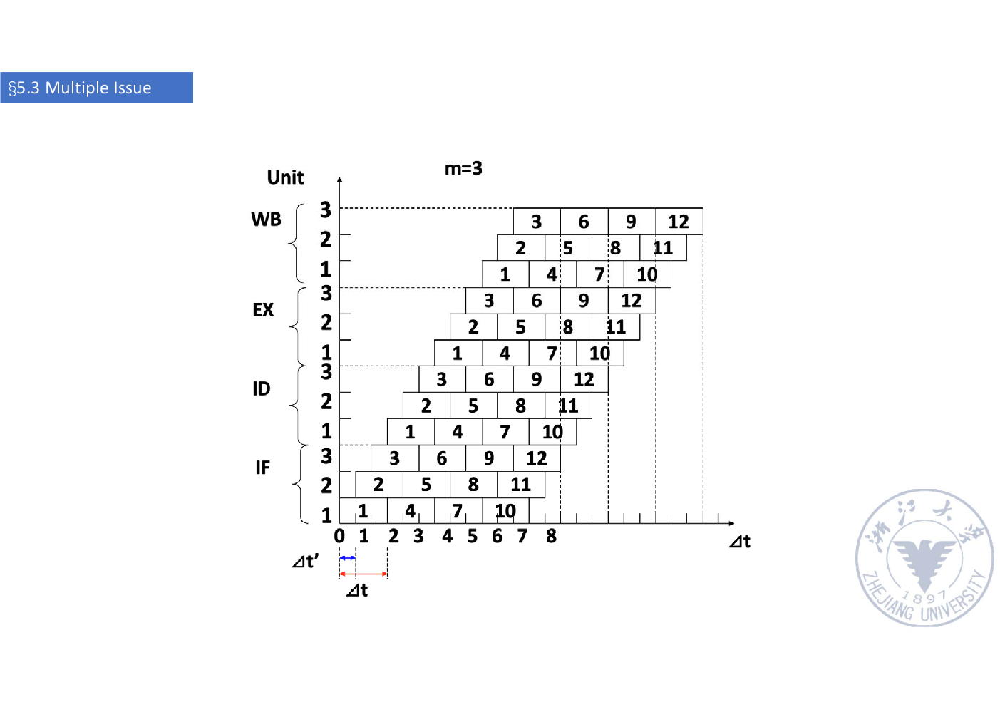

### 3.8 四种结构对比（p.47–48）【讲义】

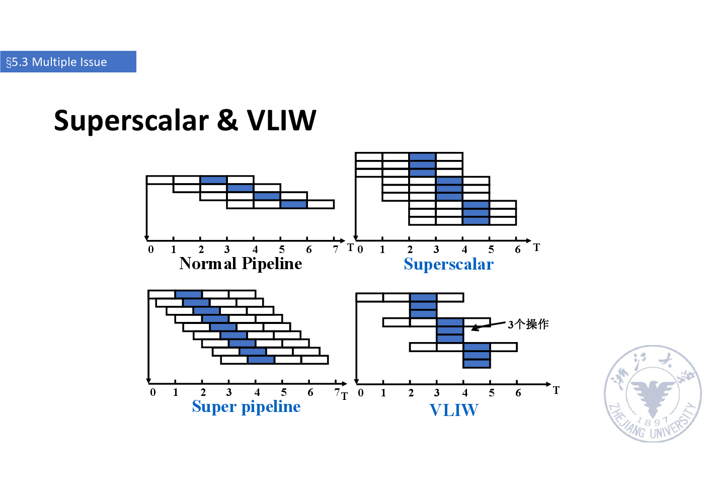

| 结构 | 「多」在哪里 | 代价 |
|---|---|---|
| 正常流水 | 每拍 1 条，靠重叠 | 流水深度决定时钟 |
| **超标量** | 每拍**同时**发射多条（条数可变） | 复制执行部件 / 端口，硬件冒险检测 |
| **超流水** | 每拍**分时**流出多条（时间片细分） | 时钟更快、流水更深，分支代价更大 |
| **VLIW** | 一条长指令里**打包**多个操作槽 | 代码膨胀、槽可能填不满、机器码不兼容 |

p.48 的「五种结构职责划分」表：

| Common name | Issue structure | Hazard detection | Scheduling | 区别特征 | 例子 |
|---|---|---|---|---|---|
| Superscalar (static) | Dynamic | Hardware | Static | 顺序执行 | 嵌入式居多：MIPS、ARM（含 Cortex-A8） |
| Superscalar (dynamic) | Dynamic | Hardware | Dynamic | 有一定乱序执行，但**不推测** | 讲义称「目前没有」 |
| Superscalar (speculative) | Dynamic | Hardware | Dynamic + speculation | 乱序执行 + 推测 | Intel Core i3/i5/i7、AMD Phenom、IBM Power 7 |
| VLIW / LIW | Static | 主要靠软件 | Static | 所有冒险由编译器确定并（常常隐式地）标注 | 信号处理，如 TI C6x |
| EPIC | 主要静态 | 主要靠软件 | 主要静态 | 所有冒险由编译器**显式**标注 | Itanium |

> **待确认**：表中的 `Issue structure` 一列，静态超标量也写作 `Dynamic`。按上下文应理解为「**发射结构由硬件动态决定**（哪几条能一起发），而**调度**是编译期静态完成的」；若按字面读会与「static」矛盾。

### 3.9 静态调度的取指与发射（p.49–52）【讲义】

p.49 先说明**超标量对程序员透明**：

- 处理器自己检测下一条能不能流出，**不需要重排指令**；
- 即使代码没经过编译器调度优化、甚至是老编译器生成的代码，也能跑（**兼容性好**），只是**效果不一定好**；
- 想跑好，一条路是用**动态超标量调度**。

p.50–51 讲静态调度超标量的取指与冒险检测：

- 典型超标量每拍可发 **1–8 条**；指令**按序流出**，在流出时做冲突检测；
- 取指阶段一次取来 **1–4 条**（称为 **issue packet**，发射包）；
- 一个时钟内，包里的指令**可能全部流出，也可能只流出一部分**。

**冒险检测分两级**（p.51）：

1. **包内**：先检查同一个发射包内的指令之间有没有结构 / 数据冒险，挑出这一拍能发的指令；
2. **包间**：再检查选出的指令与**已经在执行**的指令是否冲突。

**RISC-V 的具体假设**（p.52）：

- 每拍流出 **2 条**：**1 条整数指令 + 1 条浮点指令**；
- **load / store / branch 都算整数指令**；
- 同时取 2 条（64 位）、译码 2 条（64 位）；
- 处理步骤：取 2 条 → 判断哪几条能流出（0–2 条）→ 送到对应功能部件。

### 3.10 双发射的时空图与硬件改动（p.53–54）【讲义】

假设所有浮点指令都是加法、执行时间为 **2 拍**，且图中整数指令总排在浮点指令前面：

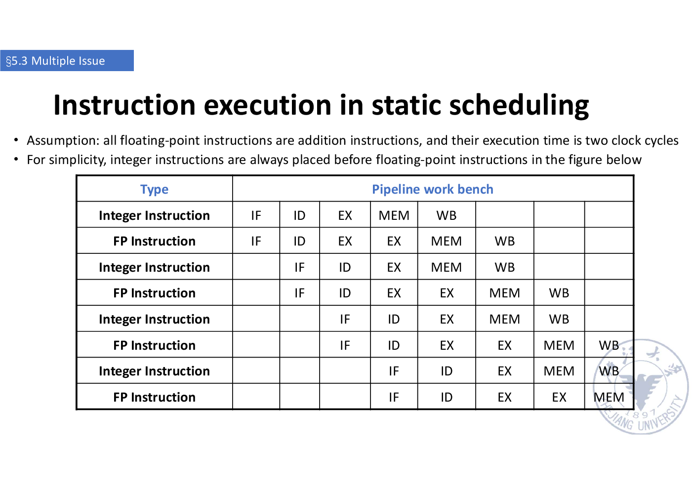

「1 整数 + 1 浮点」这种并行流出方式，**需要增加的硬件不多**，但有三个具体改动（p.54）：

1. **浮点寄存器堆加一个读 / 写端口**——因为浮点的 load/store 会用到整数部分，增加了对浮点寄存器的访问冲突；
2. **定向（forwarding）通路要加倍**——流水线里的指令数翻倍了；
3. 相应的冒险检测与选择逻辑（p.51 的两级检测）。

### 3.11 issue packet 与 RISC-V 双发射格式（p.55–57）【讲义】

编译器如何打包 issue packet（p.55）：

- 把指令分成**能在同一拍发射的一组**；
- 分组由**流水线资源**决定；
- 编译器必须**消除包内（部分或全部）冒险**：重排指令，确保**包内无依赖**，包与包之间**可以**有依赖；
- 规则**随 ISA 而变，编译器必须知道**；
- 必要时用 **nop** 填充空槽。

RISC-V 静态双发射的格式（p.56）：

- 每个包 **2 条**：**1 条 ALU/branch + 1 条 load/store**；
- **64 位对齐**；
- 顺序固定：**ALU/branch 在前，load/store 在后**；
- 用不到的槽填 **nop**。

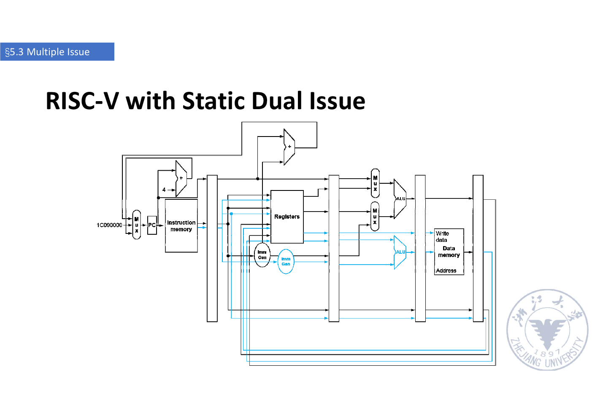

### 3.12 双发射带来的新冒险（p.58）【讲义】

指令并行度越高，冲突越多。两类典型：

1. **EX 数据冒险**：单发射时可以用转发消除停顿；**双发射时，同一个包内的 ALU 结果不能直接给 load/store 用**。

```asm
add x10, x0, x1
ld  x2, 0(x10)      # 同包内：x10 还没算出来
```

只能**拆成两个包**，效果等于停 1 拍。

2. **load-use 冒险**：延迟仍是 1 拍，但现在是**两条指令**一起等，因此需要**更激进的调度**（例如把无关指令填进空槽、循环展开）。

### 3.13 调度示例：5 条压到 4 拍（p.59）【讲义】

原循环：

```asm
Loop: ld   x31, 0(x20)      # x31 = 数组元素
      add  x31, x31, x21    # 加标量（x21）
      sd   x31, 0(x20)      # 存回
      addi x20, x20, -8     # 指针减 8
      blt  x22, x20, Loop   # x22 < x20 则继续
```

双发射调度结果：

| | ALU/branch | Load/store | cycle |
|---|---|---|---|
| Loop: | nop | `ld x31, 0(x20)` | 1 |
| | `addi x20, x20, -8` | nop | 2 |
| | `add x31, x31, x21` | nop | 3 |
| | `blt x22, x20, Loop` | `sd x31, 8(x20)` | 4 |

$$
\mathrm{IPC}=\frac{5}{4}=1.25\quad(\text{峰值 }2).
$$

两个容易看漏的点：

- `add` 必须等 `ld` 的结果（load-use），所以排在第 3 拍，而不是第 2 拍；
- **`sd` 的偏移从 0 改成了 8**：因为 `addi` 被提前到第 2 拍执行，`x20` 已经减了 8，原来 `0(x20)` 的地址现在是 `8(x20)`。

### 3.14 循环展开与寄存器重命名（p.60–62）【讲义】

**循环展开（loop unrolling）**：

- 复制循环体，暴露更多并行性；
- 减少循环控制开销；
- 每次复制用**不同的寄存器**——这就是**寄存器重命名（register renaming）**；
- 目的之一是避开**循环携带的反相关（loop-carried anti-dependency）**：store 后紧跟对同一寄存器的 load，属于**名相关（name dependence）**，只是复用了寄存器名。

4 次展开后的调度（14 条指令 / 8 拍）：

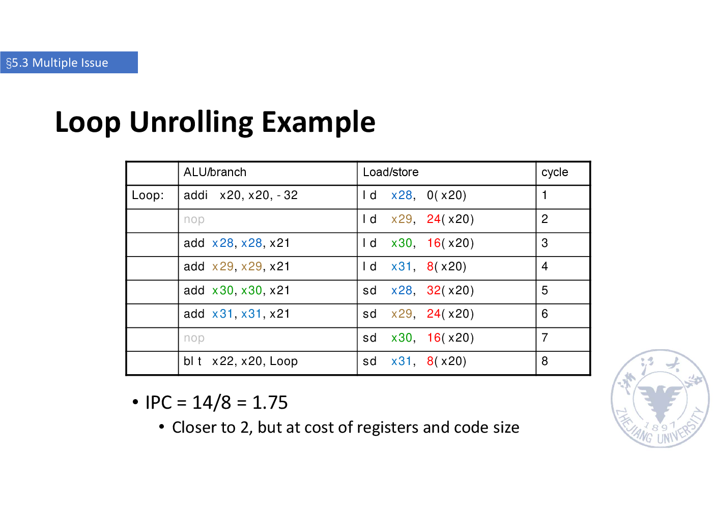

| cycle | ALU/branch | Load/store |
|---|---|---|
| 1 | `addi x20,x20,-32` | `ld x28, 0(x20)` |
| 2 | nop | `ld x29, 24(x20)` |
| 3 | `add x28,x28,x21` | `ld x30, 16(x20)` |
| 4 | `add x29,x29,x21` | `ld x31, 8(x20)` |
| 5 | `add x30,x30,x21` | `sd x28, 32(x20)` |
| 6 | `add x31,x31,x21` | `sd x29, 24(x20)` |
| 7 | nop | `sd x30, 16(x20)` |
| 8 | `blt x22,x20,Loop` | `sd x31, 8(x20)` |

$$
\mathrm{IPC}=\frac{14}{8}=1.75 \quad(\text{更接近峰值 }2).
$$

代价：**寄存器用量**和**代码体积**都增加。

p.62 把循环展开的要点归纳为：

- **正确性（correctness）**与**有效性（effectiveness）**；
- **寄存器重命名**；
- **删除冗余的分支指令**；
- 注意**内存数据依赖**；
- 展开会**产生新的数据依赖**。

### 3.15 VLIW 的例子与问题（p.63–67）【讲义】

- 把多条能并行执行的指令**拼成一条超长指令**（100 多位到几百位）；
- 指令字分成若干**操作槽（operation slot）**，每个槽**直接、独立**地控制一个功能部件；
- **所有处理和指令编排都由编译器完成**：编译时把互不相关、可并行的操作拼进同一条长指令。

p.64 是 VLIW 的时空图（$N=3$），每个长指令包同时占 3 个功能单元：

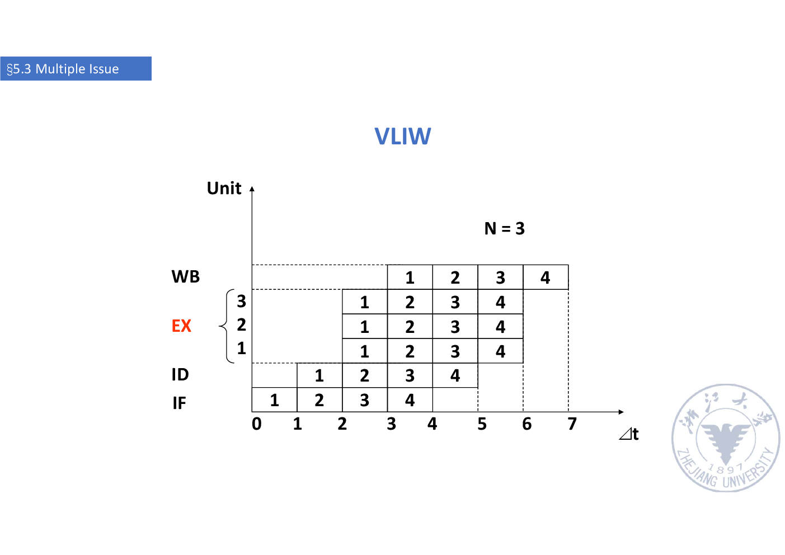

p.65 的例子：VLIW 每拍可同时流出 **5 条**——2 条访存、2 条浮点、1 条整数 / 分支。原始代码序列（17 条）：

```text
1  ld f0, 0(x1)        7  add f8, f6, f2       13 add f16, f14, f2
2  add f4, f0, f2      8  sd f8, -8(x1)        14 sd f16, -24(x1)
3  sd f4, 0(x1)        9  ld f10, -16(x1)      15 ld f18, -32(x1)
4  addiu x1, x1, -40  10  add f12, f10, f2     16 add f20, f18, f2
5  bne x1, x2, Loop   11  sd f12, -12(x1)      17 sd f20, -32(x1)
6  ld f6, -8(x1)      12  ld f14, -24(x1)
```

编译后的 VLIW 调度（8 拍）：

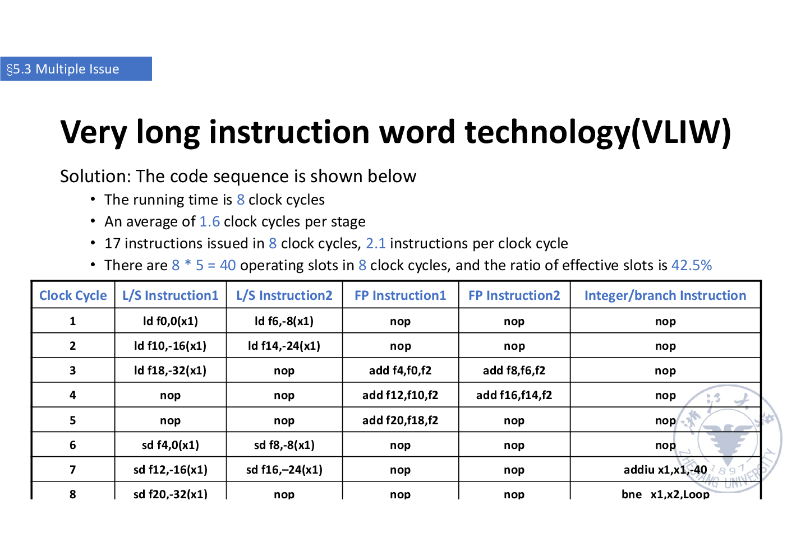

| 拍 | L/S 1 | L/S 2 | FP 1 | FP 2 | 整数 / 分支 |
|---|---|---|---|---|---|
| 1 | `ld f0,0(x1)` | `ld f6,-8(x1)` | nop | nop | nop |
| 2 | `ld f10,-16(x1)` | `ld f14,-24(x1)` | nop | nop | nop |
| 3 | `ld f18,-32(x1)` | nop | `add f4,f0,f2` | `add f8,f6,f2` | nop |
| 4 | nop | nop | `add f12,f10,f2` | `add f16,f14,f2` | nop |
| 5 | nop | nop | `add f20,f18,f2` | nop | nop |
| 6 | `sd f4,0(x1)` | `sd f8,-8(x1)` | nop | nop | nop |
| 7 | `sd f12,-16(x1)` | `sd f16,-24(x1)` | nop | nop | `addiu x1,x1,-40` |
| 8 | `sd f20,-32(x1)` | nop | nop | nop | `bne x1,x2,Loop` |

讲义的统计：

- 运行时间 **8 拍**；
- **17 条指令 / 8 拍 ⇒ 2.1 条/拍**；
- 8 拍 × 5 槽 = **40 个槽**，有效槽比例 $17/40=42.5\%$。

p.67 的问题：

1. **程序代码变长**：为提高并行性要做大量循环展开；
2. **操作槽常常填不满**（本例有效槽只有 42.5%）；缓解办法：共享立即数字段、压缩存储、装入 Cache 或译码时展开；
3. **机器码不兼容**：不同实现的操作槽数 / 延迟不同。

> **待确认**：p.66 的「平均每条指令 1.6 个时钟周期」与「17 条 / 8 拍 ⇒ 2.1 条/拍」不自洽（$8/17\approx0.47$ 拍/条，$17/8\approx2.1$ 条/拍）。疑为「平均每个槽 1.6 拍」或沿用其他例子，需对照原文。

### 3.16 多发射的三大限制（p.68）【讲义】

1. 程序**固有的指令级并行度**；
2. **硬件实现的难度**；
3. 超标量与 VLIW 自身的**技术限制**。

### 3.17 动态多发射与乱序执行（p.69–71）【讲义】

「Superscalar」处理器的动态版本（p.69）：

- CPU 每拍自行决定发 **0、1、2、…** 条；
- 由硬件避免结构冒险与数据冒险；
- **不需要编译器调度**（编译器帮忙仍然有益）；
- **代码语义由 CPU 保证**。

动态流水线调度（p.70）：

- 允许 CPU **乱序执行**以免停顿，但**按序提交（commit）结果到寄存器**；
- 例：

```asm
ld   x31, 20(x21)
add  x1, x31, x2      # 等 ld
sub  x23, x23, x3     # 与 add 无关，可以先做
andi x5, x23, 20
```

`add` 在等 `ld` 时，`sub` 可以开始执行。

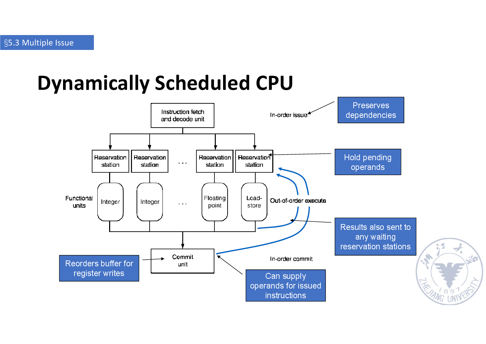

图中四个蓝框就是四个关键机制：

| 机制 | 作用 |
|---|---|
| **Reservation station** | 保存待执行的指令与**待取的操作数** |
| **Functional units** | 乱序执行；结果**同时送给所有等待的保留站**（相当于广播 / 转发） |
| **Commit unit（ROB）** | 为寄存器写入**重排序**，保证按序提交 |
| **Issue（顺序）** | 按序发射，从而**保持依赖关系**（preserves dependencies） |

### 3.18 寄存器重命名（p.72）【讲义】

保留站 + 重排序缓冲**共同实现了寄存器重命名**：

- 指令发射到保留站时，若操作数已在寄存器堆或 ROB 中，就**复制到保留站**；
- 复制后寄存器里的旧值**不再被需要，可以被覆盖**；
- 若操作数还没算出来，功能部件算好后会**直接送给保留站**；
- 因此可能**根本不需要更新寄存器**（结果只被后续指令消费）。

这就把「WaW / WaR 名相关」与「真相关（RaW）」分开了：只有真相关必须等。

### 3.19 为什么需要动态调度（p.73）【讲义】

为什么不能只让编译器调度？

1. 不是所有停顿都可预测（如 **cache miss**）；
2. 不可能总绕过分支（分支结果**动态**决定）；
3. 同一 ISA 的**不同实现**有不同的延迟与冒险。

### 3.20 多发射有效吗、功耗如何（p.74–75）【讲义】

**有用，但没想象中多**（p.74）：

- 程序有**真实依赖**，限制 ILP；
- 有些依赖很难消除（如**指针别名** pointer aliasing）；
- 有些并行性难以暴露；
- **发射窗口有限**；
- 内存延迟与带宽有限；
- 流水线很难一直填满；
- 推测做得好会有帮助。

**功耗**（p.75）：动态调度与推测的复杂性**需要功耗**；「多个更简单的核」可能更好。

| 微处理器 | 年份 | 时钟 | 流水段 | 发射宽度 | 乱序 / 推测 | 核数 | 功耗 |
|---|---|---|---|---|---|---|---|
| i486 | 1989 | 25 MHz | 5 | 1 | No | 1 | 5 W |
| Pentium | 1993 | 66 MHz | 5 | 2 | No | 1 | 10 W |
| Pentium Pro | 1997 | 200 MHz | 10 | 3 | Yes | 1 | 29 W |
| P4 Willamette | 2001 | 2000 MHz | 22 | 3 | Yes | 1 | 75 W |
| P4 Prescott | 2004 | 3600 MHz | 31 | 3 | Yes | 1 | 103 W |
| Core | 2006 | 2930 MHz | 14 | 4 | Yes | 2 | 75 W |
| UltraSparc III | 2003 | 1950 MHz | 14 | 4 | No | 1 | 90 W |
| UltraSparc T1 | 2005 | 1200 MHz | 6 | 1 | No | 8 | 70 W |

### 3.21 真实处理器：Cortex-A53 与 Core i7（p.76）【讲义】

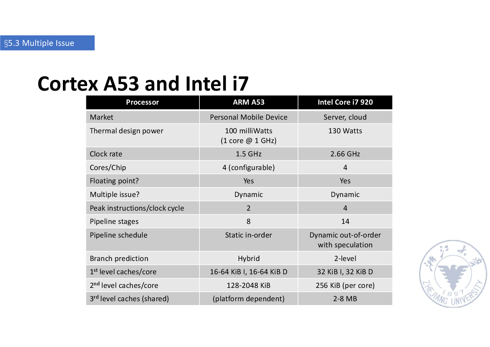

| 项目 | ARM A53 | Intel Core i7 920 |
|---|---|---|
| 市场 | 个人移动设备 | 服务器、云 |
| 热设计功耗 | 100 mW（1 核 @ 1 GHz） | 130 W |
| 时钟 | 1.5 GHz | 2.66 GHz |
| 核数 / 芯片 | 4（可配置） | 4 |
| 浮点 | 有 | 有 |
| 多发射 | 动态 | 动态 |
| 峰值指令 / 拍 | 2 | 4 |
| 流水段 | 8 | 14 |
| 流水调度 | **静态顺序** | **动态乱序 + 推测** |
| 分支预测 | 混合（hybrid） | 两级（2-level） |
| L1 / 核 | 16–64 KiB I，16–64 KiB D | 32 KiB I，32 KiB D |
| L2 / 核 | 128–2048 KiB | 256 KiB |
| L3（共享） | 视平台 | 2–8 MB |

> **待确认**：表中 A53 的「多发射 = Dynamic」与「流水调度 = Static in-order」看似矛盾。按 ARM 官方口径，A53 是 2 路**顺序**发射（静态调度）；这里的 `Dynamic` 可能指「由硬件动态选择这一拍发哪几条」。引用时注意区分「发射选择」与「指令调度」。

---

## 4. 听课重点与易混点

### 4.1 预约表 vs 时空图

- **预约表**：**一个任务**在各段、各拍的占用（行=段，列=相对拍号，可多次 √）；
- **时空图**：**多个任务**在各段、各绝对拍的占用（行=段/指令，列=绝对时间）。
- 预约表是「任务模板」，时空图是「调度结果」；前者与后者按启动时刻平移叠加。

### 4.2 禁止表 F 的含义（最容易错）

- $F$ 里的数是**同一任务内同一段两次使用的时间差**；
- 它同时是「**任意两个任务的启动间隔**」的禁区——不是「相邻任务」的禁区；
- 因此判断一个调度是否安全，要看**所有任务对**的距离，不能只看相邻两个。

### 4.3 为什么固定间隔迟早冲突

若每隔 $k$ 拍送一个任务，则任务间距离取遍 $k,2k,3k,\dots$。只要某个倍数落进 $F$，迟早撞段；$k$ 的倍数永不落进 $F$ 时，固定间隔才长期安全（本例只有 $k=7$）。混合间隔可以把平均值压到 3.5。

### 4.4 冲突向量的位序与递推

- $C=(C_{N-1}\cdots C_1)$，**左高右低**；$N-1$ 是预约表里最大的时间差；
- $C_k=0$ 才可选中间隔 $k$；
- 递推 $\;C_{k+1}=C_0\lor(C_k\gg j)\;$：右移让旧约束过期，$C_0$ 加入新任务的自身约束；
- 若写成 $C\lor(C\gg j)$，状态单调不减，画不出状态图里的环（见 §2.6 的整理者注）。

### 4.5 状态图与循环队列

- 节点 = 冲突向量，边 = 可选间隔；
- **环** = 可以永远重复的调度；环的平均边权 = 平均启动间隔；
- 同一个环的不同起点（3,4 与 4,3）是同一方案，不能重复计数。

### 4.6 超标量 / VLIW / 超流水（三者的「多」不同）

| | 多在哪 | 条数 | 谁调度 | 硬件代价 |
|---|---|---|---|---|
| 超标量 | 每拍**同时**发多条 | 可变（≤ n） | 编译器（静态）或硬件（动态） | 多套执行部件 + 冒险检测 |
| VLIW | 一条**长指令**打包多个槽 | 固定（4–16） | 编译器 | 编译器复杂，硬件简单 |
| 超流水 | 每拍**分时**流出多条 | 固定（时间片 1/n） | 编译器 / 硬件均可 | 时钟更快、流水更深 |

### 4.7 静态 vs 动态多发射

- 静态：编译器保证「包内无依赖」，硬件只做检查；代码依赖编译器与 ISA；
- 动态：硬件每拍看指令流、自行决定发几条；对旧代码兼容，但功耗高、逻辑复杂。

### 4.8 顺序发射 / 乱序执行 / 顺序提交

- **顺序发射**：保持程序语义与依赖关系；
- **乱序执行**：谁的操作数先到谁先算，避免停顿；
- **顺序提交**：结果按程序顺序写回寄存器 / 内存，保证异常与推测回滚的正确性。

### 4.9 多发射下的「新」冒险

- **同包内不能转发**：ALU 结果来不及给同包的 load/store 用 → 拆包（等于停 1 拍）；
- **load-use 仍要等**：延迟没变，但现在是两条指令一起等 → 调度要更激进；
- **控制相关更贵**：一条分支耽误的是一整包的发射机会。

### 4.10 峰值 IPC ≠ 实际 IPC

- 峰值 IPC = 发射宽度（2 路 → 2，4 路 → 4）；
- 实际 IPC 被依赖、nop 填充、控制开销、cache miss 拉低；
- 因此「发射率（issue rate）」与「完成率（completion rate）」要分开看。

---

## 5. 课前自测 / 复习清单

1. 线性与非线性流水线的区别是什么？为什么非线性流水线的预约表一行会有多个 √？（[§1.4](#14-线性与非线性p89讲义)、[§2.1](#21-四段例子与预约表p1516讲义)）
2. 静态与动态多功能流水线的差别是什么？动态流水线的代价是什么？（[§1.2](#12-静态与动态多功能流水线p45讲义)）
3. 部件级、处理器级、处理器间流水线分别发生在哪一层？（[§1.3](#13-部件级处理器级与处理器间p67讲义)）
4. 给定一张预约表，怎样求禁止表 $F$？$F$ 里的数物理意义是什么？为什么它约束的是「任意两个任务」而不只是相邻任务？（[§2.5](#25-禁止表与初始冲突向量p2526讲义)、[§2.3](#23-冲突的本质看任意两个任务的距离整理者注)）
5. 初始冲突向量为什么是 $N-1$ 位？位序为什么是「左高右低」？（[§2.5](#25-禁止表与初始冲突向量p2526讲义)）
6. 写出冲突向量的递推式，并说明右移与「或 $C_0$」各自的物理含义。（[§2.6](#26-冲突向量的递推p2732讲义)）
7. 状态图的节点、边、环分别对应什么？怎样从环求平均启动间隔？本例的最优解是多少？（[§2.7](#27-状态图与循环队列p33讲义)）
8. 为什么固定间隔 2 拍「前两个任务没事、后面会撞」？用 $F$ 解释。（[§2.3](#23-冲突的本质看任意两个任务的距离整理者注)）
9. 四段例子的 $F$ 和 $C_0$ 是多少？2、5 交替为什么安全？（[§2.8](#28-练习四段流水线怎么排p34)）
10. 提高 ILP 的两条路是什么？多发射为什么改用 IPC 衡量？（[§3.1](#31-ilp-与多发射p36讲义)）
11. 静态多发射与动态多发射，分别由谁检测冒险、谁决定发射哪几条？（[§3.3](#33-静态与动态多发射p38讲义)）
12. 超标量、VLIW、超流水三者的「多」分别多在哪里？各有什么代价？（[§4.6](#46-超标量--vliw--超流水三者的多不同)）
13. RISC-V 静态双发射的包格式是什么？为什么要 64 位对齐、为什么用 nop 填充？（[§3.11](#311-issue-packet-与-risc-v-双发射格式p5557讲义)）
14. 双发射下 `add x10,x0,x1` 后紧跟 `ld x2,0(x10)` 为什么要拆包？这相当于几拍停顿？（[§3.12](#312-双发射带来的新冒险p58讲义)）
15. p.59 的调度里，`sd` 的偏移为什么从 0 改成 8？（[§3.13](#313-调度示例5-条压到-4-拍p59讲义)）
16. 循环展开为什么能提高 IPC？寄存器重命名在这里解决的是什么相关？（[§3.14](#314-循环展开与寄存器重命名p6062讲义)）
17. VLIW 的有效槽利用率怎么算？本例为什么只有 42.5%？（[§3.15](#315-vliw-的例子与问题p6367讲义)）
18. 动态调度为什么能做到「乱序执行、顺序提交」？ROB 与保留站各起什么作用？（[§3.17](#317-动态多发射与乱序执行p6971讲义)）
19. 保留站 + ROB 怎样实现寄存器重命名？它消除了哪类相关？（[§3.18](#318-寄存器重命名p72讲义)）
20. 为什么不能只靠编译器调度？动态调度付出了什么代价？（[§3.19](#319-为什么需要动态调度p73讲义)、[§3.20](#320-多发射有效吗功耗如何p7475讲义)）

### 5.1 关联知识点（本讲 / 跨讲）

- **本讲前半 → 后半**：非线性流水线的调度关心「同一段会不会被两个任务同时占用」，多发射关心「同一拍能不能启动多条指令」——两者本质都是**资源冲突**，只是前者用预约表 / 冲突向量离线求解，后者用硬件在线检测。
- **第 2 讲**：[§3 流水线的分类](hardware-02_第02讲_流水线概念分类与性能评价.md#3-23-流水线的分类p5361)（本讲 §5.1 的出处）；[§5.3 吞吐率 TP](hardware-02_第02讲_流水线概念分类与性能评价.md#53-吞吐率-tpp7477讲义)（平均启动间隔的倒数就是吞吐率）。
- **第 3 讲**：[§1.2 结构冒险](hardware-03_第03讲_流水线冒险与控制.md#12-结构冒险structural-hazardp69讲义)（多发射把「一个部件」变成「多个部件」，结构冒险的形态随之改变）。
- **第 4 讲**：[§3.3 转发条件与 ForwardA / ForwardB](hardware-04_第04讲_流水线冒险.md#33-转发条件与-forwarda--forwardbp1519讲义)（同包内无法转发的原因）；[§3.5 load-use 冒险](hardware-04_第04讲_流水线冒险.md#35-load-use-冒险必须停一拍p2628讲义)（多发射下仍是 1 拍延迟）。
- **第 6 讲**：多发射 / 乱序执行带来的**精确异常**难题，见 [第 6 讲 §1.13](hardware-06_第06讲_异常软硬件接口与操作系统简介.md#113-流水线中的异常p2027讲义)（写作时同步补链接）。

---

## 6. 来源、页码对照与待确认

### 6.1 页码对照

| 主题 | 页码 | 本文章节 |
|---|---|---|
| 标题、教师信息 | p.1 | — |
| 单功能 / 多功能 | p.2–3 | [§1.1](#11-单功能与多功能p23讲义) |
| 静态 / 动态多功能 | p.4–5 | [§1.2](#12-静态与动态多功能流水线p45讲义) |
| 部件级 / 处理器级 / 处理器间 | p.6–7 | [§1.3](#13-部件级处理器级与处理器间p67讲义) |
| 线性 / 非线性 | p.8–9 | [§1.4](#14-线性与非线性p89讲义) |
| 有序 / 无序、标量 / 向量 | p.10–11 | [§1.5](#15-有序与无序标量与向量p1011讲义) |
| 调度问题、四段预约表 | p.12–16 | [§2.1](#21-四段例子与预约表p1516讲义) |
| 固定间隔试排与冲突 | p.17–22 | [§2.2](#22-固定间隔为什么不行p1722讲义)、[§2.3](#23-冲突的本质看任意两个任务的距离整理者注) |
| 五步法总览 | p.24 | [§2.4](#24-五步法总览p24讲义) |
| 5 段预约表、禁止表、$C_0$ | p.25–26 | [§2.5](#25-禁止表与初始冲突向量p2526讲义) |
| 冲突向量递推 | p.27–32 | [§2.6](#26-冲突向量的递推p2732讲义) |
| 状态图、循环队列、平均间隔 | p.33 | [§2.7](#27-状态图与循环队列p33讲义) |
| 四段练习 | p.34 | [§2.8](#28-练习四段流水线怎么排p34) |
| ILP 与多发射 | p.36 | [§3.1](#31-ilp-与多发射p36讲义) |
| 单发射 / 多发射时空图 | p.37 | [§3.2](#32-单发射与多发射的时空图p37讲义) |
| 静态 / 动态多发射 | p.38 | [§3.3](#33-静态与动态多发射p38讲义) |
| 推测 | p.39–40 | [§3.4](#34-推测speculationp3940讲义) |
| 超标量 / VLIW | p.41、p.43 | [§3.5](#35-超标量与-vliwp41p43讲义) |
| 超标量时空图 | p.42 | [§3.6](#36-超标量的时空图p42讲义) |
| 超流水 | p.44–46 | [§3.7](#37-超流水线super-pipelinep4446讲义) |
| 四种结构、五种结构表 | p.47–48 | [§3.8](#38-四种结构对比p4748讲义) |
| 静态调度取指 / 发射 | p.49–52 | [§3.9](#39-静态调度的取指与发射p4952讲义) |
| 双发射时空图、硬件改动 | p.53–54 | [§3.10](#310-双发射的时空图与硬件改动p5354讲义) |
| issue packet、RISC-V 双发射 | p.55–57 | [§3.11](#311-issue-packet-与-risc-v-双发射格式p5557讲义) |
| 双发射冒险 | p.58 | [§3.12](#312-双发射带来的新冒险p58讲义) |
| 调度示例 | p.59 | [§3.13](#313-调度示例5-条压到-4-拍p59讲义) |
| 循环展开 | p.60–62 | [§3.14](#314-循环展开与寄存器重命名p6062讲义) |
| VLIW 例子与问题 | p.63–67 | [§3.15](#315-vliw-的例子与问题p6367讲义) |
| 多发射的限制 | p.68 | [§3.16](#316-多发射的三大限制p68讲义) |
| 动态多发射、乱序执行 | p.69–71 | [§3.17](#317-动态多发射与乱序执行p6971讲义) |
| 寄存器重命名 | p.72 | [§3.18](#318-寄存器重命名p72讲义) |
| 为什么动态调度 | p.73 | [§3.19](#319-为什么需要动态调度p73讲义) |
| 多发射的极限、功耗 | p.74–75 | [§3.20](#320-多发射有效吗功耗如何p7475讲义) |
| A53 / i7 | p.76 | [§3.21](#321-真实处理器cortex-a53-与-core-i7p76讲义) |

### 6.2 待确认清单

1. **p.15 的任务通路与 p.16 的预约表不一致**：p.15 只写 S1 一次（`S1→S2→S3→S4→S2→…`），p.16 的预约表要求 S1 在第 1/4/7 拍出现三次。可能是文字被截断，或两页取自不同例子；本文计算以 p.16 的表为准。
2. **p.16 的 `S3` 行有两个 √（第 2、6 拍）**：与 p.15 的文字通路（S3 出现三次）仍不完全一致，但 p.16 本身自洽；引用时以表为准。
3. **p.16–22 的固定间隔具体是几拍**：幻灯片没有在标题里写间隔值，只能从任务号位置反推；本文只描述「固定间隔 → 出现同格两个任务号」的现象，不强行指定每一页的 $k$。
4. **p.20 的 `14`、`25` 记号**：表示同一格同时被任务 1/4、2/5 占用（冲突），不是数字十四、二十五。
5. **p.25 的禁止表**：讲义直接给出 `F={1,5,6,8}`；按表逐行取差可复现（S1:8；S2:1,6,5；S4:1；S5:1），S3 只有一个 √，无时间差。
6. **p.26 的位序**：文字写 $(C_N C_{N-1}\cdots C_1)$，而表给 8 位；按「左 $C_8$、右 $C_1$」读，$C_0=(10110001)$ 与 $F$ 一致。
7. **p.27–32 的递推式**：讲义写作 $C_{k+1}=SHR^{(j)}C_k\lor C_0$；本文按此复现 p.30 的 CCV 与 p.33 的状态图。若教材写作 $C\lor(C\gg j)$，与讲义图不符，需对照教材原文确认。
8. **p.30 的 `10111111 --7--> 10110001`**：只有用 $C_0\lor(C\gg7)$ 才能得到；这是判断递推式写法的关键例子。
9. **p.33 状态图的边**：图中部分箭头重叠，本文的转移表按公式逐条重算，可能与原图的画法略有出入；以公式为准。
10. **p.34 的练习**：讲义只提问、未给答案；本文补算 $F=\{3,4,6\}$、$C_0=101100$、2/5 交替平均 3.5 拍。是否全局最优未证明。
11. **p.49 的页脚写成 `§3.7 Multiple Issue`**：与本节 `§5.3` 不一致，疑为沿用旧版章节号；本文按 `§5.3` 称呼。
12. **p.51 的页脚写成 `§1.9.2 Translating and Starting a Program`**：与本节 `§5.3` 不一致，疑为模板残留；不影响内容。
13. **p.45 的超流水时空图**：标题说「每时钟周期按时间片流出 2 条」，但图中 I1–I7 仍是一拍进一条；若横轴是 $\Delta t$ 而非 $\Delta t/2$，就与「超流水」定义不符。p.46 明确标了 $\Delta t'$ 与 $m=3$，可对照理解；引用 p.45 时以图注/文字为准。
14. **p.66 的「平均每条指令 1.6 个时钟周期」**：与「17 条 / 8 拍 ⇒ 2.1 条/拍」不自洽（$8/17\approx0.47$ 拍/条）。疑为「平均每个槽 1.6 拍」或沿用其他例子，需对照原文。
15. **p.48 表中 `Superscalar (static)` 的 `Issue structure` 也写 `Dynamic`**：按字面与「static」矛盾；本文按「发射结构由硬件动态决定、调度在编译期静态完成」理解。
16. **p.52 的「memory」**：讲义正文写 memory，实际系统中取指通常来自 cache；注意区分。
17. **p.76 的 A53「多发射：Dynamic」与「流水调度：Static in-order」**：按 ARM 官方口径，A53 是 2 路顺序发射（静态调度）；此处的 `Dynamic` 可能指「由硬件动态选择发射哪几条」，需对照教材确认。

### 6.3 原始资料与图片

- 原始讲义 `../lec/lec05-advanced pipeline.pdf`（76 页）**只读**，未修改、未移动、未改名；
- 旧版 `../lec/lec05.pptx`（78 张，2026-10-17 整理时使用）仍在原位置，**只读**；其独有的 Tomasulo 例题见附录 A；
- 本文配图 20 张，均由新 PDF 对应页整页导出（120 dpi，白底、正立），命名 `fig_p<PDF 页码>_<主题>.png`，图注已注明页码；
- `assets/` 中仍保留第 5 讲旧版 `fig_s*.png`（PPTX 整页导出），未被本文引用，作为历史配图保留；不要误认为当前 PDF 的页码。

---

## 附录 A. 旧版 PPTX 独有的 Tomasulo 双发射例题

> **说明**：新 PDF（p.35–76）只讲到动态调度、保留站、ROB 与寄存器重命名，**没有** Tomasulo 双发射的完整例题；旧版 `lec05.pptx` 的 s.59–65 有这道例题。为便于复习，保留其要点；页码 `(s.x)` 指 **PPTX 幻灯片页码**，不是本文的 PDF 页码。若老师明确只考新 PDF，可跳过本附录。

### A.1 方案与假设（s.59–62）【讲义】

- 每拍发 **2 条**：**1 条整数 + 1 条浮点**；
- 指令**按序进入保留站（RS）**，否则会破坏程序语义；
- 把**整数用的表结构**与**浮点用的表结构**分开、分别处理，这样一条浮点指令和一条整数指令可以**同时**送进各自的保留站；
- 假设：每拍可流出 1 条整数 + 1 条浮点，**即使两者相关**；整数部件做整数 ALU 与地址计算；每类浮点运算有独立的流水化功能部件；**指令流出**与**写结果**各占 1 拍；有动态分支预测部件与独立的分支条件计算部件；分支**单独流出**，不用延迟槽，但**分支预测完美**；分支完成之前，其后的指令**只能取指和流出，不能执行**；
- 结果延迟（写结果占 1 拍）：整数 **1 拍**、load **2 拍**、浮点加法 **3 拍**。

### A.2 例题（Example 4.4，s.60）【讲义】

把 F2 中的标量加到向量每个元素上：

```asm
Loop: L.D    F0, 0(R1)        # 取数组元素到 F0
      ADD.D  F4, F0, F2       # 加标量 F2
      S.D    F4, 0(R1)        # 存回
      DADDIU R1, R1, #-8      # 指针减 8（每个数据 8 字节）
      BNE    R1, R2, Loop     # 未结束则继续
```

### A.3 前三个循环的流出 / 执行 / 写 CDB（s.63）【讲义】

| 轮 | 指令 | IS | EX | MEM | Write CDB | 说明 |
|---|---|---|---|---|---|---|
| 1 | `L.D F0, 0(R1)` | 1 | 2 | 3 | 4 | 流出第 1 条 |
| 1 | `ADD.D F4, F0, F2` | 1 | 5 | | 8 | 等 L.D 的结果 |
| 1 | `S.D F4, 0(R1)` | 2 | 3 | 9 | | 等 ADD.D 的结果 |
| 1 | `DADDIU R1, R1, #-8` | 2 | 4 | | 5 | 等 ALU |
| 1 | `BNE R1, R2, Loop` | 3 | 6 | | | 等 DADDIU 的结果 |
| 2 | `L.D F0, 0(R1)` | 4 | 7 | 8 | 9 | 等 BNE 的结果 |
| 2 | `ADD.D F4, F0, F2` | 4 | 10 | | 13 | 等 L.D 的结果 |
| 2 | `S.D F4, 0(R1)` | 5 | 8 | 14 | | 等 ADD.D 的结果 |
| 2 | `DADDIU R1, R1, #-8` | 5 | 9 | | 10 | 等 ALU |
| 2 | `BNE R1, R2, Loop` | 6 | 11 | | | 等 DADDIU 的结果 |
| 3 | `L.D F0, 0(R1)` | 7 | 12 | 13 | 14 | 等 BNE 的结果 |
| 3 | `ADD.D F4, F0, F2` | 7 | 15 | | 18 | 等 L.D 的结果 |
| 3 | `S.D F4, 0(R1)` | 8 | 13 | 19 | | 等 ADD.D 的结果 |
| 3 | `DADDIU R1, R1, #-8` | 8 | 14 | | 15 | 等 ALU |
| 3 | `BNE R1, R2, Loop` | 9 | 16 | | | 等 DADDIU 的结果 |

**怎么读这张表**：

- `IS` 是流出发射，`EX` 是开始执行，`MEM` 是访存，`Write CDB` 是把结果写到公共数据总线；
- `ADD.D` 第 1 拍就流出，但要等 `L.D` 在第 4 拍写 CDB，所以 `EX` 拖到第 5 拍——**流出早 ≠ 执行早**；
- `S.D` 的 `EX=3` 只算地址，真正的 `MEM=9` 要等 `ADD.D` 在第 8 拍给出数据；
- 第 2 轮的 `L.D` 在第 4 拍流出（分支在第 3 拍流出），但 `EX=7` 要等 `BNE` 在第 6 拍执行完——**控制相关**；
- 第 2、3 轮的 `DADDIU` 与 `BNE` 形成整数链：`DADDIU` 的 CDB 分别在 5、10、15 拍，`BNE` 的 `EX` 就分别在 6、11、16 拍——**整数部件被这两条辅助指令串行占用**，是后面分析中「整数部件成瓶颈」的根源。

### A.4 结果分析（s.64–65）【讲义】

- 程序基本能做到「**3 拍 5 条指令**」⇒ $\mathrm{IPC}=5/3=1.67$ 条/拍（**发射率**）；
- 但执行效率不高：**15 条指令在 16 拍内执行完**，平均 $15/16=0.94$ 条/拍（**完成率**）；
- 原因：**浮点运算太少，整数 ALU 成了瓶颈**（地址计算与整数运算挤在一起）；
- 解决办法之一：**加一个加法器，把 ALU 功能与地址计算功能分开**。

**双发射动态调度性能的三个限制**（s.65）：

1. **整数部件与浮点部件负载不平衡**，浮点部件没被充分利用 → 应设法减少循环里的整数指令；
2. **每次循环的控制开销太大**（5 条里有 2 条是辅助指令）→ 设法减少或消除；
3. **控制相关**：必须等分支结果出来，才能开始下一轮的 `L.D`。

> **待确认**：s.64 说「15 条指令在 16 拍内执行完」，但 s.63 表中最后一条 `ADD.D` 写 CDB 在第 **18** 拍，两者口径不一致（可能「16 拍」只统计到第 3 轮 `BNE` 执行完，或按教材原图统计）。引用具体数字时以表为准并注明出处。
