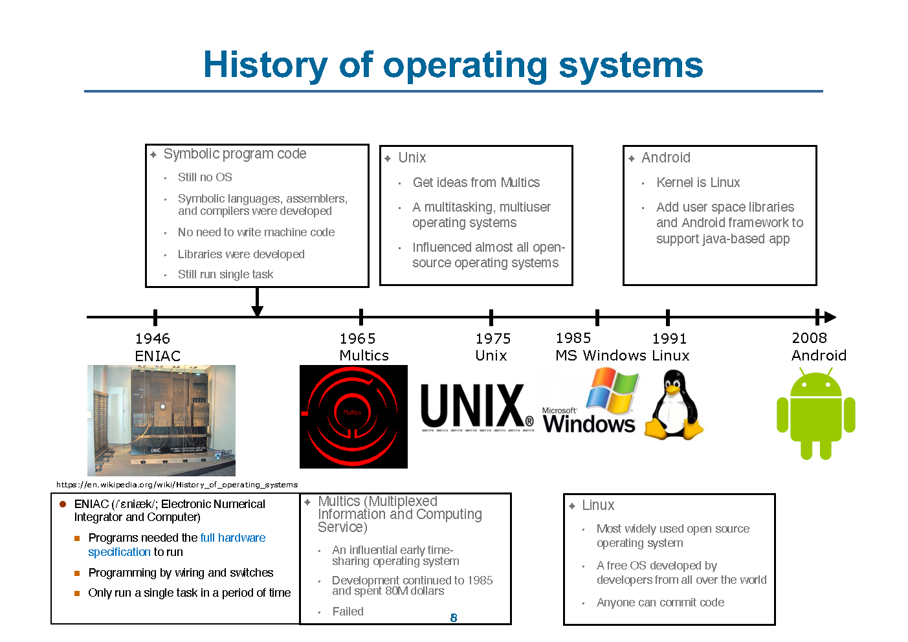
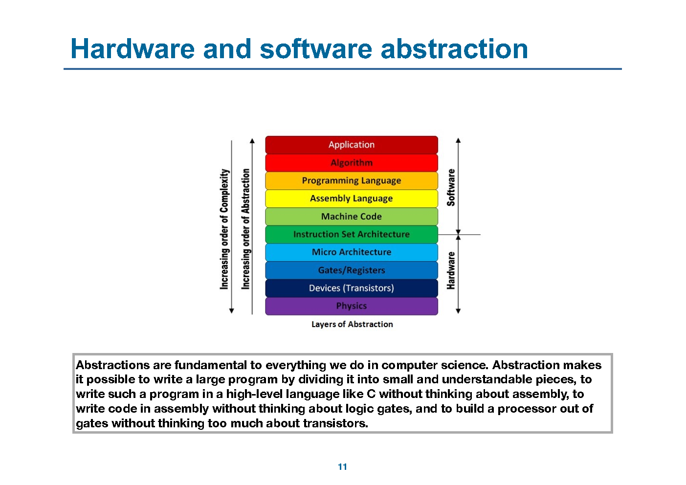
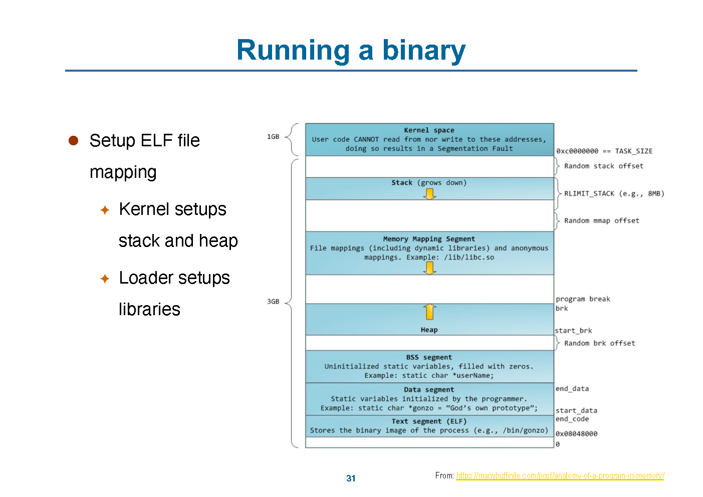
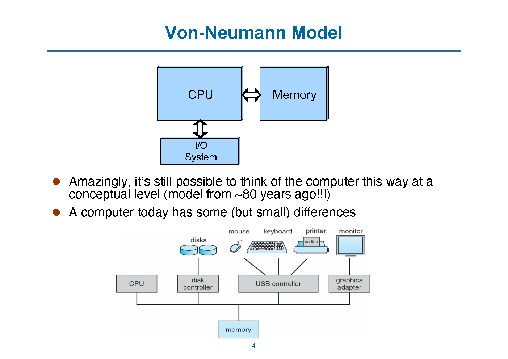
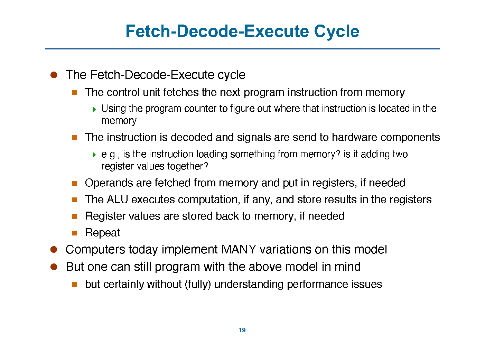
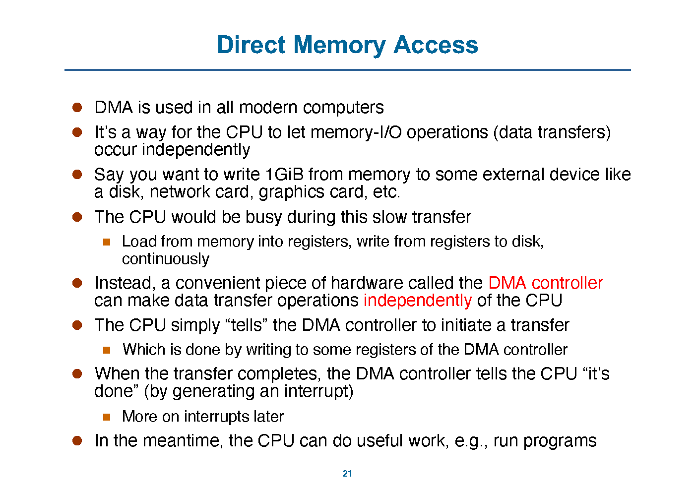
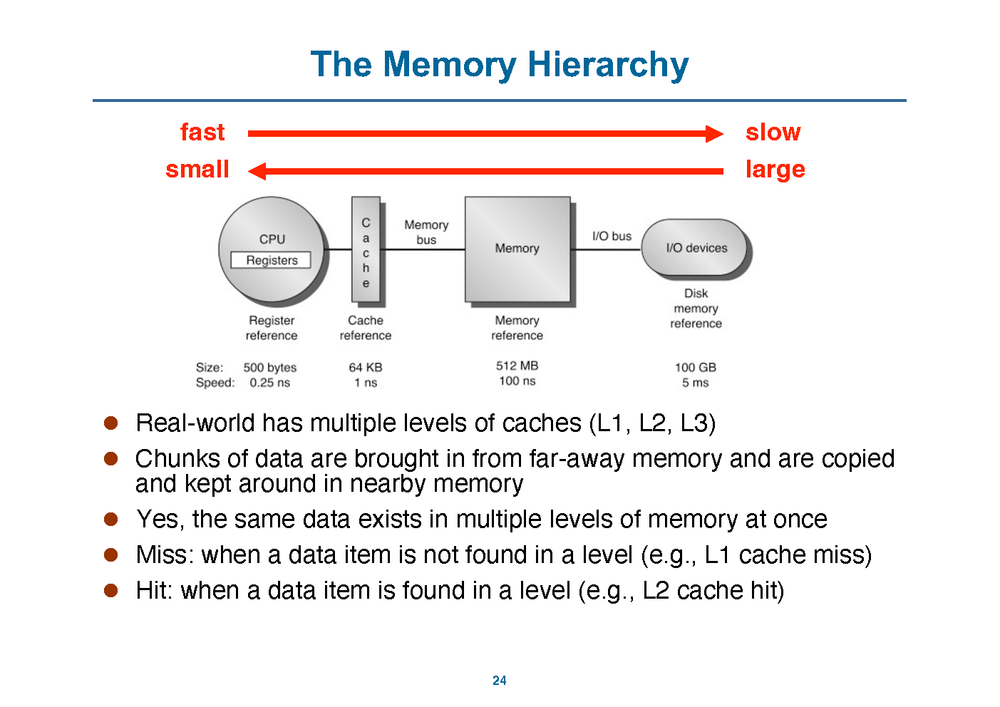
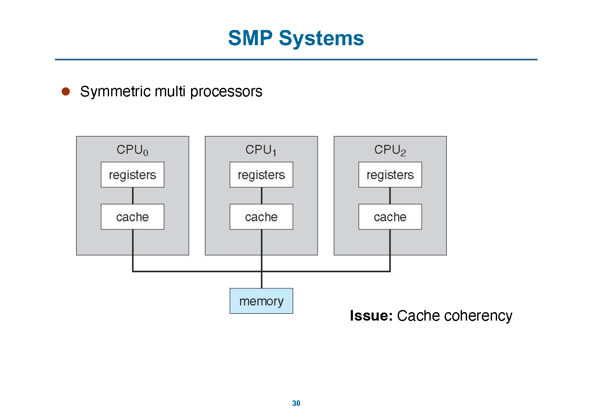
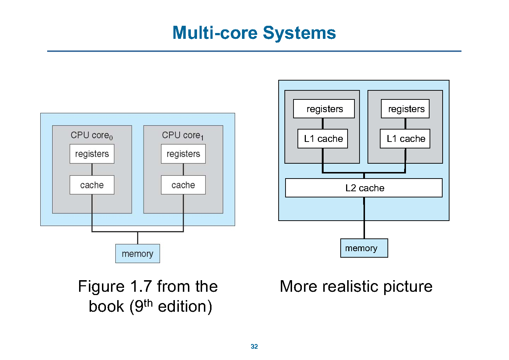
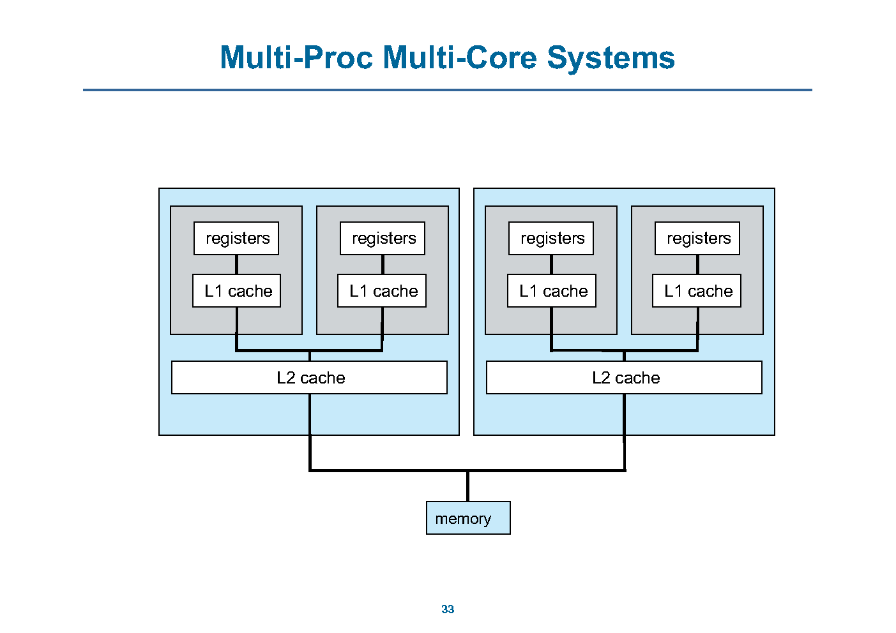

# 计算机系统 II · OS 第 0 讲：从硬件到软件与体系结构回顾

> 来源：`../lec/00-0_course_syllabus.pdf`（39 页，标题页 `OS of Computer Systems`）与 `../lec/00-1_computerarchitecture.pdf`（35 页，标题页 `Computer Architecture Review`）；两页均署 Wenbo Shen，浙江大学「Computer Systems II」讲义。
> 整理日期：2026-10-30
> 说明：本文由 AI 依据讲义幻灯片整理，供课前预习与课后复习；只做提炼、串讲与页码对照，不添加讲义之外的结论。公式、代码与细节以讲义和教材为准，可能有遗漏。
> 页码说明：本讲合并两份 PDF，所以用 `(00-0 p.x)`、`(00-1 p.x)` 分别指两份 PDF 的**物理页码**。`00-0` 的页脚编号从 13 直接跳到 28，正文不拿页脚编号当页码。
> 标注约定：`【讲义】` 表示幻灯片原文或直接提炼；`整理者注` 是整理时的串联或推导，不是讲义原话；`待确认` 表示讲义没讲清、PDF 缺页或存在疑点。

## 0. 本讲速览

| 部分 | 页码 | 主题 | 一句话摘要 |
|---|---|---|---|
| 课程导论 | 00-0 p.1–13 | 从 CPU 到 OS | 硬件课解决「怎么造 CPU」，本讲接着问「怎么用 CPU」：多任务、内存、存储、外设都要有人管。 |
| 程序如何跑起来 | 00-0 p.14–21 | hello world 的背后 | `gcc` 生成 ELF，`./a.out` 触发 `execve` 等系统调用；内核建立地址空间，加载器映射动态库。 |
| 为什么学 OS | 00-0 p.22–31 | OS 的复杂度与价值 | OS 是几千万行量级的复杂软件；学它既是为了理解程序运行的边界，也是为了性能、调试、安全和面试。 |
| 课程信息 | 00-0 p.32–39 | 目标、先修与要求 | 课程要求理解 OS 概念并知道它们怎么实现；先修汇编、C、数据结构；学术诚信要求很硬。 |
| 体系结构回顾 | 00-1 p.2–10 | ENIAC、冯·诺依曼与内存 | 计算机把信息存成二进制；每个字节有唯一地址；代码和数据都放在内存里。 |
| CPU 与执行 | 00-1 p.11–20 | CPU 组成与取指—译码—执行 | 寄存器、ALU、PC、当前指令、控制单元各司其职；现代 CPU 在此模型上加了流水线、cache 和多核。 |
| DMA 与存储层次 | 00-1 p.21–27 | DMA、cache、局部性 | DMA 让外设传输不必由 CPU 逐字节搬；存储层次用 cache 把「大而慢」伪装成「快」。 |
| 摩尔定律与多核 | 00-1 p.28–35 | 频率停涨后的并行 | 主频不能再无限提高，多核成为替代方案；SMP、多核、多处理器多核是三个不同层次的图景。 |

**本讲主线**：

1. **硬件不是终点**：CPU 只会执行指令，真正让程序「好用」的是 OS 提供的抽象和资源管理。
2. **抽象要落到一次真实的运行过程**：从 `main.c` 到 `a.out` 再到进程，编译器、ELF 格式、系统调用、地址空间、动态加载器各管一段。
3. **OS 建立在机器模型之上**：不理解地址、CPU 寄存器、DMA、cache 和中断，就很难理解 OS 为什么这样设计。

---

## 1. 从 CPU 到 OS（00-0 p.3）

【讲义】这一页把前后两段课程接起来：

- 现在已经「可以设计 CPU」；
- 接下来要回答「怎么用 CPU」：
  - 用汇编写程序？
  - 用 C 写程序？
  - 怎么支持多任务（multi-tasking）？
  - 怎么管理内存？
  - 怎么存储数据？
  - 怎么和外部设备通信？

讲义给出一句总结：**Efficiently use of hardware requires significant efforts**。CPU 能算，不等于程序能方便、安全、公平地使用整台机器。多任务、内存隔离、文件、设备驱动，都是 OS 要接手的部分。

> **整理者注**：这句话是本课程从「硬件部分」切到「OS 部分」的接口。前面几讲讲的是 CPU 内部怎么执行指令，从这里开始，问题变成「多个程序如何共享同一套硬件」。

---

## 2. OS 的发展史（00-0 p.4–10）

### 2.1 一条时间线

【讲义】p.4、p.6、p.8 用同一条时间线反复补齐节点：

| 时间 | 系统 | 讲义要点 |
|---|---|---|
| 1946 | ENIAC | 需要完整硬件规格才能运行；用接线和开关编程；一段时间只能跑一个任务；造价约 8000 万美元。 |
| 1965 | Multics | `Multiplexed Information and Computing Service`，有影响力的早期分时系统；开发持续到 1985 年，商业上失败。 |
| 1975 | Unix | 从 Multics 取经；多任务、多用户；影响了几乎所有开源操作系统。 |
| 1985 | MS Windows | 进入 PC 操作系统的时间线。 |
| 1991 | Linux | 使用最广的开源操作系统；由世界各地开发者共同开发，任何人都能提交代码。 |
| 2008 | Android | 内核是 Linux；在用户空间加库和 Android framework，支持 Java 应用。 |



> **整理者注**：p.4、p.6、p.8 不是三份不同内容，而是同一条时间线逐步加入 Unix、Linux、Android。复习时看最后一张 p.8 就够，前面的页可以当作「逐步揭示」的课堂节奏。

### 2.2 两条家族树与 Linux 内核地图

- p.5、p.25 是 UNIX 家族树，能看到 BSD、System V、Linux、macOS 等分支；
- p.26 是 Windows 家族树，从 NT 到 2000、XP、Vista、7 等版本；
- p.7 是 Linux 内核地图（`makelinux.github.io/kernel/map/`），把内核拆成进程管理、内存管理、存储、网络、设备驱动等模块。

这一页的作用不是让人背版本号，而是说明：**OS 不是一个小程序，而是一整套按功能分层的系统软件**。

### 2.3 两个系统软件人物

【讲义】p.9：

- **Linus Torvalds**：1991 年底发布最早的 Linux 原型，当时 21 岁；此后长期投入 Linux。
- **Chris Lattner**：2000 年在 UIUC 与导师 Vikram Adve 启动 LLVM；后来投入 LLVM 与 Swift（Apple）。

p.10 还提到浙大毛老师 2001 年出版的《Linux 内核源代码情景分析》。这一页属于课程文化背景，用来说明「系统软件是长期工程」。

---

## 3. 抽象、hello world 与系统调用（00-0 p.11–21）

### 3.1 抽象层（p.11）

【讲义】p.11 引用了一段关于 abstraction 的说明：抽象让人可以把大程序拆成小块；用 C 写程序时不必想汇编；写汇编时不必想逻辑门；用门搭处理器时不必过度纠缠晶体管。



这张图把层次从高到低排成：

```text
Application
Libraries
Operating System
ISA
Microarchitecture
Hardware
```

> **整理者注**：OS 位于 libraries 和 ISA 之间。它向上提供进程、文件、内存等逻辑资源，向下使用 ISA 和硬件。后面讲的「资源抽象器 / 资源分配器」就是这一层的工作。

### 3.2 一个 hello world 背后的三个问题（p.12–13）

【讲义】p.12–13 把 `hello world` 拆成三个问题：

1. **Behind `gcc main.c`**：编译器做了什么？
2. **What is `a.out`**：ELF 二进制里有什么？
3. **Behind `./a.out`**：运行一个二进制时，内核和加载器做了什么？

讲义列出的顺序是：`main.c` → `gcc main.c` 生成 `a.out` → `./a.out` 输出 hello world。但真正要理解的是「每一步谁在工作」。

> **待确认**：`00-0` 的 PDF 在 p.13 之后直接跳到页脚 28 的 section divider（物理 p.14），**14–27 号幻灯片没有导出**。因此「gcc 编译细节」和「ELF 基础」在 PDF 里只有标题与后续痕迹，没有完整正文。本文不补造这部分内容，只依据 p.15–19 能看到的运行过程整理。

### 3.3 `strace ./a.out` 看到的系统调用（p.15）

【讲义】p.15 用 `strace ./a.out` 观察程序运行，列出三类系统调用：

| 系统调用 | 讲义中的位置 | 作用（按讲义上下文） |
|---|---|---|
| `execve` | 程序启动 | 让内核加载并执行一个可执行文件 |
| `brk` | 运行过程中 | 调整进程的堆边界 |
| `write` | 输出 hello world | 把数据写到文件描述符 |


这里要建立的直觉是：**用户程序不能直接做所有事，很多动作要经过系统调用进入内核**。`write` 看起来只是打印一行字，实际上发生了用户态到内核态的切换。

### 3.4 `execve` 在内核里的路径（p.16）

【讲义】p.16 给出 Linux v6.0 中 `execve` 的调用链：

```text
SYSCALL execve
  -> do_execve
  -> do_execveat_common
  -> exec_binprm
  -> search_binary_handler
  -> load_elf_binary
  -> start_thread
```

关键句是：**`start_thread` 会把 ELF 的 entry point 作为用户程序的起始地址**。讲义右侧的代码片段也显示：

```c
elf_entry = loc->elf_ex.e_entry;
...
start_thread(regs, elf_entry, bprm->p);
```

而 `start_thread_common()` 里把 `regs->pc` 设为传入的 `pc`。所以「程序从哪里开始执行」不是由 shell 决定的，而是由 ELF 头和内核共同决定。

### 3.5 进程地址空间（p.17–19）

【讲义】p.17 把进程地址空间画成从低地址到高地址的几块：

| 区域 | 内容 |
|---|---|
| Text segment | 程序的机器码 |
| Data segment | 已初始化的静态变量 |
| BSS segment | 未初始化的静态变量，运行时填 0 |
| Heap | `malloc` / `brk` 管理的堆，向上增长 |
| Memory Mapping Segment | 动态库、文件映射、匿名映射，例如 `/lib/libc.so` |
| Stack | 函数调用栈，向下增长 |
| Kernel space | 用户代码不能读写，越界会 segmentation fault |

讲义还标出：内核负责建立 stack 和 heap，加载器（loader）负责映射动态库。



p.18–19 用 `cat /proc/self/maps` 展示真实进程的映射。p.18 高亮 `/bin/cat` 的 `r-xp` 段（可执行代码），p.19 高亮它的 `r--p` 段（只读数据）；下面还能看到 `libc`、`ld`、`[heap]`、`[stack]`、`[vdso]`、`[vsyscall]` 等区域。


> **整理者注**：`/proc/self/maps` 是理解「进程不只是一段代码」的好入口。同一个可执行文件会被拆成多个权限不同的映射段，动态库再单独映射进来；这些都不是 C 程序自己做的，而是内核和加载器合作的结果。

### 3.6 讲义留下的两个问题（p.21）

【讲义】p.21 直接问：

- 谁为 `a.out` 建立内存布局？
- 谁提供系统调用？

按 p.15–19 的线索，答案可以写成：

- **内核**建立进程的地址空间、设置栈和堆，并在 `execve` 时加载 ELF；
- **动态加载器**把 `libc` 等共享库映射进地址空间；
- **内核**提供系统调用入口，用户程序通过 `syscall` 一类的指令进入内核。

> **整理者注**：这三个角色不要混成一句「OS 做的」。内核、加载器、C 库各有分工；后面课程会把系统调用、进程和内存管理分别展开。

---

## 4. 为什么学 OS（00-0 p.22–31）

### 4.1 OS 有多大（p.22）

【讲义】p.22 给出两个量级：

- Windows：约 5000 万行源代码；
- Linux：约 2500 万行源代码。

更细的 SLOC 拆分（Windows NT / XP / Vista、Mac OS X、Ubuntu、Linux 2.6.29 内核）见 OS 第 1 讲 p.9；本页只给总量级。

这里要区分「发行版」和「内核」：发行版的代码行数包含大量用户空间软件，不等于内核有同样多的行数。

### 4.2 OS 里有什么（p.22–23）

【讲义】p.22 说 OS 包含很多重要系统概念：复杂度隐藏、性能调优、资源分配；学 OS 内部会让人成为更强的程序员和 hacker。

p.23 说几乎所有计算机系统都运行 OS，例外是一些资源受限、负担不起 OS 的芯片。讲义配图从服务器、汽车、机器人到手机，说明 OS 不只在 PC 上。

### 4.3 讲义给出的理由（p.27–31）

【讲义】p.27–31 逐步补全「为什么学」：

- 你未必会开发 OS，但理解它在做什么，能帮你写出更好的应用、知道程序能做什么和不能做什么、理解性能差异；
- OS 概念可以复用：map-reduce、DNS 等复杂系统也能借用 OS 的经验；
- OS 是所有软件的基础：调用正确的内核 API、理解缓存 / 调度 / 内存管理，能提升性能；
- 非教科书式理由：满足「知道一切」的感觉；想搞安全 / hacking，目标机器通常就在跑 OS；面试常考 coding + system design；好的系统能力能变成产品和公司。

### 4.4 家族树与流行系统（p.24–26）

p.24 列出 Linux、Windows、macOS、Android、iOS、Windows Phone、BlackBerry 等流行系统；p.25 是 UNIX 家族树，p.26 是 Windows 家族树。复习时不必背版本，只要知道「Unix 系」和「Windows 系」是两条主要脉络，Android 的内核来自 Linux。

---

## 5. 课程目标、先修与要求（00-0 p.32–39）

### 5.1 学习目标（p.32）

【讲义】p.32 列出三层目标：

1. **理解 OS 概念**：进程管理、CPU 调度、多线程、同步；内存管理、物理内存、虚拟内存；文件系统等。
2. **知道这些概念怎么实现**：讲义会给 Linux 下的代码示例和 demo。
3. **深入理解真实 OS 怎么工作**：讲义强调「除非你实现过（写过代码），否则不能真正理解一个概念」。

### 5.2 先修与材料（p.33–34）

| 项目 | 讲义要求 |
|---|---|
| 先修 | 汇编、C、数据结构 |
| 编程能力 | 熟练使用 C；熟练进行 UNIX/Linux 编程与调试；或者愿意学 |
| 课程材料 | 课程网站上的 lecture notes；教材 *Operating System Concepts*；如果做 Linux 内核编程，另有参考书 |

### 5.3 学生责任与诚信（p.35–37）

【讲义】p.35 要求学生理解讲课与阅读材料，遇到困难主动找老师或 TA，遵守学术诚信，按时交作业，定期查看课程网页。

p.36 的 Do / Don't：

- Do：分享调试经验和工具知识；感谢别人的帮助；标注书籍和网页来源。
- Don't：作弊或帮别人作弊；不要把别人的代码当成自己的（改改变量名或缩进也算）。

p.37 的 cheating policy 很硬：使用工具查重；被抓到后该次作业可能负分，甚至整门课不及格；所有学术不端都会上报 student conduct office；讲义明确说「没有例外」。

### 5.4 本讲 takeaway（p.38）

- OS 是所有软件的基础；
- OS 概念终身受用；
- 不写代码很难真正理解 OS；
- 不要作弊，尊重别人的工作并给出引用。

---

## 6. 计算机体系结构回顾（00-1 p.2–35）

这一部分不是新知识，而是把后面 OS 会用到的机器模型重新摆一遍。重点有四个：**地址、CPU、DMA、存储层次**。

### 6.1 ENIAC 与冯·诺依曼模型（00-1 p.2–4）

【讲义】p.2：

- ENIAC（1946）通常被认为是第一台电子计算机；
- 使用真空管和打孔卡；
- 比讲者的笔记本电脑慢 5 万倍以上；
- 长约 100 英尺，每个寄存器占 20 英尺；
- 用接线编程。

p.3–4 讲冯·诺依曼：

- 1944 年 John von Neumann 加入 ENIAC，写下关于计算机体系结构的备忘录，把 ENIAC 的想法形式化；
- 这套想法成为 **Von Neumann architecture**：一个处理器执行操作并控制全部过程；一个存储器同时放代码和数据；还需要某种 I/O；
- 80 年后的今天，概念上仍然可以这样看计算机，只是现代机器在细节上复杂得多。



### 6.2 内存：字节、地址与内容（00-1 p.5–9）

【讲义】p.5：

- 计算机里的所有信息都是二进制；0 表示零电压，1 表示正电压（例如 5V）；
- bit 是最小信息单位；
- 内存的基本单位是 byte，1 Byte = 8 bits，例如 `0100 1100`；
- 一个字节的含义取决于怎么解释：同样是 76，可以是无符号整数，也可以是字符 `L`；
- 每个字节有唯一地址；机器中所有地址的位数相同，例如 ARM64 用 64 位地址；
- 处理器提供「读取地址 X 的字节」和「把值写入地址 X」的指令。

p.6–8 用一张地址—内容表反复演示：

| 地址（二进制） | 内容（二进制） |
|---|---|
| `0000 0000 0000 0010` | `0100 1100` |
| `0000 0000 0000 0100` | `0101 1110` |

p.8 还演示了把地址 `0000 0000 0000 0100` 的内容改成 `0101 1110`。这类页的重点不是记具体字节，而是分清 **地址**和**地址里的值**。

p.9 讲「代码和数据都在内存里」：

- 程序加载后，地址空间里同时有代码和数据；
- 对 CPU 来说，两者都只是字节；
- 程序员知道哪些是代码、哪些是数据，但 CPU 不知道；写汇编和 OS 时必须自己保持这个区分。

### 6.3 CPU 里有什么（00-1 p.10–18）

【讲义】p.10 先把 CPU 定义成「修改内存内容的硬件」：它把一个内存状态变成另一个内存状态。

p.11–17 逐个介绍 CPU 部件：

| 部件 | 作用 |
|---|---|
| Registers | 硬件指令操作的「变量」；可以从内存 load，也可以 store 回内存；运算的操作数和结果都在寄存器；访问很快，但数量有限。 |
| ALU | 算术与逻辑单元；根据当前寄存器值计算，把结果写回寄存器；支持 `+`、`*`、`/`、`-`、`OR`、`AND`、`XOR` 等。 |
| Program Counter（PC） | 指向下一条指令的地址；每条指令后递增，控制流改变时被设为别的值。 |
| Current Instruction | 保存当前正在执行的指令。 |
| Control Unit | 译码指令，向 CPU 内的硬件部件发送相应信号。 |

p.18 是 CPU 的 die photo 和简化的内部框图，用来提醒「框图是抽象，真实芯片要复杂得多」。

### 6.4 取指—译码—执行（00-1 p.19–20）

【讲义】p.19 的 Fetch-Decode-Execute cycle：

1. 控制单元按 PC 从内存取下一条指令；
2. 译码指令，向硬件部件发信号（例如：这是 load 吗？这是两个寄存器相加吗？）；
3. 需要时从内存取操作数放入寄存器；
4. 需要时由 ALU 计算，结果写回寄存器；
5. 需要时把寄存器值写回内存；
6. 重复。



p.20 补充：这只是简化模型。真实的 control unit 不是单一部件；CPU 里有多个 ALU、cache，甚至多个核；执行是流水线的；几十年的体系结构研究让硬件变得非常复杂。但概念上，仍然是 fetch-decode-execute。

> **整理者注**：这一段和第 6 讲（硬件部分的异常 / 中断）接得上。OS 要接管 CPU，靠的就是打断这个循环：中断或异常把 PC 重定向到内核的 handler。

### 6.5 DMA（00-1 p.21–22）

【讲义】p.21：

- DMA 用于让内存和外设之间的数据传输独立于 CPU；
- 例如要把 1 GiB 从内存写到磁盘、网卡或显卡；
- 如果没有 DMA，CPU 要不断「从内存读入寄存器，再从寄存器写到设备」，在慢速传输期间一直忙；
- 有 DMA 控制器后，CPU 只需写 DMA 控制器的寄存器，告诉它启动传输；
- 传输完成后，DMA 控制器用**中断**通知 CPU；
- 这段时间 CPU 可以继续跑程序。



p.22 提醒 DMA 不是完全免费：

- DMA 控制器和 CPU 都要用内存总线，可能互相干扰；
- 可以有 DMA 优先或 CPU 优先等模式；
- 但总体而言，DMA 带来更好的性能。

### 6.6 存储层次、局部性与 cache（00-1 p.23–27）

【讲义】p.23–24：

- 大家都想要又大又快的存储器，但现实是「慢而大」或「快而小」；
- 主存对 CPU 来说很慢；
- 解决办法是 **memory hierarchy**：用多级 cache 制造「内存很快」的假象；
- 真实机器有 L1、L2、L3 cache；
- 数据会被复制到离 CPU 更近的层次，同一份数据可以同时存在于多个层次；
- **hit**：在某一层找到数据；**miss**：在某一层没找到。



p.25 解释为什么 cache 有效：

- **时间局部性**（temporal locality）：程序倾向于再次访问最近访问过的地址；第一次取 counter 要付慢速内存的代价，后面就快。
- **空间局部性**（spatial locality）：程序倾向于访问最近访问地址旁边的地址；数组第 `i` 个元素第一次可能慢，第 `i+1` 个元素通常已经在同一块 cache 里。

p.26 用「去图书馆借书」打比方：你要一本书，会把同一书架上的书一起带回家；下次要那本书或它旁边的书，就不用再跑图书馆。

p.27 的表把层次和管理者对应起来：

| 层次 | 典型内容 | 谁管理 |
|---|---|---|
| Registers | CPU 寄存器 | 编译器 |
| Cache | L1/L2/L3 | 硬件 |
| Main memory | DRAM | OS |
| Disk storage | 磁盘等 | OS |

讲义还强调：主存和磁盘由 OS 管理；cache 和 cache coherence 由硬件管理。处理「慢」的层次时，花时间做聪明决策更划算；这也是 OS 比硬件做更多复杂策略的原因之一。

> **整理者注**：这张表是后面「OS 管内存、硬件管 cache」的口径来源。不要把「虚拟内存管理」和「cache 替换」混成一件事。

### 6.7 摩尔定律、SMP 与多核（00-1 p.28–33）

【讲义】p.28–29：

- 1965 年 Gordon Moore 预测半导体芯片的晶体管密度大约每 24 个月翻一倍（常被误传成 18 个月）；
- 这个预测在一段时间内成立；
- 但「计算机每两年快一倍」是错误解读，后来不再成立。

p.30 讲 SMP（symmetric multiprocessors）：多个 CPU 共享内存；问题是 **cache coherency**。

p.31 讲多核芯片：

- 制造商不能继续无限提高时钟频率，原因是功耗和散热；
- 于是把多个「较低频率」的处理器放到一块芯片上；
- 讲义说这更像「对问题的解决方案」，不是纯粹的新技术突破；
- 多数用户 / 程序员宁愿要一个 100 GHz 核，也不想要 50 个 2 GHz 核。



p.32–33 区分三种图景：

- **多核芯片**：一块芯片上有多个核，每个核有自己的寄存器和 L1，通常共享 L2 和内存；
- **多处理器多核系统**：多块芯片、每块多核，共享内存；
- 讲义用图 1.7（教材第 9 版）和「更真实的图」作对比。





### 6.8 本部分 takeaway 与作业（00-1 p.34–35）

- 每个内存字节有唯一地址；
- 理解 CPU 组成；
- 理解 Fetch-Decode-Execute cycle；
- 想深入体系结构，可以另修计算机体系结构课，经典教材是 Patterson & Hennessy；
- 作业：阅读 CSAPP 第 1 章、2.1、2.2、2.3；安装 Linux（双系统优先或虚拟机）；构建并用 QEMU 跑内核（讲义原文：`Build and qemu kernel`）。

---

## 7. 听课重点与易混点

1. **OS 不是「让 CPU 变快」的软件**。它做的是抽象和分配：把 CPU、内存、磁盘、设备变成进程、地址空间、文件、设备接口。
2. **`gcc`、加载器、内核不是一回事**。`gcc` 生成 ELF；内核在 `execve` 时建立地址空间并加载程序；动态加载器负责映射共享库。
3. **地址和内容是两件事**。`0x02` 是地址，`0100 1100` 是那个地址里的内容；p.6–8 反复练的就是这个区分。
4. **代码和数据在 CPU 眼里没有区别**。CPU 只按地址取字节；是代码还是数据，由 PC、指令译码和程序员 / OS 的约定决定。
5. **cache 由硬件管，主存和磁盘由 OS 管**。这是 p.27 表的结论，也是后面虚拟内存、页面置换的前置知识。
6. **DMA 不是「没有开销」**。它把 CPU 从逐字节搬运中解放出来，但 DMA 和 CPU 会争内存总线，而且传输完成要靠中断通知。
7. **SMP、多核、 多处理器多核** 是不同层次的词：SMP 强调共享内存的对称多处理器；多核强调一块芯片上多个核；多处理器多核强调多块芯片、每块多核。
8. **PDF 缺页要不补造**。`00-0` 的 14–27 号幻灯片没有导出，gcc / ELF 的细节只能按后续页面的线索理解，不能假装讲义讲过。

---

## 8. 课前自测

| # | 问题 | 回查 |
|---|---|---|
| 1 | 为什么说「能设计 CPU」不等于「会用 CPU」？OS 要接手哪些问题？ | [§1 从 CPU 到 OS](#1-从-cpu-到-os00-0-p3) |
| 2 | ENIAC、Multics、Unix、Linux、Android 各在时间线的哪个位置？各自的关键词是什么？ | [§2.1 一条时间线](#21-一条时间线) |
| 3 | `gcc main.c`、`./a.out` 分别发生了什么？`execve` 在其中的作用是什么？ | [§3.2 hello world 背后的三个问题](#32-一个-hello-world-背后的三个问题p1213)、[§3.4 execve 在内核里的路径](#34-execve-在内核里的路径p16) |
| 4 | `strace ./a.out` 里的 `execve`、`brk`、`write` 各做什么？ | [§3.3 strace ./a.out 看到的系统调用](#33-strace-aout-看到的系统调用p15) |
| 5 | 进程地址空间从低到高有哪些区域？栈和堆谁向上、谁向下？ | [§3.5 进程地址空间](#35-进程地址空间p1719) |
| 6 | 为什么 `0x02` 和 `0100 1100` 不能混为一谈？ | [§6.2 内存：字节、地址与内容](#62-内存字节地址与内容00-1-p59) |
| 7 | CPU 里的 PC、当前指令、寄存器、ALU、控制单元各做什么？ | [§6.3 CPU 里有什么](#63-cpu-里有什么00-1-p1018) |
| 8 | DMA 解决了什么问题？为什么它仍然会和 CPU 抢总线？ | [§6.5 DMA](#65-dma00-1-p2122) |
| 9 | 时间局部性和空间局部性各是什么？cache 为什么能利用它们？ | [§6.6 存储层次、局部性与 cache](#66-存储层次局部性与-cache00-1-p2327) |
| 10 | SMP、多核、多处理器多核三张图有什么区别？ | [§6.7 摩尔定律、SMP 与多核](#67-摩尔定律smp-与多核00-1-p2833) |

---

## 9. 关联知识点

- **与本课程硬件部分**：本讲的地址、CPU 周期、DMA 与存储层次，是 [hardware-06 第 6 讲 §6.2 软硬件接口](hardware-06_第06讲_异常软硬件接口与操作系统简介.md#2-62-软硬件接口p2852) 的前置；异常 / 中断则在 [hardware-06 §6.1](hardware-06_第06讲_异常软硬件接口与操作系统简介.md#1-61-异常与中断p227) 中展开。
- **与 OS 第 1 讲**：本讲 p.21 留下的「谁建立地址空间、谁提供系统调用」，在 [os-01 第 1 讲](os-01_第01讲_操作系统概述.md) 的启动、内核态 / 用户态、事件与系统调用几节里接上。
- **与第 1 讲 ISA**：ELF、入口地址、机器码与寄存器约定，对应 [hardware-01 第 1 讲](hardware-01_第01讲_课程介绍与ISA设计原理.md) 的 RISC-V 指令格式与过程调用。
- **与第 2 讲流水线**：本讲 p.19 的 fetch-decode-execute 是单周期模型；流水线把它拆成多级，见 [hardware-02 第 2 讲](hardware-02_第02讲_流水线概念分类与性能评价.md)。

---

## 10. 来源、页码对照与待确认

**来源**：

- `../lec/00-0_course_syllabus.pdf`，39 页，标题页 `OS of Computer Systems`，作者 Wenbo Shen；
- `../lec/00-1_computerarchitecture.pdf`，35 页，标题页 `Computer Architecture Review`，作者 Wenbo Shen。

**页码对照**：

- `00-0 p.1–13`：课程导论、OS 历史、抽象、hello world 引言；
- `00-0 p.14–21`：`Running a binary`（p.14 页脚为 28；p.15 `strace`；p.16 `execve` 链；p.17 地址空间；p.18–19 `/proc/self/maps`；p.20–21 讨论）；
- `00-0 p.22–31`：为什么学 OS、系统与家族树、非教科书理由；
- `00-0 p.32–39`：学习目标、先修、材料、责任、诚信、takeaway；
- `00-1 p.2–10`：ENIAC、冯·诺依曼、内存、代码与数据；
- `00-1 p.11–20`：CPU 组成、die photo、fetch-decode-execute、现代 CPU 的复杂性；
- `00-1 p.21–27`：DMA、总线争用、慢速 RAM、存储层次、局部性、cache、管理归属；
- `00-1 p.28–35`：摩尔定律、SMP、多核、多处理器多核、takeaway、作业。

**待确认**：

1. `00-0` 的页脚编号从 13 直接跳到 28；14–27 号幻灯片未包含在 PDF 中。gcc 编译细节、ELF 结构等页面缺失，本文只按可见的 p.15–19 整理。
2. `00-0 p.18–19` 的终端截图里，`/proc/self/maps` 的地址和库版本是讲者机器上的具体值，不应背成通用常数；本文只取「代码段 / 数据段 / 动态库 / 堆 / 栈」的结构。
3. `00-0 p.9` 的 Windows / Mac OS X / Ubuntu 代码行数是讲义给出的量级，可能随版本变化；本文保留原值，不把它们当作当前版本数据。
4. `00-1 p.27` 的表中 cache「Typical size」写作 `> 16 MB`，与常见 L1/L2 cache 容量不符，疑为讲义笔误或排版问题；本文只采用「cache 由硬件管理、主存和磁盘由 OS 管理」这一结论，不把该容量当作可靠数据。
5. `00-0 p.21` 的两个问题在讲义中没有给出标准答案；本文按 p.15–19 的线索作答，属于整理者串联，不是讲义原文。
6. 两份 PDF 都没有讲稿备注，课堂口述部分无法核对；若老师课上补充了 gcc / ELF 的细节，以课堂为准。
