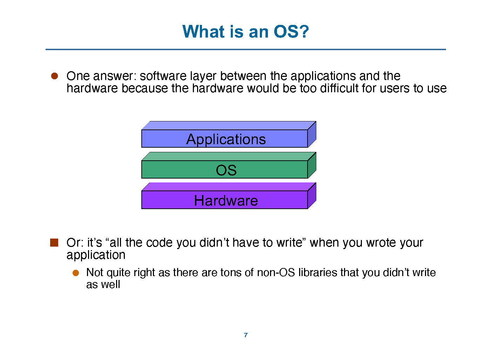
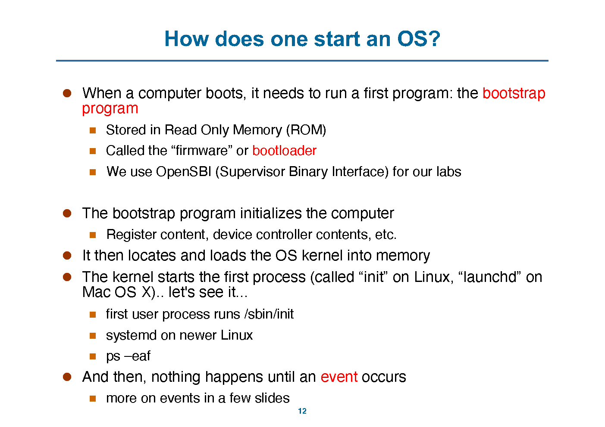
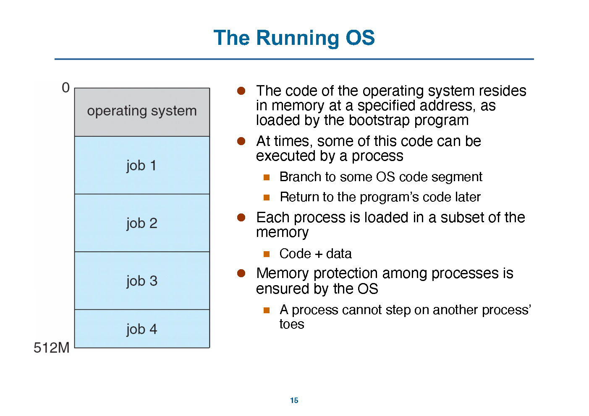
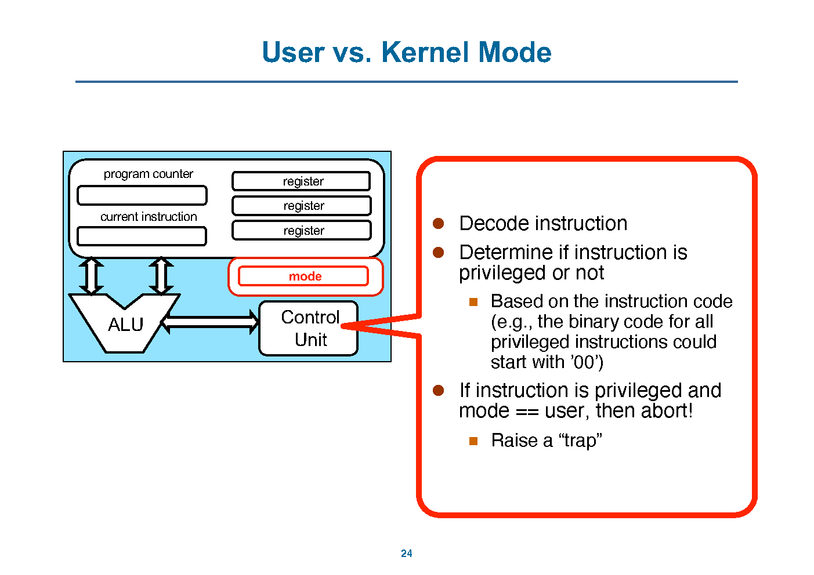
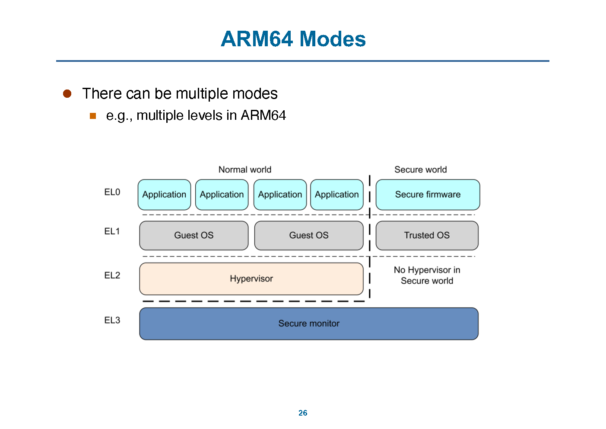
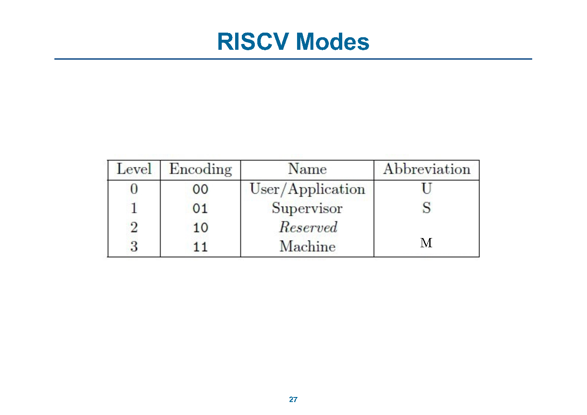
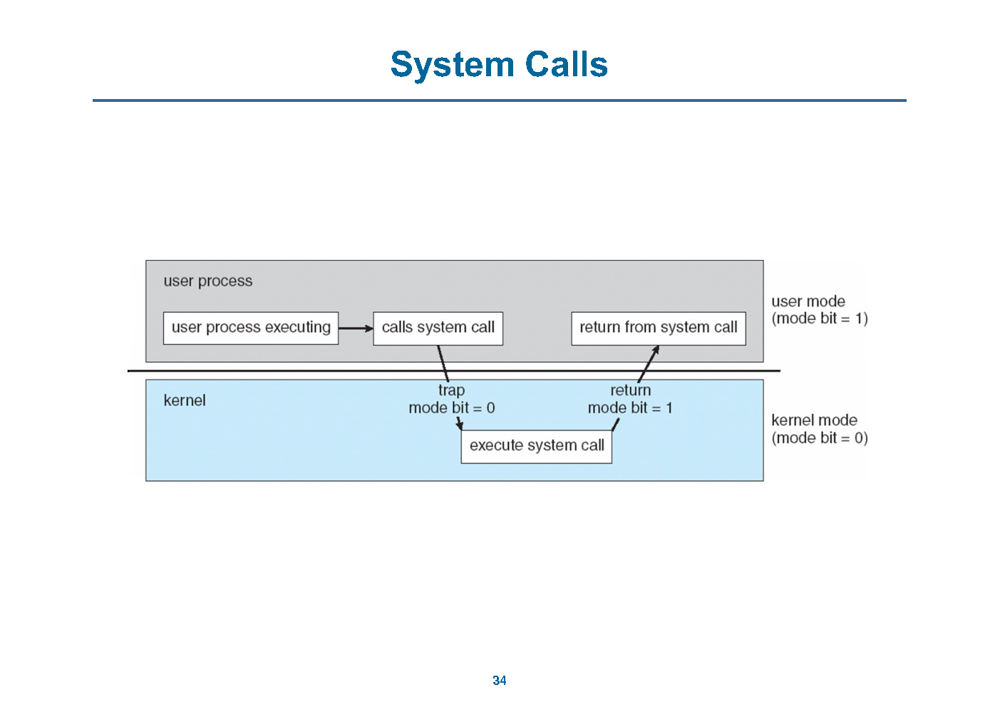
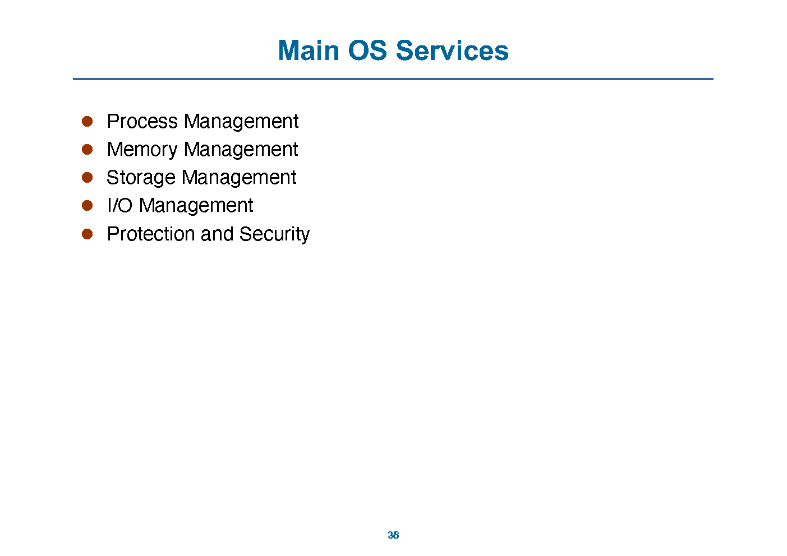

# 计算机系统 II · OS 第 1 讲：操作系统概述

> 来源：`../lec/01_intro.pdf`（47 页，标题页 `OS: An Overview`；Wenbo Shen，浙江大学「Computer Systems II」讲义；部分幻灯片来自 OSC 与 Henri Casanova@Hawaii）
> 整理日期：2026-10-30
> 说明：本文由 AI 依据讲义幻灯片整理，供课前预习与课后复习；只做提炼、串讲与页码对照，不添加讲义之外的结论。术语、代码与细节以讲义和教材为准，可能有遗漏。
> 页码说明：`(p.x)` 指 **PDF 物理页码**。本 PDF 的页脚编号与物理页码一致（1–47）。
> 标注约定：`【讲义】` 表示幻灯片原文或直接提炼；`整理者注` 是整理时的串联或推导；`待确认` 表示讲义没讲清或存在疑点。

## 0. 本讲速览

| 小节 | 页码 | 主题 | 一句话摘要 |
|---|---|---|---|
| §1 | p.2–4 | 为什么学 OS | 理解你每天使用的系统、复用 OS 的抽象、借鉴复杂软件系统的经验；开源和虚拟化让学习成本比过去低。 |
| §2 | p.5–9 | OS 是什么 | OS 是应用与硬件之间的软件层，也是资源抽象器和资源分配器；“内核一直在运行”是一个流行但错误的说法。 |
| §3 | p.10–17 | 启动、多道程序与分时 | 引导程序把内核装进内存；多道程序在等待时切换作业；分时让多个进程快速轮转，制造“独占机器”的假象。 |
| §4 | p.18–27 | CPU 如何支持 OS | 特权指令 + 用户态 / 内核态 + 模式位，让 CPU 在硬件层面拦住用户程序直接操作设备、内存管理状态和中断。 |
| §5 | p.28–37 | OS 事件 | 中断来自外部，异常来自正在执行的指令；系统调用是一种特殊的 trap；定时器中断保证 OS 能定期拿回 CPU。 |
| §6 | p.38–43 | OS 的五大服务 | 进程、内存、存储、I/O、保护与安全。 |
| §7 | p.44–45 | 课堂讨论 | 判断哪些指令应当特权化；判断依据是公平、安全和内核状态完整性。 |
| §8 | p.46–47 | 阅读与总结 | 教材第 1 章，以及 1.10、1.11 两节。 |

**本讲主线**：

1. **OS 是抽象层，也是分配器**：它把 CPU、内存、磁盘、设备变成进程、地址空间、文件和设备接口，并决定谁在什么时候拿到多少资源。
2. **OS 能管事，靠的是硬件支持**：特权指令、模式位、trap、timer 让用户程序不能为所欲为，也让内核能定期收回 CPU。
3. **OS 是事件驱动的**：启动完成后，内核大部分时间不“跑”；中断、异常、系统调用发生时才进入内核，处理完再返回。

---

## 1. 为什么学 OS（p.2–4）

### 1.1 四个理由（p.2）

【讲义】p.2 先承认一个现实：你大概率不会去开发一个 OS，除非找到一份非常有意思的工作。但学 OS 仍然有用：

- **理解你在用的东西**：知道 OS 怎么工作，才能写出更好的应用，知道程序能做什么、不能做什么，理解性能，理解为什么某些 OS 在特定场景下更好或更差。
- **抽象可以复用**：OS 里的概念不只用于 OS，也可以用于实现普通应用。
- **复杂软件系统的经验**：很多人会参与复杂软件系统；OS 是这类系统中最有意思的例子之一，它的演化经验可以迁移到别的场景。
- **今天的条件更好**：开源运动让 OS 代码可读；旧商业 OS 的代码也能看到；虚拟化让人可以安全地运行、折腾 OS。

### 1.2 这套讲义的范围（p.3–4）

【讲义】p.3 说，过去 OS 很神秘，现在学生读完别人的 OS 代码就可能自己做一个，或者给现有 OS 提交代码；虚拟化让实验不需要牺牲自己的电脑。

p.4 明确这套讲义是 **10,000 英尺的俯瞰图**：

- 很多细节这学期后面才讲；
- 会出现一些你还不熟的术语，后面会解释；
- 会做简化假设；
- 如果你已经知道更多，先忍耐一下，后面会补。

> **整理者注**：这一页是在给全课定调。第 1 讲不追求把每个机制讲透，而是先建立一张地图：OS 在哪里、它管什么、它靠什么硬件机制管事。

---

## 2. 什么是 OS（p.5–9）

### 2.1 先从直觉开始（p.5–6）

【讲义】p.5 直接问：「What do you think the answer is?」并注明有很多可能答案。p.6 用买手机和用手机两张图做对比：买手机时看参数，用手机时看界面和应用；OS 同时影响这两端。

### 2.2 三层定义（p.7–8）

【讲义】p.7 给出第一个答案：OS 是 **应用程序和硬件之间的软件层**，因为硬件对普通用户来说太难直接用。

```text
Applications
    OS
  Hardware
```

讲义还给了一个流行说法：OS 是「你写应用时不用自己写的那部分代码」。但它马上补了一句：这个说法不完全对，因为还有大量非 OS 的库也不是你写的。

p.8 给出更准确的定义：

- OS 是 **resource abstractor**（资源抽象器）：定义一组逻辑资源，与硬件资源对应，并定义一组对逻辑资源的操作；
  - 物理资源：CPU、磁盘、RAM；
  - 逻辑资源：进程、文件、数组。
- OS 是 **resource allocator**（资源分配器）：决定哪个正在运行的程序拿到什么资源、拿多少、什么时候拿。
- 一个流行但很错误的定义是：「OS 是那个一直在运行的程序（其实是它的 kernel 组件）」。
  - 讲义说这会误导人：**kernel 并不是一个一直在运行的程序**。



> **整理者注**：把 OS 想成「一层」比想成「一个进程」更接近讲义的口径。内核代码常驻内存，但只有当事件发生时才会被执行；它不像普通进程那样一直占着 CPU 跑。

### 2.3 OS 有多大（p.9）

【讲义】p.9 先承认「哪些东西算 OS、哪些不算」很难界定：窗口系统算不算？系统程序算不算？1998 年微软把太多东西叫成 OS，还引出了反垄断诉讼。

然后给出一组 SLOC（source lines of code）：

| 系统 | 代码行数 |
|---|---|
| Windows NT（1993） | 600 万 |
| Windows XP | 约 5000 万 |
| Windows Vista | 约 XP + 1000 万 |
| Mac OS X 10.4 | 约 8600 万 |
| Ubuntu 发行版 | 超过 2.3 亿 |
| Linux kernel 2.6.29 | 约 1100 万 |

讲义特意注明：Ubuntu 的 2.3 亿行里有很多东西不属于 OS；内核 2.6.29 约 1100 万行。结论是：**OS 很大**。

p.10 用 Linux 内核代码行数随版本增长的曲线说明这一点；p.11 用 Android 的分层图说明一个“OS”往往还包括 framework、库和内核。

> **整理者注**：考试如果问「Linux 有多少行」，要看清问的是内核还是发行版。讲义把这两个数字分开列，就是为了防止混用。

---

## 3. 启动、多道程序与分时（p.10–17）

### 3.1 计算机怎么启动（p.12）

【讲义】p.12：

1. 计算机启动时先运行 **bootstrap program**；
2. 它存放在 ROM 中，也叫 firmware 或 bootloader；
3. 课程实验使用 **OpenSBI**（Supervisor Binary Interface）；
4. bootstrap program 初始化计算机：寄存器内容、设备控制器内容等；
5. 它找到 OS kernel 并加载到内存；
6. 内核启动第一个进程：Linux 上叫 `init`，macOS 上叫 `launchd`；更新的 Linux 常用 `systemd`；第一个用户进程运行 `/sbin/init`；
7. 可以用 `ps -eaf` 观察进程；
8. 之后「什么也不发生」，直到某个事件出现。



### 3.2 多道程序（p.13）

【讲义】p.13：

- **Multi-programming**：现代 OS 允许多个 job（正在运行的程序）同时留在内存中；
- OS 选一个 job 开始执行；
- 当这个 job 必须等待「某个东西」时，OS 选另一个 job 来跑；
- 这个切换叫 **context switch**（上下文切换），能提高生产率；
- 以前不是这样：
  - 单用户模式下，用户思考时机器闲着，生产率很差；
  - 批处理把 job 排成队列，I/O 期间 CPU 仍然空闲，生产率也低。

### 3.3 分时（p.14）

【讲义】p.14：

- **Time-sharing**：多道程序 + 快速上下文切换；
- job 不能运行「太久」；
- 允许交互：响应时间很短，每个 job 都以为自己独占系统；
- 现代 OS 里 job 叫 **process**；
- **process 是一个正在运行的程序**；
- 很多进程可以同时（部分地）留在内存中；
- 讲义建议在笔记本电脑上运行 `ps aux` 观察。

> **整理者注**：多道程序和分时的区别不在「有没有切换」，而在切换的目的和频率。多道程序主要在 job 等待时切换，分时则主动限制时间片，让交互响应更短。

---

## 4. 运行中的 OS 与内核（p.15–17）

### 4.1 OS 代码在哪里（p.15）

【讲义】p.15 说明：

- OS 的代码由 bootstrap program 加载到内存的指定地址；
- 有时进程会执行一部分 OS 代码：跳到 OS 代码段，之后再返回程序代码；
- 每个进程被加载到内存的一个子集，包含代码和数据；
- 进程之间的内存保护由 OS 保证：一个进程不能踩到另一个进程的地盘。



### 4.2 内核不是普通 job（p.16）

【讲义】p.16 明确：

- kernel **不是**一个正在运行的 job；
- 它是代码（text segment + data segment），驻留在内存中，随时准备执行；
- 某个事件发生时，它才被执行；
- 它可以在 job 请求时「代表 job」执行；
- 它可以做特殊的、危险的事，尤其是和硬件相关的操作。

### 4.3 内核大小与内核里的风险（p.17）

【讲义】p.17：

- 内核占用物理内存，内核设计者要小心不要用太多；
- 这解释了为什么社区会争论「某个新功能是否真的必须进内核」；
- 内核代码要 lean / mean：lean 是「不多做」，mean 是「目标单一」；
- **内核内部没有内存保护**：内核自己就是那个对进程说 `segmentation fault` 的角色，但没有谁在看着内核；
- 所以开发内核必须非常小心，这也是 kernel hacking 受尊重的原因。

> **整理者注**：用户态程序出错，通常只死一个进程；内核出错可能直接 panic / 蓝屏。后面讲保护与安全时，这个区别会反复出现。

---

## 5. CPU 如何支持 OS（p.18–27）

### 5.1 先回到资源抽象（p.18–19）

【讲义】p.18 重复了 p.8 的定义：OS 是资源抽象器和资源分配器，物理资源是 CPU、磁盘、RAM，逻辑资源是进程、文件、数组；OS 决定谁拿到什么、什么时候拿。

p.19 问：**怎么设计 CPU 来支持 OS？** 这一节开始回答：靠特权指令和模式。

### 5.2 特权指令（p.20）

【讲义】p.20：

- 每个 CPU 都有一组指令被限制使用，只有 OS 能执行，叫 **protected instructions** 或 **privileged instructions**；
- 只有 OS 能：
  - 直接访问 I/O 设备（打印机、磁盘等），理由：公平、安全；
  - 操作内存管理状态，理由：公平、安全；
  - 操作受保护的控制寄存器，例如内核模式、中断级别；
  - 执行 `halt` 指令关闭处理器。
- CPU 必须知道当前能不能执行特权指令。

### 5.3 用户态与内核态（p.21–24）

【讲义】p.21：

- 现代处理器至少支持两种执行模式：
  - **User mode**：不能执行特权指令；
  - **Kernel mode**：可以执行所有指令。
- 用户代码在用户态执行；OS 代码在内核态执行；
- 模式由**受保护控制寄存器里的状态位**指示；
- CPU 在执行特权指令前检查这个位；
- 设置模式位本身也是特权指令。

p.22–23 的图把 `mode` 加进 CPU：p.22 是没有模式位的 CPU，p.23 多了一个 `mode` 寄存器。

p.24 讲译码时的检查：

1. 译码指令；
2. 判断它是不是特权指令（例如所有特权指令的二进制码都以 `00` 开头）；
3. 如果指令是特权指令且当前是用户态，就中止，并触发一个 **trap**。



### 5.4 模式可以不止两种（p.25–27）

【讲义】p.25：

- 可以有多种模式，例如 CPU 内多个层级；
- MS-DOS 只有一种模式，因为它面向的 Intel 8088 没有模式位；
- 结果是用户程序的一个 bug 可以毁掉整个系统；多个用户程序也可以同时写同一个设备，造成不一致。

p.26 是 ARM64 的异常级别：

| 级别 | 典型用途 |
|---|---|
| EL0 | Application |
| EL1 | Guest OS / OS |
| EL2 | Hypervisor |
| EL3 | Secure monitor |

p.27 是 RISC-V 的三种模式：

| Level | Encoding | Name | 缩写 |
|---|---|---|---|
| 0 | `00` | User/Application | U |
| 1 | `01` | Supervisor | S |
| 2 | `10` | Reserved | — |
| 3 | `11` | Machine | M |





> **整理者注**：ARM64 用 exception level，RISC-V 用 privilege level，名字不同，但核心思想一样：用硬件区分「普通程序」和「能操作机器的代码」。硬件部分第 6 讲已经讲过 RISC-V 的 M/S/U 和 CSR，这里是把同一套概念放回 OS 的语境。

---

## 6. OS 事件：中断、异常、系统调用与定时器（p.28–37）

### 6.1 什么是事件（p.28）

【讲义】p.28：

- **event** 是控制流中「不寻常」的变化；
- 寻常的变化是用户程序里的 `branch` 指令；
- 事件会停止当前执行，切换模式，切换上下文，也就是开始运行内核代码；
- 内核为每种事件定义一个 **handler**，即一段在内核态执行的代码；
- 系统启动后，所有进入内核的入口都是事件；
- 从这个角度看，**OS 可以看成一个巨大的事件处理器**。

### 6.2 控制流（p.29）

【讲义】p.29 引用控制流（control flow）的定义：程序中语句、指令或函数调用的执行顺序。配图是一个 `for` 循环的流程图，用来说明「正常控制流」和「事件造成的异常控制流」的区别。

### 6.3 内核的事件循环（p.30）

【讲义】p.30 用一段伪代码展示内核怎么处理事件：

```c
void processEvent(event) {
    switch (event.type) {
    case NETWORK_COMMUNICATION:
        NetworkManager.handleEvent(event);
        break;
    case SEGMENTATION_FAULT:
    case INVALID_MODE:
        ProcessManager.handleEvent(event);
        break;
    ...
    }
    return;
}
```

这段代码不是 Linux 的真实实现，而是「10,000 英尺」的 mock-up：内核按事件类型分派到不同管理器。

### 6.4 中断与异常（p.31–32）

【讲义】p.31：

- 事件分两类：**interrupts** 和 **exceptions (traps)**；
- 这两个词经常被混淆，教材里也会混；
- **fault** 通常指意外事件；
- **Interrupt** 由外部事件引起，是硬件产生的，例如设备控制器说「有事情发生了」；
- **Exception** 由执行指令引起，是软件产生的「中断」，例如：
  - CPU 试图执行特权指令，但当前不是内核态（Traps）；
  - 除以零（Aborts）。

p.32：

- CPU 被中断时，停止正在做的事，立即把执行转移到内核代码中的固定位置；
- 结果可能是内核做了一些工作，或者终止一个用户进程（例如 segmentation fault）；
- 如果内核自己出错（例如空指针解引用、除以零），这是 **fatal fault**；
- UNIX 叫 panic，Windows 叫 blue screen of death；
- 内核停止，状态转储到 core 文件，机器锁死。

> **整理者注**：讲义把 exception 说成「software-generated interrupts」，这是教学上的简化。硬件部分第 6 讲按 RISC-V 规范区分「内部异常 / 外部中断」，两处口径可以对照看，但不要把一个术语当成唯一标准。

### 6.5 系统调用（p.33–35）

【讲义】p.33：

- 用户程序需要做特权操作时，调用 **system call**；
- 例如创建进程、写磁盘、从网卡读数据；
- 系统调用是一种特殊的 **trap**；
- 每个 ISA 都提供一条系统调用指令，它：
  - 触发 trap，映射到内核 handler；
  - 传递一个参数，决定用哪个系统调用（一个编号）；
  - 保存调用者状态（PC、寄存器、模式），以便之后恢复。
- 在 x86-64 上，这条指令叫 `syscall`；
- 讲义示例：

```asm
mov $0x1, %eax
syscall        // call system call #1
```

p.34 的图把系统调用画成一次受控的模式切换：用户进程执行 `syscall`，trap 到内核，内核执行系统调用，`return from system call` 回到用户态。



p.35 在 `processEvent()` 里加入 `SYSTEM_CALL` 分支：

```c
case SYSTEM_CALL:
    SystemCallManager.execute(event);
    break;
```

> **整理者注**：`syscall` 是**进入内核的入口**，不是「让用户程序获得内核权限」。模式切换由硬件完成，内核仍然按自己的规则决定是否服务、服务什么。系统调用号 1 在 x86-64 上通常对应 `write`，但讲义只写「system call #1」，本文不把编号含义当作本页结论。

### 6.6 定时器（p.36–37）

【讲义】p.36：

- OS 必须保持对 CPU 的控制；
- OS 必须有「时间」概念；
- 程序不能不公平地占用计算机；
- OS 收回控制权的一种方式是中断；
- 为了让中断「 reasonably soon」发生，可以使用 **timer**；
- timer 定期中断计算机，例如每 1 ms 到 1 s；
- OS 在把控制权交给用户代码前，总会确保 timer 已设置；
- 修改 timer 通过特权指令完成。

p.37 在 `processEvent()` 开头加入：

```c
Timer.set(1000);  // Generate an event in 1000 time units
```

并在 `switch` 里加入 `TIMER` 分支，交给 `Timer.handleEvent(event)`。

> **整理者注**：timer 是分时系统的心跳。没有它，一个死循环的用户程序可以把 CPU 占死；有了它，内核至少能定期被叫回来做调度。

---

## 7. OS 的五大服务（p.38–43）

### 7.1 总表（p.38）

【讲义】p.38 列出五项：

| 服务 | 关键词 |
|---|---|
| Process Management | 进程的创建、删除、挂起、恢复、同步、通信、死锁 |
| Memory Management | 记录内存使用、换入换出、分配与回收 |
| Storage Management | 文件系统、目录、空闲空间、磁盘调度 |
| I/O Management | 缓冲、spooling、设备驱动接口 |
| Protection and Security | 访问控制、身份、特权级、攻击防御 |



### 7.2 进程管理（p.39）

【讲义】p.39：

- process 是 **program in execution**；
- program 是被动实体，process 是主动实体；
- OS 负责：
  - 创建和删除进程；
  - 挂起和恢复进程；
  - 提供进程同步机制；
  - 提供进程通信机制；
  - 提供死锁处理机制。

### 7.3 内存管理（p.40）

【讲义】p.40：

- 内存管理决定「什么时候内存里有什么」；
- 内核**永远**在内存里；
- OS 负责：
  - 记录哪些内存正在被哪个进程使用；
  - 决定哪些进程（或其中一部分）和数据要换入 / 换出内存；
  - 需要时分配和回收内存空间。
- OS **不负责** memory caching、cache coherency 等，这些由硬件管理。

> **整理者注**：这条边界很重要。虚拟内存的页表、换页策略属于 OS；L1/L2/L3 cache 的替换和一致性属于硬件。第 0 讲 p.27 的表也是同一个口径。

### 7.4 存储管理（p.41）

【讲义】p.41：

- OS 提供统一的、逻辑的信息存储视图；
- 把物理属性抽象成逻辑存储单位，例如「文件」；
- OS 负责文件系统管理：
  - 创建、删除文件和目录；
  - 操作文件和目录；
  - 把文件映射到二级存储；
  - 备份到稳定的非易失存储；
  - 空闲空间管理；
  - 存储分配；
  - 磁盘调度。

### 7.5 I/O 管理（p.42）

【讲义】p.42：

- OS 对用户隐藏硬件设备的特殊性；
- OS 负责：
  - I/O 的内存管理，包括 buffering（传输期间临时存数据）、spooling（把一个 job 的输出和另一个 job 的输入重叠起来）等；
  - 通用设备驱动接口，让多个设备只要提供标准接口就能配合同一个内核使用；
  - 特定硬件设备的驱动。

### 7.6 保护与安全（p.43）

【讲义】p.43：

- **Protection**：控制进程对 OS 定义的资源的访问；
- **Security**：防御内部和外部攻击，例如 bug 导致的攻击；包括 denial-of-service、worms、viruses、identity theft、theft of service；
- OS 提供：
  - 内存保护、设备保护；
  - 与进程和文件关联的 user ID；
  - 用户组的 group ID；
  - 特权级的定义。

> **整理者注**：protection 更像「系统内部的访问控制」，security 更像「对攻击的防御」。两者相关，但不是同一个词；考试里不要互换。

---

## 8. 课堂讨论：哪些指令应当特权化（p.44–45）

【讲义】p.44–45 给出同一组讨论题，要求判断哪些指令应当特权化，并说明理由：

1. 设置系统 timer 的值；
2. 读取时钟；
3. 清空内存；
4. 发出系统调用指令；
5. 关闭中断；
6. 修改设备状态表；
7. 访问 I/O 设备。

p.44 和 p.45 内容相同，讲义没有在 PDF 里给出标准答案。下面按 p.20–24 的原则分析，**属整理者按语，不是讲义原文**：

| 指令 | 是否应特权 | 理由 |
|---|---|---|
| 设置系统 timer | 是 | timer 决定内核何时能收回 CPU；用户随便改会破坏公平调度，甚至让某个程序长期独占。 |
| 读取时钟 | 通常否 | 普通程序也需要时间；只读时钟一般不会破坏系统状态。若涉及高精度时钟侧信道，可能另有硬件 / 内核限制，但这不是本讲内容。 |
| 清空内存 | 看语义 | 如果指清空任意物理内存或整台机器的内存，必须特权，否则可以破坏其他进程和内核；如果只是清空自己的缓冲区，那是普通内存写操作。 |
| 发出系统调用指令 | 否 | 系统调用指令正是用户程序进入内核的合法入口；如果它本身需要特权，用户程序就无法请求 OS 服务。 |
| 关闭中断 | 是 | 关中断会破坏 timer、设备处理和抢占；用户程序关中断可能让系统失去响应。 |
| 修改设备状态表 | 是 | 设备状态表是内核数据结构；用户直接改会破坏 I/O 管理和公平性。 |
| 访问 I/O 设备 | 是 | 直接访问设备会绕过内核的公平与安全检查；用户应通过系统调用 / 驱动访问。 |

> **待确认**：讲义只给讨论题，没有给答案；上表是按讲义原则推出的参考答案，考试若要求「按老师课堂口径」，以课堂讲解为准。

---

## 9. 听课重点与易混点

1. **OS 是一层，不是一个一直跑的进程**。内核代码常驻内存，但只在事件发生时执行；普通进程才占有 CPU 时间片。
2. **资源抽象器 vs 资源分配器**：前者定义「进程、文件、地址空间」这些逻辑资源；后者决定「谁拿多少、什么时候拿」。
3. **用户态 / 内核态不是软件约定，而是硬件状态**。模式位在受保护的控制寄存器里，CPU 在执行特权指令前检查它。
4. **系统调用是 trap，但 trap 不一定是系统调用**。缺页、除零、非法指令也会 trap；系统调用只是其中一种「用户主动请求内核服务」的 trap。
5. **中断与异常的来源不同**：中断来自外部设备，异常来自正在执行的指令。讲义有时把异常叫 software-generated interrupt，这是教学用语。
6. **timer 是抢占式调度的基础**。没有 timer，内核无法保证从死循环的用户程序手里拿回 CPU。
7. **protection 与 security 不是同义词**。前者是访问控制机制，后者是对攻击的防御。
8. **内存管理与 cache 管理分开**：OS 管主存和磁盘的分配 / 换入换出；cache 替换和一致性由硬件管。
9. **特权指令与系统调用指令方向相反**：特权指令是「只有内核能执行」；系统调用指令是「用户必须能执行，用来进入内核」。
10. **多道程序与分时**：多道程序在等待时切换，分时按时间片快速切换以支持交互。

---

## 10. 课前自测

| # | 问题 | 回查 |
|---|---|---|
| 1 | 讲义给了哪几个「为什么学 OS」的理由？ | [§1.1 四个理由](#11-四个理由p2) |
| 2 | 为什么「OS 是那个一直在运行的程序」是错的？ | [§2.2 三层定义](#22-三层定义p78) |
| 3 | OS 作为 resource abstractor 和 resource allocator 分别做什么？ | [§2.2 三层定义](#22-三层定义p78) |
| 4 | 计算机从加电到第一个用户进程，经历了哪些步骤？ | [§3.1 计算机怎么启动](#31-计算机怎么启动p12) |
| 5 | 多道程序与分时的区别是什么？ | [§3.2 多道程序](#32-多道程序p13)、[§3.3 分时](#33-分时p14) |
| 6 | 为什么内核不是普通 job？内核出错为什么可能比用户进程出错严重？ | [§4.2 内核不是普通 job](#42-内核不是普通-jobp16)、[§4.3 内核大小与内核里的风险](#43-内核大小与内核里的风险p17) |
| 7 | 特权指令有哪些例子？CPU 怎么判断当前能不能执行？ | [§5.2 特权指令](#52-特权指令p20)、[§5.3 用户态与内核态](#53-用户态与内核态p2124) |
| 8 | 中断、异常、fault、trap 之间是什么关系？ | [§6.4 中断与异常](#64-中断与异常p3132) |
| 9 | 系统调用为什么是「特殊的 trap」？它怎样切换模式？ | [§6.5 系统调用](#65-系统调用p3335) |
| 10 | 为什么 OS 需要 timer？ | [§6.6 定时器](#66-定时器p3637) |
| 11 | OS 的五大服务是什么？内存管理和 cache 管理的边界在哪里？ | [§7.1 总表](#71-总表p38)、[§7.3 内存管理](#73-内存管理p40) |
| 12 | 设置 timer、读时钟、关中断、发系统调用，哪些应特权化？ | [§8 课堂讨论](#8-课堂讨论哪些指令应当特权化p4445) |

---

## 11. 关联知识点

- **与 OS 第 0 讲**：启动、地址空间、系统调用和体系结构回顾见 [os-00 第 0 讲](os-00_第00讲_课程导论与体系结构回顾.md)；本讲 p.12 的启动流程是那里 `execve` / 地址空间讨论的下一步。
- **与硬件部分第 6 讲**：异常、中断、RISC-V 特权级与 CSR 的硬件细节见 [hardware-06 第 6 讲 §6.1](hardware-06_第06讲_异常软硬件接口与操作系统简介.md#1-61-异常与中断p227)；本讲 p.31 的事件分类是它的 OS 视角版本。
- **与硬件部分第 4 讲**：中断和异常会打断流水线，属于控制冒险的一种；见 [hardware-04 第 4 讲 §4.3 控制冒险](hardware-04_第04讲_流水线冒险.md#4-43-控制冒险control-hazardsp3267)。
- **与硬件部分第 2 讲**：本讲 p.19 的 fetch-decode-execute 在流水线里被拆成 IF/ID/EX/MEM/WB，见 [hardware-02 第 2 讲 §4.1](hardware-02_第02讲_流水线概念分类与性能评价.md#41-五个阶段p62讲义)。

---

## 12. 来源、页码对照与待确认

**来源**：`../lec/01_intro.pdf`（47 页，标题页 `OS: An Overview`，Wenbo Shen；部分幻灯片来自 OSC 与 Henri Casanova@Hawaii）。

**页码对照**：

- p.1：标题页；
- p.2–4：为什么学 OS、课程范围；
- p.5–9：OS 的直觉定义、资源抽象 / 分配、OS 规模；
- p.10–11：Linux 内核代码增长、Android 分层；
- p.12：启动流程；
- p.13–14：多道程序、分时、进程；
- p.15–17：运行中的 OS、内核不是 job、内核大小与风险；
- p.18–24：资源抽象回顾、特权指令、用户态 / 内核态、模式位与 trap；
- p.25–27：多模式、MS-DOS、ARM64 EL0–EL3、RISC-V U/S/M；
- p.28–32：事件、控制流、内核事件循环、中断与异常、致命 fault；
- p.33–35：系统调用、`syscall` 指令、系统调用流程图；
- p.36–37：timer 与 timer 事件；
- p.38–43：五大服务：进程、内存、存储、I/O、保护与安全；
- p.44–45：特权指令课堂讨论；
- p.46–47：教材 1.10 / 1.11 阅读、总结与第 1 章作业。

**待确认**：

1. p.31 把 exception 称为「software-generated interrupts」，并举例「在用户态执行特权指令（Traps）」「除以零（Aborts）」。这是讲义的教学分类；与 RISC-V 规范中「异常 / 中断」的严格定义不完全一致，硬件部分第 6 讲已按规范展开。本文保留讲义原词，不把两者强行统一。
2. p.33 的示例写作 `mov $0x1, %eax` / `syscall`，并注释 `call system call #1`。不同汇编语法下寄存器写法可能不同；本文只保留讲义示例，不额外断言系统调用号 1 的语义。
3. p.44–45 只给讨论题，没有给标准答案。本文 §8 的表格是按 p.20–24 原则整理的「整理者按语」，不是讲义答案。
4. p.9 的代码行数是讲义给出的历史量级；Windows / Ubuntu 的统计口径（内核、发行版、用户空间）不同，不能直接横向比较。
5. p.26 的 ARM64 图与 p.27 的 RISC-V 表只说明「可以有多级模式」；本课程实验具体用哪一级、哪些 CSR，以后续实验讲义和硬件部分第 6 讲为准。
6. PDF 没有讲稿备注，课堂口述部分无法核对；如果老师课上补充了系统调用号、ARM64 细节或特权指令答案，以课堂为准。
