# 计算机系统 II · OS 第 2 讲：OS 结构与链接加载

> 来源：`../lec/02-1_structures.pdf`（101 页，标题页 `OS Structures`；Wenbo Shen，浙江大学「Computer Systems II」讲义；部分幻灯片来自 OSC 与 Henri Casanova@Hawaii）
> 整理日期：2026-11-06
> 说明：本文由 AI 依据讲义幻灯片整理，供课前预习与课后复习；只做提炼、串讲与页码对照，不添加讲义之外的结论。术语、代码与细节以讲义和教材为准，可能有遗漏。
> 页码说明：`(p.x)` 指 **PDF 物理页码**。本 PDF 的页脚编号与物理页码一致（1–101）。
> 标注约定：`【讲义】` 表示幻灯片原文或直接提炼；`整理者注` 是整理时的串联或推导；`待确认` 表示讲义没讲清或存在疑点。

## 0. 本讲速览

| 小节 | 页码 | 主题 | 一句话摘要 |
|---|---|---|---|
| §1 | p.3–13 | OS 服务 | OS 在用户程序与硬件之间提供程序执行、I/O、文件、通信、资源分配、记账、错误检测、保护与安全等服务。 |
| §2 | p.14–20 | 用户接口 | CLI、GUI 与触摸界面是用户看到 OS 的不同入口；CLI 既可内建于内核，也可由系统程序实现。 |
| §3 | p.21–43 | 系统调用 | 应用程序通常通过 API 调库，库再把请求变成带编号的系统调用；内核用系统调用表分派，完成后恢复用户态。 |
| §4 | p.44–47 | 系统程序 | 文件管理、状态信息、语言支持、程序加载、通信、后台服务与应用程序共同构成用户看到的系统环境。 |
| §5 | p.48–75 | 链接与加载 | 编译器产生可重定位目标文件，链接器合成 ELF，加载器把它映射进内存；静态链接与动态链接的入口和启动路径不同。 |
| §6 | p.76 | 为什么应用与 OS 绑定 | 不同 OS 的系统调用、文件格式与 ABI 不同；解释型语言、虚拟机和分平台编译可以绕过一部分限制。 |
| §7 | p.77–79 | 设计与实现 | OS 设计要先定用户目标与系统目标；策略与机制分离是核心原则；实现语言在可移植性与性能之间取舍。 |
| §8 | p.80–93 | OS 结构 | 简单结构、单体结构、分层、微内核、模块与混合结构各有取舍；真实系统通常不是单一纯模型。 |
| §9 | p.94–96 | 构建与启动 | 从源码构建 OS 要配置、编译、安装；启动时由 ROM / UEFI 中的引导程序找到并装入内核。 |
| §10 | p.97–100 | 调试与性能 | 日志、core dump、crash dump、trace、profiling 与 `top` 等工具帮助定位崩溃和性能瓶颈。 |
| §11 | p.101 | 本讲收束 | 系统调用、OS 结构、链接与加载、策略与机制分离是本讲四个关键词。 |

**本讲主线**：

1. **服务要通过接口才能被使用**：用户看到的是 CLI / GUI、库函数和系统程序；它们最终落到系统调用，再由内核里的具体实现完成工作。
2. **程序不是天生就能运行**：从源代码到进程，中间有编译、链接、ELF、`execve`、地址空间建立、动态加载器解析库等步骤。
3. **OS 的结构是取舍**：单体结构把功能放在一个内核里，微内核把更多东西移到用户态；分层、模块和混合结构是在性能、隔离、可移植性之间做折中。

---

## 1. OS 服务（p.3–13）

### 1.1 服务分层（p.3）

【讲义】p.3 用一个分层图说明 OS 服务的位置：

```text
user and other system programs
        ↓
GUI / batch / command line
        ↓
user interfaces
        ↓
system calls
        ↓
program execution / I/O operations / file systems / communication
resource allocation / accounting / error detection / protection and security
        ↓
operating system
        ↓
hardware
```

这张图里有两层容易混：

- **服务**：OS 能做什么，例如运行程序、读写文件、分配内存、处理错误；
- **接口**：用户怎样请求这些服务，例如命令行、GUI、系统调用。

> **整理者注**：同一项服务可以有多个入口。比如“读文件”既可以通过命令行工具发起，也可以在 C 程序里调用 `read()`，最后都落到系统调用和内核实现。

### 1.2 两类服务（p.4–12）

【讲义】p.4 把 p.3 的服务分成两组：

- **Helpful to users**：程序执行、I/O 操作、文件系统、通信、错误检测；
- **Better efficiency / operation**：资源分配、记账、保护与安全。

| 服务 | 页码 | 讲义要点 |
|---|---|---|
| 程序执行 | p.5 | 装载并运行程序；允许程序以多种方式结束，例如返回错误码。 |
| I/O 操作 | p.6 | 允许程序访问 I/O 设备。 |
| 文件系统 | p.7 | 提供文件 / 目录抽象；允许创建、删除、读写；实现权限。 |
| 通信 | p.8 | 为进程交换信息提供抽象：共享内存、消息传递。 |
| 错误检测 | p.9 | OS 要知道 CPU、内存、I/O 和用户程序中的错误，并采取动作。 |
| 资源分配 | p.10 | 决定哪个进程在什么时候拿到哪种资源：CPU、内存、I/O 等。 |
| 记账 | p.11 | 记录每个用户使用了多少资源；可以施加限制，也可用于统计。 |
| 保护与安全 | p.12 | 控制资源访问；认证用户；允许用户保护自己的内容。 |

p.13 又把图中的 **user interfaces** 框出来，说明接口层是下一节的主题。

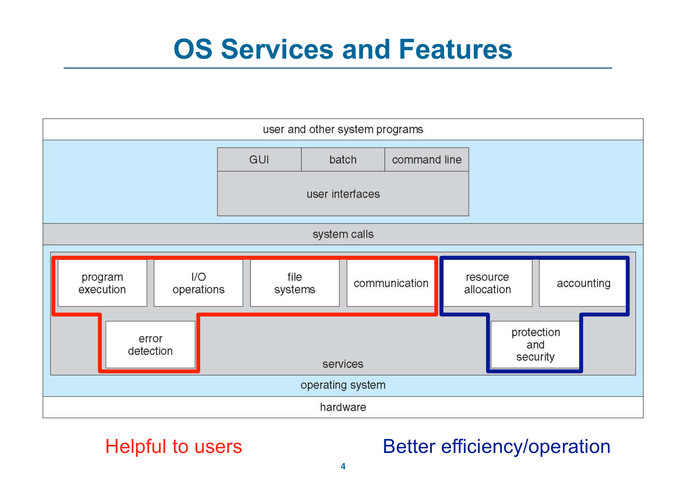

---

## 2. 用户接口（p.14–20）

### 2.1 CLI（p.14–17）

【讲义】p.14：CLI（command-line interface）或命令解释器允许用户直接输入命令。

- 有时实现在内核里，有时由系统程序实现；
- 可以有多种风格，也就是不同的 shell；
- 主要工作是取一条命令并执行；
- 命令可能是 shell 内建的，也可能只是一个程序名；
- 如果是后者，增加新功能不需要修改 shell 本身。

p.15 展示 Bourne shell 的命令解释器；p.16–17 展示 PDP-11 的 CLI。

> **整理者注**：这也解释了为什么 shell 可以很薄：它不必知道每个命令怎么实现，只要找到程序、把参数传过去即可。

### 2.2 GUI（p.18–19）

【讲义】p.18：GUI 是面向用户的桌面隐喻界面。

- 通常使用鼠标、键盘和显示器；
- 图标代表文件、程序、动作等；
- 在不同对象上按不同鼠标键会触发不同动作：提供信息、打开选项、执行功能、打开目录（文件夹）；
- 这种界面最早由 Xerox PARC 发明；
- 现代系统常常同时提供 CLI 和 GUI：
  - Windows 是 GUI，加上 `command` shell；
  - macOS 是 Aqua GUI，底层是 UNIX 内核，也提供 shell；
  - Unix / Linux 以 CLI 为主，可选 GUI（CDE、KDE、GNOME）。

p.19 展示 Mac OS X 的 GUI。

### 2.3 触摸界面（p.20）

【讲义】p.20：触摸屏设备需要新的交互方式。

- 鼠标不可用，或者不是用户想要的方式；
- 动作和选择基于手势；
- 文本输入使用虚拟键盘；
- 也支持语音命令。

| 接口 | 主要输入 | 讲义中的例子 |
|---|---|---|
| CLI | 命令文本 | Bourne shell、PDP-11 CLI |
| GUI | 鼠标、键盘、图标、窗口 | Windows、macOS Aqua、KDE / GNOME |
| 触摸界面 | 手势、虚拟键盘、语音 | 触摸屏设备 |

---

## 3. 系统调用（p.21–43）

### 3.1 API 与系统调用（p.21–22）

【讲义】p.21：

- 系统调用是 OS 所提供服务的**编程接口**；
- 通常用 C 或 C++ 写；
- 程序大多通过高层 **API** 访问系统调用，而不是直接写系统调用；
- 三种常见 API：
  - Windows 的 Win32 API；
  - POSIX 系统（几乎所有 UNIX、Linux、macOS）的 POSIX API；
  - Java 虚拟机（JVM）的 Java API。

p.22 用 `printf` 说明层次：

- `printf` 是 `write` 系统调用的 wrapper；
- C 程序调用 `printf()` 库函数，库函数再调用 `write()` 系统调用；
- 讲义还列出 glibc 中 `printf` / `vfprintf` 的源码链接。

> **整理者注**：API 是“程序员看到的函数”，系统调用是“真正跨进内核的请求”，内核实现则是“内核里完成工作的代码”。这三层不要混成一层。

### 3.2 系统调用号与系统调用表（p.23）

【讲义】p.23 以 x86_64 为例，系统调用号与入口点、实现文件对应：

| 编号 | 名称 | 入口点 | 实现 |
|---:|---|---|---|
| 0 | `read` | `sys_read` | `fs/read_write.c` |
| 1 | `write` | `sys_write` | `fs/read_write.c` |
| 2 | `open` | `sys_open` | `fs/open.c` |
| 3 | `close` | `sys_close` | `fs/open.c` |
| 4 | `stat` | `sys_newstat` | `fs/stat.c` |
| 5 | `fstat` | `sys_newfstat` | `fs/stat.c` |

讲义给出的路径是 `arch/x86/entry/syscalls/syscall_64.tbl`。

### 3.3 `write` 系统调用的进入路径（p.24–28）

【讲义】p.24–26：以 `write()` 为例，用户态准备系统调用：

```asm
mov $0x1, %eax
syscall
```

- x86_64 使用 `syscall` 指令；
- 32 位 x86 使用 `int $0x80`；
- arm64 使用 `svc`；
- 把系统调用号 `0x1`（`write`）放进 `%eax`；
- `syscall` 把控制流从用户态转到内核。


【讲义】p.27：进入内核后：

1. 调用 `kernel_entry` 代码，保存所有用户态寄存器；
2. 通过 `syscall_table` 找到 `write` 的处理器；
3. `syscall_table[1]` 就是 `write`；
4. `write` 完成后调用 `ret_to_user`；
5. 恢复保存的用户态寄存器，把控制流交回用户态。

讲义还给出内核里的 `write` 定义：

```c
SYSCALL_DEFINE3(write, unsigned int, fd, const char __user *, buf,
                size_t, count)
{
    return ksys_write(fd, buf, count);
}
```

p.28 用图把 API、系统调用接口和 OS 实现的关系串起来：


> **整理者注**：这里的“表”是内核中的系统调用分派表，不是用户程序里的普通数组。用户只负责把编号和参数放到约定位置，具体查表、保存现场和恢复现场都由内核完成。

### 3.4 系统调用的实现细节（p.29–32）

【讲义】p.29：

- 每个系统调用通常有一个编号；
- 系统调用接口维护一张按编号索引的表；
- 接口调用内核中对应的系统调用，并返回状态和返回值；
- 调用者不需要知道系统调用怎么实现，只要遵守 API、理解 OS 会做什么；
- 大部分实现细节由运行时支持库隐藏，这些库由编译器随程序提供。

p.30–32 进入 Linux 内核源码：

- Linux kernel v6.0，ARM64；
- `arch/arm64/kernel/sys.c`；
- `include/uapi/asm-generic/unistd.h`；
- 讲义给出构建预处理文件的命令：

```bash
make ARCH=arm64 CROSS_COMPILE=aarch64-linux-gnu- defconfig
make ARCH=arm64 CROSS_COMPILE=aarch64-linux-gnu- arch/arm64/kernel/sys.i
```

p.32 还要求继续查找 ARM32、RISC-V 32/64、x86 32/64 的系统调用表，并注明细节在 Lab4。

### 3.5 观察系统调用：复制文件、`strace` 与 `time`（p.33–36）

【讲义】p.33 给出“把一个文件复制到另一个文件”的系统调用序列：

1. 获取输入文件名：向屏幕写提示、接受输入；
2. 获取输出文件名：向屏幕写提示、接受输入；
3. 打开输入文件；如果不存在就中止；
4. 创建输出文件；如果已存在就中止；
5. 循环：从输入文件读，向输出文件写，直到读失败；
6. 关闭输出文件；
7. 向屏幕写完成消息；
8. 正常终止。

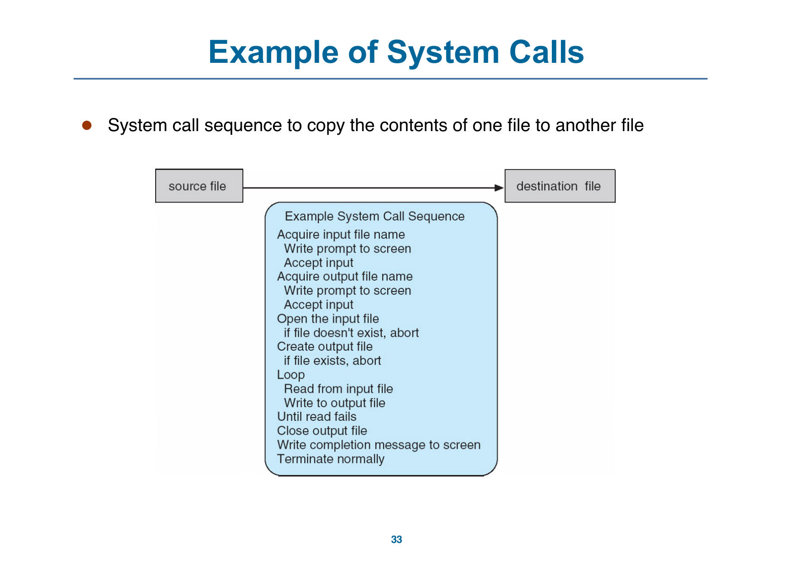

【讲义】p.34：Linux 上的 `strace` 可以显示程序执行期间发起了哪些系统调用。

- macOS 上大致对应的是 `dtruss`；
- 讲义现场演示了 `strace -xf cp <some large file> bogus`，并用 `wc` 统计系统调用数量；
- 小文件和大文件的系统调用数量可以对比；
- 结论是系统调用**非常多**；
- `strace` 还可以附加到正在运行的程序上，用来查程序为什么卡住。

【讲义】p.35 以 `read()` 为例说明标准 API 的组成：

```c
#include <unistd.h>

ssize_t read(int fd, void *buf, size_t count);
```

- 返回值类型 `ssize_t`；
- 函数名 `read`；
- 参数为文件描述符 `fd`、缓冲区 `buf`、最大读取字节数 `count`；
- 成功时返回读到的字节数，返回 0 表示文件结束，出错返回 -1。

【讲义】p.36：`time` 可以粗略测量程序执行时间，放在命令前使用。它报告三个时间：

| 时间 | 含义 |
|---|---|
| `real` | wall-clock time，也就是从开始到结束的实际时间 |
| `user` | 用户态代码消耗的时间 |
| `system` | 系统调用、内核态消耗的时间 |

> **整理者注**：`real` 不等于 `user + system`，因为程序可能等待 I/O、被调度出去，或者与其他进程并行。这个区别在性能分析里很重要。

### 3.6 系统调用的参数传递（p.37–38）

【讲义】p.37：系统调用往往不只需要一个编号，还要传参数。常见有三种方法：

1. **寄存器**：最简单，把参数放进寄存器；缺点是参数可能比寄存器多。
2. **内存中的块 / 表**：把参数放在内存块里，把块地址放进寄存器；Linux 和 Solaris 采用这种方法。
3. **栈**：程序把参数压栈，OS 从栈上取出；块和栈方法都不限制参数个数和长度。

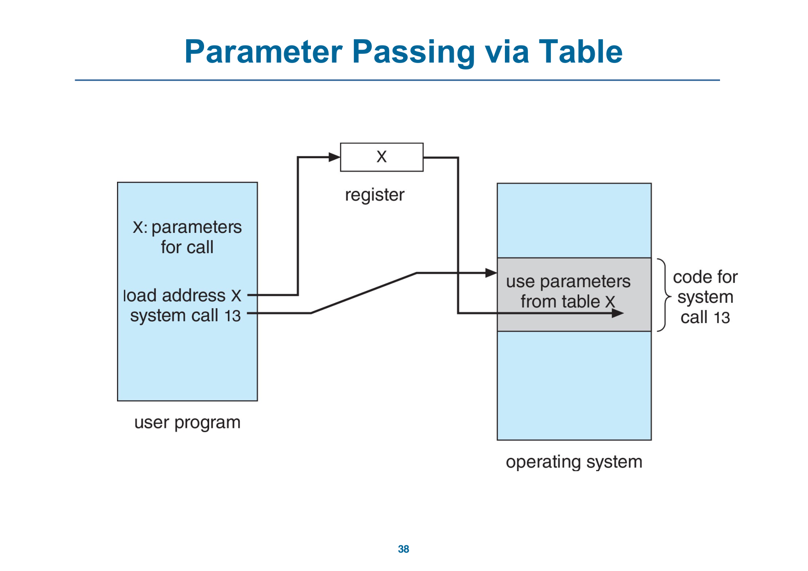

### 3.7 系统调用的类型（p.39–43）

【讲义】p.39–42 把系统调用按用途分类：

| 类型 | 典型操作 |
|---|---|
| 进程控制 | 创建 / 终止进程、结束 / 中止、装载 / 执行、取得 / 设置进程属性、等待时间、等待 / 发送事件、分配 / 释放内存、错误时转储内存、调试器单步、进程间共享数据的锁 |
| 文件管理 | 创建 / 删除文件、打开 / 关闭、读 / 写 / 重定位、取得 / 设置文件属性 |
| 设备管理 | 请求 / 释放设备、读 / 写 / 重定位、取得 / 设置设备属性、逻辑上连接 / 断开设备 |
| 信息维护 | 取得 / 设置日期时间、取得 / 设置系统数据、取得 / 设置进程 / 文件 / 设备属性 |
| 通信 | 创建 / 删除通信连接、消息传递模型下发送 / 接收消息、共享内存模型下创建 / 访问内存区域、传递状态信息、连接 / 断开远程设备 |
| 保护 | 控制资源访问、取得 / 设置权限、允许 / 拒绝用户访问 |

p.43 给出 Windows 与 UNIX 的系统调用对照，例如：

| 类别 | Windows | UNIX |
|---|---|---|
| 进程控制 | `CreateProcess()`、`ExitProcess()`、`WaitForSingleObject()` | `fork()`、`exit()`、`wait()` |
| 文件管理 | `CreateFile()`、`ReadFile()`、`WriteFile()`、`CloseHandle()` | `open()`、`read()`、`write()`、`close()` |
| 设备管理 | `SetConsoleMode()`、`ReadConsole()`、`WriteConsole()` | `ioctl()`、`read()`、`write()` |
| 信息维护 | `GetCurrentProcessID()`、`SetTimer()`、`Sleep()` | `getpid()`、`alarm()`、`sleep()` |
| 通信 | `CreatePipe()`、`CreateFileMapping()`、`MapViewOfFile()` | `pipe()`、`shm_open()`、`mmap()` |
| 保护 | `SetFileSecurity()`、`InitializeSecurityDescriptor()`、`SetSecurityDescriptorGroup()` | `chmod()`、`umask()`、`chown()` |

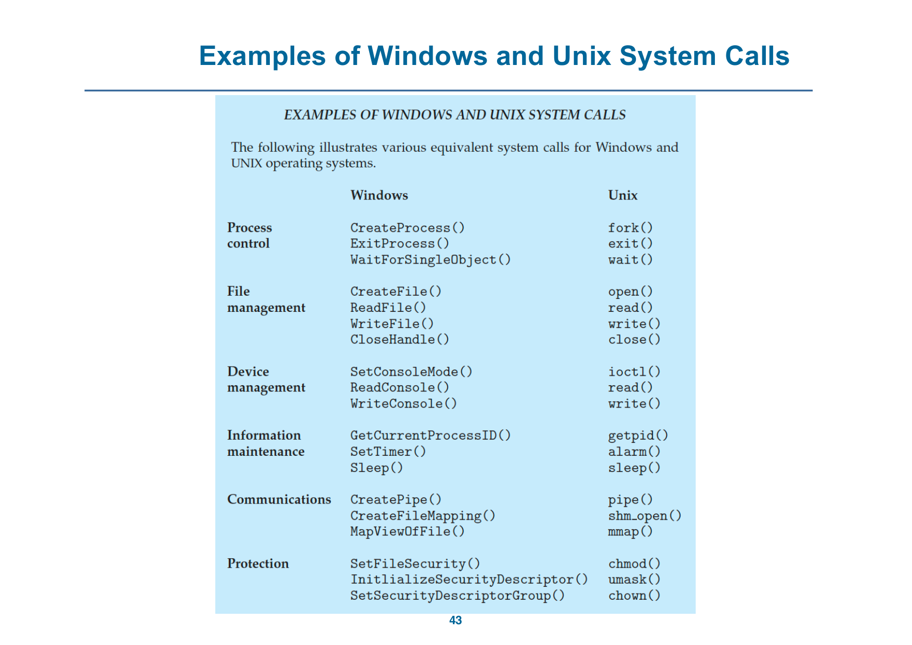

> **待确认**：p.43 的对照表是教材式示例，并不表示两个系统一一等价。比如 Windows 的进程创建模型和 UNIX 的 `fork()` + `exec()` 模型并不相同，不能只按函数名对应。

---

## 4. 系统程序（p.44–47）

### 4.1 系统程序的范围（p.44）

【讲义】p.44：系统程序为程序开发和执行提供方便的环境，可分为：

- 文件操作；
- 状态信息（有时存放在文件里）；
- 编程语言支持；
- 程序加载与执行；
- 通信；
- 后台服务；
- 应用程序。

讲义特别指出：**大多数用户看到的“操作系统”其实由系统程序定义，而不是直接由系统调用定义**。

### 4.2 各类系统程序（p.45–47）

| 类别 | 讲义内容 |
|---|---|
| 文件管理 | 创建、删除、复制、重命名、打印、转储、列出文件与目录，以及一般的文件 / 目录操作。 |
| 状态信息 | 向系统询问日期、时间、可用内存、磁盘空间、用户数；有的程序提供性能、日志、调试信息；通常把结果格式化后输出到终端或其他设备；有些系统用 registry 保存配置。 |
| 文件修改 | 文本编辑器创建 / 修改文件；搜索文件内容或做文本转换的命令。 |
| 编程语言支持 | 编译器、汇编器、调试器、解释器。 |
| 程序加载与执行 | 绝对加载器、可重定位加载器、链接编辑器、覆盖加载器，以及高级语言 / 机器语言的调试系统。 |
| 通信 | 在进程、用户、计算机之间建立虚拟连接；发送消息、浏览网页、发邮件、远程登录、传输文件。 |
| 后台服务 | 启动时运行；有的只用于系统启动，完成后退出；有的从启动一直运行到关机；提供磁盘检查、进程调度、错误日志、打印等功能；运行在用户上下文而非内核上下文，常称为 services、subsystems、daemons。 |
| 应用程序 | 不属于系统本身；由用户运行；通常不算 OS 的一部分；通过命令行、鼠标点击或触摸启动。 |

> **整理者注**：这就是为什么“哪些东西算 OS”很难回答。内核、系统程序、后台服务、桌面环境、应用程序常常被一起打包发行，但职责和运行位置不同。

---

## 5. 链接器、加载器与 ELF（p.48–75）

### 5.1 编译、链接、加载的分工（p.48–49）

【讲义】p.48：

- 源代码被编译成目标文件，目标文件设计成可以装入任意物理内存位置，叫 **relocatable object file**；
- **链接器**（linker）把目标文件合成一个二进制可执行文件，也会把库带进来；
- 程序以二进制可执行文件的形式存放在二级存储上；
- **加载器**（loader）把它装入内存才能执行；
- **重定位**（relocation）给程序各部分分配最终地址，并调整代码和数据以匹配这些地址；
- 现代通用系统通常不把库静态塞进可执行文件，而是使用动态链接库（Windows 里是 DLL），需要时加载，同一版本的库由所有使用者共享，只加载一次；
- 目标文件和可执行文件有标准格式，OS 才知道怎样加载和启动它们。


### 5.2 ELF 的基本结构（p.50–53）

【讲义】p.50：`a.out` 是 **Executable and Linkable Format（ELF）**。

- ELF 中有 **program header table** 和 **section header table**，供链接器和加载器使用；
- 常见 section：
  - `.text`：代码；
  - `.rodata`：已初始化的只读数据；
  - `.data`：已初始化的数据；
  - `.bss`：未初始化的数据。
- 讲义留下两个小问题：`static` 变量放在哪里？`static const` 放在哪里？PDF 没有给答案。

p.51 用 `readelf -S a.out` 列出所有 section。

【讲义】p.52–54：

- **静态链接**：所有需要的代码都打进一个二进制，文件较大；
- **动态链接**：复用库，减小 ELF 文件；但需要解决“库调用怎么解析”；
- 静态链接的 ELF 没有 `.interp` section；
- 动态链接的 ELF 有 `.interp` section；
- 讲义用 `readelf -S a.dynamic` 和 `readelf -p .interp a.dynamic` 展示 `.interp` 的内容，示例是：

```text
/lib64/ld-linux-x86-64.so.2
```

- 库调用由 **loader** 解析。

> **待确认**：p.50 的 `static` / `static const` 问题在 PDF 中没有答案；不要凭页面上没有的文字补答。考试若考到，以老师和教材的 ELF 规则为准。

### 5.3 ELF 到进程地址空间（p.55–61）

【讲义】p.56 把 ELF 的 section 和进程内存布局对应起来：

```text
stack（向下增长）
memory mapping segment（文件映射、动态库、匿名映射）
heap
.bss（未初始化静态变量，填 0）
.data（程序员初始化的静态变量）
.text（ELF 的二进制代码）
```

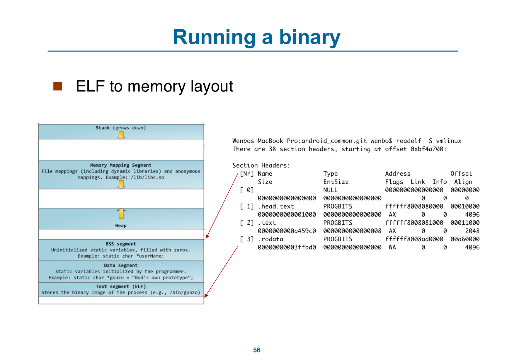

p.57 进一步给出更完整的用户 / 内核空间图，并提出三个问题：

- 谁建立 ELF 文件的映射？
- 谁建立 stack 和 heap？
- 谁建立库？

图中还标出：

- kernel space 与 user space 的分界；
- stack 向下增长；
- `RLIMIT_STACK`（例如 8 MB）；
- 随机的 stack offset、mmap offset、brk offset；
- `brk`、`start_brk`、`end_data`、`start_data`、`end_code` 等边界。

> **整理者注**：p.57 图中的 1 GB kernel space / 3 GB user space 是这张示意图的具体划分，不应直接当成所有 64 位系统的固定布局。不同架构、不同 OS、不同进程模型会不同。

【讲义】p.60 回答 p.57 的三个问题：

| 谁建立 | 由谁完成 | 关键动作 |
|---|---|---|
| ELF 文件映射 | 内核 | `execve` 系统调用 |
| stack 和 heap | 内核 | `execve` 系统调用 |
| 库 | 加载器 | `ld-xxx` |

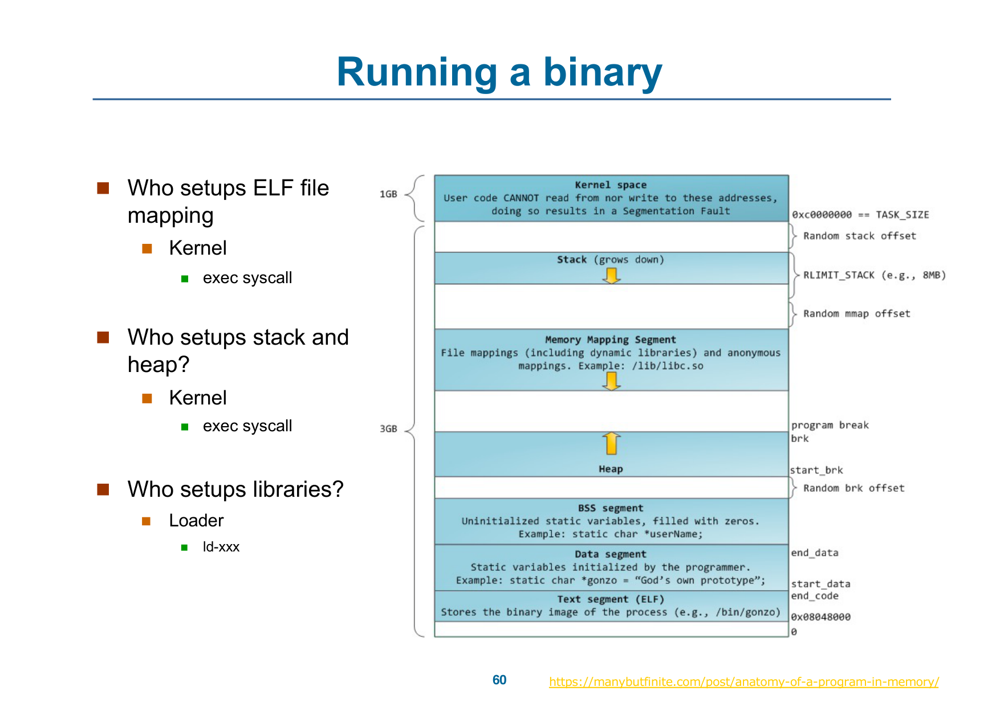

p.61 提醒区分两种“stack 和 heap”：

- OS 里的 stack / heap：进程地址空间中的区域；
- 数据结构里的 stack / heap：抽象数据类型或内存管理结构。

两者同名，但语境不同。

### 5.4 静态链接程序的运行（p.62–66）

【讲义】p.58 用 `strace ./a.out` 观察静态链接程序，看到它调用 `execve`、`brk`、`write` 等系统调用；p.62 继续回答“`./main` 从哪里开始执行”。

【讲义】p.62：

- 静态链接把所有需要的代码打进一个二进制，文件较大；
- 不需要动态加载器；
- `execve` 系统调用之后执行 `_start`；
- 用 `readelf -h a.out` 看 ELF header，示例的入口地址是 `0x400a50`。

p.64：`__libc_start_main` 在 glibc 的 `csu/libc-start.c` 中，负责建立环境和栈，然后调用 `main`。

p.66 把静态链接的启动流程画成：

```text
$ ./binary
  → fork()
  → execve("./binary", *argv[], *envp[])
  → sys_execve()
  → do_execve()
  → search_binary_handler()
  → load_elf_binary()
  → start_thread()
  → 用户态 _start
  → __libc_start_main()
  → main()
```

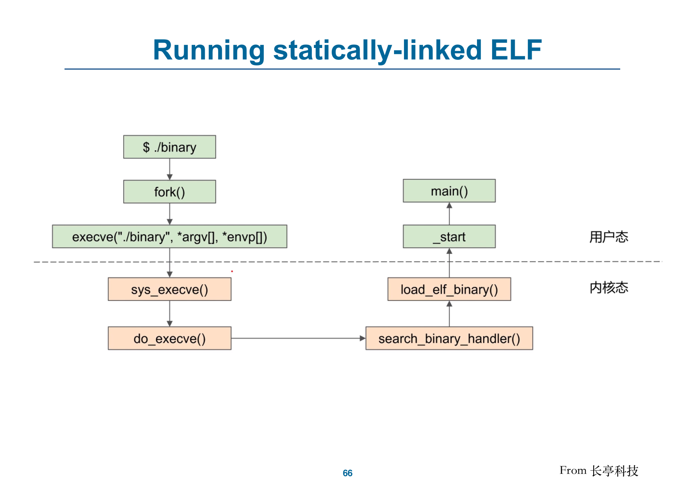

【讲义】p.59 还给出 Linux v6.0 的 `execve` 调用链：

```text
SYSCALL execve
  → do_execve
  → do_execveat_common
  → exec_binprm
  → search_binary_handler
  → load_elf_binary
  → start_thread
```

`start_thread` 会把 ELF 的入口地址作为用户程序的起始地址。

### 5.5 动态链接程序的运行（p.67–73）

【讲义】p.67：

- 动态链接复用库，减小 ELF 文件；
- 示例动态 ELF 的入口地址是 `0x530`（静态示例是 `0x400a50`）；
- 仍然用 `readelf -h` 看 header。

p.68 用 `objdump -d a.out` 看动态链接程序的代码，并追问：`puts` 什么时候被解析？p.54 已经说明库调用由 loader 解析；p.68 把这个问题落到具体的库函数上。

p.69 用 `strace ./a.dynamic` 观察动态程序启动时多出来的系统调用，图中可见：

- `openat` / `access` / `fstat` 查找和检查库；
- `mmap` / `mprotect` / `munmap` 建立映射和改权限；
- `arch_prctl`；
- `brk`；
- `write`；
- `exit_group`。

讲义用箭头标出 **Dynamic loader**。

p.71 展示 `load_elf_binary` 中的分支：

```c
if (interpreter) {
    /* 动态链接：入口指向 loader */
    elf_entry = load_elf_interp(...);
    ...
} else {
    /* 静态链接：入口指向 _start */
    elf_entry = e_entry;
    ...
}
```

p.73 把动态链接的启动流程画成：

```text
$ ./binary
  → fork()
  → execve("./binary", *argv[], *envp[])
  → sys_execve()
  → do_execve()
  → search_binary_handler()
  → load_elf_binary()
  → 用户态 ld.so
  → _start
  → __libc_start_main()
  → main()
```


> **整理者注**：静态链接和动态链接的差别不只在“文件大小”。静态程序的入口直接是 `_start`；动态程序的入口先落到动态加载器，加载器完成库映射和符号解析后，才转到程序的 `_start`。这也是 `strace` 里动态程序多出一串 `mmap` / `openat` 的原因。

### 5.6 静态链接与动态链接对照

| 维度 | 静态链接 | 动态链接 |
|---|---|---|
| 代码 | 所有需要的代码打进一个二进制 | 复用共享库 |
| 文件大小 | 较大 | 较小 |
| 动态加载器 | 不需要 | 需要 `ld.so` 等加载器 |
| ELF 的 `.interp` | 没有 | 有 |
| 入口 | `_start` | 先到动态加载器，再到 `_start` |
| 库解析 | 链接时确定 | 由加载器在运行时解析 |
| 启动开销 | 通常较小 | 要加载库、映射、解析符号 |
| 共享与更新 | 不共享库代码 | 多个程序共享同一版本的库 |

p.75 推荐了三本《Computer Systems: A Programmer's Perspective》相关书籍，属于延伸阅读，不是考试内容。

---

## 6. 为什么应用与 OS 绑定（p.76）

【讲义】p.76：

- 在一个系统上编译的应用，通常不能在另一个 OS 上直接执行；
- 每个 OS 提供自己的系统调用、文件格式等；
- 应用可以做到多 OS：
  - 用 Python、Ruby 等解释型语言写，目标机器上有解释器；
  - 用带虚拟机的语言写（例如 Java），虚拟机包含运行中的应用；
  - 用 C 等标准语言写，但为每个 OS 分别编译；
- **ABI**（Application Binary Interface）是 API 在体系结构层面的对应物，定义给定 OS、给定体系结构 / CPU 上，二进制代码不同组件之间如何接口。

> **整理者注**：API 更偏源代码层面的函数约定，ABI 更偏二进制层面的调用约定、寄存器、数据布局和系统调用接口。讲义只给了 ABI 的简短定义，没有展开具体约定。

---

## 7. OS 设计与实现（p.77–79）

### 7.1 设计目标（p.77）

【讲义】p.77：

- OS 的设计与实现没有“唯一解”，但有一些被证明有效的做法；
- 不同 OS 的内部结构可能差别很大；
- 结构受硬件选择和系统类型影响；
- 设计从定义目标和规格开始；
- 目标分两类：
  - **User goals**：方便使用、容易学习、可靠、安全、快速；
  - **System goals**：容易设计 / 实现 / 维护，灵活、可靠、无错误、高效。

### 7.2 策略与机制分离（p.78）

【讲义】p.78：

- 重要原则是分离 **policy** 与 **mechanism**；
- **Policy**：要做什么（what will be done）；
- **Mechanism**：怎么做（how to do it）；
- 分离二者，可以在不改变机制实现的情况下改变策略；
- 讲义用门锁举例：
  - 普通门锁 + 出入口策略：不好；
  - 智能门锁：机制更灵活；
- 调度也是例子：调度策略与“怎样挑选下一个”的机制要分开。

> **整理者注**：这条原则在 OS 里到处出现。比如“谁优先运行”是策略，“怎样切换上下文、怎样维护就绪队列”是机制。策略可以随场景调整，机制则应尽量稳定、可复用。

### 7.3 实现语言（p.79）

【讲义】p.79：

- 早期 OS 用汇编；
- 后来用 Algol、PL/1 等系统编程语言；
- 现在主要用 C、C++；
- 实际通常是混合：
  - 最底层用汇编；
  - 主体用 C；
  - 系统程序用 C、C++、Perl、Python、shell 脚本等；
- 更高级的语言更容易移植到其他硬件，但通常更慢；
- 模拟（emulation）可以让 OS 运行在非原生硬件上。

---

## 8. OS 结构（p.80–93）

### 8.1 简单结构与单体结构（p.80–83）

【讲义】p.80 列出四种常见结构：

- 简单结构：MS-DOS；
- 单体结构（monolithic）：Unix、Linux；
- 分层结构（layered）：一种抽象；
- 微内核（microkernel）：Mach。

【讲义】p.81：原始 UNIX 受硬件功能限制，结构有限，分成两部分：

- 系统程序；
- 内核：系统调用接口以下、物理硬件以上，提供文件系统、CPU 调度、内存管理等功能；大量功能集中在一个层次。

p.82 展示传统 UNIX 的结构：

- 最上面是用户；
- 然后是 shell、命令、编译器、解释器、系统库；
- 中间是系统调用接口；
- 内核里有信号与终端处理、文件系统、交换、块 I/O、CPU 调度、页替换、按需调页、虚拟内存、设备驱动等；
- 最下面是终端、设备、内存控制器等硬件。

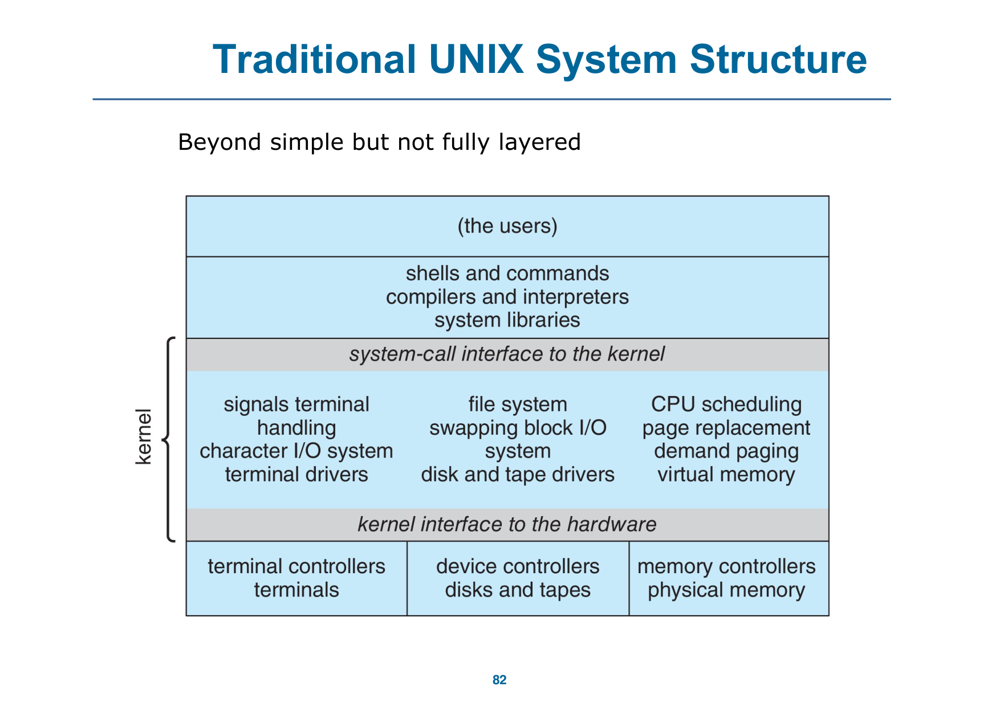

p.83 展示 Linux 的结构：

- 上层是应用程序和 glibc；
- 系统调用接口；
- 内核里有文件系统、CPU 调度器、网络（TCP/IP）、内存管理、块设备、字符设备、设备驱动；
- 最下面是硬件；
- 讲义标注 Linux 是 **monolithic supports loadable kernel module**。

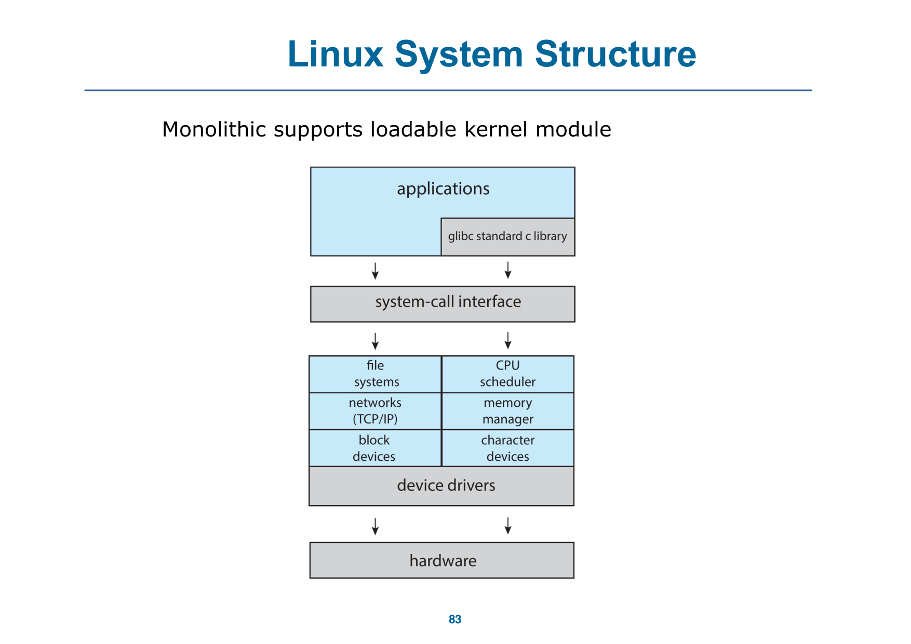

### 8.2 可加载内核模块（p.84）

【讲义】p.84：现代 OS 常用 **loadable kernel modules（LKMs）**：

- 使用面向对象的方法；
- 每个核心组件是独立的；
- 组件之间通过已知接口通信；
- 需要时可以在内核中加载；
- 整体类似分层，但更灵活；
- Linux、Solaris 等使用这种方式。

> **整理者注**：模块化不是“把内核变成微内核”。模块仍然运行在内核态、共享内核地址空间，只是可以按需加载和卸载；微内核则把更多服务移到用户态。

### 8.3 分层结构（p.86）

【讲义】p.86：

- OS 分成若干层，每层建立在更低层之上；
- 最底层（layer 0）是硬件；
- 最高层（layer N）是用户接口；
- 模块化要求每一层只使用更低层提供的功能和服务。

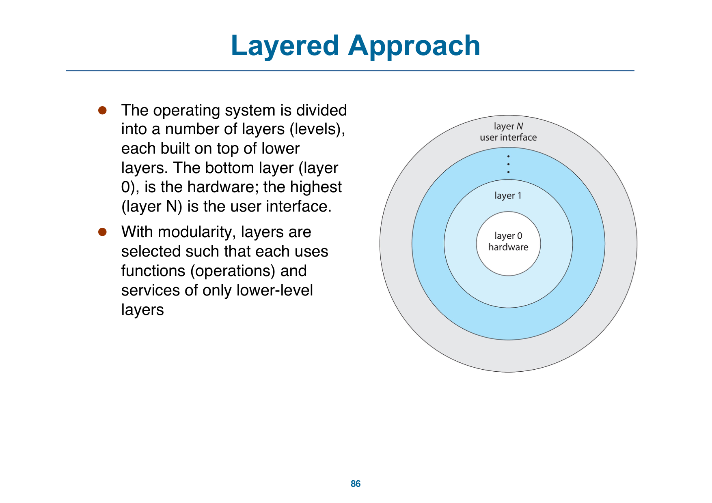

分层的好处是抽象清晰、便于替换；代价是层间调用可能带来开销，而且层怎么划分并不总是自然。

### 8.4 微内核（p.87–88）

【讲义】p.87：

- 微内核把尽可能多的东西从内核移到用户空间；
- Mach 是例子；
- macOS 的内核 Darwin 部分基于 Mach；
- 用户模块之间通过消息传递通信；
- 好处：
  - 更容易扩展微内核；
  - 更容易移植到新体系结构；
  - 更可靠（内核态运行的代码更少）；
  - 更安全；
- 代价：
  - 用户态与内核态通信带来性能开销。

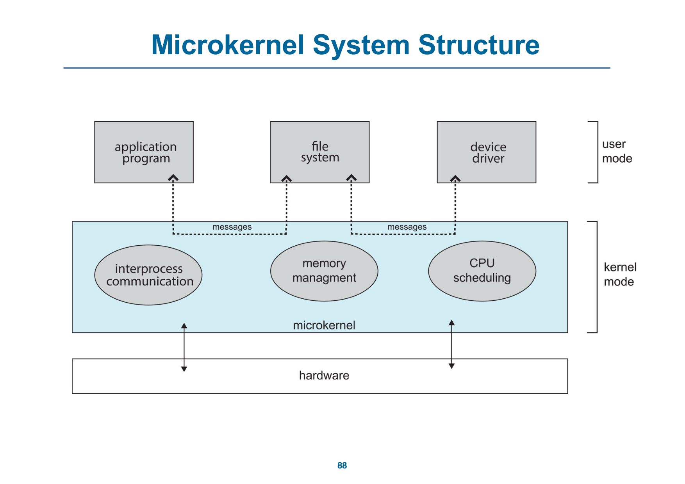

### 8.5 混合结构与真实系统（p.89–93）

【讲义】p.89：大多数现代 OS 不是单一纯模型，而是混合结构：

- Linux 和 Solaris 的内核在 kernel address space 中，因此是单体结构；同时支持模块化动态加载；
- Windows 主要是单体结构，同时用微内核处理不同子系统 personality；
- Apple macOS 是混合、分层结构：Aqua UI + Cocoa 编程环境；内核由 Mach 微内核、BSD Unix 部分、I/O Kit 和可动态加载的 kernel extensions 组成。

p.90 展示 macOS / iOS 的结构：

```text
applications
  → user experience
  → application frameworks
  → core frameworks
  → kernel environment (Darwin)
```

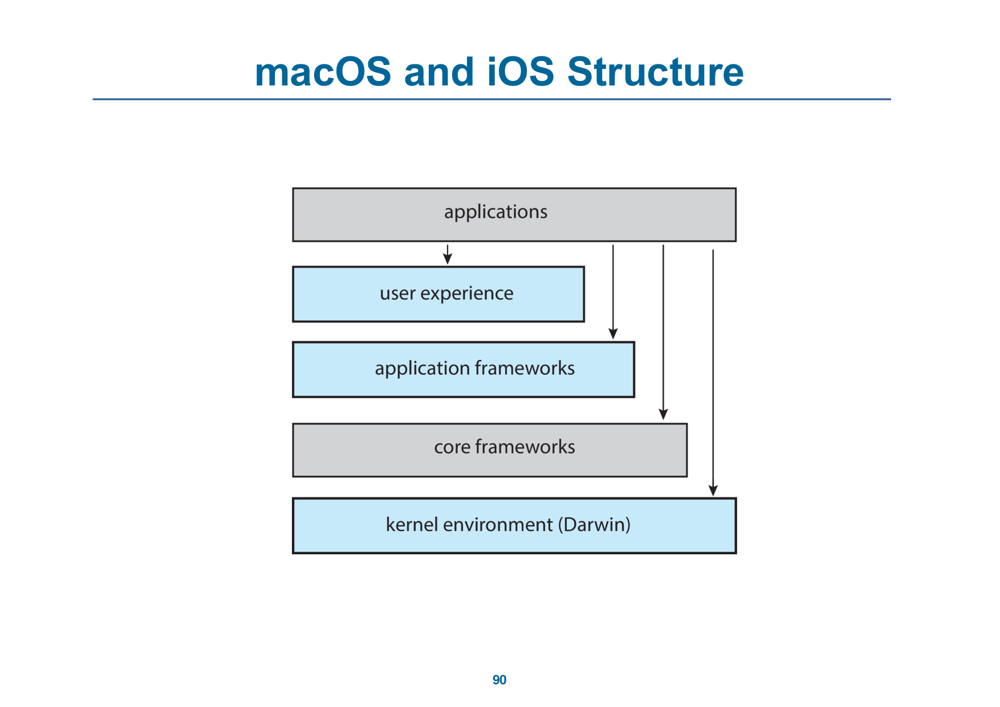

【讲义】p.91：Android：

- 由 Open Handset Alliance（主要是 Google）开发；
- 开源；
- 与 iOS 的栈类似；
- 基于 Linux 内核，但做了修改；
- 提供进程、内存、设备驱动管理；
- 增加电源管理；
- 运行时环境包含核心库和 Dalvik 虚拟机；
- 应用用 Java + Android API 开发；
- Java class 文件编译成 Java bytecode，再翻译成在 Dalvik VM 中运行的可执行形式；
- 库包括 WebKit、SQLite、多媒体、较小的 libc 等。

p.92 的 Android 架构图从下到上为：

```text
hardware
  → Linux kernel
  → Bionic
  → HAL
  → native libraries（SQLite、OpenGL、WebKit、surface manager、SSL、media framework 等）
  → ART VM / Android frameworks / JNI
  → applications
```

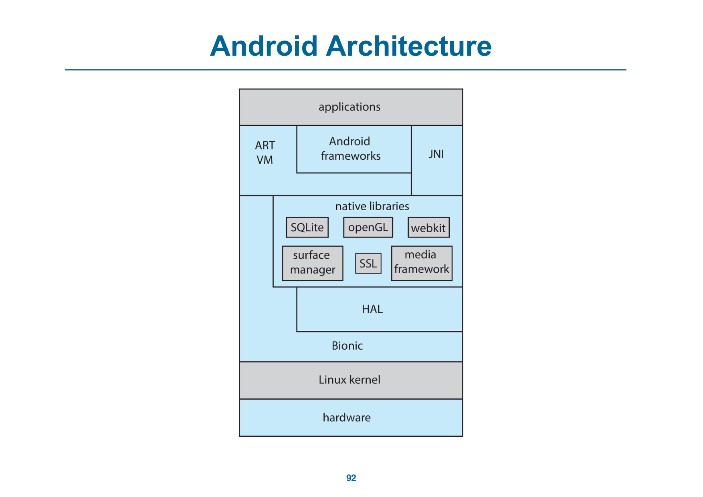

【讲义】p.93：openEuler：

- EulerOS 是面向服务器的 Linux-based OS；
- 主要维护者是华为；
- EulerOS 在 2019 年开源，命名为 openEuler；
- 细节在单独幻灯片中。

> **待确认**：p.91 的文字说运行时是 **Dalvik VM**，p.92 的架构图写的是 **ART VM**。这是讲义内部的口径差异；正文按两页分别保留，不强行统一。考试若问 Android 运行时，以老师课堂说明和教材版本为准。

### 8.6 结构对照

| 结构 | 代表 | 核心想法 | 主要代价 |
|---|---|---|---|
| 简单结构 | MS-DOS | 功能少，结构简单 | 隔离与扩展性有限 |
| 单体结构 | UNIX、Linux | 大部分功能放在一个内核里 | 内核大，耦合度高 |
| 模块化单体 | Linux、Solaris | 单体内核 + 可加载模块 | 模块仍在内核态，隔离有限 |
| 分层 | 教学模型 / 某些系统 | 每层只依赖更低层 | 层间调用开销，层次划分困难 |
| 微内核 | Mach | 尽量少的东西放内核，服务移到用户态 | 消息传递和模式切换开销 |
| 混合 | Windows、macOS | 组合多种结构满足性能、安全、兼容性 | 结构复杂，理解成本高 |

---

## 9. 构建与启动 OS（p.94–96）

### 9.1 从源码构建（p.94–95）

【讲义】p.94：OS 通常设计成能在一类硬件上运行，支持多种外设。买来的电脑通常已经装好 OS，但也可以自己构建和安装。若从零生成一个 OS：

1. 编写 OS 源代码；
2. 针对目标系统配置 OS；
3. 编译 OS；
4. 安装 OS；
5. 启动电脑和新 OS。

p.95 以 Linux 为例：

```bash
# 下载 Linux 源码：http://www.kernel.org
make menuconfig        # 配置内核
make                   # 编译内核，产生 vmlinuz
make modules           # 编译内核模块
make modules_install   # 安装内核模块
make install           # 安装新内核
```

### 9.2 启动（p.96）

【讲义】p.96：

- 系统上电后，执行从固定内存位置开始；
- OS 必须能被硬件找到并启动；
- **bootstrap loader / BIOS** 是一小段代码，存放在 ROM 或 EEPROM 中，负责找到内核、装入内存并启动；
- 有时是两步：固定位置的 boot block 由 ROM 代码加载，再由它从磁盘加载 bootstrap loader；
- 现代系统用 **UEFI** 取代 BIOS；
- 常见引导程序 **GRUB** 可以从多块磁盘、多个版本、多个内核选项中选一个；
- 内核加载后，系统开始运行；
- 引导程序通常允许不同的启动状态，例如单用户模式。

---

## 10. 调试与性能（p.97–100）

### 10.1 调试（p.97）

【讲义】p.97 引用 Kernighan 法则：

> “Debugging is twice as hard as writing the code in the first place. Therefore, if you write the code as cleverly as possible, you are, by definition, not smart enough to debug it.”

OS 相关的调试信息：

- OS 生成包含错误信息的日志；
- 应用程序失败可以生成 **core dump**，捕获进程内存；
- OS 失败可以生成 **crash dump**，包含内核内存；
- 除了崩溃，性能调优也需要分析：
  - 记录活动 trace；
  - profiling：周期性采样 instruction pointer，寻找统计趋势。

### 10.2 性能调优与追踪（p.98–100）

【讲义】p.98：

- 通过消除瓶颈提高性能；
- OS 必须提供计算和显示系统行为指标的手段；
- 例如 `top` 程序或 Windows Task Manager。

【讲义】p.99：trace 收集特定事件的数据，例如一次系统调用过程中的步骤。工具包括：

| 工具 | 用途 |
|---|---|
| `strace` | 跟踪进程发起的系统调用 |
| `gdb` | 源码级调试器 |
| `perf` | Linux 性能工具集合 |
| `tcpdump` | 收集网络数据包 |

p.100 展示 Linux bcc / BPF tracing tools 的工具全景图，属于进一步阅读。

---

## 11. 听课重点与易混点

1. **服务、接口、系统调用、系统程序不是同一个层次**。服务是能力；接口是入口；系统调用是进入内核的编程接口；系统程序是用户态的工具和程序。
2. **API 不等于系统调用**。`printf()` 是库函数，`write()` 是系统调用，内核里的 `sys_write` / `ksys_write` 才是实现。
3. **系统调用靠编号和表分派**。用户把编号放进约定寄存器，内核保存现场、查表、执行、恢复现场。
4. **参数传递有三种方式**。寄存器最简单；内存块 / 表适合参数多的情况；栈也可以，块和栈都不限制参数个数和长度。
5. **`strace` 看的是系统调用，不是函数调用**。它能看到程序与内核的边界，适合查文件、网络、进程和卡住的原因。
6. **静态链接与动态链接的入口不同**。静态程序从 `_start` 开始；动态程序先进入 `ld.so`，加载器完成工作后再转到 `_start`。
7. **ELF 的 section 和进程内存布局不是一一对应的同义词**。ELF 是文件格式；加载器按 program header 把它映射成进程地址空间中的段。
8. **`.interp` 是动态链接的标志之一**。静态 ELF 没有 `.interp`；动态 ELF 的 `.interp` 指向动态加载器路径。
9. **内核与加载器分工不同**。`execve` 建立 ELF 映射、stack、heap；动态库由用户态的加载器 `ld.so` 负责。
10. **策略与机制分离**是 OS 设计的重要原则。策略可以变，机制应稳定；不要把“怎么实现”与“要做什么”绑死。
11. **单体、分层、微内核、模块、混合不是互斥标签**。真实系统常常组合多种结构；Linux 是单体 + 模块，macOS 是混合 + 分层。
12. **应用与 OS 绑定，根子在系统调用、文件格式与 ABI**。解释器、虚拟机和分平台编译只能解决一部分可移植性问题。

---

## 12. 课前自测

| # | 问题 | 回查 |
|---|---|---|
| 1 | OS 服务图中，用户接口、系统调用、服务、硬件分别在哪一层？ | [§1.1 服务分层](#11-服务分层p3) |
| 2 | 哪些服务属于“方便用户”，哪些属于“提高效率”？ | [§1.2 两类服务](#12-两类服务p412) |
| 3 | CLI 的主要工作是什么？为什么增加命令功能不一定需要改 shell？ | [§2.1 CLI](#21-clip1417) |
| 4 | GUI、CLI、触摸界面各自的输入方式是什么？ | [§2 用户接口](#2-用户接口p1420) |
| 5 | 为什么说 `printf()` 不是系统调用？它和 `write()` 是什么关系？ | [§3.1 API 与系统调用](#31-api-与系统调用p2122) |
| 6 | x86_64 上 `write` 的系统调用号是多少？进入内核后怎样找到对应处理器？ | [§3.2 系统调用号与系统调用表](#32-系统调用号与系统调用表p23)、[§3.3 `write` 系统调用的进入路径](#33-write-系统调用的进入路径p2428) |
| 7 | 系统调用参数有哪三种传递方式？Linux 和 Solaris 用哪一种？ | [§3.6 系统调用的参数传递](#36-系统调用的参数传递p3738) |
| 8 | `strace` 和 `time` 分别能告诉你什么？`real` 与 `user + system` 为什么可能不相等？ | [§3.5 观察系统调用](#35-观察系统调用复制文件strace-与-timep3336) |
| 9 | 系统程序分成哪几类？后台服务运行在用户态还是内核态？ | [§4 系统程序](#4-系统程序p4447) |
| 10 | 编译、链接、加载三个阶段各自做什么？ | [§5.1 编译、链接、加载的分工](#51-编译链接加载的分工p4849) |
| 11 | ELF 的 `.text`、`.rodata`、`.data`、`.bss` 分别放什么？ | [§5.2 ELF 的基本结构](#52-elf-的基本结构p5053) |
| 12 | 静态链接和动态链接的 ELF 在 `.interp`、入口和库解析上有什么不同？ | [§5.6 静态链接与动态链接对照](#56-静态链接与动态链接对照) |
| 13 | 谁建立 ELF 映射、stack、heap？谁建立库？ | [§5.3 ELF 到进程地址空间](#53-elf-到进程地址空间p5561) |
| 14 | 静态链接和动态链接程序的启动流程分别是什么？ | [§5.4 静态链接程序的运行](#54-静态链接程序的运行p6266)、[§5.5 动态链接程序的运行](#55-动态链接程序的运行p6773) |
| 15 | 为什么同一个应用通常不能直接在另一个 OS 上运行？ABI 是什么？ | [§6 为什么应用与 OS 绑定](#6-为什么应用与-os-绑定p76) |
| 16 | 策略与机制分别回答什么问题？举一个调度例子。 | [§7.2 策略与机制分离](#72-策略与机制分离p78) |
| 17 | 单体、分层、微内核、模块化、混合结构各有什么取舍？ | [§8.6 结构对照](#86-结构对照) |
| 18 | Linux 内核怎样构建？UEFI、GRUB 在启动中做什么？ | [§9 构建与启动 OS](#9-构建与启动-osp9496) |
| 19 | core dump 和 crash dump 有什么区别？`strace`、`gdb`、`perf`、`tcpdump` 各做什么？ | [§10 调试与性能](#10-调试与性能p97100) |

---

## 13. 关联知识点

- **与 OS 第 1 讲**：OS 是资源抽象器与分配器、系统调用是特殊 trap、内核事件循环，见 [os-01 第 1 讲](os-01_第01讲_操作系统概述.md)。本讲把这些概念落到“服务 → 接口 → 系统调用 → 实现”的具体链路上。
- **与 OS 第 0 讲**：`hello world` 的 `strace`、`execve`、ELF、地址空间与系统调用，见 [os-00 第 0 讲](os-00_第00讲_课程导论与体系结构回顾.md)。本讲 p.48–75 是那条线的展开版。
- **与硬件部分第 6 讲**：异常 / 中断、特权级、系统调用入口与程序翻译 / 链接 / 加载，见 [hardware-06 第 6 讲](hardware-06_第06讲_异常软硬件接口与操作系统简介.md) 的 §6.1、§6.2。尤其可以对照其中的“静态链接 vs 动态链接”和“加载程序”两节。
- **与硬件部分第 1 讲**：ISA、指令格式、寄存器与过程调用约定，见 [hardware-01 第 1 讲](hardware-01_第01讲_课程介绍与ISA设计原理.md)。系统调用号、参数寄存器和 ABI 都以 ISA 约定为基础。
- **与硬件部分第 2–4 讲**：系统调用进入内核、异常和中断会打断流水线，属于控制冒险和异常处理的延伸；见 [hardware-02 第 2 讲](hardware-02_第02讲_流水线概念分类与性能评价.md)、[hardware-04 第 4 讲](hardware-04_第04讲_流水线冒险.md)。

---

## 14. 来源、页码对照与待确认

**来源**：`../lec/02-1_structures.pdf`（101 页，标题页 `OS Structures`，Wenbo Shen；部分幻灯片来自 OSC 与 Henri Casanova@Hawaii）。

**页码对照**：

- p.1：标题页；
- p.2：本讲目录；
- p.3–13：OS 服务分层、两类服务、各项服务与用户接口；
- p.14–20：CLI、GUI、触摸界面；
- p.21–43：系统调用、API、系统调用号与表、`write` 路径、`strace` / `time`、参数传递、系统调用类型、Windows / UNIX 对照；
- p.44–47：系统程序与后台服务；
- p.48–75：链接器、加载器、ELF、静态 / 动态链接、程序启动流程；
- p.76：应用与 OS 绑定、ABI；
- p.77–79：OS 设计目标、策略与机制、实现语言；
- p.80–93：简单结构、单体、模块、分层、微内核、混合结构、macOS / iOS、Android、openEuler；
- p.94–96：构建 OS、构建 Linux、系统启动；
- p.97–100：调试、性能调优、trace、profiling 与工具；
- p.101：本讲 takeaway。

**待确认**：

1. p.50 留下 `static` 变量与 `static const` 放在哪个 section 的问题，PDF 没有给答案。本文没有补答；需要时按老师和教材的 ELF 规则确认。
2. p.91 的文字写运行时是 **Dalvik VM**，p.92 的架构图写 **ART VM**。两页口径不一致，本文分别保留，未强行统一。
3. p.59 与 p.65 内容重复，p.66 与 p.72 内容重复；正文只保留一份，并在页码对照中注明。
4. p.62 的 `0x400a50` 与 p.67 的 `0x530` 是讲义示例程序的入口地址，不是所有 ELF 的固定值。
5. p.57 的 1 GB kernel space / 3 GB user space 是示意图中的划分，不应直接套到所有 64 位系统；不同架构和 OS 的地址空间布局不同。
6. p.36 的 `time` 精度有限，只适合粗略判断；更细的性能分析要用 `perf`、profiling 或其他工具。
7. p.54 说“loader 解析 libcalls”，p.68 进一步问 `puts` 何时解析，但没有展开“加载时绑定 / 首次调用时绑定”的细节；本文只写到讲义给出的范围。
8. PDF 没有讲稿备注，课堂口述部分无法核对；如果老师课上补充了 Android 运行时、ELF 细节或系统调用参数寄存器的具体约定，以课堂为准。
