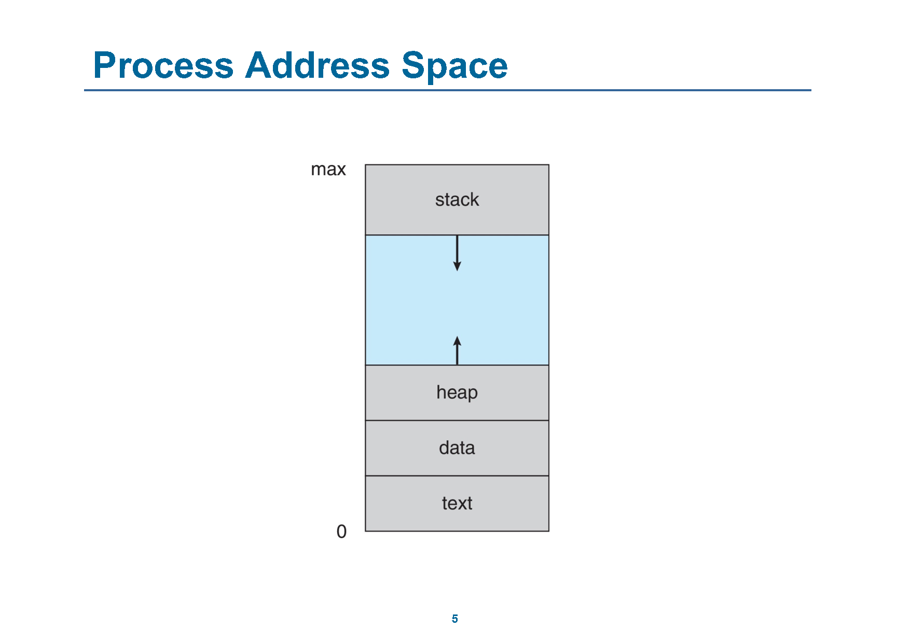
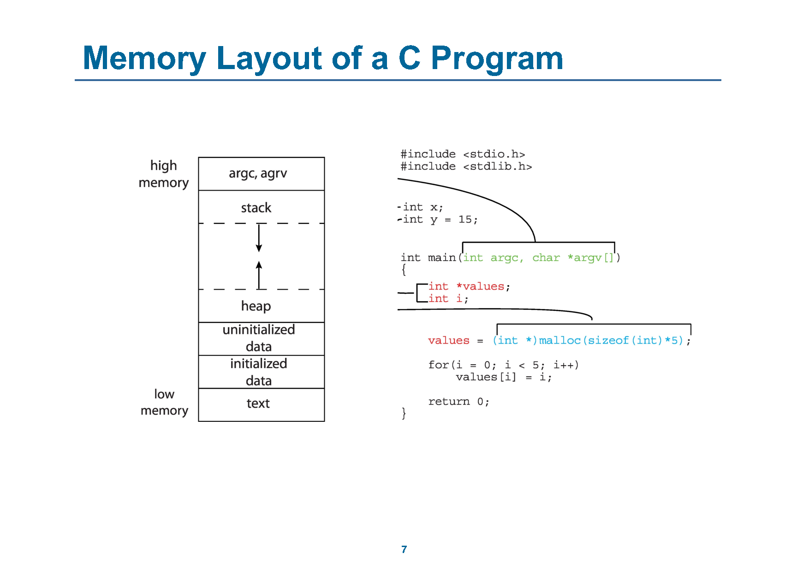
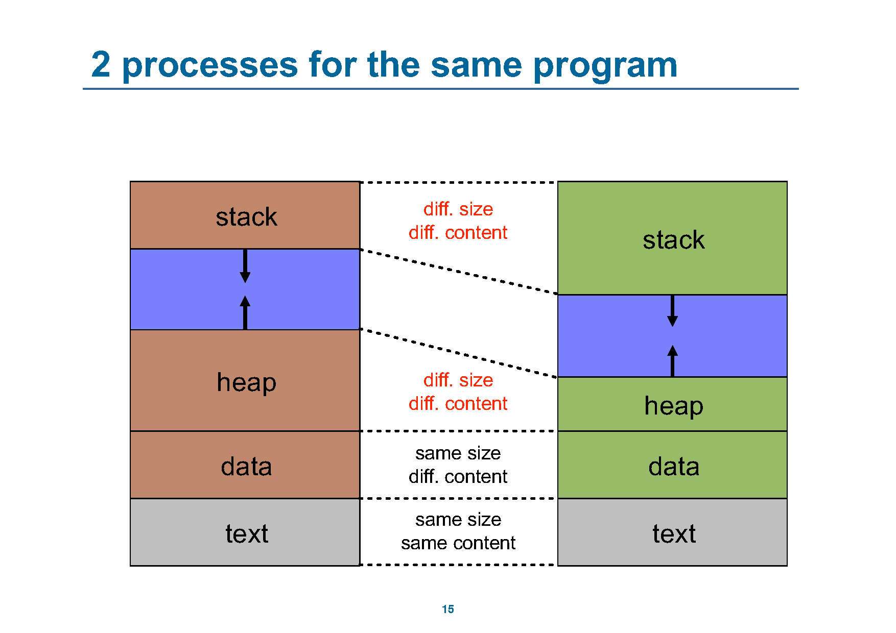
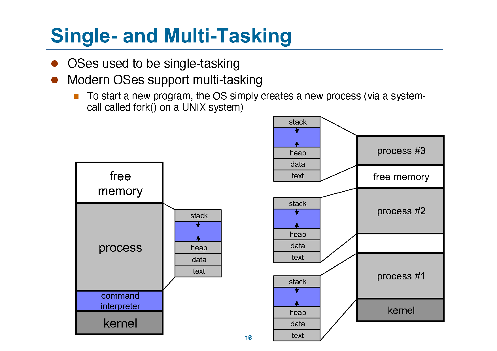
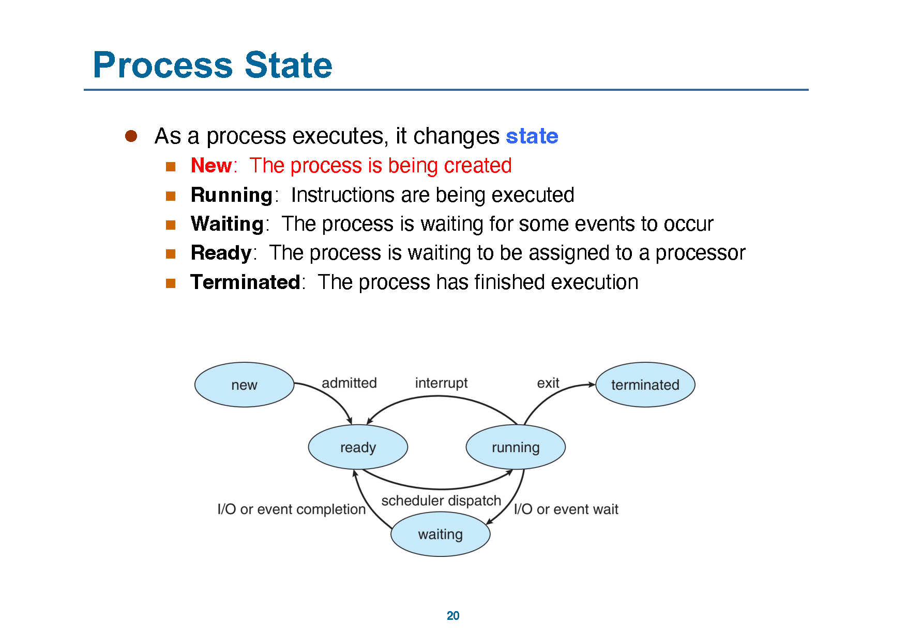
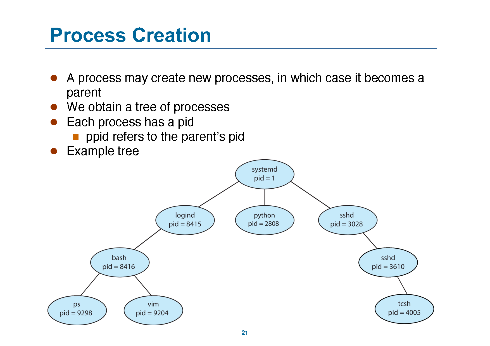
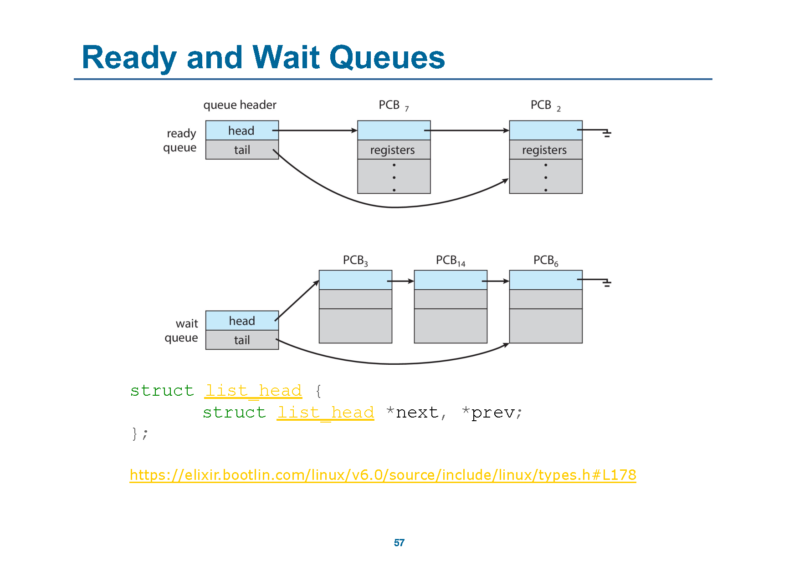
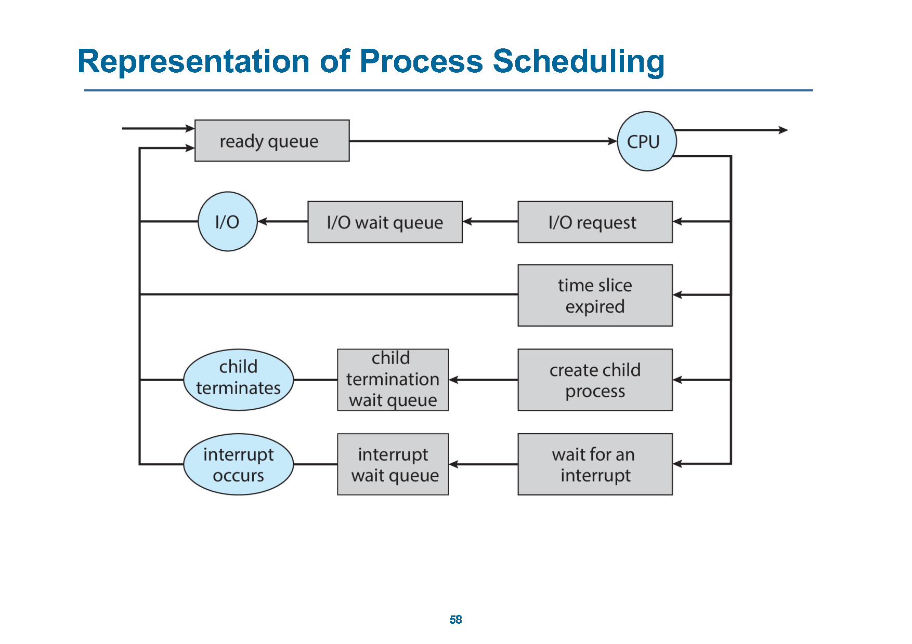
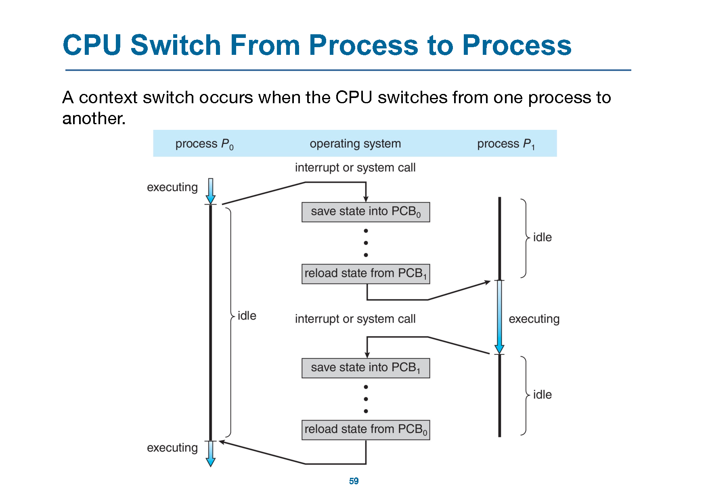

# 计算机系统 II · OS 第 3 讲：进程

> 来源：`../lec/03-0_processes.pdf`（78 页，标题页 `Processes`；Wenbo Shen，浙江大学「Computer Systems II」讲义；部分幻灯片来自 OSC 与 Henri Casanova@Hawaii）
> 课堂记录：依据整理前同一文件中的课堂录音转写，以及 `../lec/11-24课程记录.md`（2026-11-24 课堂录音整理）补充。录音转写有较多识别错误，本文只取能与幻灯片或代码对应上的部分；口述与幻灯片不一致处分别标注。
> 整理日期：2026-11-20（2026-11-24 补充课堂记录；11-24 课堂记录中的调度部分另见 [os-04 第 4 讲](os-04_第04讲_调度入门与Linux调度代码演进.md)）
> 说明：本文由 AI 依据讲义幻灯片与课堂记录整理，供课前预习与课后复习；只做提炼、串讲与页码对照。代码细节以讲义、Linux 源码和教材为准，可能有遗漏。
> 页码说明：`(p.x)` 指 `03-0_processes.pdf` 的 **PDF 物理页码**（1–78，页脚编号与物理页码一致）。
> 标注约定：`【讲义】` 表示幻灯片原文或直接提炼；`【课堂记录】` 表示录音整理中的讲法或例子；`【课堂记录·11-24】` 表示 2026-11-24 课堂记录补充的内容；`整理者注` 是整理时的串联；`待确认` 表示讲义没讲清、转写有歧义或存在疑点。

## 0. 本讲速览

| 小节 | 页码 | 主题 | 一句话摘要 |
|---|---|---|---|
| §1 | p.3–16 | 进程概念 | 进程是运行中的程序，也是资源分配与保护的单位；它由 text、data、PC、寄存器、栈和堆组成。 |
| §2 | p.17–19 | PCB | 每个进程恰好有一个 PCB；Linux 用 `task_struct` 表示，所有 PCB 用 `list_head` 串起来。 |
| §3 | p.20、45、55 | 进程状态 | new、ready、running、waiting、terminated 五状态；ready 与 waiting 需要队列，running 每个 CPU 只有一个。 |
| §4 | p.21–40、44 | 创建进程：`fork` | 子进程是父进程的拷贝，PID 不同、资源计数清零；`fork` 对父进程返回子 PID，对子进程返回 0。 |
| §5 | p.41–43 | 加载程序：`exec` | `execve` 用新程序替换当前进程的映像；成功后不返回，失败才返回。 |
| §6 | p.46–47 | 终止进程 | `exit` 结束自己并交出退出码；父进程用 `wait` / `waitpid` 回收。 |
| §7 | p.48–51 | 信号 | 信号是异步的软件中断；多数可忽略或自定义处理，`SIGKILL` 与 `SIGSTOP` 除外。 |
| §8 | p.52–54 | 僵尸与孤儿 | 子进程退出而父进程未回收 → zombie；父进程先死 → orphan，由 PID 1 收养。 |
| §9 | p.56–58 | 调度与队列 | 调度器在 ready 进程中选择下一个；PCB 在 ready queue 与各种 wait queue 之间迁移。 |
| §10 | p.59–67 | 上下文切换 | 保存旧进程寄存器到 PCB、加载新进程寄存器；关键是切换栈和切换 PC，切换本身是纯开销。 |
| §11 | p.68–72 | `fork` 的两个返回值 | 父进程的返回值写在自己的 `pt_regs`，子进程的 `pt_regs[0]` 被清零；两者都返回到 `fork` 之后。 |
| §12 | p.73–77 | Linux 调度代码演进 | 从 0.11 的固定 PCB 表，到 2.3 的链表、2.4 的命名 ready queue、2.6 的优先级数组，再到按调度类拆分。 |

**本讲主线**：

1. **程序是静态的，进程是动态的**。程序只是磁盘上的字节；一旦载入内存、有了寄存器和栈，它才开始“活着”。
2. **PCB 是进程在内核里的身份证**。状态、寄存器、优先级、地址空间、打开文件都记在这里；调度器移动的其实是 PCB。
3. **状态决定进程在哪个队列**。能跑的进 ready queue，等事件的进某个 wait queue，正在跑的每个 CPU 只有一个。
4. **`fork` 造壳，`exec` 换魂**。`fork` 复制出一个完整进程，`execve` 再把它的映像换成新程序；shell 执行一条命令就是这两步加一个 `wait`。
5. **上下文切换只做两件关键的事**：把栈指针换成新进程的，把 PC 换成新进程上次离开内核时的位置。其余寄存器跟着一起存和取。

---

## 1. 进程是什么（p.3–16）

### 1.1 进程 vs 程序（p.3）

【讲义】p.3 先回答“怎样使用 CPU、内存这些计算机资源”：

- **进程是资源分配与保护的单位**（a unit of resource allocation and protection）；
- **进程是正在执行的程序**（a program in execution）；
- **程序是被动的实体**：它以字节形式存放在磁盘上的可执行文件里；
- 程序被装入内存后才变成进程；
- 同一个程序可以对应多个进程：共享服务器上，每个用户都可能启动同一个编辑器或同一个 shell 的实例；
- 一个运行中的系统包含多个进程，既有 OS 进程，也有用户进程；
- 在操作系统教材里，“job”和“process”经常混用，本课程不区分。

【课堂记录】老师把这句话讲得更直白：程序是躺在磁盘上的 ELF 文件，进程是 ELF 正在运行；进程是“主动实体”，操作系统按进程分配 CPU、内存和打开的文件。

> **整理者注**：这里说的“资源分配单位”是相对线程而言的。本讲只讲到进程；线程要到后面的讲次才展开。

### 1.2 进程由什么组成（p.4）

【讲义】p.4 列出一个进程的六个组成部分：

| 组成 | 内容 |
|---|---|
| code / text | 指令；最初存放在磁盘的可执行文件中 |
| data section | 全局变量；x86 汇编里分为 `.bss` 与 `.data` |
| program counter | 指向下一条要执行的指令，也就是 code 里的某个地址 |
| processor registers | 该进程使用的寄存器内容 |
| stack | 运行时栈，存放栈帧、局部变量、返回地址等 |
| heap | 动态分配的内存，供 `malloc`、`new` 等使用 |

【课堂记录】进程的内存资源可以分成两半：一半是 ELF 映射进来的 section（text、data 等），另一半是运行时才有的部分，主要是寄存器、栈和堆。本讲后面讲上下文切换，重点就是寄存器与栈怎么换。

### 1.3 进程地址空间与 C 程序的内存布局（p.5–7）

【讲义】p.5 给出一个简化的进程地址空间，从高地址到低地址依次是：

```text
kernel
stack      ← 向低地址增长
heap       → 向高地址增长
data
text
```

p.6 换成一张真实的 `/proc/<pid>/maps` 截图，可以看到可执行文件、共享库、堆、栈和内核空间的实际映射；p.7 则把 C 程序的各个部分对应到地址空间：

```text
high memory
    argc, argv
    stack          ← 向下增长
    ...
    heap           → 向上增长
    uninitialized data   (.bss)
    initialized data     (.data)
    text
low memory
```

【讲义】p.7 右侧用一段 C 代码做了对应：

- `argc`、`argv` 在栈的高处；
- `int *values`、`int i` 这类局部变量在栈上；
- `malloc(sizeof(int) * 5)` 得到的内存在堆上；
- 全局的 `int x;` 进入未初始化数据段（`.bss`）；
- 全局的 `int y = 15;` 进入已初始化数据段（`.data`）；
- 函数体的机器指令在 `text` 段。





> **整理者注**：这张图是 32 位时代的经典布局，`kernel` 和用户空间画在同一张地址空间图里。64 位系统的具体地址范围不同，但“栈在高地址、堆在低地址、text 在最低处”的相对关系不变。

### 1.4 栈与栈帧（p.8–14）

【讲义】p.8–9 把运行时栈讲清楚：

- 栈支持 push / pop；
- 栈里的元素叫**活动记录**（activation record），也就是**栈帧**（stack frame）；
- 栈用来管理一连串函数 / 方法调用；
- 栈的管理完全由编译器替程序员完成；
- 一个栈帧要保存函数运行所需的“状态”：
  - 调用者传进来的参数；
  - 局部变量；
  - 函数返回后应该执行哪条指令，即**返回地址**；
  - 函数将要返回的值；
- 调用函数之前，调用者还要保存自己的寄存器状态；
- 这些内容都放在栈上的活动记录里，栈**向低地址增长**。

p.10–13 用 `main() → func() → print()`、`func() → add() → g() → h()` 演示栈帧的压入与弹出：

```text
main() 调用 func()，func() 调用 print()
┌──────────────┐
│ frame main   │
├──────────────┤
│ frame func   │
├──────────────┤
│ frame print  │  ← 栈顶
└──────────────┘

print() 返回后，print 的栈帧弹出；再调用 add()、g()、h()，
栈上依次出现 add、g、h 的栈帧。
```

p.14 讲栈的增长与溢出：

- 调用链越长，栈越大，递归调用尤其明显；
- 栈可能大到撞上系统规定的上限，或者撞上堆；
- 这就是著名的 **runtime stack overflow**；
- 溢出会触发 trap，内核随后以该错误终止进程；
- 常见原因是无限递归。

【课堂记录】老师特别提醒要掌握 `return address` 和 `frame pointer` 在栈帧里的位置：函数返回时靠返回地址跳回去，调试器靠 frame pointer 一层层回溯调用栈。栈上不能分配“永久地址”，需要长期存在的数据要放到堆上。栈溢出在用户看来通常就是 segmentation fault。

### 1.5 同一个程序的两个进程（p.15）

【讲义】p.15 把同一个程序运行两次得到的两个进程放在一起比较：

| 区域 | 大小 | 内容 |
|---|---|---|
| stack | 不同 | 不同 |
| heap | 不同 | 不同 |
| data | 相同 | 不同 |
| text | 相同 | 相同 |



【课堂记录】栈的大小和内容取决于程序调用到了哪一层、局部变量是什么；堆取决于分配了多少、分配了什么；data 段的**大小**由 ELF 决定，所以两次运行一样，但可写全局变量的**内容**可能被改过；text 段是代码，运行中不能改，所以大小和内容都一样。

> **整理者注**：严格说，栈和堆的“大小”指当前实际使用量，不是地址空间保留量；ASLR 还会让两次运行的地址不同。讲义比较的是内容与使用量，不是虚拟地址。

### 1.6 单任务与多任务（p.16）

【讲义】p.16：

- 早期 OS 是单任务的（single-tasking）；
- 现代 OS 支持多任务（multi-tasking）；
- 要启动一个新程序，OS 就创建新进程；UNIX 上这个系统调用叫 `fork()`。

左边的图是单任务：内核之上是命令解释器，再往上只有一块进程区域，剩下是 free memory。右边的图是多任务：内核之上有 process #1、#2、#3，每个进程各有自己的 text、data、heap、stack，中间夹着 free memory。



> **整理者注**：这张图把“进程是资源分配单位”画得很具体：同一块物理内存被划成多个进程的地址空间，每个进程都以为自己独占一块从 text 到 stack 的连续区域。

---

## 2. 进程控制块 PCB（p.17–19）

### 2.1 PCB 里有什么（p.17）

【讲义】p.17：PCB（Process Control Block），也叫 task control block，保存与某个进程相关的信息。

- **每个进程有且只有一个 PCB**；
- 创建进程时分配 PCB，进程终止时释放 PCB；
- PCB 里的典型字段：

| 字段 | 作用 |
|---|---|
| process state | running、waiting 等 |
| program counter | 下一条要执行的指令位置 |
| CPU registers | 该进程所有“进程相关”寄存器的内容 |
| CPU scheduling information | 优先级、调度队列指针等 |
| memory-management information | 分配给进程的内存 |
| accounting information | 已用 CPU、启动后经过的时间、时间限额 |
| I/O status information | 分配给进程的 I/O 设备、打开文件列表 |

【课堂记录】老师把 PCB 叫“进程的元数据”：进程运行到哪了、现在什么状态、属于谁、优先级多少，全都拼在一个结构体里。PCB 不是“进程的内存”，而是内核替进程保存的一本账。

### 2.2 Linux 的 `task_struct`（p.18–19）

【讲义】p.18：Linux 用 C 结构体 `task_struct` 表示进程，链接指向 `include/linux/sched.h` 的第 727 行（v6.0）。幻灯片上的代码很长，整页都是字段。

p.19 只挑出几个字段：

```c
pid t_pid;                  /* process identifier */
long state;                 /* state of the process */
unsigned int time_slice     /* scheduling information */
struct task_struct *parent; /* this process's parent */
struct list_head children;  /* this process's children */
struct files_struct *files; /* list of open files */
struct mm_struct *mm;       /* address space of this process */
```

下半张图把所有 `task_struct` 用双向链表串起来，`current` 指向当前正在执行的进程。


> **待确认**：p.19 的代码里第一行写作 `pid t_pid;`，而 Linux 的实际类型是 `pid_t pid;`；`time_slice` 一行末尾也少了分号。这两处应是幻灯片排版时的笔误，正文按字段含义讲解，不按字面抄写。

【课堂记录】老师给了一个很实用的视角：操作系统里经常只有两件事——“一个地址”和“想把这个地址按什么类型读”。所有进程的 `task_struct` 通过 `list_head` 挂成链表；已知当前 `task_struct` 的地址，想找下一个，不能直接加固定长度，而是：

1. 找到结构体里 `list_head` 成员的地址；
2. 取出它的 `next` 指针；
3. 用 `next` 减去 `list_head` 在 `task_struct` 里的偏移量（offset）；
4. 把结果强转成 `task_struct *`。

这就是 `container_of` 的做法；偏移量由编译器在编译期算好。后面讲 ready queue 与 wait queue 时，PCB 就是靠这套指针运算在队列之间移动的。

> **整理者注**：p.18 的 `task_struct` 有 800 多行，p.19 只列了 7 行。考试如果问“PCB 里有什么”，按 p.17 的通用字段答；如果问“Linux 里对应什么”，答 `task_struct`；再往下才是 `thread_struct`、`cpu_context` 这些内部成员。

---

## 3. 进程状态（p.20、45、55）

### 3.1 五个状态（p.20）

【讲义】p.20：进程执行过程中会改变状态：

| 状态 | 含义 |
|---|---|
| **New** | 进程正在被创建 |
| **Running** | 指令正在被执行 |
| **Waiting** | 进程在等待某个事件发生 |
| **Ready** | 进程在等待被分配给某个处理器 |
| **Terminated** | 进程已经结束执行 |



### 3.2 状态转移图（p.20）

【讲义】p.20 的图给出这些边：

```text
new ──admitted──→ ready ──scheduler dispatch──→ running ──exit──→ terminated
                    ↑                              │
                    │                              │ I/O or event wait
                    │                              ↓
                    └──── I/O or event completion ─ waiting

running ──interrupt──→ ready
```

按图中的标注逐条读：

- **new → ready**：admitted，进程被接纳，进入就绪队列；
- **ready → running**：scheduler dispatch，调度器选中它，把 CPU 交给它；
- **running → ready**：interrupt，时间片用完或被中断，回到就绪队列；
- **running → waiting**：I/O or event wait，等 I/O 或某个事件；
- **waiting → ready**：I/O or event completion，事件完成，重新可运行；
- **running → terminated**：exit，进程结束。

【课堂记录】new 状态时间很短，`fork` 完成后子进程几乎立即变成 ready。running 进程的时间片到期后不会直接“退出”，而是回到 ready 队列尾部，等下一次调度。

> **待确认**：p.20 与 p.45 的状态顺序相同（New、Running、Waiting、Ready、Terminated），p.55 的顺序不同（New、Ready、Running、Waiting、Terminated），但状态集合与转移关系一致。背的时候按“new → ready → running → waiting → terminated”这条主线记，不要被三页的排列顺序干扰。

### 3.3 哪些状态需要队列（p.20）

【课堂记录】老师用一个很朴素的标准判断“要不要队列”：**这个状态是不是可能同时有 N 个进程**。

- **ready**：系统里往往有几十到几百个可运行进程，所以需要队列；
- **running**：每个 CPU 同一时刻只有一个进程在跑，因为寄存器只有一套，所以不需要队列；
- **waiting**：等 I/O、等锁、等子进程的进程可能很多，所以需要队列；而且**每个等待对象一个队列**——一把锁、一块磁盘、一个子进程，都可以有自己的等待队列；
- **new / terminated**：存在时间很短，通常不单独维护队列。

由此得到一组数量关系（课堂记录的简化模型）：

| 状态 | 进程数 | 是否排队 |
|---|---|---|
| ready | 至少 1 个（idle），一般几十到几百个 | 是 |
| running | 等于 CPU 核数 | 否，一核一个 |
| waiting | 可能几十、几百甚至几千个 | 是，每个等待对象一个队列 |

【课堂记录】实验里为了简化，通常只实现**一个 ready 队列**，所有 CPU 都从这一个队列取任务；waiting 队列则有很多个。真实的 Linux 调度器要复杂得多，后面 §9 和 §12 还会看到。

---

## 4. 进程创建：`fork`（p.21–40、44）

### 4.1 进程树（p.21）

【讲义】p.21：

- 一个进程可以创建新进程，创建者成为**父进程**；
- 于是系统里的进程构成一棵树；
- 每个进程有一个 `pid`；
- `ppid` 是父进程的 `pid`。

p.21 的例子：

```text
systemd (pid=1)
├── logind (pid=8415)
│   └── bash (pid=8416)
│       ├── ps (pid=9298)
│       └── vim (pid=9204)
├── python (pid=2808)
└── sshd (pid=3028)
    └── sshd (pid=3610)
        └── tcsh (pid=4005)
```



### 4.2 `fork` 的语义（p.22–24）

【讲义】p.22 先把“创建子进程”的几种可能列出来：

- 子进程可以继承 / 共享父进程的部分资源，也可以拥有全新的资源；
- 父进程可以把输入传给子进程；
- 子进程创建后，父进程可以继续执行，也可以等子进程结束；
- 子进程可以是父进程的克隆（地址空间的一份拷贝），也可以是一个全新的程序；
- 在 UNIX / Linux 上，创建进程用 `fork()`；具体行为可以看 `man 2 fork`。

【讲义】p.23 给出 `fork()` 的定义：

- `fork()` 创建一个新进程；
- 子进程是父进程的拷贝，但有两处不同：
  - 子进程有**不同的 pid**；它的 `ppid` 指向父进程（因此与父进程的 `ppid` 不同）；
  - 子进程的资源利用率（到目前为止）被**置 0**；
- `fork()` 对父进程返回**子进程的 pid**，对子进程返回 **0**；
- 每个进程可以用 `getpid()` 取自己的 pid，用 `getppid()` 取父进程的 pid；
- `fork()` 之后，父子两个进程都继续执行。

p.24 的例子：

```c
pid = fork();
if (pid < 0) {
    fprintf(stdout, "Error: can't fork()\n");
    perror("fork()");
}
if (pid != 0) {
    fprintf(stdout, "I am parent and my child has pid %d\n", pid);
    while (1);
} else {
    fprintf(stdout, "I am child, and my pid is %d\n", getpid());
    while (1);
}
```

【讲义】p.24 还强调：要**总是检查错误码**，`fork()` 失败时返回负值；例子里的 `while (1);` 是为了让父子进程都留在系统里，方便用 `ps` 观察。

【课堂记录】`fork` 完成后，子进程已经具备运行条件，状态是 **ready**，内核把它的 PCB 挂到 ready queue；具体挂到队头、队尾还是按优先级插入，取决于调度策略。之后父子谁先执行，由调度器决定。

【课堂记录】`fork` 最反直觉的地方是“调用一次，返回两次”：父进程拿到子进程的 pid，子进程拿到 0。C 语言的普通函数做不到对不同调用者返回不同值，所以实验里实现 `fork` 时，这一点是重点。

> **整理者注**：`fork()` 失败返回 -1，并设置 `errno`；`perror` 会打印对应的错误说明。p.24 的例子先打印错误，但没有 `return` 或 `else`，失败后仍会落入 `pid != 0` 的父进程分支；实际代码应在错误分支里 `return` 或 `exit`。用 `if (pid > 0)` 区分父进程可以避开这个坑。

### 4.3 `fork` 与内存（p.25–29）

【讲义】p.25–26 给出一段经典代码：

```c
int a = 12;
pid = fork();
if (pid) {              // PARENT
    sleep(10);
    fprintf(stdout, "a = %d\n", a);
    while (1);
} else {                // CHILD
    a += 3;
    while (1);
}
```

问题是：父进程睡 10 秒后打印什么？答案是 **12**。

【讲义】p.27–29 用三张内存图解释：

- p.27：`fork()` 刚完成时，父子进程的 stack、heap、data、text 全部相同，`a = 12`；
- p.28：父进程调用 `sleep`，父进程栈上多了一个 `sleep` 的栈帧；子进程执行 `a += 3`，子进程 data 段里的 `a` 变成 15；
- p.29：父进程调用 `fprintf`，父进程栈上又多了 `fprintf` 的栈帧；子进程的 `a` 仍是 15；父进程打印自己那份 `a`，所以输出 12。


【课堂记录】父子进程各有独立的地址空间，父进程访问的永远是自己的那份 `a`；子进程改的是子进程的副本。这里不是“共享一个变量”，而是“拷贝之后再各过各的”。

> **整理者注**：Linux 的 `fork` 用写时复制（copy-on-write）实现，刚 fork 完并不真的复制所有物理页；只有当某一方写某页时，内核才复制那一页。讲义用“拷贝”讲语义，和实现上的 COW 不矛盾：从程序角度看，两个进程的内存互不影响。

### 4.4 数 `hello` 与数进程（p.30–40）

【讲义】p.30–31：

```c
pid1 = fork();
printf("hello\n");
pid2 = fork();
printf("hello\n");
```

问打印几次 `hello`。答案是 **6 次**。数法：

- 第一次 `fork` 后有两个进程，各自执行第一个 `printf`，共 2 次；
- 第二次 `fork` 时，这两个进程各自再创建一个子进程，变成 4 个进程；
- 4 个进程各自执行第二个 `printf`，共 4 次；
- 合计 2 + 4 = 6 次。

【讲义】p.32–40 是另一道更复杂的题：

```c
int main(int argc, char *arg[])
{
    fork();
    if (fork()) {
        fork();
    }
    fork();
}
```

问这个程序一共创建多少个进程。答案是 **12 个**（包括最开始的原始进程）。p.33–40 用彩色圆点一步步画：

1. 原始进程先执行第一个 `fork()`，变成 2 个进程；
2. 这 2 个进程都执行 `if (fork())`，各自再创建一个子进程，变成 4 个；
3. 这 4 个进程里，`fork()` 返回非 0 的两个（原来的两个父进程）进入 `if` 分支，各自再 `fork()` 一次，增加 2 个，变成 6 个；
4. 最后，6 个进程都执行最后一个 `fork()`，各自再创建一个子进程，增加 6 个，变成 12 个。

p.40 的原话是：6 个进程调用最后一次 `fork()`，每个创建一个新进程，所以最后共 12 个，其中一个是原始进程。


【课堂记录】老师说这类题不要背答案，画进程树最稳：每遇到一个 `fork()`，就在当前每个进程下面各挂一个子进程；遇到 `if (fork())`，只让返回非 0 的那一支进入分支。画完数叶子节点即可。

> **整理者注**：`if (fork())` 里，父进程拿到非 0 返回值，所以进入 `if`；子进程拿到 0，跳过 `if`。这正是 p.37–38 用颜色标注“yellow and green 不进 if，red and blue 进 if”的意思。

### 4.5 `fork` 的代价与 `clone`（p.44）

【讲义】p.44 用一张“Thinking”页讨论 `fork` 的优缺点：

**优点**：

- **简洁**：Windows 的 `CreateProcess` 需要提供 10 个参数，`fork` 没有参数；
- **分工**：`fork` 搭起骨架，`exec` 赋予灵魂；
- **联系**：保留进程与进程之间的父子关系。

**缺点**：

- **复杂**：完成“启动一个新程序”需要两个系统调用；
- **性能差**：要把父进程的内存拷贝一份，随后 `exec` 又把它全部换掉；
- **安全性问题**：子进程能看到父进程地址空间的副本，可能被用来推断父进程的内存布局。

**改进**：`clone` 系统调用；幻灯片把它概括为 `fork + exec`。

【课堂记录】老师举了 Android 上的经典攻击：进程可以通过自己的内存分布，推断父进程乃至 systemd 的内存布局；`fork` 把父进程的地址空间整份复制给子进程，等于给了攻击者一个观察窗口。性能问题也来自这里：复制了一大块内存，紧接着 `execve` 又把它扔掉。

> **整理者注**：`clone` 并不是简单的 `fork + exec`，它通过 `flags` 决定父子进程共享哪些资源（地址空间、文件描述符、信号处理等），`fork`、`vfork`、线程创建都可以建立在 `clone` 上。幻灯片这句话是面向初学者的简化，考试按讲义答“clone 相当于 fork + exec”即可，但心里要知道它更通用。

---

## 5. 加载新程序：`exec`（p.41–43）

### 5.1 `fork` 之后为什么要 `exec`（p.41–42）

【讲义】p.41：

- 创建进程时，地址空间有两种处理方式：
  - 子进程是父进程的副本；
  - 子进程里装入一个新程序。
- UNIX 的例子是：
  - `fork()` 创建新进程；
  - `execve()` 在 `fork()` 之后使用，用新程序替换进程的内存空间；
  - 父进程调用 `wait()` 等子进程结束。

【讲义】p.42：`execve` 系统调用用指定程序的映像替换当前进程的映像。

- 可以在 `man 3 exec` 里看到所有版本；C 语言里的标准名字有 `execl`、`execle`、`execlp`、`execv`、`execve`、`execvp`，但没有一个叫 `exec` 的函数；
- Linux 内核里只有一个对应的系统调用，叫 `execve`；`execl`、`execv`、`execvp` 等是用户态对它的封装；
- 调用 `exec` 时要指定：
  - 可执行文件的路径；
  - 传给它的命令行参数；
  - 可能还有一组环境变量；
- **`exec()` 只有在出错时才返回**；成功时，当前进程的代码、数据、栈都被新程序替换，原来的调用点已经不存在了。

p.42 还留了一个问题：**为什么 `strace` 里看不到 `fork`？** 幻灯片只给了一个 StackExchange 链接，没有给答案。

【课堂记录】老师的解释是：`strace` attach 得比较晚，前面的 `fork` 已经发生过了；在 `strace` 的输出里，第一行往往直接就是 `execve`。

> **待确认**：p.42 的问题没有在幻灯片上作答。除了“attach 晚”，Linux 上 glibc 的 `fork()` 还可能通过 `clone` 系统调用实现，`strace` 看到的是 `clone`；如果只跟踪主进程而没有加 `-f`，子进程的系统调用也不会显示。这几种解释分别适用于不同场景，考试若问，以老师课上的说法为准。

### 5.2 `exec` 家族与调用示例（p.42–43）

【讲义】p.43 的演示代码：

```c
if (fork() == 0) { // run ls
    char *const argv[] = {"ls", "-l", "/tmp/", NULL};
    execv("/bin/ls", argv);
}
```

这段代码的行为：

- 父进程调用 `fork()`，子进程进入 `if`；
- 子进程把 `argv` 准备成 `ls -l /tmp/`；
- `execv("/bin/ls", argv)` 用 `/bin/ls` 替换子进程的映像；
- `execv` 成功后不返回，所以 `if` 后面的代码不会执行；如果 `execv` 失败，才会继续往下走（例子没有处理失败）。

【课堂记录】shell 执行一条命令的完整流程：

1. shell 调用 `fork()` 创建子进程；
2. 子进程调用 `execve()`，把自己替换成要执行的命令（例如 `ls`），并把参数传进去；
3. 父进程（shell）调用 `wait()` 等子进程；
4. 子进程执行完退出，父进程被唤醒，继续接受下一条命令。

老师说，终端里敲一条命令，背后操作系统干的就是这三步。

### 5.3 `exec` 的关键性质

【课堂记录】老师用几个例子说明 `exec` 的“抹掉”效果：

- `fork` 之后，子进程调用 `execve` 加载另一个程序；`execve` **之后的代码不会执行**，因为当前进程的代码段已经被替换；
- 如果没有 `fork`，主进程直接调用 `execve`，那么 `execve` 之后的代码同样不会执行，主进程直接变成新程序；
- `exec` 只影响当前进程，不影响父进程或其他进程。

> **整理者注**：`execve` 成功时“不返回”是理解 shell 的关键。shell 之所以能继续工作，是因为它 fork 出了一个子进程去 exec，自己留在原地 wait；如果 shell 自己 exec，它就被 `ls` 替换掉了，命令结束后 shell 也没了。

【课堂记录·11-24】`exec` 改的是**用户态 PC**。新程序的入口地址来自 ELF header 的 `entry`，`load_elf_binary` 把它写进当前进程 `pt_regs` 里的 PC；`kernel_exit` 恢复 `pt_regs` 后，进程就从新程序的入口开始执行。`cpu_context.pc`（内核 PC）在 `exec` 时不动，仍是这个进程上次被换出去时保存的返回地址——`exec` 换的是用户态映像，内核里的执行流还在原来的系统调用里。

> **整理者注**：所以 `exec` 之后“原来的代码不执行了”，是因为用户态 PC 被改了，不是因为内核 PC 被改了。内核仍然要从 `execve` 的系统调用路径返回，只是返回的目标已经变成新程序的入口。

---

## 6. 进程终止（p.46–47）

### 6.1 `exit`（p.46）

【讲义】p.46：

- 进程用 `exit()` 系统调用结束自己；
- `exit()` 接受一个整数参数，叫进程的 **exit / return / error code**；
- 进程的所有资源由 OS 释放：物理内存、虚拟内存、打开的文件、I/O 缓冲区等；
- 一个进程也可以让另一个进程终止：通过**信号**（signal）和 `kill()` 系统调用。

【课堂记录】`hello world` 的 `return 0` 最终也会走到 `exit`：C 运行时在 `main` 返回后调用 `exit`，把返回值作为退出码交给内核。进程退出后，资源必须由操作系统回收；如果不回收，就会像内存泄漏一样，资源越用越少，最后耗尽。

### 6.2 `wait` 与 `waitpid`（p.47）

【讲义】p.47：

- 父进程可以等子进程结束；
- `wait()`：
  - 阻塞，直到**任意一个**子进程结束；
  - 返回已结束子进程的 pid 和它的退出码；
- `waitpid()`：
  - 阻塞，直到**指定的**子进程结束；
  - 可以用 `WNOHANG` 选项变成非阻塞；
  - 具体用法看 `man 2 waitpid`。

【课堂记录】父进程 fork 之后调用 `wait`，可以等特定的 pid；这样既不会让子进程变成 zombie，也不会让父进程自己先跑完、把子进程变成 orphan。`wait` 也是后面“父进程回收子进程 PCB”的实现基础。

> **整理者注**：`wait()` 的返回值不只是 pid；如果传入 `status` 指针，它还会把子进程的退出状态写进去，需要用 `WIFEXITED`、`WEXITSTATUS` 等宏解析。讲义只讲到“返回 pid 和退出码”，没有展开宏的用法。

---

## 7. 信号（p.48–51）

### 7.1 信号是什么（p.48）

【讲义】p.48：

- 进程可以接收**信号**（signal），也就是**软件中断**（software interrupt）；
- 信号是**异步事件**，程序必须对它做出某种反应；
- 信号有很多用途，包括进程同步；后面还会讲更强大、更灵活的同步工具；
- OS 定义了一组信号，每个信号有名字、编号和含义；见 `man 7 signal`；
- 信号产生的原因很多：
  - 命令行上按 `^C`，会给正在运行的程序发 `SIGINT`；
  - 段错误（segmentation violation）会给进程发 `SIGBUS`；
  - 一个进程给另一个进程发 `SIGKILL`。

> **待确认**：p.48 说段错误发送 `SIGBUS`。Linux 上常见的段错误（非法地址访问）通常发送 `SIGSEGV`（编号 11），`SIGBUS`（编号 7）更多对应总线错误 / 未对齐访问。幻灯片这里可能是简化或笔误，考试按讲义原文答 `SIGBUS`，实际调试时两个都要认识。

### 7.2 信号的编号与处置（p.49–50）

【讲义】p.49 是 `kill -l` 的输出，列出 64 个信号。常见的有：

| 编号 | 名称 | 含义 |
|---|---|---|
| 1 | `SIGHUP` | 挂断 |
| 2 | `SIGINT` | 中断（Ctrl+C） |
| 9 | `SIGKILL` | 强制杀死，不能被捕获或忽略 |
| 11 | `SIGSEGV` | 段错误 |
| 15 | `SIGTERM` | 终止请求（默认的 `kill`） |
| 17 | `SIGCHLD` | 子进程状态改变 |
| 19 | `SIGSTOP` | 暂停，不能被捕获或忽略 |

【讲义】p.50：

- 每个信号在进程里都有一个**默认行为**，例如 `SIGINT` 的默认行为是终止进程；
- 但大多数信号可以被**忽略**，也可以由用户提供 **handler** 来处理；
- `SIGKILL` 和 `SIGSTOP` 出于安全原因，**不能被忽略，也不能被用户处理**；
- `signal()` 系统调用让进程指定对某个信号的动作：
  - `signal(SIGINT, SIG_IGN);`：忽略；
  - `signal(SIGINT, SIG_DFL);`：恢复默认行为；
  - `signal(SIGINT, my_handler);`：自定义处理；
  - handler 的形式是 `void my_handler(int sig) { ... }`。

【课堂记录】`kill -l` 能看到 64 种信号；最常用的是 `SIGINT`（Ctrl+C）和 `SIGKILL`（`kill -9`）。如果进程把 `SIGINT` 处理掉了，Ctrl+C 就杀不死它，只能用 `kill -9`。`SIGKILL` 不能被忽略或处理，否则一个占满 CPU / GPU 的挖矿程序就永远杀不掉，只能拔电源。

### 7.3 信号处理示例（p.51）

【讲义】p.51：

```c
#include <signal.h>
#include <stdio.h>

void handler(int sig) {
    fprintf(stdout, "I don't want to die!\n");
    return;
}

main() {
    signal(SIGINT, handler);
    while (1); // infinite loop
}
```

这个程序把 `SIGINT` 的默认行为（终止）换成了打印一句话，所以按 Ctrl+C 不会退出；每按一次就打印一句 “I don't want to die!”，然后继续死循环。要结束它，需要用 `kill -9 <pid>` 发 `SIGKILL`。

【课堂记录】老师把这个例子叫“黑客”小把戏：操作系统没学好，就会被一个几行的程序耍得团团转。理解信号的处理方式，也是后面理解 `SIGCHLD` 回收僵尸进程的基础。

---

## 8. 僵尸进程与孤儿进程（p.52–54）

### 8.1 僵尸进程（p.52）

【讲义】p.52：

- 子进程终止后，会以 **zombie**（僵尸）状态停留一段时间；
- 直到被 OS **reap**（回收，幻灯片写作 garbage collected）为止；
- 为什么不能立刻回收？因为父进程可能还要调用 `wait()` 或它的变体，取子进程的退出码；
- 问题：子进程有哪些资源不能自己释放？答案是 **PCB**；
- OS 因此把 zombie 留在系统里：
  - 它已经不是真正的进程，不消耗 CPU；
  - 但它占着一个内存槽位（a slot in memory）；
  - 槽位可能被占满，最终导致 `fork()` 失败。

【讲义】p.52 给的观察命令：

```bash
ps xao pid,ppid,comm,state | grep a.out
```

状态列显示 `Z` 的就是僵尸进程。

【课堂记录】子进程退出时，栈、堆、ELF 映射都可以释放，唯独 PCB 不能由子进程自己释放，必须等父进程来回收。父进程如果卡住不 wait，子进程就一直“已死但仍占着 PCB”。

### 8.2 如何避免僵尸（p.53）

【讲义】p.53：

- zombie 会一直存在，直到：
  - 父进程对它调用了 `wait()`，或者
  - 父进程自己也死了；
- 无缘无故留着 zombie 是坏习惯；
- 子进程退出时，会给父进程发一个 `SIGCHLD` 信号；
- 避免 zombie 的典型做法：
  - 父进程给 `SIGCHLD` 注册一个 handler；
  - handler 里调用 `wait()`；
  - 这样每次子进程死亡都会被“确认”；
  - 例子见 `nozombie_example.c`。

【课堂记录】老师在课上演示了 `nozombie_example.c`：父进程用 `signal(SIGCHLD, handler)` 注册处理函数，handler 里 `wait`，子进程退出后自动被回收，`ps` 里不会留下 `Z`。

> **整理者注**：`SIGCHLD` 可能在一个 handler 执行期间再次到达，严格写法通常在 handler 里循环 `waitpid(-1, ..., WNOHANG)` 直到没有更多已退出的子进程。讲义只给了一个 `wait()` 的版本，考试按讲义答即可。

### 8.3 孤儿进程（p.54）

【讲义】p.54：

- **孤儿进程**（orphan）是父进程已经死掉的进程；
- 孤儿会被 **pid 为 1 的进程**收养：
  - Linux 上是 `init`；
  - macOS 上是 `launchd`；
  - 演示见 `orphan_example1.c`；
- pid 1 的进程为 `SIGCHLD` 注册了 handler，handler 里调用 `wait`（和上一页一样）；
- 因此，**孤儿永远不会变成僵尸**；
- 一个“技巧”：想创建一个和父进程完全分离、以后不用负责的进程，可以创建孙进程，再把它的父进程“杀掉”；
  - 演示见 `orphan_example2.c`；
  - 被杀的父进程会变成僵尸，所以父进程自己要正确处理子进程退出。

【课堂记录】老师演示时，父进程 fork 后先退出，子进程 sleep 一段时间再打印 `getppid()`，结果不是原来的父进程 pid，而是一个 systemd 的子进程（课上看到的是 2967 左右）。现代 Linux 上 PID 1 是 systemd，它自己会“练小号”，把收养工作交给一个子进程；所以看到 PPID 不是 1 也不要惊讶。

> **待确认**：p.54 按教材口径写 `init`，课堂演示看到的是 systemd 的子进程；两者不矛盾——现代 Linux 的 PID 1 是 systemd，systemd 可以再派生进程处理收养。课上看到的 2967 是那台机器的具体 pid，不是通用值。

### 8.4 僵尸与孤儿的对照

| 情况 | 谁先结束 | 结果 | 谁来回收 |
|---|---|---|---|
| 正常 | 子进程先结束，父进程 `wait` | 子进程被回收 | 父进程 |
| zombie | 子进程结束，父进程没 `wait` | 子进程留下 PCB，状态 `Z` | 父进程（或父进程死亡后由收养者） |
| orphan | 父进程先结束 | 子进程被 PID 1 / systemd 收养 | 收养者 |
| 双 fork | 孙进程的父进程被杀死 | 孙进程成为 orphan | PID 1 / systemd |

> **整理者注**：zombie 和 orphan 不是同一种东西：zombie 是“子进程死了但没被回收”，orphan 是“父进程死了但子进程还活着”。考试喜欢把这两个概念放在一起考，答题时先写“谁死了”。

---

## 9. 进程调度与队列（p.56–58）

### 9.1 调度器做什么（p.56）

【讲义】p.56：

- 调度的目标是**最大化 CPU 使用率**，并让进程尽快切换到 CPU 核上；
- **进程调度器**（process scheduler）从 ready 进程中选择下一个在 CPU 核上执行的进程；
- 调度器维护一组**调度队列**（scheduling queues）：
  - **ready queue**：所有已经在主存里、准备好等待执行的进程；
  - **wait queue**：等待某个事件（例如 I/O）的进程；
  - 进程会在这些队列之间迁移。

### 9.2 ready queue 与 wait queue（p.57）

【讲义】p.57 先给出 Linux 的 `list_head`：

```c
struct list_head {
    struct list_head *next, *prev;
};
```

上半张图是 ready queue：队头（head）指向 `PCB 7`，`PCB 7` 指向 `PCB 2`，`PCB 2` 的 next 为空；队尾（tail）也记录在队列头里。下半张图是 wait queue：队头指向 `PCB 3`，依次是 `PCB 14`、`PCB 6`。



### 9.3 进程在队列之间的迁移（p.58）

【讲义】p.58 的流程图：

```text
                 ┌──────────────┐
                 │ ready queue  │
                 └──────┬───────┘
                        ↓
                      ┌─────┐
                      │ CPU │
                      └──┬──┘
       ┌─────────────────┼─────────────────┐
       ↓                 ↓                 ↓
 I/O request      time slice expired   create child process
       ↓                 ↓                 ↓
 I/O wait queue     （回到 ready）     child termination wait queue
       ↓                                   ↓
      I/O                            child terminates
       ↓                                   ↓
   （回到 ready）                     （回到 ready）

 wait for an interrupt → interrupt wait queue → interrupt occurs → ready
```

按图读：

- 进程从 ready queue 被选中，进入 CPU；
- 发出 I/O 请求 → 进入 I/O wait queue → I/O 完成后回到 ready queue；
- 时间片用完 → 直接回到 ready queue；
- 创建子进程 → 进入 child termination wait queue，等子进程结束；
- 等待中断 → 进入 interrupt wait queue，中断发生后回到 ready queue。



【课堂记录】老师把“哪个状态需要队列”讲成了一个设计问题：ready 队列可以只有一个，所有 CPU 共用一个；wait 队列则按等待对象拆开——一把锁一个队列，一块磁盘一个队列，甚至连软盘马达都有一个 `motor_wait` 队列。进程在这些队列之间移动，靠的就是 PCB 里的 `list_head`。

【课堂记录】一个具体的例子：

1. ready queue 里取出第一个进程，让它上 CPU；
2. 它要读文件，于是从 ready queue 摘下，挂到那块磁盘的 wait queue；
3. 读完后，从 wait queue 摘下，挂回 ready queue；
4. 如果它的时间片用完而还没运行完，就放到 ready queue 的尾部，等下一次调度。

还有一个从 `fork` 场景来的例子：父进程调用 `wait` 等子进程时，父进程自己被挂到**子进程的等待队列**上；子进程退出后，父进程被唤醒，从等待队列摘下，放回 ready queue。所以一次 `wait` 也包含“从 running 到 waiting，再从 waiting 到 ready”的两次迁移。

> **整理者注**：ready queue 的排序策略（先来先到、按优先级、按剩余时间等）属于调度策略，本讲只讲“有队列、会迁移”，具体算法留到后面的调度讲次。

---

## 10. 上下文切换（p.59–67）

### 10.1 为什么需要切换 CPU（p.59–60）

【讲义】p.59 的时间线：

```text
process P0        operating system        process P1
executing ──interrupt/system call──→ save state into PCB0
                                     ...
                                     reload state from PCB1 ──→ executing
                                     ...
executing ←──reload state from PCB0── save state into PCB1 ←── interrupt/system call
```

CPU 从一个进程切换到另一个进程，就叫一次**上下文切换**（context switch）。中间那段时间两个进程都没有执行，图中标为 idle。



【讲义】p.60：

- CPU 切换到另一个进程时，系统必须保存旧进程的状态，再加载新进程保存的状态；
- 进程的上下文（context）表示在 PCB 里；
- **上下文切换时间是开销**（overhead）：切换期间系统没有做任何有用的工作；
- OS 和 PCB 越复杂，切换时间越长；
- 切换时间取决于硬件支持：有些硬件为每个 CPU 提供多组寄存器，可以一次保存 / 加载多个上下文。

【课堂记录】老师反复强调的根本原因是：**寄存器只有一份**。一个 CPU 只有一套通用寄存器、一个 SP、一个 PC；进程在等内存、等硬盘时，不能抱着这套寄存器干等。CPU 比内存和磁盘快太多，让你在 CPU 上等是浪费，所以要把你换下去，让别的进程用寄存器。

【课堂记录】`context` 和 `state` 在这里是同一个东西：寄存器。把 P0 的寄存器存到 P0 自己的 PCB，把 P1 的寄存器从 P1 的 PCB 取出来装回硬件，再跳到 P1 去执行，就完成了切换。老师说，学生第一次看到“一个进程调了个函数，出来变成另一个进程”会觉得神奇；看完 `cpu_switch_to` 就会发现没那么神秘。

【课堂记录】上下文切换是 **pure overhead**：保存和加载的过程中，P0 没有往前执行，P1 也没有往前执行，系统没有做任何 useful work。系统越复杂、PCB 越大、寄存器越多，切换越慢；CPU 每秒可能发生几百、上千甚至几万次切换，所以这个开销很值得优化。这也是为什么硬件要提供多组寄存器、为什么 OS 要尽量减少不必要的切换。

### 10.2 切换时保存什么（p.60–61）

【讲义】p.60 说上下文保存在 PCB 里；p.61 把 ARM64 的具体位置展开：

```text
task_struct
└── struct thread_struct thread;
    └── struct cpu_context cpu_context;
        ├── unsigned long x19;
        ├── ...
        ├── unsigned long x28;
        ├── unsigned long fp;   // x29
        ├── unsigned long sp;
        └── unsigned long pc;   // x30 / lr
```

也就是说，上下文不是“所有寄存器”都塞进 PCB，而是**内核认为需要跨进程保留的那一组**：x19–x28（被调用者保存寄存器）、fp（x29）、sp、pc（lr / x30）。x0–x18 这些不由被调用者保存的寄存器，由 C 编译器在调用 `cpu_switch_to` 之前按调用约定处理好。

【课堂记录】老师提醒：`cpu_context` 里的 `pc` 不是用户程序的 PC，而是**内核 PC**——这个进程下次被换回来时，从内核的哪一行继续执行。用户程序的 PC 在另一处，叫 `pt_regs`，§10.7 再讲。

### 10.3 ARM64 的 `cpu_switch_to`（p.61–62）

【讲义】p.61 的函数原型：

```c
extern struct task_struct *cpu_switch_to(struct task_struct *prev,
                                         struct task_struct *next);
```

ARM64 调用约定：第 0 个参数放 `x0`，第 1 个参数放 `x1`。所以：

- `x0` = `prev`，要被换出去的进程；
- `x1` = `next`，要换进来的进程。

汇编逐段读：

```asm
ENTRY(cpu_switch_to)
    mov x10, #THREAD_CPU_CONTEXT   // x10 = cpu_context 在 task_struct 里的偏移
    add x8, x0, x10                // x8 = &prev->thread.cpu_context
    mov x9, sp                     // x9 = 当前 SP（稍后存进 prev 的 cpu_context）
    stp x19, x20, [x8], #16        // 成对保存，x8 自动加 16
    stp x21, x22, [x8], #16
    stp x23, x24, [x8], #16
    stp x25, x26, [x8], #16
    stp x27, x28, [x8], #16
    stp x29, x9,  [x8], #16        // x29 = fp，x9 = sp
    str lr, [x8]                   // lr（x30）单独存，作为 pc

    add x8, x1, x10                // x8 = &next->thread.cpu_context
    ldp x19, x20, [x8], #16        // 按相反顺序恢复
    ldp x21, x22, [x8], #16
    ldp x23, x24, [x8], #16
    ldp x25, x26, [x8], #16
    ldp x27, x28, [x8], #16
    ldp x29, x9,  [x8], #16        // x29 = fp，x9 = next 的 sp
    ldr lr, [x8]                   // lr = next 的 pc
    mov sp, x9                     // 切换栈
    msr sp_el0, x1                 // 把当前 task_struct 指针放到 sp_el0
    ret                            // 返回到 lr，也就是 next 的 pc
ENDPROC(cpu_switch_to)
```

几个容易看漏的点：

- `THREAD_CPU_CONTEXT` 是 `cpu_context` 在 `task_struct` 里的**编译期偏移**；拿到 `task_struct` 地址后加上它，就得到 `cpu_context` 的地址；
- `stp` 是 store pair，一次存两个 64 位寄存器，后缀 `#16` 表示存完后地址自动加 16；
- `x29` 是 frame pointer，`x9` 这时装的是旧进程的 SP，所以 `stp x29, x9` 一次把 fp 和 sp 都存了；
- `lr`（x30）是返回地址，单独用 `str` 存到 `cpu_context.pc`；
- 恢复时顺序相反，最后 `ldr lr` 把新进程的 pc 装进 LR，`mov sp, x9` 把新进程的 SP 装进硬件 SP；
- `msr sp_el0, x1` 把 `next` 的 `task_struct` 指针写到 `sp_el0`；在这份代码对应的内核里，`current` 就是从这里取当前进程的；
- 最后 `ret` 跳到 LR，也就是新进程的 pc。


### 10.4 两个关键步骤：切换栈与切换 PC（p.62–64）

【讲义】p.62 用红线标出两处：

- `mov x9, sp`：先把旧进程的 SP 保存到 x9；
- `mov sp, x9`：再把新进程的 SP 装回硬件 SP。

这两行完成的是**栈的切换**。讲义说，除了 PCB，进程的执行状态还在栈上，所以只换 PCB 不够，必须把栈也换掉。

p.63–64 问：`cpu_switch_to()` 返回到哪里？这个值是什么时候设置的？

- `cpu_switch_to` 也是一个函数，函数必须 `ret`；
- `ret` 返回到 LR（x30），而 LR 在进入函数时由调用者设置；
- 调用者在 `schedule()` 里用 `bl cpu_switch_to` 调用它，`bl` 会把下一条指令的地址写进 LR；
- 所以 `cpu_switch_to` 的返回地址，就是 `schedule()` 里 `cpu_switch_to` 调用点的下一行；
- 这个 LR 被存进旧进程的 `cpu_context.pc`；
- 等旧进程以后再次被换进来，`ldr lr, [x8]` 会把这个值装回 LR，`ret` 就回到它上次离开的地方；
- p.64 说，如果 Process 0 调用 `schedule()` 让出 CPU，它以后回来时会返回到 `schedule()` 之后（图中写作 line 756）。

【课堂记录】老师把这件事讲成一个“神奇函数”：

- 平常函数调用：进程 A 调 `printf`，返回后还是进程 A；
- `cpu_switch_to` 调用一次，进去的是 A，出来的可能是 B；
- 原因是它把 A 的返回地址存进了 A 的 `cpu_context`，又把 B 的返回地址装进了 LR；`ret` 用的是 B 的返回地址，所以“回到 B 上次离开的地方”；
- 学生回答“return 到 next 的 PC”是对的；更准确地说，是 return 到 next 上次调用 `cpu_switch_to` 时留下的返回地址，也就是 next 的 `schedule()` 里面。

【课堂记录】老师用“小明调了这个函数，出来变成小王”形容第一次看到这种现象的感觉；但把 `cpu_switch_to` 的 save / load 两半看懂，就没有魔法了。

> **整理者注**：`cpu_switch_to` 只负责**内核上下文**的切换（不管切换的是内核线程还是用户进程）。用户进程的寄存器不在这里保存，而是在进入内核时由 `kernel_entry` 保存到 `pt_regs`；两条线在 §10.7 汇合。

### 10.5 heap 为什么不用切换（p.62）

【课堂记录】问题：进程除了栈，还有 heap，为什么上下文切换不换 heap？

答案：**heap 没有硬件寄存器指向它**。栈有 SP 寄存器，PC 有 PC 寄存器，通用寄存器也有一套；heap 只是一个内存区域，进程切换时地址空间整体跟着换（或者说，等讲内存管理时再换页表），不需要在 `cpu_switch_to` 里单独保存一个“heap 指针”。

同理，ELF 映射区也没有寄存器指向它，所以也不在 `cpu_context` 里。把 SP、PC 和通用寄存器换掉，这个进程的 CPU 上下文就切好了。

> **整理者注**：更准确地说，不同进程有各自的页表；切换地址空间通常由 `switch_mm` 一类的工作完成，和 `cpu_switch_to` 是两个层次。本讲只讲 CPU 上下文，内存上下文留到“系统三”。

### 10.6 内核栈与 `task_struct` 的布局（p.65）

【讲义】p.65 是一张没有标题的“神图”，把内核栈和 `task_struct` 画在一起：

```text
低地址
┌──────────────────────────┐
│ thread_info              │──→ task_struct
├──────────────────────────┤      └── thread_struct
│                          │            └── cpu_context
│      （栈空间）           │                  ├── x19…x28
│                          │                  ├── fp
│   ┌──────────────────┐   │                  ├── sp
│   │ previous fp      │   │                  └── pc
│   ├──────────────────┤   │
│   │ previous fp      │   │
│   ├──────────────────┤   │
│   │ previous fp      │   │
│   └──────────────────┘   │
│                          │
│ pt_regs                  │──→ regs[31], sp, pc, pstate
└──────────────────────────┘
高地址
```


图里的关键点：

- 一整块是**内核栈**；Linux 里每个进程的内核栈大小固定，课上是 4 个 page，一页 4 KB，共 **16 KB**；
- `thread_info` 在栈的最低地址，指向 `task_struct`；
- SP 指向当前栈帧的最低地址（图中绿色区域的上沿），FP（x29）指向栈帧的末尾；
- 每个栈帧里保存 previous frame pointer，形成一条链；
- `pt_regs` 在内核栈的**最高地址**（图的最下面，标着 high address），进入内核时把用户寄存器压到这里；
- `cpu_context` 在 `task_struct` 里，保存内核上下文；
- 内核栈的最高地址可以由 `task_struct` 里的 `stack` 成员加上内核栈大小算出来：`stack` 指向栈的最低地址，加上 16 KB 就得到栈顶。

【课堂记录】老师顺着这张图讲了几个现实问题：

- 程序崩了，调试器要打印调用栈（stack trace），靠的就是 frame pointer 链：从当前 FP 往上找 previous FP，每个 FP 上方是返回地址，一层层打印；
- 如果 frame pointer 被写坏，下面的栈就找不着了，调用栈会“断”；
- 老师做过返回地址加密的安全机制，加密后调试器打出来的返回地址是密文；他又写了个工具，把内存 dump 里所有进程栈的返回地址解密再塞回去，方便调试；
- 如果 frame pointer 被抹掉，很多时候只能暴力搜索：在栈上下找“长得像 frame pointer”的地址，顺着往下试，能找到算运气好，大部分时候找不着。

【课堂记录】`task_struct` 的大小演化：

- Linux 0.11 时结构体还很小，只有几十个字段；后来长到几百字节；
- 课上看到的一个版本约 3.7 KB，已经接近一个 page；
- 如果把 `task_struct` 放在内核栈的最低地址，它会吃掉栈的很大一块；
- 所以后来把 `task_struct` 移出内核栈，栈上只留一个指针；
- 再后来为了安全，连 `thread_info` 指向 `task_struct` 的关系也去掉了，改用系统寄存器（`sp_el0`）指向当前 `task_struct`。

> **待确认**：p.65 的图仍是“`thread_info` 在栈底、指向 `task_struct`”的旧布局；课堂记录说新版内核已经把 `task_struct` 移出栈，并用 `sp_el0` 指向它。两者是不同内核版本的画法，考试按讲义图答，实际代码以所用内核版本为准。`task_struct` 的 3.7 KB 也是课上某次观察的值，随配置变化，不是固定常量。

### 10.7 从用户态进入内核态：`pt_regs`（p.66–67）

【讲义】p.66 讲**两个内核线程**之间的切换：

- 上下文切换发生在内核态；
- 何时保存：在 `context_switch` 里，更具体是在 `cpu_switch_to`；
- 保存在哪：PCB 里，更具体是在 `cpu_context`；
- 这时所有寄存器跑的都是内核代码，所以叫 **kernel context**。

p.67 讲**两个用户线程**之间的切换，多了一层：

- 上下文切换必须发生在内核态（why）；
- **用户上下文**（user context）何时保存：`kernel_entry`；保存在哪：每个线程的内核栈，更具体是 `pt_regs`；
- **内核上下文**（kernel context）何时保存：`cpu_switch_to`；保存在哪：`cpu_context`。


【课堂记录】这些入口都在 `arch/arm64/kernel/entry.S` 里：`kernel_entry`、`ret_from_fork`、`ret_to_user`、`kernel_exit` 都能在这个文件里找到。老师说，看懂这个文件，中断和上下文切换就明白大半了。

【课堂记录】为什么上下文切换一定要在内核态？因为要直接操作 SP、LR、`task_struct` 这些关键资源。如果用户态能随便改，保护就没有意义了。所以用户程序先通过系统调用 / 中断进入内核，内核再调用 `cpu_switch_to`。

【课堂记录】用户态到内核态的保存分两步：

1. 从用户态进内核时，`kernel_entry` 把用户寄存器（x0–x30、SP、PC、PSTATE）保存到内核栈上的 `pt_regs`；
2. 内核里真正切换进程时，`cpu_switch_to` 把内核寄存器保存到 `task_struct.thread.cpu_context`。

切回来时顺序相反：先 `cpu_switch_to` 恢复内核上下文，再 `kernel_exit` 从 `pt_regs` 恢复用户上下文，最后返回用户态。

【课堂记录】老师给了一个“面试评分”玩笑：

- 答出 PCB：60 分；
- 答出 Linux 里叫 `task_struct`：说明不只背了概念，还知道具体名字；
- 答出 `task_struct` 里有 `thread_struct`：80 分；
- 答出 `thread_struct` 里有 `cpu_context`：100 分。

### 10.8 两个 PC、两个 SP（p.67）

`pt_regs` 里有一个 PC，`task_struct` 的 `cpu_context` 里也有一个 PC；两边都有 SP。它们不是同一个东西：

| 位置 | 是什么 | 什么时候用 |
|---|---|---|
| `cpu_context.pc` | **内核 PC**：进程下次被换回来时，从内核的哪一行继续执行 | `cpu_switch_to` 的 `ldr lr` / `ret` |
| `pt_regs.pc` | **用户 PC**：进程回到用户态后，从用户代码的哪一行继续执行 | `kernel_exit` 恢复用户上下文 |
| `cpu_context.sp` | **内核栈指针**：内核栈的栈顶 | `cpu_switch_to` 的 `mov sp, x9` |
| `pt_regs.sp` | **用户栈指针**：用户栈的栈顶 | `kernel_exit` 恢复用户上下文 |

【课堂记录】老师说，这两个 PC 很关键：一个管“回到内核的哪里”，一个管“回到用户的哪里”。两个 SP 同理：一个管内核栈，一个管用户栈。p.65 的神图里画的都是内核空间，没有画用户栈；用户栈要等讲内存时再画。

> **整理者注**：ARM64 的异常级别切换会换栈，用户 SP 和内核 SP 不是同一个；`pt_regs` 里保存的是用户态的 SP，`cpu_context.sp` 保存的是内核态的 SP。这也是为什么一张图里会有两个 SP。

### 10.9 上下文切换的代价

【讲义】p.60 已经给出结论：上下文切换是纯开销，OS / PCB 越复杂越慢，硬件多组寄存器可以加速。

【课堂记录】补充了几条直观的账：

- 切换要做的事情包括保存寄存器、恢复寄存器、切换栈、切换 PC，可能还要切换页表、刷新 TLB；
- 这些工作对“当前进程完成多少任务”没有直接贡献；
- CPU 每秒切换几百到几万次，单次节省一点，累计就很可观；
- 所以调度器要尽量避免无意义的切换，例如不要把刚睡下的进程立刻唤醒、不要在锁竞争激烈时频繁让出 CPU。

> **整理者注**：本讲只讲 CPU 上下文（寄存器、栈、PC）。完整的上下文还包括 cache、TLB、页表等，属于内存管理的内容，后面的讲次再展开。

### 10.10 11-24 课堂补充：三次切换与用户上下文的落点

【课堂记录·11-24】这次课又把上下文切换过了一遍，补了三个容易漏的点。

1. **user space 上下文存在内核栈的最顶端**。`pt_regs` 在内核栈的高地址端（§10.6 的神图），里面保存 31 个通用寄存器以及 SP、PC、PSTATE。从用户态进内核时，`kernel_entry` 用 `stp` 一对一对地写进去；返回用户态时，`kernel_exit` 再一对一对读回来。
2. **换入之后，只能从新进程的内核栈恢复用户上下文**。P0 从用户态进内核，用户上下文存在 **P0 的内核栈**；做完 `cpu_switch_to` 之后，CPU 已经在跑 P1 的内核代码，用的是 **P1 的内核栈**。这时返回用户态，必须从 P1 的内核栈取 P1 的 `pt_regs`。如果拿 P0 的栈去恢复，P1 就会带着 P0 的 SP 和 PC 回用户态，通常直接 segment fault。
3. **P1 的 user space 上下文是什么时候存的**？两种来源：
   - 上一次 P1 被换出时，从用户态进内核，由 `kernel_entry` 保存；
   - P1 是 `fork` 出来的，`copy_thread` 直接把父进程的 `pt_regs` 整份拷过来（§11.2）。

【课堂记录·11-24】一次**进程切换**的完整路径要算三次上下文切换：

| # | 动作 | 保存 / 恢复 | 位置 |
|---|---|---|---|
| 1 | P0 用户态 → 内核态 | 保存 P0 的 user context | P0 内核栈的 `pt_regs` |
| 2 | 内核里 `cpu_switch_to(P0, P1)` | 保存 P0 的 kernel context、恢复 P1 的 | 两个 `task_struct.thread.cpu_context` |
| 3 | 内核态 → P1 用户态 | 恢复 P1 的 user context | P1 内核栈的 `pt_regs` |

如果只是**系统调用**、不发生进程切换，就只有第 1 和第 3 步，共两次，而且都是同一个进程 P0 自己的上下文。老师说，面试问“发生了几次上下文切换”，只答一次的人忘了 user / kernel 这一层；能答三次并说清每一步存到哪里，才算把内核看懂了。

> **待确认**：课堂记录在同一节里先写“进程切换发生两次上下文切换”，后面又按三次计算。两种口径应是：两次指 user ↔ kernel 的两次边界切换，三次再把 `cpu_switch_to` 算进去。正文按三次讲；若老师期末按另一种口径，以课上最终说法为准。

【课堂记录·11-24】`kernel_entry` 还有一段小插曲：老师说他当年在 Linux 4.14 的 `entry.S` 里发现过一个 bug——某行宏少写了一个反斜杠，导致条件判断不成立，中间一段保存寄存器的代码没有被编译进去，后来修掉了。这说明入口代码里的宏拼接出错时，编译器不一定报错，而是静默地少存几个寄存器。

---

## 11. `fork` 为什么能返回两个值（p.68–72）

### 11.1 父进程：一次普通的系统调用（p.68–71）

【讲义】p.68–70 先把父进程的路径讲清楚：

- `fork()` 对父进程来说就是一个系统调用，和 `write` 没有本质区别；
- 用户态调用 `fork()`，进入内核后走 `kernel_entry`；
- `kernel_entry` 把用户寄存器保存到父进程内核栈上的 `pt_regs`；
- 内核里的实现是 `kernel_clone`（p.69–70 图中标出）；
- `kernel_clone` 创建子进程并返回**子进程的 pid**；系统调用的返回路径再把这个值放进父进程的 `pt_regs`（x0）；
- 返回用户态时，`kernel_exit` 从 `pt_regs` 恢复寄存器，父进程看到的就是子进程的 pid。

p.70 的原话：

- When and where are user mode context (registers) saved?
- When: `kernel_entry`; Where: per-process kernel stack, more specifically `pt_regs`;
- `new_pid` is returned to parent via syscall return value (saved in `pt_regs`).

> **待确认**：p.71 的文字把时机写成 `kernel_exit`，p.70 写的是 `kernel_entry`。按上下文，保存用户寄存器发生在 `kernel_entry`（进入内核时），`kernel_exit` 是恢复；p.71 应是笔误。正文按 `kernel_entry` 保存、`kernel_exit` 恢复来讲。

### 11.2 子进程：`copy_thread` 做了什么（p.72）

【讲义】p.72 的代码（`copy_thread`，节选）：

```c
int copy_thread(unsigned long clone_flags, unsigned long stack_start,
                unsigned long stk_sz, struct task_struct *p)
{
    struct pt_regs *childregs = task_pt_regs(p);

    memset(&p->thread.cpu_context, 0, sizeof(struct cpu_context));

    if (likely(!(p->flags & PF_KTHREAD))) {
        *childregs = *current_pt_regs();
        childregs->regs[0] = 0;
        ...
    }

    ...
    p->thread.cpu_context.pc = (unsigned long)ret_from_fork;
    p->thread.cpu_context.sp = (unsigned long)childregs;

    ptrace_hw_copy_thread(p);
    return 0;
}
```

逐行看：

1. `childregs = task_pt_regs(p)`：拿到子进程内核栈上的 `pt_regs`；
2. `memset(&p->thread.cpu_context, 0, ...)`：先把子进程的 `cpu_context` 清零；
3. `*childregs = *current_pt_regs()`：把父进程的 `pt_regs` 整份拷贝到子进程的 `pt_regs`；
4. `childregs->regs[0] = 0`：把子进程 `pt_regs` 里的 x0（返回值寄存器）置 0；
5. `p->thread.cpu_context.pc = ret_from_fork`：子进程第一次被调度时，从 `ret_from_fork` 开始执行；
6. `p->thread.cpu_context.sp = childregs`：子进程的内核栈指针指向它自己的 `pt_regs`。

【课堂记录】老师说他当年为了找“子进程的返回值在哪里被置 0”，翻了将近一天，最后在 `copy_thread` 里找到 `childregs->regs[0] = 0` 这一行。父进程的返回值是系统调用正常返回时写进 `pt_regs` 的；子进程没有“正常返回”的过程，只能靠拷贝父进程的 `pt_regs` 再手动把 x0 清零。

### 11.3 子进程从哪里开始跑（p.72）

【讲义】p.72：

- `fork` 之后，子进程是 **READY**；上下文切换后变成 **RUN**；
- 切换后，子进程从 `ret_from_fork` 开始执行；
- 调用链是 `ret_from_fork → ret_to_user → kernel_exit`，`kernel_exit` 恢复 `pt_regs`；
- `pt_regs` 里的 x0 是 0，所以子进程回到用户态后，`fork()` 的返回值是 0。


> **待确认**：p.72 的正文第一条写 `ret_to_fork`，但同页下方和代码里都是 `ret_from_fork`；`ret_to_fork` 应是笔误，正确入口是 `ret_from_fork`。

### 11.4 父子都返回到 `fork` 之后（p.72 + 课堂记录）

【课堂记录】子进程被调度后，第一行执行的不是用户代码，而是内核里的 `ret_from_fork`。它做完内核侧的收尾，转到 `ret_to_user`，再经 `kernel_exit` 恢复 `pt_regs`，才回到用户态。

回到用户态后，父子进程都从**`fork()` 之后的第一行**继续执行：

- 父进程的 `pt_regs` 里 x0 = 子进程 pid；
- 子进程的 `pt_regs` 里 x0 = 0；
- 两者回到的是同一行用户代码，但因为 x0 不同，走的分支不同。

【课堂记录】老师把 `fork` 的神奇之处总结为：一段用户态代码执行着，突然在内核里造出了两个进程；两个进程都从内核返回用户态，返回的位置都是 `fork` 之后。父进程看到的是子进程的 pid，子进程看到的是 0。

### 11.5 一张表总结

| 项目 | 父进程 | 子进程 |
|---|---|---|
| 进入内核 | `kernel_entry`（系统调用入口） | 不经过 `kernel_entry`，第一次被调度时从 `ret_from_fork` 开始 |
| 用户寄存器保存在哪 | 父进程内核栈的 `pt_regs` | 拷贝父进程的 `pt_regs` 到子进程内核栈 |
| x0（返回值） | 子进程 pid | 0 |
| `cpu_context.pc` | 父进程上次切换出去时的内核 PC | `ret_from_fork` |
| `cpu_context.sp` | 父进程内核栈 | 子进程的 `childregs`（`pt_regs` 起始处） |
| 第一次运行 | 从 `fork` 系统调用返回 | 从 `ret_from_fork` 开始，再 `ret_to_user` |
| 回到用户态的位置 | `fork` 之后 | `fork` 之后 |

> **整理者注**：`pt_regs->regs[0]` 就是 x0。ARM64 的系统调用返回值放在 x0；`fork` 的“两个返回值”不是 C 语言魔法，而是内核在两条不同的返回路径上，把不同的值写进了各自的 x0。

---

## 12. Linux 调度代码的演进（p.73–77）

【讲义】p.73–77 用五个版本展示 `task_struct`、ready queue、wait queue 的变化。这一节是“代码考古”，考试可能只考大框架，但把演化线索记住，有助于理解为什么现代调度器这么复杂。

### 12.1 Linux 0.11（1991，p.73）

- `linux-0.11/include/linux/sched.h`：`task_struct` 定义、`switch_to()` 定义；
- `linux-0.11/kernel/sched.c`：`schedule()`；
- **没有 list 概念**；
- **固定 PCB 表，最多 64 个**；
- **没有 ready queue**：直接遍历 PCB 表挑下一个；
- **没有 wait queue**：用一个固定数组。


【课堂记录·11-24】0.11 的 `schedule()` 从数组尾部往前遍历，找到可运行进程就切过去；`switch_to` 不是函数，而是定义在 `include/linux/sched.h` 里的宏，用内联汇编换寄存器。

### 12.2 Linux 2.3.0（1999，p.74）

- `include/linux/sched.h`：`task_struct`；引入 list，有**未命名的 ready queue**；
  - 用 list 实现；
  - 通过 `task_struct->prev_run`、`task_struct->next_run` 连接；
- `kernel/sched.c`：固定 PCB 表，最多 512 个：
  - `struct task_struct *task[NR_TASKS] = {&init_task, };`
  - `schedule()` 遍历 list 挑下一个；
- `include/asm-i386/system.h`：`switch_to()` 定义；
- 有**命名的 wait queue**，例如软盘的 `motor_wait`；`sleep_on` 把当前进程加到 `motor_wait` 的等待队列。


> 这一节的课堂版（`schedule()` / `sleep_on` 的细节、0.11 与 2.3 的对照）见 [os-04 第 4 讲](os-04_第04讲_调度入门与Linux调度代码演进.md)。

### 12.3 Linux 2.4.0（2001，p.75）

- `task_struct` 数量可以动态变化，不再有 `NR_TASKS`；
- 有**命名的 ready queue**：`runqueue_head`，用 list 实现，通过 `task_struct->run_list` 连接，遍历 list 挑下一个；
- 有命名的 wait queue，例如 `motor_wait`；`sleep_on` 把当前进程加进去。

### 12.4 Linux 2.6.0（2003，p.76）

- `task_struct` 数量动态；
- 有命名的 ready queue：`runqueue_head`，用 `struct runqueue` 实现，通过 `task_struct->run_list` 连接；
- 挑下一个时**遍历优先级数组**（priority array）；
- 有命名的 wait queue，例如 `motor_wait`。

### 12.5 最新内核（p.77）

幻灯片问：Linux 5.15、6.0、6.12、6.18、7.4 呢？

- 太复杂；
- 每种调度策略有专门的数据结构，例如 `rt_sched_class`、`cfs_sched_class`；
- 使用不同的 runqueue；
- runqueue 可以是 list、list + array，或 tree（红黑树）实现。

> **待确认**：p.77 写的“7.4”在现实中没有对应版本（Linux 主线版本号到 6.x），可能是幻灯片笔误或指未来的版本；正文按“最新内核”理解，不把它当作确定版本。

### 12.6 演化线索

| 版本 | PCB 表 | ready queue | wait queue | 选择方式 |
|---|---|---|---|---|
| 0.11 | 固定，64 | 无 | 无（固定数组） | 遍历 PCB 表 |
| 2.3.0 | 固定，512 | 未命名 list | 命名（`motor_wait`） | 遍历 list |
| 2.4.0 | 动态 | 命名 `runqueue_head`（list） | 命名 | 遍历 list |
| 2.6.0 | 动态 | `struct runqueue` | 命名 | 优先级数组 |
| 最新 | 动态 | 按调度类拆分 | 命名 | list / array / tree |

> **整理者注**：这条线索说明“数据结构是跟着调度需求长出来的”：进程少时用固定数组就够；进程多了要动态分配；要按优先级选，就加优先级数组；要支持多种调度策略，就按调度类拆 runqueue。

---

## 13. 听课重点与易混点

1. **进程 vs 程序**：程序是磁盘上的被动字节；进程是运行中的主动实体，是资源分配与保护的单位。
2. **PCB 有且只有一个**：创建时分配，终止时释放；Linux 里叫 `task_struct`。
3. **PCB 不等于进程内存**：PCB 是内核保存的元数据；进程的代码、数据、栈、堆在它自己的地址空间里。
4. **五状态与队列**：ready 需要队列，running 每 CPU 一个，waiting 每个等待对象一个队列；new / terminated 时间很短。
5. **running → ready 的两种原因**：时间片到期（interrupt）或主动让出；running → waiting 是等 I/O 或事件。
6. **`fork` 是拷贝**：子进程有独立地址空间，父进程改变量不影响子进程；`a = 12` 的例子就是考这一点。
7. **`fork` 返回两次**：父进程得子 pid，子进程得 0；失败返回 -1。
8. **数进程要画树**：每遇到一个 `fork()`，当前每个进程都挂一个子进程；`if (fork())` 只让返回非 0 的分支进入。
9. **`exec` 成功不返回**：它替换当前进程的映像，`exec` 之后的代码不会执行；shell 靠 fork 出子进程来 exec，自己才能留下来。
10. **zombie 与 orphan 不是一回事**：zombie 是子进程死了没被回收；orphan 是父进程死了、子进程还活着。
11. **`SIGKILL` 与 `SIGSTOP` 不能被忽略 / 处理**：这是 OS 的“最后手段”；`SIGINT` 可以被 handler 接管。
12. **上下文切换是纯开销**：保存旧寄存器、加载新寄存器，期间没有有用工作；OS / PCB 越复杂越慢。
13. **切换的两个关键**：切换栈（SP）和切换 PC（LR）；heap 没有寄存器指向，不单独切。
14. **kernel context vs user context**：`cpu_switch_to` 保存内核上下文到 `cpu_context`；`kernel_entry` 保存用户上下文到 `pt_regs`。
15. **两个 PC、两个 SP**：`cpu_context` 里是内核 PC / 内核 SP；`pt_regs` 里是用户 PC / 用户 SP。
16. **`fork` 两个返回值的来源**：父进程的 `pt_regs` x0 写子 pid；子进程的 `pt_regs` x0 清零；两条返回路径都回到 `fork` 之后。
17. **子进程第一行在内核**：`ret_from_fork → ret_to_user → kernel_exit`，然后才回到用户态。
18. **`cpu_switch_to` 返回到 next 的返回地址**：不是“跳到 next 的 PC”这么简单，而是 next 上次调用 `cpu_switch_to` 时留在 LR 里的地址。

---

## 14. 课前自测

| # | 问题 | 回查 |
|---|---|---|
| 1 | 进程和程序的区别是什么？为什么说进程是资源分配与保护的单位？ | [§1.1 进程 vs 程序](#11-进程-vs-程序p3) |
| 2 | 一个进程由哪六部分组成？text、data、stack、heap 各放什么？ | [§1.2 进程由什么组成](#12-进程由什么组成p4) |
| 3 | C 程序的 `argc` / `argv`、局部变量、`malloc` 的内存、全局变量分别在哪？ | [§1.3 地址空间与 C 程序的内存布局](#13-进程地址空间与-c-程序的内存布局p57) |
| 4 | 栈帧里保存什么？为什么栈溢出会导致进程被内核终止？ | [§1.4 栈与栈帧](#14-栈与栈帧p814) |
| 5 | 同一个程序运行两次，stack、heap、data、text 哪些相同、哪些不同？ | [§1.5 同一个程序的两个进程](#15-同一个程序的两个进程p15) |
| 6 | PCB 里有哪些字段？Linux 用什么结构体表示 PCB？ | [§2.1 PCB 里有什么](#21-pcb-里有什么p17)、[§2.2 Linux 的-task_struct](#22-linux-的-task_structp1819) |
| 7 | 已知 `task_struct` 地址，怎样找到下一个进程？为什么要减偏移量？ | [§2.2 Linux 的 `task_struct`](#22-linux-的-task_structp1819) |
| 8 | 画出进程五状态图，标出 admitted、dispatch、interrupt、I/O wait、exit 五条边。 | [§3.2 状态转移图](#32-状态转移图p20) |
| 9 | 哪些状态需要队列？running 为什么不需要？waiting 为什么可能有多个队列？ | [§3.3 哪些状态需要队列](#33-哪些状态需要队列p20) |
| 10 | `fork` 的返回值是什么？父子进程谁先执行？ | [§4.2 `fork` 的语义](#42-fork-的语义p2224) |
| 11 | `int a = 12; fork();` 后子进程 `a += 3`，父进程打印多少？为什么？ | [§4.3 `fork` 与内存](#43-fork-与内存p2529) |
| 12 | 两次 `fork` 加两次 `printf("hello")` 打印几次？画图说明。 | [§4.4 数 `hello` 与数进程](#44-数-hello-与数进程p3040) |
| 13 | 三道 `fork` 嵌套的程序最后有多少个进程？ | [§4.4 数 `hello` 与数进程](#44-数-hello-与数进程p3040) |
| 14 | `fork` 有哪些优缺点？`clone` 和它是什么关系？ | [§4.5 `fork` 的代价与 `clone`](#45-fork-的代价与-clonep44) |
| 15 | `execve` 成功后会发生什么？为什么 shell 要先 `fork` 再 `exec`？ | [§5.1 `fork` 之后为什么要 `exec`](#51-fork-之后为什么要-execp4142)、[§5.3 `exec` 的关键性质](#53-exec-的关键性质) |
| 16 | `wait` 和 `waitpid` 有什么区别？`WNOHANG` 有什么用？ | [§6.2 `wait` 与 `waitpid`](#62-wait-与-waitpidp47) |
| 17 | 哪些信号不能被忽略或处理？为什么？ | [§7.2 信号的编号与处置](#72-信号的编号与处置p4950) |
| 18 | zombie 和 orphan 分别怎么产生？谁来回收？ | [§8.1 僵尸进程](#81-僵尸进程p52)、[§8.3 孤儿进程](#83-孤儿进程p54) |
| 19 | 怎样用 `SIGCHLD` 避免僵尸？ | [§8.2 如何避免僵尸](#82-如何避免僵尸p53) |
| 20 | ready queue 与 wait queue 有什么区别？进程怎样在它们之间迁移？ | [§9.2 ready queue 与 wait queue](#92-ready-queue-与-wait-queuep57)、[§9.3 进程在队列之间的迁移](#93-进程在队列之间的迁移p58) |
| 21 | 上下文切换为什么是纯开销？切换时间与什么有关？ | [§10.1 为什么需要切换 CPU](#101-为什么需要切换-cpup5960) |
| 22 | `cpu_switch_to` 保存哪些寄存器？`x0`、`x1` 分别是什么？ | [§10.3 ARM64 的 `cpu_switch_to`](#103-arm64-的-cpu_switch_top6162) |
| 23 | 上下文切换的两个关键步骤是什么？heap 为什么不用单独切？ | [§10.4 两个关键步骤](#104-两个关键步骤切换栈与切换-pcp6264)、[§10.5 heap 为什么不用切换](#105-heap-为什么不用切换p62) |
| 24 | 内核栈里的 `pt_regs` 和 `task_struct` 里的 `cpu_context` 分别存什么？ | [§10.7 从用户态进入内核态](#107-从用户态进入内核态pt_regsp6667) |
| 25 | 两个 PC、两个 SP 分别指什么？ | [§10.8 两个 PC、两个 SP](#108-两个-pc两个-spp67) |
| 26 | `fork` 为什么能返回两个值？父进程和子进程分别在哪一步得到返回值？ | [§11.1 父进程](#111-父进程一次普通的系统调用p6871)、[§11.2 子进程](#112-子进程copy_thread-做了什么p72) |
| 27 | 子进程第一次被调度时从哪里开始执行？ | [§11.3 子进程从哪里开始跑](#113-子进程从哪里开始跑p72) |
| 28 | Linux 的 ready queue 从 0.11 到最新内核是怎样演化的？ | [§12 Linux 调度代码的演进](#12-linux-调度代码的演进p7377) |

---

## 15. 关联知识点

- **与 OS 第 0 讲**：`hello world` 的 `strace`、ELF、`execve`、地址空间与系统调用，见 [os-00 第 0 讲](os-00_第00讲_课程导论与体系结构回顾.md)。本讲 §1 的进程地址空间、§5 的 `execve` 是那条线的展开。
- **与 OS 第 1 讲**：OS 是资源抽象器与分配器、用户态 / 内核态、trap 与系统调用，见 [os-01 第 1 讲](os-01_第01讲_操作系统概述.md)。本讲 §10.7 的 `kernel_entry` / `kernel_exit` 就发生在用户态与内核态的边界上。
- **与 OS 第 2 讲**：ELF、静态 / 动态链接、`execve` 与加载器，见 [os-02 第 2 讲](os-02_第02讲_OS结构与链接加载.md) 的 §5。本讲 §5 只讲 `exec` 的进程语义，ELF 的细节在那篇。
- **与硬件部分第 1 讲**：寄存器约定、过程调用、栈帧与返回地址，见 [hardware-01 第 1 讲](hardware-01_第01讲_课程介绍与ISA设计原理.md)。本讲 §10.3 的 x19–x28、x29（fp）、x30（lr）都建立在这些约定上。
- **与硬件部分第 6 讲**：异常 / 中断、特权级、系统调用入口，见 [hardware-06 第 6 讲](hardware-06_第06讲_异常软硬件接口与操作系统简介.md) 的 §6.1。`kernel_entry` 的保存现场、`kernel_exit` 的恢复现场，和那里的异常处理是同一套机制。
- **与 OS 第 4 讲**：2026-11-24 的课堂记录把调度背景又讲了一遍，并走到 Linux 0.11 / 2.3.0 的调度代码，见 [os-04 第 4 讲](os-04_第04讲_调度入门与Linux调度代码演进.md)。本讲 §9 只讲“有队列、会迁移”，§10.10 补了三次上下文切换；`schedule()` / `sleep_on` / `switch_to` 的关系和 0.11 → 2.3 的演化在 os-04。
- **与后续讲次**：本讲只讲到进程与 CPU 上下文；线程、调度算法、同步与死锁、内存管理会在后面的讲次展开。ready queue 的排序策略、`switch_mm` 与页表切换，本讲都只留了入口。

---

## 16. 来源、页码对照与待确认

**来源**：`../lec/03-0_processes.pdf`（78 页，标题页 `Processes`；Wenbo Shen；部分幻灯片来自 OSC 与 Henri Casanova@Hawaii）。课堂记录依据整理前同一文件中的录音转写，以及 `../lec/11-24课程记录.md`（2026-11-24 课堂录音整理）补充；转写有明显识别错误，本文只取能与幻灯片或代码对应的部分。

**页码对照**：

- p.1：标题页；
- p.2：本讲目录（Process Concept、PCB、Process State、Creation、Termination、Signal、Scheduling）；
- p.3–4：进程概念、进程的组成；
- p.5–7：进程地址空间、真实的 `/proc/<pid>/maps`、C 程序内存布局；
- p.8–14：栈、栈帧、运行时栈的增长与溢出；
- p.15：同一个程序的两个进程；
- p.16：单任务与多任务；
- p.17：PCB 的字段；
- p.18–19：Linux `task_struct`、字段节选与 PCB 链表；
- p.20：进程五状态与状态图；
- p.21–22：进程树、创建子进程的几种方式；
- p.23–24：`fork()` 的语义与示例；
- p.25–29：`fork()` 与内存（`a = 12` 的例子）；
- p.30–31：数 `hello`（6 次）；
- p.32–40：数进程（12 个）；
- p.41–43：`exec` 家族、`execv` 示例；
- p.44：`fork` 的优缺点与 `clone`；
- p.45：进程状态（重复 p.20，顺序相同）；
- p.46–47：`exit`、`wait` / `waitpid`；
- p.48–51：信号、`kill -l`、信号处理示例；
- p.52–54：zombie、避免 zombie、orphan；
- p.55：进程状态（再次重复，顺序与 p.20 不同）；
- p.56–58：调度的目标、ready / wait queue、队列迁移；
- p.59–60：CPU 切换时间线、上下文切换的定义与开销；
- p.61–62：`cpu_switch_to` 汇编、栈切换；
- p.63–64：`cpu_switch_to` 返回到哪里、何时设置；
- p.65：内核栈与 `task_struct` 布局（无标题“神图”）；
- p.66–67：内核线程 / 用户线程的上下文切换、`pt_regs`；
- p.68–72：`fork` 的两个返回值、父进程路径、子进程 `copy_thread`、`ret_from_fork`；
- p.73–77：Linux 0.11 / 2.3.0 / 2.4.0 / 2.6.0 / 最新内核的调度代码；
- p.78：本讲 takeaway。

**待确认**：

1. p.48 说段错误发送 `SIGBUS`；Linux 上常见的段错误通常是 `SIGSEGV`（11），`SIGBUS`（7）更多对应总线错误。正文保留讲义原文并标注差异。
2. p.19 的 `pid t_pid;` 应为 `pid_t pid;`；`time_slice` 一行缺分号。按字段含义讲解，不按字面抄写。
3. p.44 把 `clone` 概括为 `fork + exec`；严格说 `clone` 通过 `flags` 决定共享哪些资源，是更通用的接口。考试可按讲义答，理解时要知道它是简化。
4. p.42 问“为什么 `strace` 看不到 `fork`”，幻灯片只给了链接没给答案；课堂记录的解释是 attach 晚。Linux 上还可能看到 `clone`，或因为没加 `-f` 看不到子进程，具体场景具体分析。
5. p.54 写 `init`，课堂演示看到的是 systemd 的子进程（约 PID 2967）。现代 Linux 的 PID 1 是 systemd，两者不矛盾；2967 是那台机器的具体值，不是通用值。
6. p.71 把用户上下文的保存时机写成 `kernel_exit`，p.70 写的是 `kernel_entry`；按上下文，保存发生在 `kernel_entry`，`kernel_exit` 负责恢复。正文按后者讲。
7. p.72 的正文写 `ret_to_fork`，代码与下一行写 `ret_from_fork`；正确入口是 `ret_from_fork`。
8. p.77 写 Linux “7.4”；现实中没有这个主线版本，疑似笔误或指未来版本，正文按“最新内核”理解。
9. p.65 的图是旧版内核布局（`thread_info` 在栈底、指向 `task_struct`）；课堂记录说新版内核已把 `task_struct` 移出栈，并用 `sp_el0` 指向当前进程。两种画法对应不同版本，考试按讲义图答。
10. 课堂记录中 `task_struct` 的大小（约 3.7 KB）是某次观察值，随内核配置变化，不是固定常量。
11. 课堂记录里“当前进程指针用 `TPIDR_EL0` 还是 `sp_el0`”这一段转写含糊；p.61 的代码明确写的是 `msr sp_el0, x1`，正文按代码讲，不采用转写中的寄存器名。
12. p.20 与 p.45 的状态顺序相同，p.55 的顺序不同；三页的状态集合与转移关系一致，正文按 p.20 的图讲。
13. p.25 用 `if (pid = fork())`（赋值），p.26 改成 `pid = fork(); if (pid)`；前者是演示写法，后者更规范。正文按 p.26 讲。
14. PDF 没有讲稿备注，课堂记录来自录音转写，无法逐句核对；如果老师课上补充了其他例子或口径，以课堂为准。
15. 11-24 课堂记录在上下文切换次数上先写“两次”、后写“三次”；`os-03` §10.10 按“进程切换三次、纯系统调用两次”整理，并把两种口径的差别写在该节的待确认中。
16. 11-24 课堂记录里“内核栈最高地址 = `task_struct.stack` + 栈大小”是课堂口径；`stack` 指向栈的最低地址，这一点与 p.65 的神图一致，但不同内核版本的字段名与布局可能变化。


这张图展示了操作系统中**进程/线程的内核栈（Kernel Stack）**与**任务控制块（Task Struct）**以及**CPU上下文（CPU Context）**之间的内存布局和指针关系。这通常出现在 Linux 内核（特别是 ARM64 架构）的上下文中。

以下是图中各个部分的详细解释：

### 1. 左侧：内核栈内存布局 (Stack Memory Layout)

*   **地址方向**：
    *   上方是 **Low address（低地址）**。
    *   下方是 **High address（高地址）**。
    *   注意：**stack growth（栈增长）**箭头向上，表示栈是从高地址向低地址生长的（这是大多数现代架构的惯例）。
*   **顶部蓝色区域 `thread_info`**：
    *   位于栈的起始位置（低地址处）。在较新的 Linux 内核中，`thread_info` 通常被包含在 `task_struct` 中，但这里它位于栈顶，可能代表一种特定的架构实现或旧版本布局。
    *   它有一个箭头指向右侧的 `task_struct`，表示可以通过 `thread_info` 找到对应的任务结构体。
*   **中间绿色区域（栈帧）**：
    *   这是函数调用时使用的栈空间。
    *   **`stack pointer (SP)`**：当前栈指针，指向栈顶（当前使用的栈位置）。
    *   **`frame pointer (x29)`**：帧指针，指向当前栈帧的基址。在 ARM64 中，x29 通常用作帧指针。
    *   图中显示了多个**`previous frame pointer`**（前一个帧指针），它们通过**单向箭头**连接，形成了一个**调用链（Call Chain）**。这使得调试器可以回溯函数的调用历史。
*   **底部深绿色区域 `pt_regs`**：
    *   位于栈的底部（高地址处）。
    *   `pt_regs` 用于保存**用户态寄存器**的现场。当发生系统调用或中断时，CPU 会将用户态的寄存器状态压入这里，以便内核处理完后能恢复用户态的执行。

### 2. 右侧：数据结构 (Data Structures)

*   **右上角 `task_struct`**：
    *   这是进程描述符（Process Descriptor），包含了一个进程/线程的所有信息。
    *   内部包含 `struct thread_struct thread`，其中又嵌套了 `struct cpu_context cpu_context`。
    *   箭头指向下方的具体寄存器定义。
*   **右中 `cpu_context`（CPU 上下文）**：
    *   这是**进程切换（Context Switch）**时保存的硬件上下文。
    *   包含 `x19` 到 `x28` 的通用寄存器（在 ARM64 调用约定中，这些是 callee-saved 寄存器，即被调用者需要保存的寄存器）、`fp`（帧指针）、`sp`（栈指针）和 `pc`（程序计数器）。
    *   **关键点**：当进程被挂起时，这些寄存器的值会被保存到这里，以便下次调度回来时恢复执行。
*   **右下角 `pt_regs` 结构**：
    *   对应左侧底部的 `pt_regs` 内存区域。
    *   包含 `regs[31]`（通用寄存器数组）、`sp`、`pc` 和 `pstate`（程序状态寄存器）。这是系统调用或中断发生时保存的完整用户态上下文。

### 3. 核心关系总结

1.  **栈的生长**：栈从高地址向低地址生长（向上箭头），`SP` 始终指向当前栈顶。
2.  **调用链**：通过 `x29`（帧指针）和 `previous frame pointer` 形成的链表，可以回溯函数调用栈。
3.  **上下文保存**：
    *   如果是**用户态陷入内核**（系统调用/中断），寄存器保存在栈底的 `pt_regs` 中。
    *   如果是**内核态进程切换**，寄存器保存在 `task_struct` 的 `cpu_context` 中。
4.  **定位关系**：`thread_info` 位于栈顶低地址处，用于关联到 `task_struct`。

这张图非常清晰地展示了 Linux 内核在 ARM64 架构下如何管理线程的栈、上下文以及任务结构。

