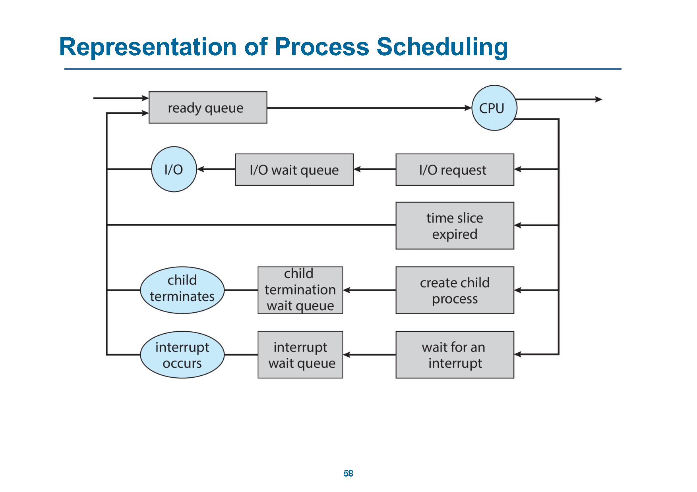

# 计算机系统 II · OS 第 4 讲：调度入门与 Linux 调度代码演进

> 来源：`../lec/11-24课程记录.md`（2026-11-24 课堂录音整理）。本次课没有配套的新讲义 PDF；能与幻灯片对上的内容，页码回指 `../lec/03-0_processes.pdf`。
> 整理日期：2026-11-24
> 说明：本文由 AI 依据课堂记录整理，供课后复习。课堂记录有口语重复和转写误差，本文只保留能与讲义、源码对应的部分；口述与幻灯片不一致处在文末标注。
> 页码说明：`(p.x)` 指 `03-0_processes.pdf` 的 **PDF 物理页码**，不是本次课新编的页码。
> 标注约定：`【课堂记录】` 表示 11-24 录音整理中的讲法；`【讲义】` 表示 `03-0_processes.pdf` 对应页的原文或直接提炼；`整理者注` 是整理时的串联；`待确认` 表示转写有歧义或讲义没讲清。

## 0. 本讲速览

| 小节 | 对应页 | 主题 | 一句话摘要 |
|---|---|---|---|
| §1 | — | 本讲定位 | 把“进程”收尾，再讲一遍调度背景，最后看 Linux 0.11 → 2.3.0 的调度代码。 |
| §2 | p.56–58 | 调度器与队列 | 调度器从 ready 进程里挑一个上 CPU；ready 通常一个队列，wait 每个等待对象一个，running 没有队列。 |
| §3 | p.56、p.73–74 | `schedule()` 做什么 | 它找的是“下一个处于 ready 状态的进程”，不是“下一条能执行的指令”。 |
| §4 | p.58、p.74 | 睡眠与等待队列 | `sleep_on` 改状态、挂 wait queue、调用 `schedule()`；2.3.0 的 `motor_wait` 是软盘马达等待队列。 |
| §5 | p.73 | Linux 0.11 | 没有链表、没有 ready / wait queue，固定 64 个 PCB，`schedule()` 直接遍历数组。 |
| §6 | p.74 | Linux 2.3.0 | 引入 `list_head` 和未命名 ready queue，固定 512 个 PCB，有具名 wait queue，`switch_to` 按架构定义。 |
| §7 | p.75–77 | 之后的演化 | 2.4 动态进程数 + 具名 `runqueue_head`；2.6 优先级数组；最新内核按调度类拆 runqueue。 |
| §8 | p.59–67 | 从调度看上下文切换 | 进程切换三次上下文切换，纯系统调用两次；切换是纯开销。 |
| §9 | — | 重点与易混点 | 分清调度对象、队列数量、`schedule()` 与 `switch_to`、进程调度与流水线调度。 |
| §10 | — | 课前自测 | 14 道题，按小节回查。 |

**本讲主线**：

1. **调度器只做一件事**：从 ready 进程里挑一个，让它上 CPU。它挑的是 PCB，不是某条指令。
2. **队列是 PCB 的容器**：ready queue 通常只有一个，wait queue 按等待对象拆成很多个，running 没有队列。
3. **`schedule()` 负责“选谁”，`switch_to` 负责“怎么切”**。前者是 C 代码、与架构无关；后者每个架构一份。
4. **数据结构跟着需求长**：0.11 用固定数组，2.3.0 用链表，2.4.0 才把 ready queue 命名，后面又加上优先级数组和调度类。

---

## 1. 这一讲在课程里的位置

【课堂记录】本次课的任务有两个：**把“进程”讲完**，以及**再讲一遍调度的背景**，最后看 Linux 从 0.11 开始，`task_struct`（PCB）和 `switch_to` 是怎么演化的。

前面已经讲过：

- 进程的概念；
- 进程控制块 PCB；
- 进程的五个状态；
- 调度第一遍（ready queue / wait queue 长什么样）。

| 主题 | 之前讲过 | 本次补充 | 落在哪 |
|---|---|---|---|
| 进程概念 | 进程 vs 程序、地址空间 | 进程是**资源分配与保护**的单位；线程是执行单元（预告） | [os-03 §1](os-03_第03讲_进程.md#1-进程是什么p316) |
| 栈 | 栈帧、栈增长方向 | SP 指栈顶、FP 指当前帧底；内核栈顶可由 `task_struct.stack` 加栈大小算出 | [os-03 §1.4](os-03_第03讲_进程.md#14-栈与栈帧p814)、[§10.6](os-03_第03讲_进程.md#106-内核栈与-task_struct-的布局p65) |
| PCB | `task_struct`、字段 | 队列里移动的是 PCB，靠链表指针在队列间迁移 | [os-03 §2](os-03_第03讲_进程.md#2-进程控制块-pcbp1719) |
| 五状态 | new / ready / running / waiting / terminated | ready 有队列、waiting 每个对象一个队列、running 没有队列 | [os-03 §3](os-03_第03讲_进程.md#3-进程状态p204555) |
| 上下文切换 | `cpu_switch_to`、`pt_regs` | 进程切换三次、纯系统调用两次；换入后从新进程的内核栈恢复 | [os-03 §10.10](os-03_第03讲_进程.md#1010-11-24-课堂补充三次切换与用户上下文的落点) |
| 调度 | 队列与迁移 | `schedule()` / `sleep_on` / `switch_to` 串起来 | 本篇 §2–§6 |
| 内核代码 | 0.11 → 最新内核的提纲 | 0.11 与 2.3.0 的细节、两版对照 | 本篇 §5–§7 |

【课堂记录】“调度第一遍”讲的是**队列长什么样**；这一次要回答两个问题：**谁从队列里挑**（`schedule()`），**挑完怎么把 CPU 交出去**（`switch_to`）。

> **整理者注**：进程概念、PCB、状态、`fork` / `exec`、上下文切换的细节在 `os-03`；本篇不重复，只讲调度这条线。两篇合起来才是 11-24 这次课的完整内容。

---

## 2. 调度器要解决什么问题（p.56–58）

### 2.1 调度的目标与队列

【讲义】p.56：

- 调度的目标是**最大化 CPU 使用率**，并让进程尽快切换到 CPU 核上；
- **进程调度器**（process scheduler）从 ready 进程中选择下一个在 CPU 核上执行的进程；
- 调度器维护一组**调度队列**（scheduling queues）：
  - **ready queue**：所有已经在主存里、准备好等待执行的进程；
  - **wait queue**：等待某个事件（例如 I/O）的进程；
  - 进程会在这些队列之间迁移。

### 2.2 三种状态与三种队列

【课堂记录】哪些状态需要队列，可以按“这个状态是不是可能同时有 N 个进程”来判断：

- **ready 有队列**，叫 **ready queue**。一般系统只有**一个** ready queue，所有 CPU 都从里面取进程；
- **waiting 有队列**，而且**每个被等待的对象都有自己的 waiting queue**：一块磁盘、一把锁、一个子进程，都可以各有一个队列；
- **running 没有队列**。每个 CPU 同一时刻只有一个进程在跑，寄存器只有一套，不需要排队。

【课堂记录】队列不是另造一套数据结构来装进程，而是把 **PCB 用链表串起来**。进程从一个队列移到另一个队列，改的是 PCB 里的链表指针（`list_head` 的 `next` / `prev`），PCB 本身不复制、不移动。

### 2.3 进程在队列之间怎么走

【课堂记录】三条最典型的迁移：

1. **时间片用完**：running → ready queue 的尾部，等下一次调度；
2. **发出 I/O 请求**：running → 那块设备的 I/O wait queue；I/O 完成后 → ready queue；
3. **等子进程退出**：父进程调用 `wait` 后，自己挂到**子进程的等待队列**；子进程退出后，父进程被唤醒，回到 ready queue。

【课堂记录】还有一个容易忽略的点：**离开 running 不一定是因为时间片到期**。进程主动让出 CPU（例如调用 `sleep_on`、等锁）也会离开 running，只是去的是 wait queue 而不是 ready queue。

> **整理者注**：p.58 的图把“创建子进程”也画成进入 child termination wait queue，指的是父进程等子进程结束的那条路径；子进程自己创建后是进 ready queue。看图时注意箭头起点是父进程还是子进程。

---

## 3. `schedule()`：选下一个 ready 进程

### 3.1 `schedule()` 找的是什么

【课堂记录】`schedule()` 的效果：

- 当前进程要 sleep 或时间片用完，让出 CPU；
- 在 ready 进程里找一个，做上下文切换，把 CPU 给它。

老师特别强调：**不是找“下一条能跑的指令”，而是找“下一个处于 ready 状态的进程”**。指令流是进程内部的事；调度器看的是进程状态和 PCB。

【课堂记录】同一个 `schedule()`，在不同版本里“怎么找”不一样：

- Linux 0.11：没有 ready queue，直接**从 PCB 数组尾部往前遍历**，找到可运行的就切过去；
- Linux 2.3.0：ready queue 是双向链表，**沿着 list 走**，挑下一个。

### 3.2 `schedule()` 与 `switch_to` 的分工

| 角色 | 职责 | 是否与架构相关 |
|---|---|---|
| `schedule()` | 选出下一个进程、处理状态与队列、调用切换 | 否，C 代码 |
| `switch_to()` / `cpu_switch_to()` | 保存旧进程寄存器、恢复新进程寄存器、换栈、换 PC | 是，每个架构一份 |

【课堂记录】`switch_to` 的名字从 0.11 一直沿用到现在；但它的**定义每个硬件架构一份**：x86、ARM、RISC-V 的寄存器名字和指令都不一样，所以不能共用一份汇编。

> **整理者注**：把调度拆成“策略”和“机制”两层更好记：**选谁**是策略（后面讲的 CFS、实时调度等），**怎么切**是机制（`switch_to`）。本讲只讲到机制；`os-03` §9 讲的队列是机制的容器。

---

## 4. 睡眠与唤醒：`sleep_on` 与 wait queue（p.58、p.74）

### 4.1 `sleep_on` 做三件事

【课堂记录】进程等一个事件时，用 `sleep_on` 把自己挂到对应的等待队列上。它做三件事：

1. 把当前进程的状态改成 `TASK_INTERRUPTIBLE`（或 waiting）；
2. 把进程加到 waiting queue 的**头部或尾部**；
3. 调用 `schedule()`，让出 CPU。

`schedule()` 接着从 ready queue 里挑别的进程；等事件完成，当前进程被唤醒，从 wait queue 摘下，回到 ready queue（迁移路径见 §2.3 的 p.58 图）。

> **待确认**：课堂记录写的是 `TASK_INTERRUPTIBLE`。Linux 2.3 的 `sleep_on()` 实际把状态设成 `TASK_UNINTERRUPTIBLE`，`interruptible_sleep_on()` 才用 `TASK_INTERRUPTIBLE`；课堂说的可能是后者，或只是笼统地说“进入等待”。读源码时按具体函数区分。

### 4.2 `motor_wait`：一个具体的等待队列

【讲义】p.74：Linux 2.3.0 有**具名的 wait queue**，例如软盘的 `motor_wait`；`sleep_on` 把当前进程加到 `motor_wait` 的等待队列。

【课堂记录】老师顺手科普了软盘：硬盘之前是软盘，盘片很软，插入电脑后要靠马达转起来才能读；`motor_wait` 就是**等软盘马达转起来**的等待队列。今天可以把它类比成等硬盘或 SSD 就绪。

【课堂记录】这个例子说明 wait queue 是**按等待对象**拆的：不是全系统一个“等待队列”，而是每个设备、每把锁、每个子进程各有一个。ready queue 通常只有一个，wait queue 可以有很多个。

> **整理者注**：本节只讲 `sleep_on` 的挂入；从 wait queue 唤醒回 ready queue 的完整路径，本讲没有展开，`os-03` §9.3 的迁移图给了入口。

---

## 5. Linux 0.11：没有队列的调度器（p.73）

【讲义】p.73 的要点：

- `linux-0.11/include/linux/sched.h`：`task_struct` 定义、`switch_to()` 定义；
- `linux-0.11/kernel/sched.c`：`schedule()`；
- **没有 list 概念**；
- **固定 PCB 表，最多 64 个**；
- **没有 ready queue**：直接遍历 PCB 表挑下一个；
- **没有 wait queue**：用一个固定数组。

【课堂记录】0.11 的具体做法：

- `task_struct` 定义在 `include/linux/sched.h`，只有**二三十行**；
- 最大进程数固定：**`NR_TASKS = 64`**；
- 所有 PCB 放在一个固定数组 `task[64]` 里，数组元素是**指针**；
- 没有 `list_head`，没有 ready queue、waiting queue；
- 选下一个 ready 进程：**遍历这个 64 元素数组**；
- 找 sleep 的进程：**也是遍历数组**；
- `schedule()` **从数组尾部往前遍历**，找到可运行进程，最后靠 `switch_to` 做上下文切换；
- `switch_to` 定义在头文件里，是一个**宏**，用内联汇编换寄存器，写起来像一个 C 函数。

> **整理者注**：0.11 的“队列”其实是数组下标隐含的顺序。进程上限只有 64，遍历一遍很便宜；进程一多、等待对象一多，这种“全表扫描”就不够用了，这正是 2.3.0 引入链表和具名等待队列的动机。

> **待确认**：`task_struct` “二三十行”、`schedule()` “从数组尾部往前遍历”都是课堂口径；具体行数与遍历方向以 Linux 0.11 源码为准，不同转载版本的排版也会影响行数。

---

## 6. Linux 2.3.0：链表与具名等待队列（p.74）

【讲义】p.74：

- `include/linux/sched.h`：
  - `task_struct` 定义；
  - 引入 list，有**未命名的 ready queue**；
  - 用 `task_struct->prev_run`、`task_struct->next_run` 连接；
- `kernel/sched.c`：
  - 固定 PCB 表，最多 **512** 个；
  - `struct task_struct *task[NR_TASKS] = {&init_task, };`
  - `schedule()` **沿着 list 走**，挑下一个；
- `include/asm-i386/system.h`：`switch_to()` 定义；
- 有**具名的 wait queue**，例如软盘的 `motor_wait`；`sleep_on` 把当前进程加到 `motor_wait` 的等待队列。

【课堂记录】2.3.0 相对 0.11 的变化：

- 有了 **`list_head`** 概念，队列用双向链表维护；
- 还有一个**未命名的 ready queue**，靠 `prev_run` / `next_run` 把 `task_struct` 串起来；
- 仍有**固定 PCB 表**，但上限从 64 变成 **512**；
- 有 `schedule()` 函数，`switch_to` 的名字沿用至今；
- `switch_to` **每个硬件架构一个**：x86 放在 `include/asm-i386/system.h`，ARM、RISC-V 各有一份；
- 有**具名的 waiting queue**，如 `motor_wait`；
- `task_struct` 不到 100 行（放在一个约一千多行的上下文里）。

### 6.1 0.11 与 2.3.0 对照

| 项目 | Linux 0.11（1991） | Linux 2.3.0（1999） |
|---|---|---|
| PCB 组织 | 固定数组 `task[64]`，元素是指针 | 固定数组 `task[512]`，元素是指针 |
| 链表 | 没有 | 有 `list_head`，用 `prev_run` / `next_run` 串 |
| ready queue | 没有，遍历数组 | 有，未命名的 list |
| wait queue | 没有，固定数组 | 有，具名（如 `motor_wait`） |
| 选下一个 | `schedule()` 遍历数组 | `schedule()` 遍历 list |
| `switch_to` | `include/linux/sched.h` 里的宏 | `include/asm-i386/system.h`，按架构定义 |

> **整理者注**：注意版本顺序：**2.3.0 的 ready queue 还没有名字**，到 2.4.0 才有 `runqueue_head`（`os-03` §12.3）。别把 2.3 的 `prev_run` / `next_run` 和 2.4 的 `run_list` 混在一起。

> **待确认**：`task_struct` “不到 100 行”是课堂口径，实际行数随版本和排版变化，不必当成固定数字背。

---

## 7. 之后的演化（p.75–77，提纲）

这一节在 `os-03` §12.3–§12.5 已经按讲义页整理过，这里只留调度线的提纲，细节看那一篇。

| 版本 | PCB 数量 | ready queue | 选择方式 |
|---|---|---|---|
| 0.11 | 固定 64 | 无 | 遍历 PCB 数组 |
| 2.3.0 | 固定 512 | 未命名 list（`prev_run` / `next_run`） | 遍历 list |
| 2.4.0 | 动态 | 具名 `runqueue_head`（list，`task_struct->run_list`） | 遍历 list |
| 2.6.0 | 动态 | `struct runqueue` | 优先级数组（priority array） |
| 最新内核 | 动态 | 按调度类拆分（`rt_sched_class`、`cfs_sched_class` 等） | list / array / tree（红黑树） |

【课堂记录】这条演化线的逻辑是：进程少时固定数组就够；进程多了要动态分配；要按优先级选，就加优先级数组；要同时支持多种调度策略，就把 runqueue 按调度类拆开。

> **整理者注**：表格中标“2.3.0 / 2.4.0 / 2.6.0”的是讲义给的版本号，不是“每一版只改了这一处”。真实内核的调度器在这些版本之间还有很多别的变化，考试按讲义的大框架答即可。

---

## 8. 从调度看上下文切换（p.59–67）

【课堂记录】调度决定“谁上 CPU”，真正把 CPU 交出去的是**上下文切换**。这两件事经常被混为一谈：

- `schedule()` 选出 `next`；
- `switch_to(prev, next)` 保存 `prev` 的内核上下文、恢复 `next` 的内核上下文；
- 返回用户态时，还要恢复 `next` 的用户上下文。

### 8.1 一次进程切换要算几次

| 场景 | 用户态 → 内核态 | `cpu_switch_to` | 内核态 → 用户态 | 合计 |
|---|---|---|---|---|
| 纯系统调用，不换进程 | 保存 P0 的 user context | 不发生 | 恢复 P0 的 user context | **2 次** |
| 进程切换 P0 → P1 | 保存 P0 的 user context | 保存 P0、恢复 P1 的 kernel context | 恢复 **P1** 的 user context | **3 次** |

【课堂记录】这里最容易错的是第三步：P0 的用户上下文存在 **P0 的内核栈**，但 `cpu_switch_to` 之后已经在跑 P1 的内核代码，用的是 **P1 的内核栈**。返回用户态时必须从 **P1 的内核栈**取 `pt_regs`；拿 P0 的栈去恢复，P1 就会带着 P0 的 SP / PC 回用户态，通常直接 segment fault。

【课堂记录】老师说，面试问“发生了几次上下文切换”，只答一次的人忘了 user / kernel 这一层；能答三次并说清每一步存到哪里，才算把内核看懂了。

> 细节（`pt_regs`、`cpu_context`、P1 的用户上下文是什么时候保存的、`kernel_entry` 的 bug 故事）见 [os-03 §10.10](os-03_第03讲_进程.md#1010-11-24-课堂补充三次切换与用户上下文的落点)。

### 8.2 为什么切换是纯开销

【课堂记录】保存和恢复寄存器、换栈、换 PC 的过程中，P0 没有往前执行，P1 也没有往前执行，系统没有做任何 useful work。CPU 每秒可能切换几百到几万次，所以调度器要尽量避免无意义的切换（例如刚睡下就唤醒、锁竞争时频繁让出）。

> **整理者注**：本讲只算 CPU 上下文（寄存器、栈、PC）。完整切换还可能涉及页表、TLB、cache，属于内存管理的内容。

---

## 9. 听课重点与易混点

1. **调度对象是进程，不是指令**：`schedule()` 选的是下一个 ready 进程（PCB），不是“下一条能执行的指令”。
2. **ready 一个、wait 多个、running 没有**：ready queue 通常全系统一个，所有 CPU 共用；wait queue 按等待对象拆；running 每个 CPU 只有一个。
3. **`schedule()` 与 `switch_to` 分工**：前者选谁（C、与架构无关），后者怎么切（汇编、每架构一份）。
4. **0.11 没有队列**：固定 64 个 PCB 数组，没有 `list_head`，`schedule()` 直接遍历数组。
5. **2.3.0 才有链表**：`list_head` + `prev_run` / `next_run`，PCB 上限 512，有具名 `motor_wait`。
6. **2.3 的 ready queue 还没名字**：2.4.0 才有 `runqueue_head` 和 `task_struct->run_list`。
7. **`switch_to` 每架构一份**：x86、ARM、RISC-V 的寄存器和指令不同，不能共用。
8. **`sleep_on` 三步**：改状态 → 挂 wait queue → 调 `schedule()`。
9. **`motor_wait` 是软盘马达等待队列**：不是“马达进程”，也不是现代内核里还存在的队列名。
10. **进程切换三次、纯系统调用两次**：第三次是恢复新进程的 user context，位置在新进程的内核栈。
11. **别和流水线调度混**：`hardware-05` 讲的是指令级 / 流水线调度（预约表、冲突向量、多发射），本篇讲的是进程调度。
12. **上下文切换是纯开销**：调度器优化的一个方向就是减少不必要的切换。

---

## 10. 课前自测

| # | 问题 | 回查 |
|---|---|---|
| 1 | 调度器从哪个队列挑进程？running 为什么不需要队列？ | [§2.2 三种状态与三种队列](#22-三种状态与三种队列) |
| 2 | ready queue 和 wait queue 在数量上是什么关系？为什么？ | [§2.2 三种状态与三种队列](#22-三种状态与三种队列) |
| 3 | 时间片用完、发 I/O、等子进程，分别把进程送到哪个队列？ | [§2.3 进程在队列之间怎么走](#23-进程在队列之间怎么走) |
| 4 | `schedule()` 找的是“下一条指令”还是“下一个 ready 进程”？ | [§3.1 `schedule()` 找的是什么](#31-schedule-找的是什么) |
| 5 | `schedule()` 和 `switch_to` 各负责什么？哪个与架构相关？ | [§3.2 `schedule()` 与 `switch_to` 的分工](#32-schedule-与-switch_to-的分工) |
| 6 | Linux 0.11 用什么数据结构管理 PCB？上限多少？ | [§5 Linux 0.11](#5-linux-011没有队列的调度器p73) |
| 7 | 0.11 没有 ready queue，`schedule()` 怎么选下一个？ | [§5 Linux 0.11](#5-linux-011没有队列的调度器p73) |
| 8 | 2.3.0 引入了什么？ready queue 用哪两个字段串起来？ | [§6 Linux 2.3.0](#6-linux-230链表与具名等待队列p74) |
| 9 | 2.3.0 的 PCB 上限是多少？`switch_to` 定义在哪？ | [§6 Linux 2.3.0](#6-linux-230链表与具名等待队列p74) |
| 10 | `sleep_on` 做哪三件事？ | [§4.1 `sleep_on` 做三件事](#41-sleep_on-做三件事) |
| 11 | `motor_wait` 是什么？为什么它要单独有一个队列？ | [§4.2 `motor_wait`](#42-motor_wait一个具体的等待队列) |
| 12 | 一次进程切换发生几次上下文切换？纯系统调用呢？ | [§8.1 一次进程切换要算几次](#81-一次进程切换要算几次) |
| 13 | 换入 P1 后，user context 从哪个栈恢复？从 P0 的栈恢复会怎样？ | [§8.1 一次进程切换要算几次](#81-一次进程切换要算几次) |
| 14 | 2.4.0、2.6.0 和最新内核的 runqueue 各用什么实现？ | [§7 之后的演化](#7-之后的演化p7577提纲) |

---

## 11. 关联知识点

- **进程本身**：进程概念、PCB、五状态、`fork` / `exec`、信号、zombie / orphan，见 [os-03 第 3 讲](os-03_第03讲_进程.md)。本篇 §1 的表格就是两张笔记的接口。
- **队列与迁移**：ready queue / wait queue 的链表图与迁移图在 [os-03 §9](os-03_第03讲_进程.md#9-进程调度与队列p5658)；本篇 §2 只讲调度视角。
- **上下文切换**：`cpu_switch_to` 的汇编、两个 PC / 两个 SP、`pt_regs` 与 `cpu_context` 的区别在 [os-03 §10](os-03_第03讲_进程.md#10-上下文切换p5967)；三次切换的补充在 [§10.10](os-03_第03讲_进程.md#1010-11-24-课堂补充三次切换与用户上下文的落点)。
- **`fork` 的两个返回值**：父进程 `pt_regs` 的 x0 写子 PID、子进程清零，见 [os-03 §11](os-03_第03讲_进程.md#11-fork-为什么能返回两个值p6872)；`exec` 改用户态 PC 的补充在 [os-03 §5.3](os-03_第03讲_进程.md#53-exec-的关键性质)。
- **Linux 调度代码的讲义版**：0.11 → 最新内核的页码对照与表格在 [os-03 §12](os-03_第03讲_进程.md#12-linux-调度代码的演进p7377)；本篇 §5–§7 是课堂补充版。
- **OS 总览**：OS 的服务、用户态 / 内核态、系统调用与中断，见 [os-01 第 1 讲](os-01_第01讲_操作系统概述.md) 与 [os-02 第 2 讲](os-02_第02讲_OS结构与链接加载.md)。
- **别混淆的“调度”**：流水线的非线性调度、多发射与指令调度在 [hardware-05 第 5 讲](hardware-05_第05讲_非线性流水线调度与多发射.md)；那里调度的是指令，这里调度的是进程。

---

## 12. 来源、页码对照与待确认

**来源**：

- `../lec/11-24课程记录.md`（2026-11-24 课堂录音整理，本讲的主要依据）；
- `../lec/03-0_processes.pdf`（本次课没有新 PDF，调度与内核代码的幻灯片页码回指这一份）。

**页码对照**：

- p.56：调度的目标、ready / wait queue 的定义；
- p.57：ready queue 与 wait queue 的 `list_head` 图；
- p.58：进程在 ready / I/O / child / interrupt 队列之间迁移；
- p.59–60：CPU 切换时间线、上下文切换的定义与开销；
- p.61–67：`cpu_switch_to`、内核栈、`pt_regs`、user / kernel context；
- p.73：Linux 0.11 的 `task_struct` / `switch_to` / `schedule()`，无 list、固定 64；
- p.74：Linux 2.3.0 的 list、未命名 ready queue、固定 512、`motor_wait`；
- p.75：Linux 2.4.0 的动态 PCB 与 `runqueue_head`；
- p.76：Linux 2.6.0 的 `struct runqueue` 与优先级数组；
- p.77：最新内核按调度类拆 runqueue。

**待确认**：

1. **没有本次课的新讲义 PDF**：本讲依据课堂录音整理，页码是按内容对回 `03-0_processes.pdf` 的，讲课顺序可能与 PDF 页序不完全一致。
2. **“两次”还是“三次”**：课堂记录在同一节里先写“进程切换发生两次上下文切换”，后面又按三次计算。本篇按“进程切换三次、纯系统调用两次”整理；两种口径的差别见 §8.1 与 `os-03` §10.10 的待确认。
3. **`sleep_on` 的状态**：课堂说 `TASK_INTERRUPTIBLE`；Linux 2.3 的 `sleep_on()` 实际用 `TASK_UNINTERRUPTIBLE`，`interruptible_sleep_on()` 才用 `TASK_INTERRUPTIBLE`。正文按课堂记录写，读源码时按具体函数区分。
4. **0.11 的 `task_struct` 行数**：“二三十行”是课堂口径，实际行数随版本与排版变化。
5. **0.11 的遍历方向**：“`schedule()` 从数组尾部往前遍历”是课堂口径，具体以 Linux 0.11 源码为准。
6. **2.3.0 的 `task_struct` 行数**：“不到 100 行”同样是课堂口径，不必当固定数字背。
7. **`motor_wait` 的适用范围**：它是 2.3.0 里软盘马达的等待队列，现代内核没有同名队列；不要把旧字段当成现在还在。
8. **课堂作业**：老师要求学生课后看 Linux 0.11 / 2.3 的源码，参考 Linux Cross Reference（LXR）。本次课没有布置书面作业。
9. **讲义页 p.77 的“7.4”**：`os-03` 已把它标为疑点（现实中没有这个主线版本），本篇按“最新内核”理解。
