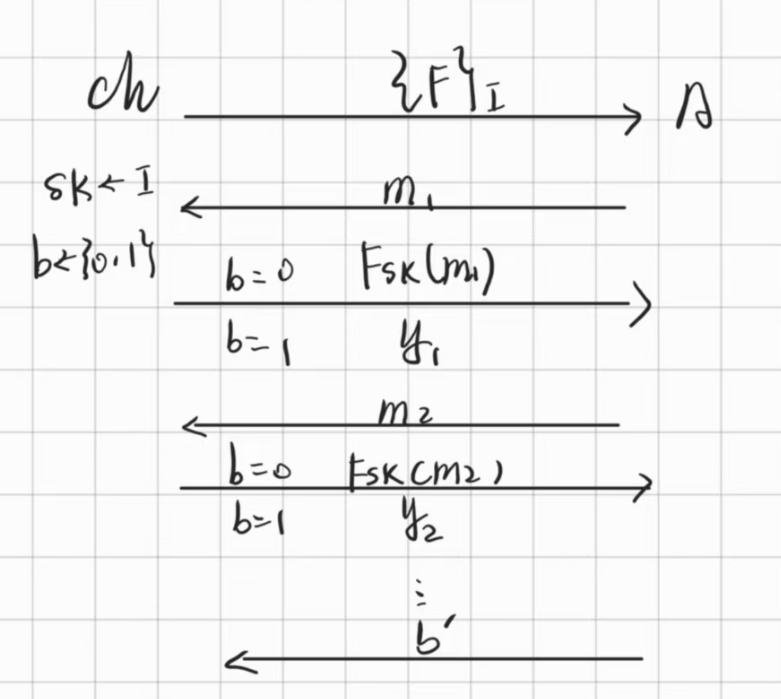
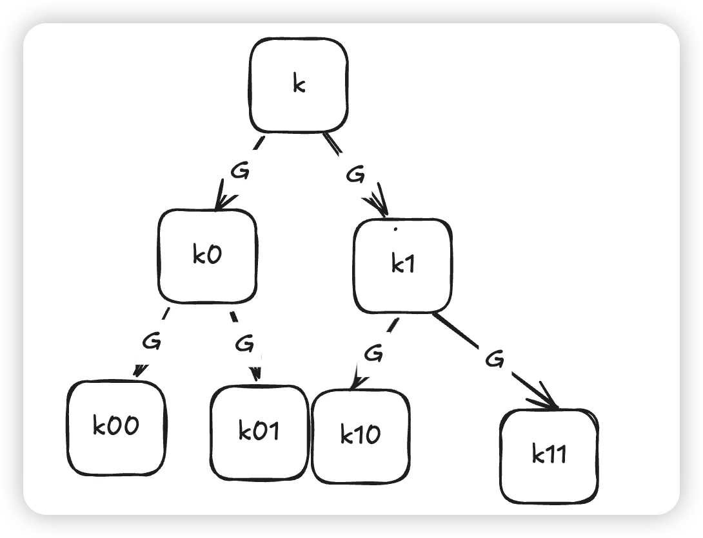
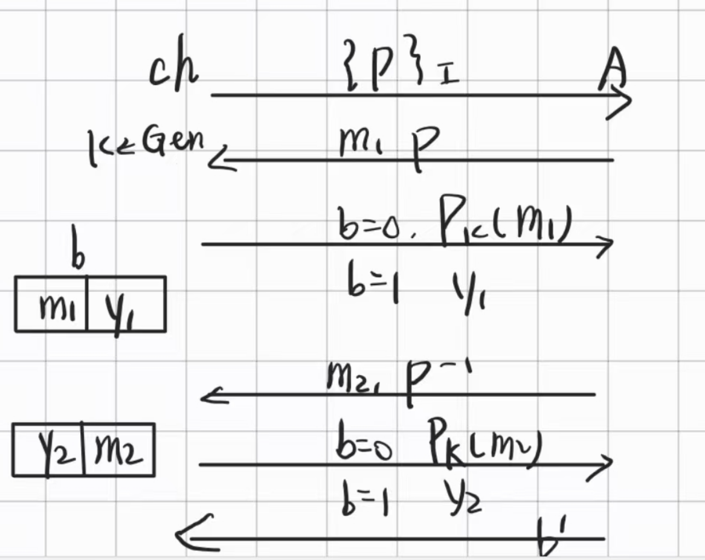
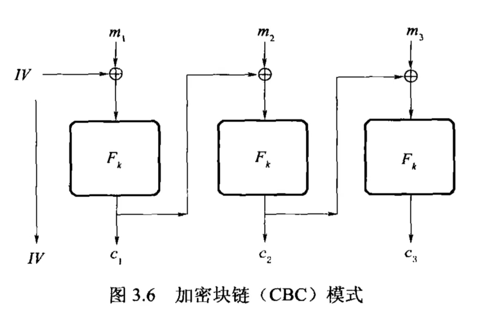

# 密码学基础 · 05：伪随机函数与伪随机置换（PRFs, PRPs & Modes of Operation）

> 来源：2026-11-02 课堂记录（PRF 定义、PRF ⇒ PRG、PRF ⇒ IND-CPA 的加密构造与归约）；PRP、CBC/OFB/CTR 等来自早期资料与教材 §3.6.3–§3.6.4。
> 整理日期：2026-11-02（PRF 部分按 11-02 课堂记录重写；PRP 与工作模式沿用旧稿）
> 说明：PRF 部分以 11-02 课堂记录为准。课堂没有展开的 GGM、PRP 与工作模式，均标为教材补充或旧稿内容，不混作本次课原文。
> 教材对照：Katz & Lindell（2007 年第 1 版）**§3.6.1** Pseudorandom Functions（Definition 3.24）、**§3.6.2** CPA-Secure Encryption Schemes from Pseudorandom Functions（Construction 3.25 / Theorem 3.26）、**§3.6.3** Pseudorandom Permutations and Block Ciphers（Definition 3.28 / Proposition 3.29）、**§3.6.4** Modes of Operation（ECB / CBC / OFB / CTR）、**§6.5** Constructions of Pseudorandom Functions（GGM）、**§6.6** Constructions of Pseudorandom Permutations（Feistel）。

## 0. 本节速览

| 小节 | 主题 | 一句话摘要 |
|---|---|---|
| §1 | 为什么要 PRF | 真随机函数太多（$\lvert\mathcal{F}\rvert=(2^n)^{2^n}$），随机取样代价太大 ⇒ 用**密钥索引**的函数族冒充。 |
| §2 | PRF 的定义 | 函数族公开、密钥 $sk$ 保密；攻击者只能黑盒询问，无法区分 $F_{sk}$ 与随机函数。 |
| §3 | PRF ⇒ IND-CPA（构造） | 密文 $c=(r,F_{sk}(r)\oplus m)$，每条消息重新取 $r$。 |
| §4 | PRF ⇒ IND-CPA（归约） | 归约器用外部 PRF oracle 模拟 CPA 游戏，内部选 $d$，按 $\mathcal{A}$ 是否猜对反推 PRF 分支。 |
| §5 | PRG ⇒ PRF | 11-02 课堂只作预告，未展开构造；GGM 树作为教材补充保留。 |
| §6 | PRF ⇒ PRG | 固定多个互不相同的输入，把函数值拼接起来，想要多长取多长。 |
| §7 | PRP 的定义 | 置换族（可逆）；游戏里 $\mathcal{A}$ 既可问 $P$ 也可问 $P^{-1}$，正反两个方向都要不可区分。 |
| §8 | 模式（modes） | 由 $(r,F_{sk}(r)\oplus m)$ 链式化得到 CBC 式构造；一般化需要 PRP：$\mathrm{CBC}/\mathrm{OFB}/\mathrm{CTR}$。 |

---

## 1. 为什么要 PRF：真随机函数太贵

- 记 $\mathcal{F}=F\bigl(\{0,1\}^{n},\{0,1\}^{n}\bigr)$（把 $n$ 位映到 $n$ 位的**所有**函数），则

$$|\mathcal{F}|=(2^{n})^{2^{n}}$$

- 资料的动机说明：**我们希望能随便选取一个 $F_I$**（从所有函数里均匀挑一个），**但显然这个随机生成的代价太大**（要描述一个真随机函数需要指数级的“表”），于是引入 **PRFs**：用**短密钥 $sk$ 索引一个函数 $F_{sk}$**，让它在 PPT 眼里“像”随机函数。

## 2. PRFs 的定义

PRF 要解决的是“怎样用短密钥冒充一个随机函数”。做法不是把某个随机函数压缩成短代码，而是准备一个公开的函数族，用密钥挑其中一个成员；攻击者只能在黑盒里问输入输出，看不到密钥，也读不到具体成员。

> **定义（11-02 课堂口径；教材 Definition 3.24）**：设 $\mathcal{F}=\{F_{sk}\}$ 是高效、长度保持的带密钥函数族，$sk\in\{0,1\}^n$。称 $\mathcal{F}$ 是伪随机函数，若对每个 PPT 区分器 $\mathcal{A}$，都有
> $$
> \left|\Pr\bigl[\mathcal{A}^{F_{sk}(\cdot)}(1^n)=1\bigr]-\Pr\bigl[\mathcal{A}^{f_n(\cdot)}(1^n)=1\bigr]\right|\le\mathrm{negl}(n),
> $$
> 其中 $sk\leftarrow\{0,1\}^n$，$f_n$ 从所有 $\{0,1\}^n\to\{0,1\}^n$ 的函数中均匀随机选取。

游戏按下面的顺序进行：

1. 挑战者把整个函数族 $\mathcal{F}$ 和求值算法公开给 $\mathcal{A}$；
2. 挑战者私下均匀选一个 $sk$，并投一个比特 $b$；
3. 若 $b=0$，之后对输入 $x$ 回答 $F_{sk}(x)$；若 $b=1$，回答一个均匀随机函数 $f_n(x)$ 的值；
4. $\mathcal{A}$ 可自适应地询问任意多个输入，同一输入重复询问必须得到同一答案；
5. $\mathcal{A}$ 输出 $b'$，其优势为 $\left|\Pr[b'=b]-\frac12\right|$。

这里有两件事必须分清：

- **公开的是函数族**：攻击者知道 $F$ 怎么算、所有可能的函数长什么样；
- **保密的是下标**：$sk$ 决定实际用哪一个成员，攻击者不知道它，也无法从 oracle 回答中直接读出来。

PRF 的输入不需要服从某种分布。只要攻击者没有重复问过某个点，理想随机函数在该点的取值就与已问过的值独立。这也是它能支持“同一密钥下多次加密”的原因。

### 2.1 为什么不能“随机抽一个函数”：函数族有多大

- 定义函数族 $\mathrm{Func}_n=\{\,F_1(),F_2(),\dots,F_t()\,\}$，每个 $F_i()$ 是 $\{0,1\}^n\to\{0,1\}^n$ 的映射。
- 最“朴素”的加密想法：加密时**从函数族里均匀随机抽一个函数**。但把函数**想成一张表**：定义域大小 $2^n$ ⇒ 表有 $2^n$ 行、每行 $n$ 位 ⇒ 一个函数就是一个 $n\cdot 2^n$ 位的串。于是

$$\mathrm{size}\bigl(\mathrm{Func}_n(\cdot)\bigr)=t=2^{\,n\cdot 2^{n}},\qquad \mathrm{size}(sk)=\log t=n\cdot 2^{n}$$

- 这个 size 是**指数级**的，**不“有效”**，所以随机均匀选取不现实 ⇒ 必须用**伪随机**重新定义 PRF。
- 课程笔记对 PRF 目标的表述：**没有多项式时间的敌手能够区分 $F_{sk}()$ 与 $f$**——其中前者的 $sk$ 从 $\{0,1\}^n$ 中随机均匀选取，后者的 $f$ 从函数族中随机均匀选取。

> 这与 [§1](#1-为什么要-prf真随机函数太贵) 的 $|\mathcal{F}|=(2^n)^{2^n}$ 是同一个量的两种写法：$2^{n\cdot2^n}=(2^n)^{2^n}$。
> 截图里的 $b$ 标号只影响记法，不影响定义。关键是攻击者拿到的是函数族描述和 oracle，拿不到具体密钥。

### 2.2 PRF 与 PRG 的对照

| 项目 | PRF | PRG |
|---|---|---|
| 对象 | 公开的函数族 $\mathcal{F}=\{F_{sk}\}$ | 固定算法 $G$ |
| 秘密 | 具体下标 $sk$ | 种子 $x$ |
| 公开信息 | 函数族描述、求值算法 | 算法本身 |
| 长度关系 | 不要求扩张，输入输出可以等长 | 必须扩张，输出比输入长 |
| 攻击者能力 | 可自适应地黑盒询问很多输入 | 拿到输出样本，猜它来自 $G$ 还是均匀分布 |
| 要防的事 | 不能从输入输出行为看出用了哪个成员 | 不能从输出看出种子或区分伪随机串 |

两者都不允许攻击者看到秘密：PRF 要藏 $sk$，PRG 要藏种子 $x$。差别在于 PRF 提供的是一个可查询的函数，PRG 只给一段输出。

## 3. PRF ⇒ IND-CPA：用伪随机函数构造加密方案

构造直接来自 11-02 课堂：

$$\mathrm{Gen}(1^{n})\to sk\leftarrow\{0,1\}^n,$$

$$\mathrm{Enc}_{sk}(m):\quad r\leftarrow\{0,1\}^n,\quad c:=\langle r,\ F_{sk}(r)\oplus m\rangle,$$

$$\mathrm{Dec}_{sk}(\langle r,s\rangle):=F_{sk}(r)\oplus s.$$

每条消息重新取一个 $r$，所以同一明文两次加密一般会得到不同的 $F_{sk}(r)$，密文也随之不同。这里的 $r$ 相当于“一次性索引”：它不需要作为密钥保存，但必须不可预测，并且本次加密使用的值不能重复。课堂强调归约主要用到“无碰撞”条件；实现上仍应每次均匀随机抽取，否则攻击者可能提前问出同一个 $F_{sk}(r)$，把一次性 pad 抵消掉。归约中的碰撞概率约为 $O(Q^2/2^n)$，按可忽略的失败事件处理。

正确性为

$$\mathrm{Dec}_{sk}(\mathrm{Enc}_{sk}(m))
=F_{sk}(r)\oplus\bigl(F_{sk}(r)\oplus m\bigr)=m.$$

这就是教材 Construction 3.25；Theorem 3.26 证明：若 $F$ 是 PRF，则该方案 IND-CPA 安全。注意 $r$ 要放在密文里，解密方才能重新算出 $F_{sk}(r)$。这里先限与 PRF 输出等长的单块消息；变长消息要用后面的工作模式。

## 4. PRF ⇒ IND-CPA：归约的细节

**要证的事**：若存在 PPT 攻击者 $\mathcal{A}$ 能以不可忽略优势 $\varepsilon$ 攻破上述加密方案，就能构造 PPT 归约器 $B$，以约 $\varepsilon/2$ 的优势区分 PRF 与真正的随机函数。

| 项目 | 内容 |
|---|---|
| 外部游戏 | $B$ 参加 PRF 游戏，收到公开的函数族描述和一个函数 oracle |
| 内部游戏 | $B$ 扮演 IND-CPA 挑战者，与 $\mathcal{A}$ 交互 |
| $B$ 的输入 | 函数族、oracle；**没有** $sk$ |
| $B$ 的输出 | 若 $\mathcal{A}$ 猜对内部比特 $d$，输出 0（认为外部是 PRF）；否则输出 1（认为外部是随机函数） |
| 模拟一致性 | 外部是 PRF 时，$\mathcal{A}$ 看到的正是真实 IND-CPA 游戏 |
| 概率损失 | $\varepsilon\to\varepsilon/2$；另有 $O(Q^2/2^n)$ 的碰撞失败概率 |

具体流程：

1. $B$ 先把公开参数和加密算法交给 $\mathcal{A}$，自己选一个内部比特 $d\leftarrow\{0,1\}$。
2. $\mathcal{A}$ 在 Phase 1 询问明文 $m$ 的密文时，$B$ 取一个新的 $r$，向外部 oracle 询问 $F(r)$，返回 $(r,F(r)\oplus m)$。
3. 挑战阶段，$\mathcal{A}$ 给出等长消息 $m_0,m_1$。$B$ 取新的 $r^*$，向 oracle 询问 $F(r^*)$，返回 $(r^*,F(r^*)\oplus m_d)$。
4. Phase 2 的加密询问照第 2 步处理。
5. $\mathcal{A}$ 输出 $d'$。若 $d'=d$，$B$ 猜外部是 PRF；若 $d'\ne d$，$B$ 猜外部是随机函数。

概率分析：

- **外部是 PRF 时**：$\mathcal{A}$ 看到的就是真实方案，猜对 $d$ 的概率是 $1/2+\varepsilon/2$（若优势落在不利方向，把 $B$ 的最后输出翻转即可）。因此 $B$ 猜对 PRF 的概率也是 $1/2+\varepsilon/2$。
- **外部是随机函数时**：对不同且未重复的 $r$，$F(r)$ 是独立均匀的随机值，密文相当于一次一密；$\mathcal{A}$ 无论怎样都无法从密文看出 $d$，猜对概率恰好是 $1/2$。因此 $B$ 猜对“随机函数”的概率也是 $1/2$。
- 两分支相差 $\varepsilon/2$。若 $\varepsilon$ 不可忽略，$B$ 就以不可忽略优势攻破 PRF，矛盾。

**懒惰采样**：模拟随机函数不必真的写出整张表。挑战者维护一张查询表；输入第一次出现时均匀取一个值并记下来，之后再问同一输入就返回旧值。这样得到的分布与“一开始就选好一个完整随机函数”完全一致。

**碰撞**：若 $r_i=r_j$（包括与 $r^*$ 相同），随机函数分支中两个密文会共用同一个 pad，归约的独立性论证就失效。对 $Q$ 次询问，碰撞概率约为 $O(Q^2/2^n)$，可忽略；归约遇到碰撞可以直接认输，这不影响“不可忽略优势推出矛盾”的结论。

## 5. PRG ⇒ PRFs：GGM 树与 hybrid argument

> 11-02 课堂只预告“下节课如何从 PRG 构造 PRF”，没有展开 GGM。下面的 GGM 树与 hybrid 讨论来自教材 §6.5 和早期整理，保留作预习，不是本次课原文。

资料（小标题 “PRG 2 PRFs”）：“**还是 hybrid argument**”，并给出两张说明：

- “相当于你需要从 $[0,2^{n})$ 全 0 → $[0,2^{n})$ 全 1”；
- 游戏序列：$\mathrm{Game}_0$ 用 $G$；$\mathrm{Game}_1$ “层 1 反”；$\mathrm{Game}_1$ “层 1,2 反”；……

资料自己指出的一处**技术问题**：

> “这里一个问题是 $\mathrm{Game}_{n-1}$ 这个间隔有 $2^{n-1}$（个点/条路径），**是不能用 hybrid argument**；显然我们是求解具体一个 $O(q)$ 的发问，因此**完善这部分即可**。”

也就是说：完整版（真正的随机函数）与“逐层替换 GGM 树”的中间游戏之间，在**整个树**上差了指数多的不一致点；但因为 $\mathcal{A}$ 只会问 $O(q)$ 个点（$q=\mathrm{poly}$），只需**针对被问到的那 $O(q)$ 条路径**做混合论证，就能把差距压回多项式级别。

> 待确认：资料的 “层 1 反 / 层 1,2 反” 与 “[0,2^n) 全 0 → 全 1” 两种说法都是**示意性**的（前者指 GGM 树的层、后者指函数取值表），未给出严格的 hybrid 序列。教材 §6.5（Constructing Pseudorandom Functions）是这部分的正规出处。

## 6. PRF ⇒ PRG

PRF 本身不要求长度扩张，但把多个不同输入上的函数值拼起来，就能得到 PRG。固定互不相同的 $n$ 位编码 $1,2,\dots,\ell(n)$，定义

$$G(sk)=F_{sk}(1)\|F_{sk}(2)\|\cdots\|F_{sk}(\ell(n)).$$

$\ell(n)$ 取任意多项式，输出就有 $\ell(n)\cdot n$ 位，想要多长取多长。直观上，PRF 在每个新输入上的回答都像独立随机值；若能把 $G(sk)$ 与均匀串区分开，也就能用这些查询区分 $F_{sk}$ 与随机函数。严格证明是对输出块做 hybrid。

课堂还说 PRG、PRF 与单向函数在复杂性上可以互相构造，因此“看似每一步都在升级，实际上三个东西本质等价”。这一结论本节没有证明；下节课先补 PRG ⇒ PRF。

## 7. PRPs：伪随机置换（Pseudorandom Permutation）

> $\mathcal{P}_{I}$ 为一个被 $I$ 索引的映射集合（资料同样称为“题库”），它是伪随机的，当且仅当下面的游戏成立：

- $ch$ 首先把整个置换族 $\mathcal{P}_{I}$ 给 $\mathcal{A}$；
- 然后 $ch$ 自己在 $I$ 里选一个 $sk$，并把 $b$ 随便定下来；
- 然后 $\mathcal{A}$ 反复问 $(\text{正向},\ \mathcal{P})$ 或 $(\text{反向},\ \mathcal{P}^{-1})$（资料写作 $(m_0,\mathcal{P})$ 或 $(m_1,\mathcal{P}^{-1})$）；
- 最后 $\left|\mathbb{P}[b=b']-\frac12\right|\le\mathrm{negl}(n)$。

**教材 Definition 3.28（本笔记以此为准）**：设 $F:\{0,1\}^*\times\{0,1\}^*\to\{0,1\}^*$ 是高效、带密钥的**置换**（对每个 $k$，$F_k$ 是双射，且 $F_k^{-1}$ 也高效可算）。称 $F$ 为伪随机置换，若对每个 PPT 区分器 $D$，存在可忽略函数 $\mathrm{negl}$ 使

$$\Bigl|\Pr\bigl[D^{F_k(\cdot),F_k^{-1}(\cdot)}(1^n)=1\bigr]-\Pr\bigl[D^{f_n(\cdot),f_n^{-1}(\cdot)}(1^n)=1\bigr]\Bigr|\le\mathrm{negl}(n),$$

其中 $k\leftarrow\{0,1\}^n$，$f_n$ 是从所有 $\{0,1\}^n$ 上的置换中均匀随机选取的。

> 教材明确说：有些文献把“只给正向 oracle”的版本叫 PRP，把这里“正反两个 oracle 都给”的版本叫 **strong / super PRP**；教材自己采用后一个定义。本笔记按教材，把“正反都要不可区分”当作 PRP 定义。

- 与 PRF 的区别：**PRP 一定是可逆的**（置换），因此对手可以利用**逆函数** $P_{sk}^{-1}$ 来询问——安全性定义必须把这条通道堵上。
- 分块密码（block cipher）就是 PRP 的标准实例（教材 §3.6.3、第 5 章、§6.6）。

> 待确认：资料写“然后 $\mathcal{A}$ 反复问 $(m_0,\mathcal{P})$ 或者 $(m_1,\mathcal{P}^{-1})$，然后**A 这边**根据问题回答”——按上下文回答者应为 $ch$，疑为笔误。

### 7.1 PRP 的计数与形式化游戏

**（1）为什么要 PRP**：要加密**任意长度**的消息，可以用 CPA 安全方案**逐比特**加密：

$$m=m_1\Vert m_2\Vert\cdots\Vert m_l,\qquad c=\mathrm{Enc}(m_1)\Vert\mathrm{Enc}(m_2)\Vert\cdots\Vert\mathrm{Enc}(m_l)$$

这**符合 IND-CPA**，但**非常低效**（密文被撑得极长、冗余信息过多）。理想情况是**密文长度 = 明文长度**；课程笔记说这个理想条件苛刻，于是**放松为“密文比明文多一个常数”**——这正是 PRP 能做到的事。

**（2）PRP 是什么**：对 $\{0,1\}^n$ 而言，一个**置换**是从该空间到自身的**一一对应**映射（每个输入唯一对应一个输出、每个输出有唯一输入 ⇒ **存在逆函数**）。记作 $\mathrm{Perm}_n$：它是 $\mathrm{Func}_n$ 的**子集**，且

$$\mathrm{size}(\mathrm{Perm}_n(\cdot))=(2^n)!$$

> 课程笔记的补充：$n!\approx\dfrac{n^{n}}{e^{n}}$ 是 **super-exp 级别**，远大于 $2^n$；为什么是阶乘？因为空间 $\{0,1\}^n$ 有 $2^n$ 个元素，一个置换就是对它们的重新排列。

**（3）形式化游戏**（课程笔记的四步）：

1. **初始化**：$\mathcal{P}_I$ 是被索引集合 $I$ 参数化的置换族；挑战者选 $sk\leftarrow I$ 与 $b\leftarrow\{0,1\}$，$b$ 决定 oracle 是 $(\mathcal{P}_{sk},\mathcal{P}_{sk}^{-1})$ 还是随机置换 $(\pi,\pi^{-1})$。
2. **查询阶段**：$\mathcal{A}$ 可**自适应**地多次查询——**前向查询（加密）** 提交 $m$ 要 $\mathcal{P}(m)$；**后向查询（解密）** 提交 $c$ 要 $\mathcal{P}^{-1}(c)$。
3. **猜测阶段**：$\mathcal{A}$ 输出 $b'$（认为用的是伪随机置换还是随机置换）。
4. **胜利条件**：

$$\Bigl|\Pr[b'=b]-\frac12\Bigr|\le\mathrm{negl}(n)$$

## 8. 从 $(r,F_{sk}(r)\oplus m)$ 到链式模式（Cipher-Block-Chaining 等）

资料先回顾 §3 的单块构造：

$$\mathrm{Enc}(m,sk,r)=(r,\ F_{sk}\oplus m)$$

- 动机：**我们希望节省 $sk$（以及每个随机量）生成的开销**，于是有了“**循环利用**”的想法：

$$\mathrm{Enc}(sk,\,m_1\Vert m_2\Vert\cdots\Vert m_t,\,r)=\bigl(r,\ F_{sk}(r)\oplus m_1,\ F_{sk}(c_1)\oplus m_2,\ \ldots,\ F_{sk}(c_{t-1})\oplus m_t\bigr)$$

- 资料随即指出问题：这里的 $F$ **用到了异或可逆的性质**，因此**更一般的做法需要 PRPs**，实现

$$(r,\ P_{k}(m,r))\ \leftrightarrow\ m$$

- 资料列出的模式名称：**CBC、OFB、CTR**（资料只列名字，未展开各自定义）。

> 待确认：资料在本小节里的 $F_{sk}(r)\oplus m_1$、$F_{sk}(c_1)\oplus m_2$ 是 **CBC 的示意写法**（用前一块密文当下一块的“索引”），但严格说 CBC 是 $c_i=F_{sk}(c_{i-1}\oplus m_i)$ 这类分组密码模式（教材 §3.6.4）；而 $F_{sk}(\cdot)\oplus m$ 这种“密钥流”写法更接近流密码模式（教材 §3.6.4）。资料把两者混在一处，**具体定义请以教材 §3.6.4 的 CBC / OFB / CTR 为准**。

### 8.1 CBC 模式的公式

课程笔记在这里给出了资料只列名字的 **CBC** 的具体定义：

| 项 | 公式课程笔记 |
|---|---|
| 加密 | $C_i=E_k(P_i\oplus C_{i-1})$，其中 $C_0=IV$ |
| 解密 | $P_i=D_k(C_i)\oplus C_{i-1}$ |
| 安全性 | 在**选择明文攻击（IND-CPA）下安全，但需要随机 IV** |

> 这与资料的说法是一致的（资料说“**更一般的做法需要 PRPs**”，也就是这里的分组密码 $E_k$）：
> $\mathrm{Enc}(sk,m,r)=(r,F_{sk}(r)\oplus m)$ 那种“**密钥流**”写法属于流密码模式（教材 §3.6.4），
> 而 $C_i=E_k(P_i\oplus C_{i-1})$ 这种“**分组链接**”写法是分组密码模式（教材 §3.6.4）——[§8](#8-从-rf_skroplus-m-到链式模式cipher-block-chaining-等) 已标注过资料把两者混在一处。
> 课程笔记只给了 CBC；下面按教材 §3.6.4 补全四种模式（教材明确把 ECB 标为**绝不能使用**）。

### 8.2 分组密码与加密操作模式

- **Block Cipher（分组密码）**是 **PRP 的别称**；课程笔记补一句：**Block Cipher 也可以用来构造 Stream Cipher**。
- **加密操作模式**：用**分组密码（PRP）加密任意长度消息**的基本方法，常见四种——**ECB（电子密码本）、CBC（密码分组链接）、OFB（输出反馈）、CTR（计数器）**；课程笔记本节只展开 **CBC**。
- 为什么需要模式：上讲的

$$\mathrm{Enc}(m,sk;r):=r,\ F_{sk}(r)\oplus m$$

（注意：每加密一次都要**重新生成纯随机数 $r$**）会把密文长度扩大到**两倍**（$L\to 2L$）；CBC 的目标是**减少 $r$ 的数量**，让“密文/明文长度比”在摊还意义下**只差一个常数**。

- CBC 的做法（课程笔记原文）：“**把上一组的密文和这一组的明文异或后整体作为输入，输入到伪随机置换中**”，即

$$C_i=E_k\bigl(P_i\oplus C_{i-1}\bigr),\qquad C_0=IV$$

课程笔记给出的性质与缺点：

- **性质**：可以证明，如果 $F$（分组密码）是**伪随机置换**，则 CBC 加密模式是 **CPA 安全**的；
- **缺点**：它是**线性（链式）**的——“要加密明文分组 $m_i$ 依赖于密文分组 $c_{i-1}$，所以**每组的加密必须从头来过**”（不能并行）。

> 待确认：课程笔记在此处把两个式子混写了——$C_i=E_k(P_i\oplus C_{i-1})$（CBC 模式）与 $\mathrm{Enc}(m,sk;r)=r,P_k(m\oplus r)$（随机化的 PRF/PRP 加密）**并不是同一个东西**；[§8.1](#81-cbc-模式的公式) 已按期末考要点的公式整理了 CBC，这里保留课程笔记原文供对照。

### 8.3 教材 §3.6.4 的四种工作模式

记分组长度为 $n$，$F_k$ 是 PRP，明文按 $n$ 位分组 $m_1,\dots,m_\ell$。

| 模式 | 加密 | 解密 | 关键性质 |
|---|---|---|---|
| **ECB** | $c_i=F_k(m_i)$ | $m_i=F_k^{-1}(c_i)$ | **确定性**，相同明文块产生相同密文块；连 EAV 都不安全，**绝不要用** |
| **CBC** | $c_0=IV$；$c_i=F_k(c_{i-1}\oplus m_i)$ | $m_i=F_k^{-1}(c_i)\oplus c_{i-1}$ | 需要**随机 IV**；加密必须串行，解密可并行；PRP ⇒ CPA 安全 |
| **OFB** | $r_0=IV$；$r_i=F_k(r_{i-1})$；$c_i=m_i\oplus r_i$ | $m_i=c_i\oplus r_i$ | 需要随机 IV；加解密都串行；$F$ 不必可逆；PRF ⇒ CPA 安全 |
| **CTR** | 随机取 $ctr$；$r_i=F_k(ctr+i\bmod 2^n)$；$c_i=m_i\oplus r_i$ | $m_i=c_i\oplus r_i$ | 需要随机初始计数器；可并行、可随机访问；PRF ⇒ CPA 安全（Theorem 3.30） |

- 四种模式都**不提供完整性**；教材把完整性单独放在第 4 章用 MAC 解决。
- CBC 的 IV 必须**每次随机**；教材留了练习：把 IV 改成“每次加 1”的变体**不安全**。
- CTR 的初始计数器必须随机且不重复；否则同一密钥流会被复用。

## 9. 关键公式与记号汇总

| 名称 | 式 | 出处 |
|---|---|---|
| 真随机函数总数 | $\lvert\mathcal{F}\rvert=(2^{n})^{2^{n}}$ | [§1](#1-为什么要-prf真随机函数太贵) |
| PRF 定义 | $\bigl|\Pr[D^{F_k(\cdot)}(1^n)=1]-\Pr[D^{f_n(\cdot)}(1^n)=1]\bigr|\le\mathrm{negl}(n)$ | [§2](#2-prfs-的定义)（教材 Definition 3.24） |
| 由 PRF 加密 | $\mathrm{Enc}(sk,m,r)=(r,F_{sk}(r)\oplus m)$ | [§3](#3-prf--ind-cpa用伪随机函数构造加密方案) |
| PRP 定义 | $\bigl|\Pr[D^{F_k,F_k^{-1}}(1^n)=1]-\Pr[D^{f_n,f_n^{-1}}(1^n)=1]\bigr|\le\mathrm{negl}(n)$ | [§7](#7-prps伪随机置换pseudorandom-permutation)（教材 Definition 3.28） |
| 链式加密 | $(r,F_{sk}(r)\oplus m_1,F_{sk}(c_1)\oplus m_2,\ldots)$ | [§8](#8-从-rf_skroplus-m-到链式模式cipher-block-chaining-等) |

## 10. 听课重点与易混点

1. **PRG / PRF / PRP 是三种“伪随机物”**：PRG 把短种子拉长、PRF 是“像随机函数”、PRP 是“像随机置换（可逆）”。本节把三者的推导方向（谁能构造谁）串成一张网。
2. **“一次一个随机 $r$”是本节的核心技巧**：$r$ 保证同一明文两次加密不同，$F_{sk}(r)$ 提供“一次性密钥”。
3. **PRP 的定义必须包含逆方向**——只挡住正向询问是不够的（对手可以直接问 $P^{-1}$）。
4. **归约的“角色分工”**要记牢：外部 PRF 游戏提供函数 oracle，$B$ 用它回答 $\mathcal{A}$ 的加密询问；$B$ 不知道 $sk$，最后按 $\mathcal{A}$ 是否猜对内部 $d$ 反推外部是 PRF 还是随机函数。
5. **GGM 树那一处的技术细节**（资料点出的 $2^{n-1}$ 间隔问题）属于教材补充，不是 11-02 课堂内容：hybrid 只需覆盖 $\mathcal{A}$ 实际询问的 $O(q)$ 个点。
6. **四种模式（ECB/CBC/OFB/CTR）的定义与安全性**见 [§8.3](#83-教材-364-的四种工作模式)；ECB 绝不使用，CBC/OFB/CTR 都需要随机 IV/计数器。

## 11. 复习清单

- [ ] 为什么不能直接随机取一个函数当密钥？$\lvert\mathcal{F}\rvert$ 是多少？（[§1](#1-为什么要-prf真随机函数太贵)）
- [ ] 默写 PRF 游戏与形式化定义，并解释 $b$ 控制什么。（[§2](#2-prfs-的定义)）
- [ ] 写出由 PRF 构造的加密方案，并说明 $r$ 为什么必须每次都重新取。（[§3](#3-prf--ind-cpa用伪随机函数构造加密方案)）
- [ ] 按“外部 PRF 游戏 → $B$ 模拟 CPA → $\mathcal{A}$ 输出”的顺序复述 PRF ⇒ IND-CPA 的归约。（[§4](#4-prf--ind-cpa归约的细节)）
- [ ] GGM 树是怎么用 PRG 造出 PRF 的？为什么说“$2^{n-1}$ 那一步不能用 hybrid”？（[§5](#5-prg--prfsggm-树与-hybrid-argument)）
- [ ] PRP 与 PRF 的定义差在哪里？为什么 PRP 要管逆方向？（[§7](#7-prps伪随机置换pseudorandom-permutation)）
- [ ] 说明“循环利用”想法怎么把单块方案变成链式方案，并指出为什么更一般的构造需要 PRP。（[§8](#8-从-rf_skroplus-m-到链式模式cipher-block-chaining-等)）

- [ ] 默写 CBC/OFB/CTR 的加密公式，并说明为什么“需要随机 IV/计数器”才能达到 IND-CPA 安全。（[§8.3](#83-教材-364-的四种工作模式)）

## 12. 关联知识点

- 随机化加密的动机与 IND-CPA 游戏——见 [`04_多消息安全与IND-CPA.md`](04_多消息安全与IND-CPA.md#3-ind-cpa选择明文攻击下的不可区分性)。
- PRG、hybrid argument 与归约图——见 [`03_单向函数与伪随机生成器.md`](03_单向函数与伪随机生成器.md#64-prg-链与-hybrid-argument)。
- 由 MAC 提供完整性、避免“可延展性”——见 [`06_消息认证码MAC.md`](06_消息认证码MAC.md)。
- CCA 安全与认证加密——教材 §3.7（CCA 定义）、§4.8–§4.9（CPA + MAC 与 encrypt-then-authenticate）。
- 教材：§3.6.1–§3.6.4（PRF/PRP、CPA 安全与工作模式）、§6.5–§6.6（由 PRG 构造 PRF/PRP）。

## 13. 来源与延伸阅读

- 来源：`class_documentation/class_documentation.md` 的「11.2 PRF、PRG 与 IND-CPA 加密」，原始转写见 `class_documentation/origin/2026-11-2.md`。PRP 与工作模式另参考早期课程资料和教材 §3.6.3–§3.6.4。
- 原始资料与课堂转写均为只读引用，未改动。
- 参考书：Katz & Lindell, *Introduction to Modern Cryptography*（2007 年第 1 版）**§3.6**（§3.6.1–§3.6.4）、**§6.5–§6.6**。
- 图片：`assets/fig_ggm_tree.png`（原页上的手绘示意图）。
- 仍待补：**OFB / CTR** 在资料里只有名字与要点，没有展开（本笔记不补写）。
