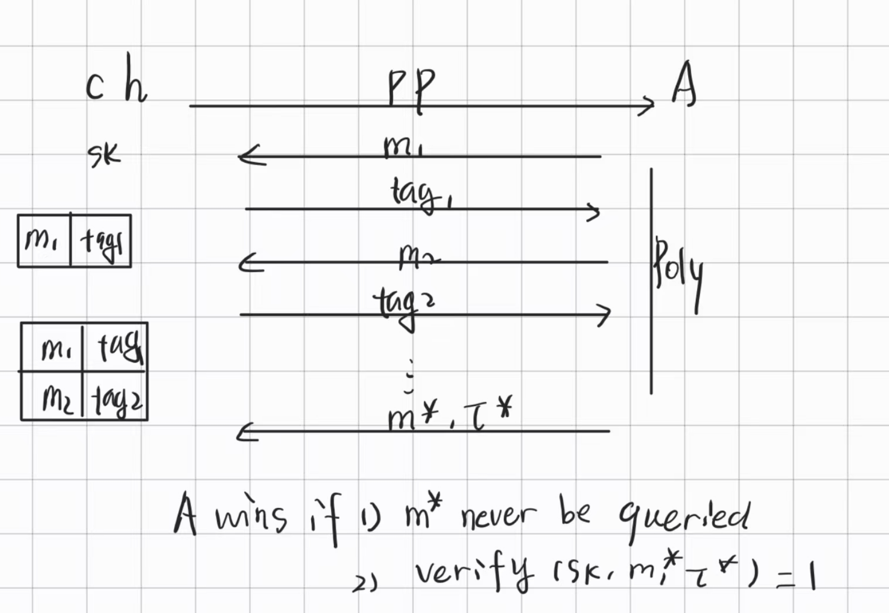
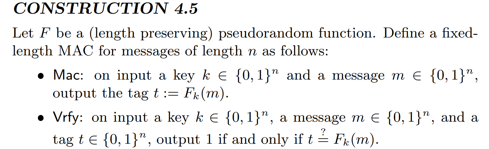
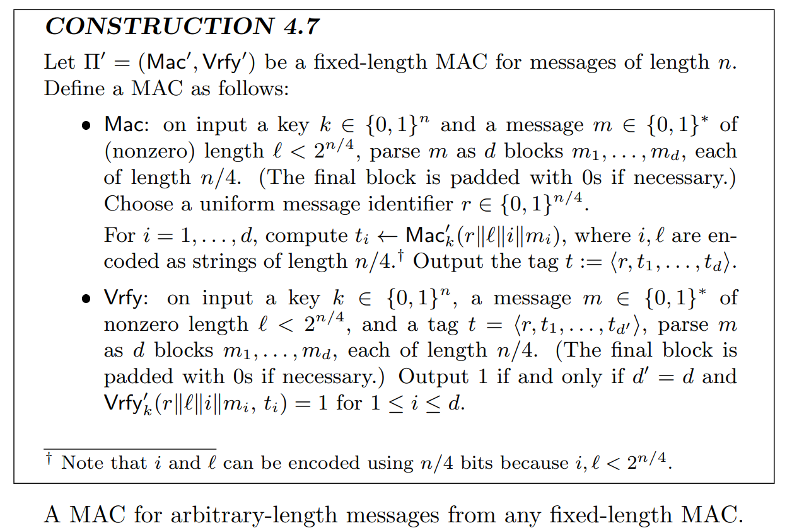
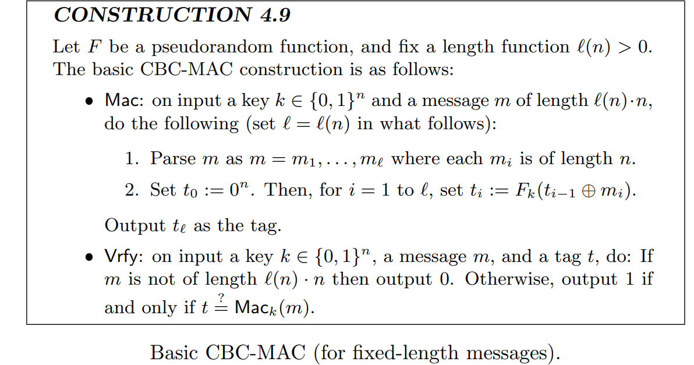
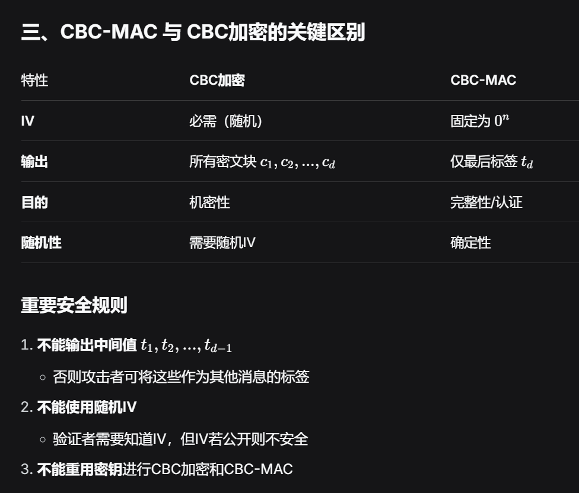
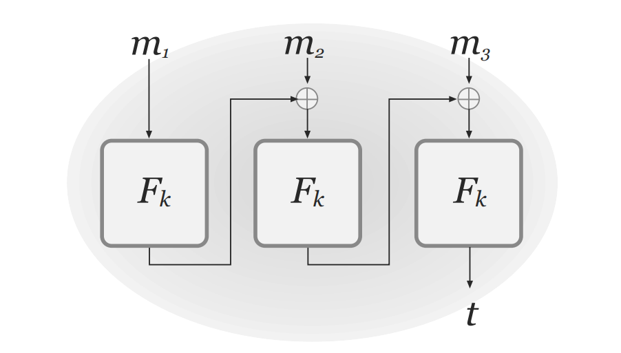
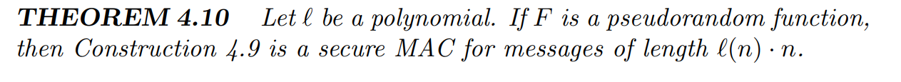
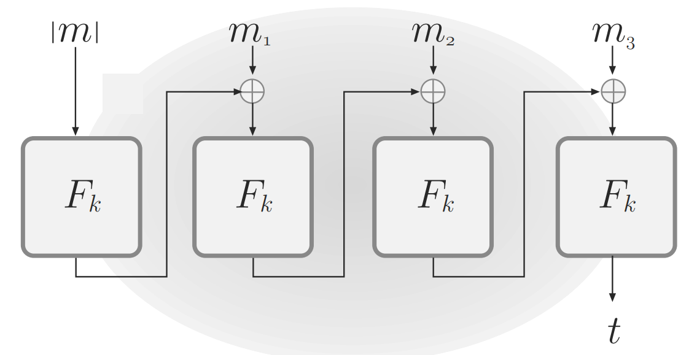
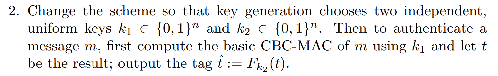

# 密码学基础 · 06：消息认证码与不可伪造性（MAC & Unforgeability）

> 来源：2026-11-23 课堂记录（从机密性转向完整性：主动攻击者、MAC 语法、EUF、确定性 MAC、PRF 定长 MAC、任意长消息的四次尝试）；教材 §4.1–§4.5、§4.7 用于核对定义与编号。
> 整理日期：2026-11-23
> 说明：§1–§6.2 按 11-23 课堂记录重写；§6.3–§6.6 的 CBC-MAC、ECBC-MAC、Hash-and-MAC 与 Padding Oracle 是教材/早期课程笔记的延伸，11-23 课堂只讲到“链式结构可以认证任意长消息，但标签太长”，这些内容单独标注，不与课堂原话混在一起。课堂类比只作直观解释，不当作形式定义。
> 教材对照：Katz & Lindell（2007 年第 1 版）**§4.1** Secure Communication and Message Integrity、**§4.2** Encryption and Message Authentication、**§4.3** MAC – Definitions（Definition 4.1 语法 / Definition 4.2 存在性不可伪造）、**§4.4** Constructing Secure MACs（Construction 4.3 定长 / Theorem 4.4 / Construction 4.5 变长 / Theorem 4.6）、**§4.5** CBC-MAC（Construction 4.7 / Theorem 4.8）、**§4.7** NMAC and HMAC。

## 0. 本节速览

| 小节 | 主题 | 一句话摘要 |
|---|---|---|
| §1 | 关注点转移 | 敌手从被动窃听升级为主动篡改；完整性要的是“改了能被发现”，不是“改不动”。 |
| §2 | MAC 的基本形状 | $\mathrm{Gen},\mathrm{Mac},\mathrm{Vrfy}$ 三个算法；发送 $(M,t)$，收方验证 $t$ 是否匹配。 |
| §3 | 与数字签名的差别 | MAC 是对称的，验证者也知道 $sk$；数字签名用私钥签名、公钥验证。 |
| §4 | 攻击模型 | **EUF-CMA**：可询问标签，但不能伪造未问过消息的合法标签；另有强不可伪造与确定性 MAC 的等价性。 |
| §5 | 方案骨架与游戏 | Mac-forge 实验的三步；教材只给 $\mathrm{Mac}$ oracle，不给验证 oracle。 |
| §6 | 具体构造 | PRF 构造定长 MAC；任意长消息的四次尝试；CBC-MAC 等后续构造作为延伸。 |

---

## 1. 关注点的转移

前几节（[02](02_完美保密与一次性密码本.md)–[05](05_伪随机函数与伪随机置换.md)）追求的是**机密性（confidentiality）**：让攻击者看不懂消息内容。11-23 的课把攻击者升级为**主动攻击者**，开始讨论**完整性/认证性（integrity / authenticity）**。

### 1.1 从被动窃听到主动篡改

| | 被动攻击者 | 主动攻击者 |
|---|---|---|
| 能做什么 | 窃听 Alice 与 Bob 之间的全部通信 | 除了窃听，还能截获、修改、替换、注入信道中的消息 |
| 目标 | 偷消息 $M$，破坏机密性 | 让 Bob 收到被篡改的内容，或冒充 Alice 发消息 |
| 信道假设 | 信道本身不被干扰，Bob 收到的消息一定来自 Alice | 信道不可信，Bob 收到的消息可能被改过 |

典型例子：Alice 给 Bob 发“转账 1000 元”，主动攻击者把消息改成“转账 10000 元”。这时仅仅“看不懂”已经不够，Bob 还必须确认消息确实来自 Alice，而且没有被改过。

### 1.2 完整性的目标：检测，而不是阻止

课堂用“验钞机/伪钞”作类比：

- 我们无法保证坏人不伪造钞票；
- 但验钞机要保证伪造的钞票过不了验证。

完整性不是要求攻击者“不能改”，而是：

> 如果攻击者改了消息，接收方能够检测出来并拒绝该消息。

因此 MAC 的安全性目标是：攻击者可以看消息，甚至消息本身可以公开；但攻击者不能伪造一个能通过验证的“新消息-标签对”。一旦伪造，验证算法输出 0，接收方丢弃。

---

## 2. MAC 的基本形状

一个消息认证码 MAC 由三个算法组成：

$$\begin{cases}
\mathrm{Gen}(1^{n})\to sk\\
\mathrm{Mac}(sk,M)\to t\\
\mathrm{Vrfy}(sk,M,t)\to\{0,1\}
\end{cases}$$

- **密钥生成**：Alice 和 Bob 共享同一个密钥 $sk$，攻击者没有。
- **认证/生成标签**：输入密钥和消息，输出认证标签 tag；课堂把 tag 形象地叫作“五角星”。
- **验证**：输入密钥、消息和标签，输出 1 表示通过，0 表示拒绝。

发送方发送 $(M,t)$；接收方收到后计算 $\mathrm{Vrfy}(sk,M,t)$。MAC **不要求隐藏 $M$**：消息可以明文传输，MAC 只负责完整性和来源认证。

**正确性**：如果标签确实是按算法生成的，

$$t=\mathrm{Mac}(sk,M),$$

则验证必须通过：

$$\mathrm{Vrfy}(sk,M,t)=1.$$

这是正确性要求。注意它和安全性是两件事：正确性保证“真标签能过”，安全性保证“假标签很难过”。

---

## 3. 与数字签名的差别

> 这一节是整理者按教材第 12 章补的对照，11-23 课堂没有展开数字签名。

MAC 是对称的：签名和验证使用同一个 $sk$，因此**任何能验证的人都能伪造**。数字签名是非对称的：用私钥签名、公钥验证，验证方不会因为持有公钥而获得伪造能力。

本节只讲对称情形（教材 §4；数字签名在课程后半段/公钥部分，本课程未展开）。

---

## 4. 攻击模型：EUF-CMA（课程口中的 UCMA）

### 4.1 存在性不可伪造

课堂用“攻击者能查询真钞样本，但不能拿真钞冒充自己伪造”的思路定义安全性。安全性游戏大致为：

1. 挑战者运行 $\mathrm{Gen}(1^n)$ 生成 $sk$，攻击者获得公开参数；
2. 攻击者可以自适应地询问 Mac oracle：提交 $M_i$，得到 $t_i=\mathrm{Mac}(sk,M_i)$；
3. 攻击者最后输出伪造 $(M^*,t^*)$；
4. 攻击者赢的条件是：
   - $\mathrm{Vrfy}(sk,M^*,t^*)=1$；
   - 且 $M^*$ 没有在之前的查询中出现过。

记 $Q$ 为攻击者询问过的**所有消息集合**，则获胜条件写成

$$\mathrm{Vrfy}(sk,M^*,t^*)=1\ \wedge\ M^*\notin Q.$$

这叫**存在性不可伪造性**（existential unforgeability）：攻击者只要伪造出**某个**新消息的合法标签，就算赢；不要求伪造指定消息。

课堂特别解释：

- 不能允许攻击者直接拿之前查询得到的 $(M,t)$ 重放，否则太容易赢；
- 所以要求 $M^*\notin Q$，排除“拿真钞糊弄”的重放；
- 攻击者可以查询很多真标签，目标是造出一个新的、能过验证的伪造标签。

教材 **Definition 4.2** 的正式名称是：MAC 在**自适应选择消息攻击下存在性不可伪造**（existentially unforgeable under an adaptive chosen-message attack），通常缩写为 **EUF-CMA**。课程资料把它叫 **UCMA**（unforgeability under chosen-message attack），指的是同一个攻击模型；教材没有把 UCMA 与 EUF-CMA 定义成两个不同的东西。

安全要求：对每个 PPT 攻击者 $\mathcal{A}$，存在可忽略函数 $\mathrm{negl}$，使

$$\Pr\bigl[\mathrm{Mac\text{-}forge}_{\mathcal{A},\Pi}(n)=1\bigr]\le\mathrm{negl}(n).$$

> 要点：任何 MAC 都可能以可忽略概率被随机猜中，因此上界只能是 $\mathrm{negl}(n)$，不能要求概率为 0。教材 §4.3 也指出了这一点。

### 4.2 强不可伪造性

课堂还区分了更强的定义：**强存在性不可伪造**。

- **普通不可伪造**：赢条件是 $M^*$ 没被查询过，且标签通过验证。
- **强不可伪造**：即使 $M^*$ 被查询过，只要攻击者给出一个**新的标签对** $(M^*,t^*)$，且该对没有出现过，也算伪造成功。

区别在于：

- 普通版本只保护“新消息”；
- 强版本还保护“同一消息的新标签”。

课堂用“真钞记录表”类比：

- 普通版本：最后伪造的金额不能和之前问过的一样；
- 强版本：不仅金额，连“金额 + 真钞/tag”这个对都不能和之前记录完全一样。

形式化地，记 $Q_{\text{pair}}$ 为攻击者询问得到的 $(M,t)$ 对集合，强不可伪造的获胜条件是

$$\mathrm{Vrfy}(sk,M^*,t^*)=1\ \wedge\ (M^*,t^*)\notin Q_{\text{pair}}.$$

### 4.3 确定性 MAC：普通不可伪造与强不可伪造等价

如果 $\mathrm{Mac}$ 是**确定性算法**，则很多定义会简化。

1. **验证算法可被 Mac 重算**：

   $$\mathrm{Vrfy}(sk,M,t)=1\iff \mathrm{Mac}(sk,M)=t.$$

   因此 $\mathrm{Vrfy}$ 可以由 $\mathrm{Mac}$ 模拟，不需要额外给攻击者验证 oracle。

2. **普通不可伪造与强不可伪造等价**：若 MAC 是确定性的，同一消息的标签唯一。如果 $M^*$ 已经查询过，那么其唯一标签 $t^*$ 也已经知道；攻击者不可能给出同消息的新标签。所以在确定性 MAC 下，

   $$\text{普通不可伪造}\iff\text{强不可伪造}.$$

课堂因此说：确定性 MAC 有好处，定义更简单，构造中也更偏好确定性 MAC。对于随机化 MAC，课堂表示一般更偏好强不可伪造定义，并提到后续讲 AE 时会形式化证明相关等价/归约。

---

## 5. 方案骨架与安全游戏

### 5.1 三个算法

$$\begin{cases}
\mathrm{Gen}(1^{n})\to k\\
\mathrm{Mac}_k(m)\to t\\
\mathrm{Vrfy}_k(m,t)\in\{0,1\}
\end{cases}$$

> 记号：上式是教材（Definition 4.1）的写法；11-23 课堂记录把后两个算法记作 $\mathrm{Mac}(sk,M)\to t$ 与 $\mathrm{Vrfy}(sk,M,t)$，含义相同。

### 5.2 游戏

$$\mathrm{ch}\xrightarrow{\mathrm{Gen}(1^n)}\mathcal{A};
\qquad
\mathrm{ch}\underset{\mathrm{Mac}_k(m_1)}{\overset{m_1}{\leftrightharpoons}}\mathcal{A};
\ \cdots\ ;
\qquad
\mathrm{ch}\underset{\mathrm{Mac}_k(m_t)}{\overset{m_t}{\leftrightharpoons}}\mathcal{A};
\qquad
\mathcal{A}\longrightarrow(m^{*},\tau^{*})$$

- 即：$\mathcal{A}$ 可以**自适应地反复**向 $ch$ 要标签，最后提交一对 $(m^{*},\tau^{*})$ 作为伪造尝试；记 $Q$ 为它问过的**所有消息集合**。
- **教材口径（Definition 4.2）**：Mac-forge 只给**标签生成 oracle** $\mathrm{Mac}_k(\cdot)$，**不给**验证 oracle。早期课程笔记的游戏图里多画了一条 $\mathrm{Verify}_{sk}$ 通道；本笔记以教材为准，把它视为**课程补充**。对确定性 MAC，验证 oracle 基本不增加能力，因为验证就是重算 $\mathrm{Mac}$ 再比较；对随机化 MAC，验证 oracle 可能泄露额外信息，需按具体定义处理。
- 安全性：

$$\Pr[\mathcal{A}\ \text{wins}]=\Pr[\mathrm{Vrfy}_k(m^{*},\tau^{*})=1\wedge m^{*}\notin Q]\le\mathrm{negl}(n)$$

- 早期课程笔记里有一句提醒（很重要）：

> “注意 **$\mathcal{A}$ 这次开挂了**，相当于**本地可以一直跑，跑好了才找人**。”

  也就是说：对手可以在线下的本地计算里**任意尝试**（不需要限次询问），把 $\mathcal{A}$ 的能力全部用上；安全性依然要求伪造概率可忽略。

### 5.3 MAC-Secure 实验的三步与 UF-CMA

早期课程笔记把 [§5.2](#52-游戏) 的游戏写成了**标准的三步实验**（名字叫 **$\mathrm{Mac\text{-}forge}_{\mathcal{A},\Pi}(n)$**，安全性目标写作“**在自适应选择消息攻击下的存在性不可伪造**”）：

| 步骤 | 内容 |
|---|---|
| 1. **密钥生成** | 挑战者运行 $\mathrm{Gen}(1^n)$ 得到密钥 $k$。 |
| 2. **敌手攻击** | 敌手 $\mathcal{A}$ 得到 $1^n$，可**自适应地**访问消息认证预言机 $\mathrm{Mac}_k(\cdot)$（任选 $m$ 得 $t=\mathrm{Mac}_k(m)$），最后输出伪造的 $(m,t)$。记 $Q$ 为敌手查询过的**所有消息集合**。 |
| 3. **成功判定** | $\mathcal{A}$ 成功 **当且仅当** ① $\mathrm{Vrfy}_k(m,t)=1$（标签有效）**且** ② $m\notin Q$（该消息**从未查询过**）。成功则实验输出 1。 |

- 敌手是 PPT 的，并且：可以**根据已获得的标签动态选择**下一个查询消息；**不知道 $k$**，但可以访问合法的标签生成预言机。
- 早期课程笔记对“攻破”的定义：**在未查询过某个消息的情况下，为该消息生成一个有效的认证标签**，即成功制造了一个**存在性伪造（existential forgery）**。
- 安全定义：

$$\Pr\bigl[\mathrm{Mac\text{-}forge}_{\mathcal{A},\Pi}(n)=1\bigr]\le\mathrm{negl}(n)$$

- 早期课程笔记注明：这也被称为 **UF-CMA**（选择消息攻击下的不可伪造性）——正好补齐了 [§4](#4-攻击模型euf-cma课程口中的-ucma) 里资料只说“UCMA ≈ EUF-CMA”的那一处缺口（**这里的“$m\notin Q$”就是“存在性”**）。

---

## 6. 具体的 MAC 构造

### 6.1 由 PRF 构造**定长** MAC（及归约证明）

11-23 课堂选择 PRF 作为构造 MAC 的工具。设 $F_{sk}$ 是伪随机函数，定义

$$\mathrm{Mac}(sk,M)=F_{sk}(M),$$

验证为

$$\mathrm{Vrfy}(sk,M,t)=1\iff F_{sk}(M)=t.$$

因为是确定性 MAC，验证算法就是重算并比较。这里 $M$ 必须是 PRF 能接受的定长输入。

**安全性直觉**：

- 若 $F_{sk}$ 是真正随机函数，攻击者没见过 $M^*$ 时，$F_{sk}(M^*)$ 对攻击者来说像完全随机的 $n$ 比特串；
- 即使查询过很多其他 $M_i$ 的标签，由于随机函数在各点独立，攻击者猜中 $F_{sk}(M^*)$ 的概率最多约 $2^{-n}$；
- 若 $F_{sk}$ 只是伪随机函数，则用 PRF 安全性做归约：攻击者伪造 MAC 的优势不超过“区分 PRF 与随机函数”的优势加 $2^{-n}$。

**归约证明**。要证的式子是

$$\Pr\bigl[\mathrm{Mac\text{-}forge}_{\mathcal{A},\Pi}(n)=1\bigr]\le 2^{-n}+\mathrm{negl}(n),$$

其中 $2^{-n}$ 是**纯随机函数**情况下敌手猜对标签的概率，$\mathrm{negl}(n)$ 来自 **PRF 与随机函数的不可区分性**。

证明思路（两个游戏 + 一个区分器）：

1. 设游戏 0 用**真随机函数**、游戏 1 用 **PRF**；
2. 若敌手能区分这两个游戏，就能构造**区分器 $D$** 来区分 PRF 与真随机函数：
   - $D$ 运行 $\mathcal{A}$；当 $\mathcal{A}$ 查询 $m_i$ 时，用预言机 $O(m_i)$ 作为标签返回；
   - 当 $\mathcal{A}$ 输出 $(m^*,t^*)$ 时，若 $m^*$ 在之前的查询中出现过，$D$ 直接输出 0（重放不算伪造）；否则查询 $O(m^*)$，若 $t^*=O(m^*)$ 则输出 1（猜是 PRF），否则输出 0（猜是随机函数）；
3. 若 $O=F_k$（PRF），$D$ 输出 1 的概率 $=\varepsilon_0$（敌手在真实 MAC 中获胜概率）；若 $O=R$（随机函数），则 $=2^{-n}$；
4. 由 PRF 定义 $\bigl|\Pr[D^{F_k}(1^n)=1]-\Pr[D^{R}(1^n)=1]\bigr|\le\mathrm{negl}(n)$，代入得

$$|\varepsilon_0-2^{-n}|\le\mathrm{negl}(n)\ \Longrightarrow\ \varepsilon_0\le2^{-n}+\mathrm{negl}(n)$$

结论：

> 一个 PRF 可以构造一个定长消息的确定性 MAC。

### 6.2 变长 MAC 的四次尝试与各自的失败原因

PRF 通常定长输入，而实际消息任意长。11-23 课堂开始讨论如何把任意长消息认证成短标签。

| 尝试 | 构造 | 被什么攻击打破 |
|---|---|---|
| **尝试一** | 分块后**逐块独立**：$\mathrm{Mac}(sk,M)=F_{sk}(M_1)\Vert\cdots\Vert F_{sk}(M_s)$ | **块重排（block re-ordering）**：把 $M_1\Vert M_2$ 换成 $M_2\Vert M_1$，标签同步换序 $t_2\Vert t_1$ 即合法 |
| **尝试二** | 引入**块序号**：$t_i=F_{sk}(i\Vert M_i)$ | **截断（truncation）**：取原消息的**前缀** $M''=M_1\Vert\cdots\Vert M_{s'}$，对应截取前 $s'$ 个标签块即合法 |
| **尝试三** | 序号 + **总块数**：$t_i=F_{sk}(s\Vert i\Vert M_i)$ | **混合匹配（mix-and-match）**：两条**等长**消息的相同位置块**互相嫁接**（如 $M_1\Vert M_2^*$），标签块照样拼得起来 |
| **尝试四** | 再引入**随机数/链式结构**，把各块绑定 | 本身可用，但**标签和消息一样长**，仍不满足“固定短标签”的实际需求 |

**尝试一：不能防重排。** 攻击者交换块的顺序，标签也跟着交换，仍能通过验证，但消息含义变了。

**尝试二：不能防截断。** 加入块序号可以防重排，但攻击者丢掉后面的块和标签，只发送前一部分，仍可能通过验证；因为验证方不知道原消息应该有多长。

**尝试三：仍可能出现拼接/混合攻击。** 把长度信息也认证进去，可以防简单截断，但两条不同消息分别认证后，攻击者可以从各自标签中选取片段拼接，构造出新的消息-标签组合。例如两条等长消息 $M$ 与 $M'$ 使用同一个总长度 $s$，攻击者取 $M$ 的前半段和 $M'$ 的后半段，再把对应位置的标签拼起来；每个块的位置、长度都对得上，验证仍会通过。

**尝试四：链式绑定可用，但标签太长。** 课堂提到可以用固定随机数或链式方式把各块串起来，类似 CBC 的链式思想，使块与块之间不能随意拆分、拼接、重排。这样可以得到一个能用的任意长 MAC，但缺点是：**标签和消息一样长**，不满足实际需求。

实际中希望最终标签是固定短的，如 128 或 256 比特；验证只需要输出 0/1，不需要恢复消息。因此需要把长链压缩成一个短标签。课堂在这里收尾，下节课用类似 CBC 的链式技术，把任意长消息压缩成固定短标签，即后续的 **CBC-MAC** 思路。

> 待确认：11-23 课堂记录只说了“链式结构可用但标签太长”，没有给出尝试四的完整构造与效率数字；早期课程笔记里有更具体的参数，本笔记不把这些参数当作课堂内容。

### 6.3 CBC-MAC（定长 MAC）

> 以下 §6.3–§6.6 是教材/早期课程笔记的延伸；11-23 课堂只预告了 CBC-MAC，尚未展开。

对消息 $m=m_1\Vert m_2\Vert\cdots\Vert m_l$：

- 计算：$t_0=0^n$，$t_i=E_k(m_i\oplus t_{i-1})$；
- 输出 $t_l$ 作为 MAC 标签；
- **仅对定长消息安全**（课程笔记原句）。

> 教材对照：§4.5 CBC-MAC（Construction 4.7 / Theorem 4.8；教材只对**固定长度**消息证明安全）。

### 6.4 CBC-MAC 的两个细节与“变长 CBC-MAC”

**（a）Basic CBC-MAC 长什么样**（教材 CONSTRUCTION 4.7）：对长度恰为 $\ell(n)\cdot n$ 的定长消息

$$t_0:=0^n,\qquad t_i:=F_k(t_{i-1}\oplus m_i)\ (i=1,\dots,\ell),\qquad \text{输出 } t_\ell$$

**（b）既然只对定长安全，为什么还要用它？**

- 同样长度的密钥下，**能认证的消息更长**（不再受早期尝试的随机数长度限制）；
- **更高效**：长度 $dn$ 的消息分成 $d$ 个 block，只需 $d$ 次运算，且**最终输出只有 $n$ 位的 tag**。

**（c）CBC-MAC 与 CBC 加密模式的两点主要区别**：

1. **CBC-MAC 不引入随机性**（没有外部输入 $r$；早期课程笔记说“更好的视角是把 $r$ 看成 $0^n$”）；
2. **CBC-MAC 只输出一个 tag**：CBC 加密对每个 $m_i$ 都要输出 $c_i$，而 CBC-MAC **只输出最后的 $t_l$**；早期课程笔记还提醒“若输出中间的 tag，CBC-MAC 不安全”。

> 这两条按早期课程笔记保留，具体安全性依赖消息长度和验证方式；11-23 课堂未展开，待后续课核对。

**（d）变长 CBC-MAC（课程笔记的 Way 1 / Way 2）**：

- **Way 1**：**预处理消息**，在**前面引入消息长度**；
- **Way 2**：生成**两个密钥**——先用 $sk_1$ 跑一次 CBC-MAC，再用 $sk_2$ **加密一次 tag**（即 [§6.5 的 ECBC-MAC](#65-从定长-mac-到变长-mac-的两种方法)）；
  - 好处：**不需要提前知道消息长度**；坏处：**多生成一个 $sk$ 的代价往往很高**，对很长的消息可能难以接受。

### 6.5 从定长 MAC 到变长 MAC 的两种方法

**方法 1：加密的 CBC-MAC（ECBC-MAC）**

- 使用**两个独立密钥** $k_1,k_2$；
- 先算定长 CBC-MAC：$t=\mathrm{CBC\text{-}MAC}_{k_1}(m)$；
- 再加密：$\mathrm{tag}=E_{k_2}(t)$。

**方法 2：MAC 与 Hash 组合**

- 设 $\mathrm{MAC}_k$ 是**定长 MAC**，$H$ 是**抗碰撞 Hash 函数**；
- 构造变长 MAC：$\mathrm{MAC}'_k(m)=\mathrm{MAC}_k(H(m))$；
- 课程笔记给的口诀：**MAC(F) + Hash(A) = MAC(A)**。

**安全性证明要点**（课程笔记原文）：

1. 如果攻击者能伪造 $\mathrm{MAC}'$，则要么：
   - 找到 $H(m)=H(m')$（**碰撞**），攻破 $H$；
   - 要么伪造 $\mathrm{MAC}_k$ 对新消息 $H(m)$ 的标签；
2. 因此，**如果 $\mathrm{MAC}$ 安全且 $H$ 抗碰撞，则 $\mathrm{MAC}'$ 安全**。

> 教材对照：教材的变长 MAC 在 **§4.4**（Construction 4.5：随机标识符 + 位置/总块数编码），不是“固定长度 MAC + 抗碰撞 Hash”；后者是课程补充的 Hash-and-MAC 思路，见 [`07`](07_哈希函数与Merkle-Damgård结构.md)。
> 相关：Merkle–Damgård 结构与 Hash 见 [`07_哈希函数与Merkle-Damgård结构.md`](07_哈希函数与Merkle-Damgård结构.md)。

### 6.6 Padding Oracle Attack：为什么必须“机密性 + 完整性”一起要

- 课程笔记以 **Padding Oracle Attack（填充提示攻击）** 作为例子，说明**为什么需要把保密性与完整性结合起来**（原文给了一篇简书详解作为延伸阅读：<https://www.jianshu.com/p/833582b2f560>）。
- 课程笔记在结尾写下：**“下一讲中，将会由此引入 CCA”**——也就是说这个攻击是 [08 篇 CCA 安全](08_CCA安全与认证加密.md) 的动机来源。

> 本笔记没有展开该攻击的具体步骤（课程笔记只给了外部链接，未写细节）⇒ 需要的话看链接或讲义；不臆造。

## 7. 关键公式与记号汇总

| 名称 | 式/记号 | 出处 |
|---|---|---|
| 标签生成 | $\mathrm{Mac}(sk,M)\to t$ | [§2](#2-mac-的基本形状) / 教材 Definition 4.1 |
| 验证 | $\mathrm{Vrfy}(sk,M,t)\in\{0,1\}$ | [§2](#2-mac-的基本形状) |
| 正确性 | $\mathrm{Vrfy}(sk,M,\mathrm{Mac}(sk,M))=1$ | [§2](#2-mac-的基本形状) |
| 普通不可伪造 | $\Pr[\mathrm{Vrfy}(sk,M^*,t^*)=1\wedge M^*\notin Q]\le\mathrm{negl}(n)$ | [§4.1](#41-存在性不可伪造) / 教材 Definition 4.2 |
| 强不可伪造 | $\Pr[\mathrm{Vrfy}(sk,M^*,t^*)=1\wedge (M^*,t^*)\notin Q_{\text{pair}}]\le\mathrm{negl}(n)$ | [§4.2](#42-强不可伪造性) |
| 确定性 MAC 的验证 | $\mathrm{Vrfy}(sk,M,t)=1\iff \mathrm{Mac}(sk,M)=t$ | [§4.3](#43-确定性-mac普通不可伪造与强不可伪造等价) |
| PRF 定长 MAC | $\mathrm{Mac}(sk,M)=F_{sk}(M)$ | [§6.1](#61-由-prf-构造定长-mac及归约证明) |
| PRF MAC 的安全界 | $\Pr[\text{forge}]\le 2^{-n}+\mathrm{negl}(n)$ | [§6.1](#61-由-prf-构造定长-mac及归约证明) |
| CBC-MAC（延伸） | $t_0=0^n,\ t_i=F_k(t_{i-1}\oplus m_i),\ \text{输出 }t_l$ | [§6.3](#63-cbc-mac定长-mac) / 教材 Construction 4.7 |

## 8. 听课重点与易混点

1. **机密性 ≠ 完整性**：加密方案（哪怕 CPA 安全）**不保证**密文没被改过；反之 MAC 也不保密（它不隐藏 $M$）。
2. **完整性是“改了能发现”，不是“改不动”**：攻击者当然可以改信道里的比特；安全性要求改完的标签过不了验证。
3. **“存在性不可伪造”要看清允许伪造的范围**：对手只需要对**任意一条没问过标签的消息**伪造成功，就算赢——这比“伪造指定消息”弱，但仍要求 $\mathtt{negl}(n)$。
4. **重放不算伪造**：普通 EUF 要求 $M^*\notin Q$，所以拿之前问过的 $(M,t)$ 原样重放不能赢；强 EUF 进一步要求 $(M^*,t^*)$ 是新对，连同一消息的新标签也不允许。
5. **确定性 MAC 下普通 = 强**：同一消息只有一个标签，知道 $M$ 就问得到唯一 $t$，给不出“同消息的新标签”。随机化 MAC 则要区分这两个定义，通常偏好强不可伪造。
6. **PRF MAC 只解决定长消息**：$F_{sk}$ 接受 $n$ 位输入；任意长消息不能直接丢进去。四次尝试说明“分块独立认证”不够，必须有链式/位置/长度绑定，并且最后要压缩成短标签。
7. **MAC 是对称的**：验证者持有同一把密钥，因此**知道密钥的人都能生成标签**；数字签名则用私钥签名、公钥验证，验证者不能伪造。

## 9. 复习清单

- [ ] 主动攻击者比被动攻击者多了哪些能力？为什么“加密了”不等于“完整性有保证”？举出流密码和 CBC 两个反例。（[§1](#1-关注点的转移)）
- [ ] 写出 MAC 的三个算法、发送形式与正确性条件。（[§2](#2-mac-的基本形状)）
- [ ] 复述 EUF-CMA 游戏，说明 $Q$ 是什么、$\mathcal{A}$ 什么时候算赢、为什么排除重放。（[§4.1](#41-存在性不可伪造)）
- [ ] 普通不可伪造与强不可伪造的区别是什么？确定性 MAC 下为什么二者等价？（[§4.2](#42-强不可伪造性)、[§4.3](#43-确定性-mac普通不可伪造与强不可伪造等价)）
- [ ] 用 PRF 构造定长 MAC，写出构造、安全界和归约思路。（[§6.1](#61-由-prf-构造定长-mac及归约证明)）
- [ ] 任意长消息的四次尝试分别被什么攻击打破？为什么最后需要“链式 + 压缩”？（[§6.2](#62-变长-mac-的四次尝试与各自的失败原因)）
- [ ] 默写 CBC-MAC 的迭代式，并说明“仅对定长消息安全”意味着什么攻击面。（[§6.3](#63-cbc-mac定长-mac)）
- [ ] ECBC-MAC 的两个密钥各起什么作用？“MAC + 抗碰撞 Hash”这条路的证明要点是什么？（[§6.5](#65-从定长-mac-到变长-mac-的两种方法)）

## 10. 关联知识点

- PRF/PRP 是构造 MAC 的常用零件（如定长 MAC、CBC-MAC）——见 [`05_伪随机函数与伪随机置换.md`](05_伪随机函数与伪随机置换.md#2-prfs-的定义)；教材 §4.3–§4.4。
- 认证加密（同时要机密性与完整性）与 CCA 安全——见 [`08_CCA安全与认证加密.md`](08_CCA安全与认证加密.md)；教材 §3.7（CCA）、§4.8–§4.9（CCA 安全加密与认证加密）。
- 归约式证明的通用套路（把“伪造能力”变成“区分能力”）——见 [`03_单向函数与伪随机生成器.md`](03_单向函数与伪随机生成器.md#63-由-prg-得到-eav-安全的加密方案归约的思路)。
- Hash 与 Merkle–Damgård 结构，以及 Hash-and-MAC——见 [`07_哈希函数与Merkle-Damgård结构.md`](07_哈希函数与Merkle-Damgård结构.md)。
- 教材：§4.1（消息完整性与安全通信）、§4.2（加密与消息认证）、§4.3（MAC 语法 Definition 4.1 与 EUF-CMA Definition 4.2）、§4.4（Construction 4.3 / 4.5）、§4.5（CBC-MAC，Construction 4.7 / Theorem 4.8）、§4.6（抗碰撞 Hash）、§4.7（NMAC / HMAC）。

## 11. 来源与延伸阅读

- **主要来源**：2026-11-23 课堂记录，原始文件 `class_documentation/origin/2026-11-23.md`；整理稿见 `class_documentation/class_documentation.md` 的 11.23 节。
- **教材（核对用）**：Katz & Lindell, *Introduction to Modern Cryptography*（2007 年第 1 版）**§4.1–§4.5**、**§4.7**。
- **延伸内容**：§6.3–§6.6 的 CBC-MAC、ECBC-MAC、Hash-and-MAC、Padding Oracle 来自教材与早期课程笔记；配图为早期课程笔记截图，已逐处注明。
- **未展开/待确认**：11-23 课堂没有给出尝试四的完整构造与效率参数，也没有展开 CBC-MAC；这些留给后续课与教材。
